# ĐIỀU LỆ DỰ ÁN (PROJECT CHARTER)

**Tên đề tài:** Xây dựng hệ thống ghép đội, ghép đồng đội theo độ phù hợp trong lĩnh vực cầu lông (Mobile App)  
**Tên viết tắt dự án:** Badminton Matchmaker (Đà Nẵng)  
**Mã dự án:** QLDAPM-2026-BADMINTON  
**Ngày ban hành:** 15/11/2026  
**Phiên bản:** 1.0  

---

## 1. Bối cảnh dự án (Project Context)

Phong trào tập luyện và thi đấu cầu lông tại khu vực thành phố Đà Nẵng đang phát triển rất mạnh mẽ với hàng chục cụm sân hoạt động liên tục (sân Kỳ Đồng, Tuyên Sơn, Quân Khu 5, Trương Vĩnh Ký,...). Tuy nhiên, việc tổ chức các buổi giao lưu cầu lông ("kèo đánh") hiện nay chủ yếu diễn ra tự phát thông qua các nhóm Facebook hoặc Zalo, bộc lộ nhiều bất cập lớn:
1. **Lệch trình độ sâu sắc:** Người chơi tự bắt cặp ngẫu hứng dẫn đến các trận đấu "một chiều", bên quá mạnh bên quá yếu, làm giảm hứng thú và thể lực của người tham gia.
2. **Host thường xuyên thiếu người chơi hoặc bị bùng kèo:** Chủ kèo (host) đã đặt sẵn 1–2 sân nhưng nhóm bạn cố định (người mặc định) chỉ có 4–6 người, cần tìm thêm 1–4 khách vãng lai cho đủ chân chia tiền sân. Việc đăng bài tuyển người trên mạng xã hội tốn nhiều thời gian, khó kiểm chứng trình độ và thường xuyên gặp tình trạng xin slot rồi bùng kèo sát giờ.
3. **Thao tác chia cặp, xoay tua tại sân cồng kềnh:** Khi buổi đánh diễn ra (đặc biệt khi có 5 hoặc 7 người trên một sân), host phải dùng trí nhớ hoặc ghi chép giấy bút để xếp ai đánh với ai, ai nghỉ hiệp nào. Thao tác này mất nhiều thời gian giữa các set đấu, dễ gây tranh cãi và không công bằng về số trận được thi đấu.

Dự án ra đời nhằm cung cấp một giải pháp di động thông minh, tinh gọn, chuyên biệt cho thị trường Đà Nẵng, giúp tự động hóa khâu tuyển vãng lai, kiểm soát uy tín và thuật toán cân kèo chuẩn xác ngay tại sân.

---

## 2. Vấn đề cần giải quyết (Problem Statement)

- **Vấn đề 1 (Khó tìm bạn chơi đúng trình độ):** Chưa có thang đánh giá trình độ thống nhất cho giới phong trào; người chơi tự nhận định chủ quan dẫn đến ghép đôi cọc cạch.
- **Vấn đề 2 (Rủi ro bùng kèo & quản lý suất tuyển):** Host không có công cụ định lượng độ uy tín của người xin tham gia; không có cơ chế dự bị (waitlist) tự động đôn người khi có sự cố hủy slot.
- **Vấn đề 3 (Gánh nặng chia kèo cho Host):** Xếp cặp thủ công cho 4–8 người/sân mất từ 3–5 phút mỗi lượt, khó cân đối giữa việc tôn trọng các "cặp cố định" (bạn thân/vợ chồng) và việc cân bằng sức mạnh 2 bên lưới.
- **Vấn đề 4 (Mất kết nối và dữ liệu tại sân):** Các nhà thi đấu cầu lông có kết cấu mái tôn khung thép thường gây suy giảm sóng 3G/4G, khiến các ứng dụng phụ thuộc mạng liên tục bị treo hoặc gián đoạn.

---

## 3. Mục tiêu dự án (Measurable Project Objectives)

### A. 3 Mục tiêu đo lường cốt lõi (Theo chuẩn quản trị):
1. **Tốc độ tuyển vãng lai:** Host tạo kèo có sân thiếu người và duyệt đủ số lượng vãng lai trong **dưới 2 phút** thao tác trên app.
2. **Tốc độ & Trải nghiệm chia cặp tại sân:** Chia cặp và lập lịch thi đấu cho một sân 8 người mất **dưới 1 giây** xử lý thuật toán và **không quá 3 lần chạm màn hình** của Host.
3. **Chất lượng kiểm thử:** Tối thiểu **90% số ca kiểm thử** trong Test Plan (các bộ mã S, E, B, R, X) đạt kết quả PASS trước ngày bảo vệ đồ án.

### B. Mục tiêu cụ thể cho từng Module:
- **Module 1 (Hồ sơ & Đánh giá trình độ động):** 100% người chơi đăng ký được phân loại theo thang 6 cấp phong trào; điểm Elo đôi được tự động tính toán và cập nhật trong **dưới 2 giây** ngay sau khi Host xác nhận kết quả trận đấu.
- **Module 2 (Ghép đồng đội & Chia cặp cân kèo):** 
  - Partner Finder gợi ý các bạn đánh phù hợp với độ lệch Elo **≤ 150 điểm** và bù trừ vai trò cầu trước / cầu sau.
  - Thuật toán cân kèo (Session Balancing) đảm bảo chênh lệch điểm sức mạnh dự đoán giữa 2 đôi trong một trận tự động **≤ 100 điểm Elo**.
- **Module 3 (Quản lý kèo & Danh sách dự bị):** Triển khai giao dịch nguyên tử (Atomic Transaction) loại bỏ hoàn toàn **100% rủi ro race-condition** khi đặt suất cuối cùng; tự động đôn người chơi từ waitlist lên suất chính thức trong **dưới 3 giây** khi có người hủy.
- **Module 4 (Lịch sử & Đồng đội ăn ý):** Lưu trữ 100% lịch sử trận đấu và tự động nhận diện, gắn nhãn danh hiệu "Đồng đội ăn ý" cho các cặp đôi đạt điều kiện (≥ 3 trận đánh cùng nhau, tỷ lệ thắng ≥ 60%).

---

## 4. Phạm vi dự án (Project Scope)

### A. Trong phạm vi (In-Scope - MVP 4 Module):
1. **Module 1: Hồ sơ & Trình độ động (Profile & Dynamic Rating):**
   - Đăng ký, đăng nhập tài khoản, khai báo thông tin ban đầu (giới tính, tay thuận, vị trí sở trường, cấp độ tự khai 1–6).
   - Thang trình độ 6 cấp: Yếu (1), TB- (2), TB (3), TB+ (4), Khá (5), Tốt (6).
   - Điểm Elo đôi động cập nhật theo kết quả thực tế; hệ thống điểm uy tín (bắt đầu 100 điểm, trừ điểm khi hủy muộn hoặc bùng kèo).
   - Thẻ đánh giá sau trận ("đánh hay hơn tự khai", "thân thiện", "đúng giờ").
2. **Module 2: Ghép đồng đội & Cân kèo sân đấu (Matching & Balancing):**
   - **Partner Finder:** Tìm đồng đội đánh đôi theo tiêu chí chênh lệch ≤ 150 Elo, bù trừ công thủ.
   - **Session Balancing:** Thuật toán chia cặp và lập lịch cho 1 sân (4–8 người). Hỗ trợ: cặp tự bắt (`self`), cặp host gán (`host`), cặp tự động (`auto`). Cơ chế xoay tua người nghỉ công bằng cho ca lẻ (5 người, 7 người). Hoạt động được cả khi offline tại sân.
3. **Module 3: Quản lý kèo & Danh sách dự bị (Match Lobby & Waitlist):**
   - Host tạo kèo 1 hoặc 2 sân; thiết lập nội dung từng sân (đôi nam, đôi nữ, đôi nam nữ) và dải trình độ cho phép.
   - Quản lý danh sách người mặc định (core), bao gồm cả thành viên "ghost" chưa có tài khoản.
   - Tính toán suất tuyển vãng lai tự động theo công thức: `slot = min(4, 8 - số người mặc định)`.
   - Cơ chế nộp đơn đặt suất, kiểm tra điều kiện (giới tính, trình độ, uy tín), host duyệt/từ chối, danh sách dự bị (waitlist) tự động đôn người.
4. **Module 4: Lịch sử & Đồng đội ăn ý (History & Chemistry):**
   - Tra cứu lịch sử các trận đấu đã tham gia, biểu đồ biến động Elo.
   - Thống kê tỷ lệ thắng/thua theo từng đối tác đánh cặp; gợi ý Top bạn đánh ăn ý nhất.
5. **Quản trị hệ thống (Admin in-app):**
   - Phân quyền Admin trực tiếp trong Mobile App theo vai trò (`role: "admin"`). Admin có quyền quản lý tài khoản, hỗ trợ điều chỉnh điểm uy tín khi có khiếu nại, duyệt danh mục sân cầu Đà Nẵng.

---

## 5. Ngoài phạm vi MVP (Out-of-Scope)

Để đảm bảo hoàn thành đồ án chất lượng cao trong 12 tuần, các hạng mục sau **không** thuộc phạm vi triển khai của MVP:
- **Không thi đấu đơn (1 vs 1):** Chỉ hỗ trợ đánh đôi (đôi nam, đôi nữ, đôi nam nữ).
- **Không hỗ trợ quá 2 sân trong một kèo:** Mỗi kèo giới hạn tối đa 2 sân đấu.
- **Không thanh toán và chia tiền in-app:** Không tích hợp cổng thanh toán trực tuyến (VNPAY, Momo,...); người chơi thanh toán tiền sân/cầu bằng tiền mặt hoặc chuyển khoản VietQR trực tiếp cho host ngoài đời thực.
- **Không có Web Admin riêng:** Quản trị viên sử dụng chung ứng dụng di động với tài khoản đặc quyền.
- **Không tự động duyệt vãng lai:** Trong bản MVP, 100% người xin tham gia phải do Host duyệt tay để đảm bảo sự phù hợp.
- **Không có tính năng nhắn tin (Chat real-time) in-app:** Người chơi liên hệ qua số điện thoại hoặc Zalo.
- **Không tổ chức giải đấu (Tournament bracket / League table).**
- **Không làm trọng tài số trực tiếp:** Không ghi nhận điểm số từng pha cầu (live point-by-point tracking) mà chỉ nhập tỷ số set đấu khi trận đấu kết thúc.

---

## 6. Tổ chức nhân sự & Phân công trách nhiệm

Nhóm thực hiện gồm 2 thành viên thuộc chuyên ngành Công nghệ thông tin / Kỹ thuật phần mềm:

| Vai trò | Thành viên phụ trách | Trách nhiệm chính |
|---|---|---|
| **Giảng viên hướng dẫn** | `[NGUYEN THANH TUAN]` | Định hướng học thuật, duyệt kế hoạch, đánh giá tiến độ và nghiệm thu đồ án |
| **Thành viên 1 (TV1)** | `[DAO DUY NHAT]` | **Trưởng nhóm (PM), Phân tích nghiệp vụ (BA), Backend Cloud, Kiến trúc Dữ liệu & Thuật toán:** - Quản lý tiến độ WBS 12 tuần, Project Charter, SRS, Risk Register. - Thiết kế Firestore Database, Security Rules, Cloud Functions. - Phát triển thuật toán pure domain (tính slot, cân kèo, Elo đôi, uy tín). - Định nghĩa API / Data Contract, hỗ trợ TV2 kết nối dữ liệu. - Tổng hợp báo cáo, kịch bản demo, slide bảo vệ. |
| **Thành viên 2 (TV2)** | `[NGUYEN DUC DAT]` | **Mobile Developer & UI/UX Designer:** - Thiết kế Prototype và Design System trên Figma (WBS 2.4). - Phát triển ứng dụng di động React Native / Expo (Expo Router). - Xây dựng UI Components, màn hình ứng dụng theo chuẩn UI một tay. - Tích hợp State Management, Cache offline và gọi API theo Data Contract của TV1. - Tham gia chạy thử nghiệm thực tế tại sân và sửa lỗi giao diện. |

---

## 7. Kiến trúc công nghệ & Quy trình phát triển

### A. Kiến trúc công nghệ:
- **Mobile Frontend:** React Native với nền tảng **Expo SDK**, sử dụng **Expo Router** (File-based routing), TypeScript, AsyncStorage / MMKV cho bộ nhớ đệm offline.
- **Backend as a Service (BaaS):** **Google Firebase Platform**:
  - *Firebase Authentication:* Quản lý phiên và định danh người dùng.
  - *Cloud Firestore:* Cơ sở dữ liệu NoSQL lưu trữ tài liệu với cơ chế realtime listener.
  - *Cloud Functions for Firebase:* Xử lý logic nhạy cảm (cập nhật Elo, tự động đôn waitlist).
  - *Firestore Security Rules:* Bảo vệ quyền đọc/ghi dữ liệu nghiêm ngặt theo phân quyền.

### B. Quy trình phát triển:
- Áp dụng phương pháp luận **Agile / Scrum tinh gọn**, chu kỳ **6 Sprint x 2 tuần** (Tổng cộng 12 tuần):
  - Sprint Planning vào đầu mỗi sprint.
  - Weekly Sync meeting (30 phút cuối tuần) để rà soát tiến độ và cập nhật Risk Register.
  - Feature Freeze tại cuối Sprint 4 để dành trọn Sprint 5 cho kiểm thử thực địa và tối ưu hóa.

---

## 8. Các mốc tiến độ chính (Milestones M1–M12)

```mermaid
flowchart LR
    M1["M1: Charter & Setup"] --> M2["M2: SRS & Figma"]
    M2 --> M3["M3: Auth & Profile"]
    M3 --> M4["M4: Profile & Partner"]
    M4 --> M5["M5: Lobby & Waitlist"]
    M5 --> M6["M6: Balancing Algo"]
    M6 --> M7["M7: Match & Elo Loop"]
    M7 --> M8["M8: Feature Freeze"]
    M8 --> M9["M9: Advanced UI & Tests"]
    M9 --> M10["M10: Field Test & Bugfix"]
    M10 --> M11["M11: Report & Video"]
    M11 --> M12["M12: Final Defense"]
```

| Mốc | Tên mốc | Thời hạn (Tuần) | Kết quả bàn giao chính |
|---|---|---|---|
| **M1** | Charter & Môi trường Dev | Tuần 1 | Project Charter duyệt, Git repo (`main`, `dev`), bộ quy tắc, bộ nhớ chung |
| **M2** | SRS & Figma Prototype | Tuần 2 | Tài liệu SRS hoàn chỉnh, Data Contract, bản mẫu Figma tương tác |
| **M3** | Đăng nhập & Profile Cloud | Tuần 3 | Đăng nhập Firebase Auth, tạo hồ sơ, đồng bộ Firestore |
| **M4** | Module Hồ sơ & Partner Finder | Tuần 4 | Thang 6 cấp, thuật toán Partner Finder (lệch ≤ 150 Elo, vị trí) |
| **M5** | Phòng kèo Realtime & Waitlist | Tuần 6 | Tạo kèo 1–2 sân, tuyển vãng lai, cơ chế đặt suất, hàng đợi dự bị |
| **M6** | Thuật toán chia cặp cân kèo | Tuần 7 | Thuật toán cân kèo sân 4–8 người, cặp khóa, xoay tua người nghỉ, Jest test |
| **M7** | Vòng lặp trận đấu & Elo | Tuần 8 | Ghi nhận tỷ số, Cloud Function cập nhật Elo đôi và điểm uy tín |
| **M8** | Feature Freeze | Cuối Tuần 8 | Đóng băng tính năng, không thêm yêu cầu mới, chuẩn bị tích hợp sâu |
| **M9** | Mobile nâng cao & Test Cases | Tuần 10 | Tối ưu UI một tay, cache offline, hoàn thành bảng ca kiểm thử S, E, B, R, X |
| **M10**| Hoàn tất kiểm thử & Sửa lỗi | Tuần 10 | Chạy field test tại sân thật ở Đà Nẵng, sửa 100% lỗi nghiêm trọng |
| **M11**| 100% Báo cáo & Video Demo | Tuần 11 | Hoàn thành báo cáo đồ án, video demo kịch bản thực tế, slide bảo vệ |
| **M12**| Nộp hồ sơ & Bảo vệ | Tuần 12 | Đóng gói mã nguồn, nghiệm thu với Giảng viên và bảo vệ trước Hội đồng |

---

## 9. Ràng buộc dự án (Project Constraints)

1. **Ràng buộc thời gian:** Thời lượng gói gọn trong 12 tuần của học kỳ, không được phép gia hạn.
2. **Ràng buộc nhân lực:** Nhóm phát triển chỉ có 02 sinh viên, đòi hỏi sự phối hợp nhịp nhàng, cam kết trách nhiệm cao độ theo đúng Data Contract.
3. **Ràng buộc hạ tầng (BaaS):** Sử dụng Firebase làm nền tảng Backend; cần kiểm soát số lượng lượt đọc/ghi (Read/Write operations) để không vượt hạn mức và phát sinh chi phí ngoài dự kiến.
4. **Ràng buộc môi trường thực địa (Offline-readiness):** Ứng dụng phải duy trì được các tính năng cốt lõi (xem danh sách người chơi, bấm chia cặp, nhập tỷ số) ngay cả khi mất kết nối mạng tạm thời tại sân thi đấu.

---

## 10. Các giả định nghiệp vụ cốt lõi (Assumptions A1–A8)

Dự án được xây dựng dựa trên 8 giả định ban đầu (theo `badminton-domain-rules`):
- **A1:** Mỗi sân đấu phải có ít nhất 4 người mặc định mới được phép mở tuyển vãng lai.
- **A2:** Người mặc định có thể chưa có tài khoản app (thành viên "ghost" do host tự gán tên, giới tính, trình độ tự khai; không cập nhật lịch sử Elo).
- **A3:** Chỉ có Host được quyền duyệt vãng lai, chưa có tính năng tự động duyệt trong MVP.
- **A4:** Nếu host thêm người mặc định làm vượt quá số chỗ khi đã có vãng lai: Hệ thống chặn thao tác, bắt buộc host phải tự chọn 1 vãng lai trả về danh sách dự bị.
- **A5:** Host chọn dải trình độ cấp 1–6 cho từng sân. Mặc định hệ thống gợi ý = Cấp trung bình nhóm ± 1.
- **A6:** Sử dụng một chỉ số điểm Elo duy nhất cho cả 3 nội dung thi đấu trong giai đoạn MVP.
- **A7:** Quy tắc hủy kèo và trừ điểm uy tín tuân thủ bảng phạt tại skill `badminton-rating`.
- **A8:** Thanh toán chi phí sân/cầu hoàn toàn diễn ra ngoài đời thực giữa các người chơi.

*(Các giả định này sẽ được khảo sát thực tế với 2–3 chủ sân/host tại Đà Nẵng trong Sprint 1 để điều chỉnh nếu cần).*

---

## 11. Tiêu chí thành công của dự án (Success Criteria)

1. **Về mặt kỹ thuật & chất lượng phần mềm:**
   - Hoàn thành đầy đủ 4 module chức năng theo phạm vi MVP.
   - Vượt qua ít nhất **90% số ca kiểm thử** tự động và thủ công.
   - Ứng dụng không bị crash đột ngột trong suốt quá trình demo liên tục 15 phút.
   - Thuật toán chia cặp phản hồi tức thì (< 1 giây) khi ngắt kết nối mạng.
2. **Về mặt kiểm chứng thực tế:**
   - Được ít nhất 02 Host cầu lông phong trào tại Đà Nẵng dùng thử và xác nhận quy trình chia cặp tiện lợi hơn cách làm thủ công cũ.
3. **Về mặt học thuật & quản trị:**
   - Toàn bộ hồ sơ quản trị dự án (Charter, SRS, Risk Register, Test Report) được nộp đúng hạn, minh bạch vết commit trên Git.
   - Được Giảng viên hướng dẫn đánh giá đạt yêu cầu để ra bảo vệ trước Hội đồng chấm đồ án.

---

## 12. Ngân sách & Chi phí dự kiến (Budget & Cost)

- **Chi phí phát triển:** Nhân lực nội bộ nhóm sinh viên (0 VNĐ).
- **Chi phí hạ tầng Firebase:** Phụ thuộc vào phương án lựa chọn gói Spark (0 VNĐ) hoặc Blaze Pay-as-you-go: `[phương án lựa chọn gói Spark (0 VNĐ)]`
- **Chi phí tài khoản triển khai (nếu có):** Tài khoản Expo (Miễn phí), Android test internal: `[Tài khoản Expo (Miễn phí)]`
- **Kinh phí khảo sát thực địa (thuê sân test, nước uống):** `[đã có trong đầu tôi]`

---

## 13. Phê duyệt & Ký nhận (Sign-off)

| Đại diện Giảng viên hướng dẫn | Đại diện Nhóm phát triển (TV1 - Trưởng nhóm) |
|:---:|:---:|
| *(Ký và ghi rõ họ tên)* | *(Ký và ghi rõ họ tên)* |
|     |     |
| **`[NGUYEN THANH TUAN]`** | **`[DAO DUY NHAT]`** |
| Ngày: .... / .... / 2026 | Ngày: 15 / 11 / 2026 |

