# CƠ CẤU PHÂN RÃ CÔNG VIỆC VÀ MA TRẬN TRÁCH NHIỆM (WBS & RACI)

**Dự án:** Hệ thống ghép đội, ghép đồng đội theo độ phù hợp trong lĩnh vực cầu lông (Mobile App)  
**Tài liệu:** WBS Dictionary & RACI Matrix  
**Ngày ban hành:** 15/11/2026 | **Phiên bản:** 1.0  
**Nhân sự:**
- **TV1 (Đào Duy Nhật):** Project Manager (PM), Business Analyst (BA), Backend Cloud, Data Architect & Algorithm Lead.
- **TV2 (Nguyễn Đức Đạt):** QA Lead, UI/UX Designer, Mobile Developer (React Native / Expo).

---

## 1. Cơ cấu phân rã công việc (Work Breakdown Structure - WBS)

Hệ thống WBS gồm 5 gói công việc cấp 1, được phân rã chi tiết thành 21 gói công việc cấp 2:

```mermaid
flowchart TD
    ROOT["Hệ thống Ghép đội & Cân kèo Cầu lông"]
    
    ROOT --> W1["1.0 Khởi tạo & Lập kế hoạch quản trị"]
    ROOT --> W2["2.0 Phân tích nghiệp vụ & Thiết kế hệ thống"]
    ROOT --> W3["3.0 Phát triển lõi thuật toán & BaaS"]
    ROOT --> W4["4.0 Phát triển giao diện mobile & Tích hợp"]
    ROOT --> W5["5.0 Kiểm thử, đóng gói & Bảo vệ đồ án"]
    
    W1 --> W11["1.1 Khảo sát bối cảnh & Phỏng vấn host"]
    W1 --> W12["1.2 Xây dựng Project Charter & Stakeholders"]
    W1 --> W13["1.3 Thiết lập WBS, RACI & Lịch trình Gantt"]
    W1 --> W14["1.4 Kế hoạch quản trị rủi ro & Môi trường Dev"]

    W2 --> W21["2.1 Thang trình độ 6 cấp & Toán Elo đôi"]
    W2 --> W22["2.2 Đặc tả yêu cầu phần mềm SRS & Use Cases"]
    W2 --> W23["2.3 Thiết kế dữ liệu Firestore & Data Contract"]
    W2 --> W24["2.4 Thiết kế Prototype & Design System Figma"]

    W3 --> W31["3.1 Hạ tầng Firebase & CRUD Profile"]
    W3 --> W32["3.2 Module Tuyển vãng lai & Đặt suất"]
    W33["3.3 Thuật toán chia cặp & Xoay tua sân"]
    W3 --> W33
    W3 --> W34["3.4 Module Đánh giá sau trận & Elo đôi"]

    W4 --> W41["4.1 Khung app Expo Router & Theme"]
    W4 --> W42["4.2 UI Auth, Profile & Partner Finder"]
    W4 --> W43["4.3 UI Tạo kèo, Match Lobby & Waitlist"]
    W4 --> W44["4.4 UI Sân đấu, Cân kèo & Nhập tỷ số"]
    W4 --> W45["4.5 UI Lịch sử, Chemistry & In-app Admin"]

    W5 --> W51["5.1 Test Plan tổng thể & Unit Test Domain"]
    W5 --> W52["5.2 Test tích hợp & Security Rules Emulator"]
    W5 --> W53["5.3 Kiểm thử thực địa sân đấu & Sửa lỗi"]
    W5 --> W54["5.4 Báo cáo đồ án, Video demo & Bảo vệ"]
```



---

## 2. Bảng phân công trách nhiệm tổng quát (WBS Overview)

| Mã WBS | Tên gói công việc | Phụ trách chính (Lead) | Hỗ trợ (Support) | Tuần thực hiện | Mốc liên quan |
|---|---|---|---|---|---|
| **1.0** | **Khởi tạo và lập kế hoạch quản trị** | **TV1** | **TV2** | **Tuần 1** | **M1** |
| 1.1 | Khảo sát thực tế Đà Nẵng, phỏng vấn 2–3 host & xác nhận giả định A1–A8 | TV1 | TV2 | Tuần 1 | M1 |
| 1.2 | Xây dựng Điều lệ dự án (Charter) & Phân tích các bên liên quan | TV1 | TV2 | Tuần 1 | M1 |
| 1.3 | Lập cơ cấu WBS, từ điển WBS, ma trận RACI và tiến độ Gantt | TV1 | TV2 | Tuần 1 | M1 |
| 1.4 | Thiết lập Kế hoạch quản trị rủi ro (Risk Register) & Môi trường Dev Git | TV1 | TV2 | Tuần 1 | M1 |
| **2.0** | **Phân tích nghiệp vụ và thiết kế hệ thống** | **TV1 / TV2** | **Cả hai** | **Tuần 2** | **M2** |
| 2.1 | Xây dựng thang trình độ 6 cấp, quy tắc uy tín & mô hình toán Elo đôi | TV1 | TV2 | Tuần 2 | M2 |
| 2.2 | Đặc tả yêu cầu phần mềm (SRS), danh mục FR-01..14, Use Case, User Stories | TV1 | TV2 | Tuần 2 | M2 |
| 2.3 | Thiết kế lược đồ NoSQL Firestore, Security Rules & Data Contract | TV1 | TV2 | Tuần 2 | M2 |
| 2.4 | Thiết kế Prototype giao diện Figma & Design System Mobile | TV2 | TV1 | Tuần 2 | M2 |
| **3.0** | **Phát triển lõi thuật toán và BaaS (Cloud Backend)** | **TV1** | **TV2** | **Tuần 3 – 8** | **M3, M4, M5, M6, M7, M8** |
| 3.1 | Cấu hình Firebase project, Firebase Auth & CRUD User Profile | TV1 | TV2 | Tuần 3 | M3 |
| 3.2 | Phát triển Module Tuyển vãng lai, Đặt suất nguyên tử (Transaction) & Waitlist | TV1 | TV2 | Tuần 5–6 | M5 |
| 3.3 | Phát triển Thuật toán chia cặp cân kèo (Session Balancing) sân 4–8 người | TV1 | TV2 | Tuần 7 | M6 |
| 3.4 | Phát triển Module Đánh giá sau trận, tính toán cập nhật Elo đôi & Điểm uy tín | TV1 | TV2 | Tuần 8 | M7, M8 |
| **4.0** | **Phát triển giao diện mobile và tích hợp** | **TV2** | **TV1** | **Tuần 3 – 9** | **M3, M4, M5, M6, M9** |
| 4.1 | Khởi tạo dự án Expo, cấu hình Expo Router, Navigation & Design Tokens | TV2 | TV1 | Tuần 3 | M1, M3 |
| 4.2 | Phát triển màn hình Đăng nhập, Hồ sơ cá nhân & Partner Finder | TV2 | TV1 (Data API) | Tuần 4 | M3, M4 |
| 4.3 | Phát triển màn hình Tạo kèo, Phòng chờ Match Lobby & Hàng đợi Waitlist | TV2 | TV1 (Data API) | Tuần 6 | M5 |
| 4.4 | Phát triển màn hình Điều khiển sân đấu, Chia cặp tự động & Nhập tỷ số | TV2 | TV1 (Algo API) | Tuần 7–8 | M6, M7 |
| 4.5 | Phát triển màn hình Lịch sử thi đấu, Bạn đánh ăn ý & Giao diện Admin in-app | TV2 | TV1 (Data API) | Tuần 9 | M9 |
| **5.0** | **Kiểm thử, đóng gói và bảo vệ đồ án** | **Cả hai** | **Cả hai** | **Tuần 9 – 12** | **M9, M10, M11, M12** |
| 5.1 | Lập Test Plan toàn diện (ca kiểm thử S, E, B, R, X) & Unit test pure domain | TV2 (Lead QA) | TV1 (Test code) | Tuần 9 | M9 |
| 5.2 | Kiểm thử tích hợp UI–Backend & Kiểm thử Security Rules trên Emulator | TV2 | TV1 | Tuần 10 | M10 |
| 5.3 | Kiểm thử thực địa (Field test) tại sân cầu lông Đà Nẵng & Sửa lỗi nghiêm trọng | TV1 & TV2 | — | Tuần 10 | M10 |
| 5.4 | Tổng hợp Báo cáo đồ án, kịch bản demo, quay video minh chứng & Slide | TV1 | TV2 | Tuần 11–12 | M11, M12 |

---

## 3. Từ điển WBS cho toàn bộ hạng mục của TV1 (WBS Dictionary)

Mục này quy định chi tiết Mô tả, Đầu vào, Đầu ra và Tiêu chí hoàn thành (DoD) cho tất cả các gói công việc do TV1 phụ trách chính hoặc đồng sở hữu:

```carousel
### WBS 1.1: Khảo sát thực tế & Phỏng vấn host
- **Mô tả:** Tiếp cận trực tiếp 2–3 chủ sân/host phong trào tại các cụm sân Đà Nẵng (Kỳ Đồng, Tuyên Sơn, Quân Khu 5). Xác minh thực tế 8 giả định (A1–A8).
- **Đầu vào:** Bảng câu hỏi giả định A1–A8 trong `badminton-domain-rules`.
- **Đầu ra:** Biên bản phỏng vấn tại `docs/meetings/interview-hosts.md`, bảng cập nhật quyết định trong `DECISIONS-PENDING.md`.
- **Tiêu chí xong (DoD):** Có ý kiến của ít nhất 2 host; xác nhận được tính hợp lý của công thức tuyển vãng lai và quy tắc bùng kèo.
<!-- slide -->
### WBS 1.2: Điều lệ dự án (Charter) & Stakeholders
- **Mô tả:** Soạn thảo Điều lệ dự án chính thức và phân tích chi tiết các bên liên quan, xác định ma trận Quyền lực - Quan tâm.
- **Đầu vào:** Bối cảnh đề tài, yêu cầu đồ án môn học QLDAPM, kỹ năng `project-docs-vi`.
- **Đầu ra:** `docs/01-project-charter.md` và `docs/02-stakeholders.md`.
- **Tiêu chí xong (DoD):** Đầy đủ 13 mục chuẩn mực, không vi phạm luật nghiệp vụ sân 8 người, có chữ ký xác nhận của TV1 và Giảng viên.
<!-- slide -->
### WBS 1.3: Lập WBS, RACI & Tiến độ Gantt
- **Mô tả:** Phân rã 5 gói cấp 1 thành 21 gói cấp 2, lập ma trận RACI và biểu đồ Gantt phụ thuộc cho 12 tuần làm việc.
- **Đầu vào:** Phạm vi MVP 4 module, danh sách mốc M1–M12, `PROJECT_CONTEXT.md`.
- **Đầu ra:** `docs/03-wbs-raci.md`, `docs/04-schedule-gantt.md`, `docs/schedule.csv`.
- **Tiêu chí xong (DoD):** Biểu đồ Mermaid hiển thị chính xác không lỗi cú pháp; file CSV mở được trên Excel/Sheets; xác định rõ đường găng.
<!-- slide -->
### WBS 1.4: Quản trị rủi ro & Môi trường Dev
- **Mô tả:** Lập bảng theo dõi rủi ro Risk Register, khởi tạo Git repository (`main`, `dev`, branch conventions), thiết lập bộ nhớ chung.
- **Đầu vào:** Bảng rủi ro mẫu RK-01..RK-09 từ `project-docs-vi`.
- **Đầu ra:** `docs/risk-register.md`, cấu trúc thư mục dự án, file `.gitignore` an toàn.
- **Tiêu chí xong (DoD):** Git commit sạch sẽ; không lộ credentials; 100% rủi ro có phương án phòng ngừa và chủ sở hữu.
<!-- slide -->
### WBS 2.1: Thang trình độ 6 cấp & Mô hình Elo đôi
- **Mô tả:** Toán học hóa luật xếp hạng phong trào: thang 6 cấp tương ứng dải điểm Elo, công thức cập nhật Elo sau trận cho thể thức đánh đôi, hệ thống điểm uy tín (0–100).
- **Đầu vào:** Skill `badminton-rating`, `badminton-domain-rules`.
- **Đầu ra:** Đặc tả toán học trong `docs/adr/01-elo-rating-model.md` và mã TypeScript khởi tạo trong `src/domain/rating.ts`.
- **Tiêu chí xong (DoD):** Công thức toán bảo toàn điểm (zero-sum hoặc scaled Elo); xử lý được độ chênh lệch điểm giữa 2 đôi; có ca kiểm thử biên.
<!-- slide -->
### WBS 2.2: Đặc tả yêu cầu phần mềm (SRS)
- **Mô tả:** Viết tài liệu SRS hoàn chỉnh gồm 14 yêu cầu chức năng cốt lõi (FR-01 đến FR-14), Use Case tổng thể và chi tiết, User Stories theo mẫu Gherkin.
- **Đầu vào:** Nhu cầu bên liên quan (`02-stakeholders.md`), phạm vi 4 module MVP.
- **Đầu ra:** `docs/05-srs.md`.
- **Tiêu chí xong (DoD):** 100% FR được gán mã duy nhất để truy vết (traceability); tiêu chí nghiệm thu rõ ràng; mô tả chi tiết ca lẻ 5 và 7 người.
<!-- slide -->
### WBS 2.3: Thiết kế dữ liệu Firestore & Data Contract
- **Mô tả:** Thiết kế cấu trúc các collection Firestore (`users`, `sessions`, `courts`, `roster`, `requests`, `matches`), viết Security Rules bảo mật và định nghĩa TypeScript Interface chuẩn.
- **Đầu vào:** `firebase-data-model/references/schema.md`, tài liệu SRS.
- **Đầu ra:** `docs/api/data-contract.ts`, file `firestore.rules`, `firestore.indexes.json`.
- **Tiêu chí xong (DoD):** Data Contract định nghĩa đầy đủ Type cho 4 module; Security Rules vượt qua bài audit của `firebase-security-rules-auditor`.
<!-- slide -->
### WBS 3.1: Hạ tầng Firebase & CRUD Profile
- **Mô tả:** Thiết lập Firebase Project, tích hợp Firebase SDK vào `src/config/firebase.ts`, triển khai Auth (Google/Email) và các hàm quản lý hồ sơ người dùng.
- **Đầu vào:** Data Contract, quyết định phương thức Auth từ `DECISIONS-PENDING.md`.
- **Đầu ra:** Mã nguồn tại `src/config/firebase.ts`, `src/domain/user.ts`, bộ unit test profile.
- **Tiêu chí xong (DoD):** Tạo tài khoản, lưu profile lên Firestore thành công; dữ liệu user chứa đủ trường: `eloRating`, `reputationScore`, `skillLevel`.
<!-- slide -->
### WBS 3.2: Module Tuyển vãng lai & Đặt suất (Matching)
- **Mô tả:** Cài đặt hàm tính suất tuyển `computeSlots = min(4, 8 - core)`, kiểm tra điều kiện đặt suất `canRequestSlot`, xử lý transaction chống race condition khi đặt suất cuối cùng, tự động đôn waitlist.
- **Đầu vào:** Skill `recruit-slot-matching`, bảng test S1–S8 và E1–E13 từ `badminton-testing`.
- **Đầu ra:** `src/domain/recruit.ts` và test suite `test/domain/recruit.test.ts`.
- **Tiêu chí xong (DoD):** 100% test case S1–S8 và E1–E13 chạy PASS trên Jest; transaction kiểm soát chặt chẽ trạng thái `confirmed`/`waitlist`.
<!-- slide -->
### WBS 3.3: Thuật toán chia cặp cân kèo (Session Balancing)
- **Mô tả:** Phát triển thuật toán xếp cặp và lên lịch thi đấu cho sân 4–8 người. Hỗ trợ cặp khóa (`self`, `host`), cân bằng Elo cho các cặp tự do, phân bổ số trận nghỉ công bằng cho ca lẻ (5 và 7 người). Chạy offline hoàn toàn.
- **Đầu vào:** Skill `session-balancing`, bảng test B1–B15 từ `badminton-testing`.
- **Đầu ra:** `src/domain/balancing.ts` và test suite `test/domain/balancing.test.ts`.
- **Tiêu chí xong (DoD):** 100% test case B1–B15 chạy PASS; thời gian tính toán < 100ms trên mobile; không bao giờ tách cặp đã khóa.
<!-- slide -->
### WBS 3.4: Module Đánh giá sau trận & Cập nhật Elo
- **Mô tả:** Cài đặt hàm tính biến động Elo sau trận đấu, hàm tính phạt điểm uy tín khi bùng kèo, thống kê lịch sử và xác định bạn đánh ăn ý (win rate ≥ 60%).
- **Đầu vào:** Skill `badminton-rating`, bảng test R1–R7 từ `badminton-testing`.
- **Đầu ra:** `src/domain/rating.ts` và test suite `test/domain/rating.test.ts`.
- **Tiêu chí xong (DoD):** 100% test R1–R7 PASS; kết quả Elo tăng/giảm chính xác theo tỷ số set đấu; tính toán đúng Top đồng đội ăn ý.
<!-- slide -->
### WBS 5.3: Kiểm thử thực địa (Field test) & Sửa lỗi
- **Mô tả:** Cùng TV2 mang bản build Expo Go / APK ra sân cầu lông thực tế tại Đà Nẵng, mời các host và người chơi thật trải nghiệm trọn vẹn 1 buổi đánh (2 tiếng), ghi nhận lỗi và tinh chỉnh thuật toán.
- **Đầu vào:** Ứng dụng đã hoàn thành tích hợp M9, kịch bản field test từ `badminton-testing`.
- **Đầu ra:** Báo cáo thực địa `docs/test/field-test-report.md`, danh sách bug log và các bản vá lỗi.
- **Tiêu chí xong (DoD):** Ứng dụng hoạt động trơn tru trong điều kiện sóng yếu; chia cặp thành công cho ít nhất 5 trận đấu thực tế; không crash.
<!-- slide -->
### WBS 5.4: Báo cáo đồ án, Video demo & Bảo vệ
- **Mô tả:** Tổng hợp toàn bộ hồ sơ quản trị dự án, viết báo cáo tổng kết đồ án theo chuẩn học thuật, xây dựng kịch bản và quay video demo thực tế tại sân, thiết kế slide thuyết trình bảo vệ.
- **Đầu vào:** Kết quả các Sprint, biểu đồ tiến độ thực tế, nhật ký lỗi, skill `project-docs-vi`.
- **Đầu ra:** Báo cáo đồ án (PDF/Word), Slide thuyết trình (PowerPoint), Video demo (Full HD).
- **Tiêu chí xong (DoD):** Báo cáo đầy đủ các chương mục; video demo rõ nét theo đúng kịch bản 6 bước; Giảng viên hướng dẫn ký duyệt nghiệm thu.
```

---

## 4. Ma trận phân công trách nhiệm RACI (RACI Matrix)

*Quy ước:*
- **R (Responsible):** Người trực tiếp thực hiện công việc.
- **A (Accountable):** Người chịu trách nhiệm cuối cùng về kết quả và chất lượng bàn giao (duy nhất 1 người).
- **C (Consulted):** Người được tham vấn ý kiến chuyên môn trong quá trình làm.
- **I (Informed):** Người được thông báo khi công việc bắt đầu hoặc hoàn thành.

| Mã WBS | Gói công việc | TV1 (Đào Duy Nhật) | TV2 (Nguyễn Đức Đạt) | Ghi chú phối hợp |
|---|---|:---:|:---:|---|
| **1.1** | Khảo sát thực tế & Phỏng vấn host | **A / R** | **C** | TV2 cùng tham gia phỏng vấn để hiểu UX |
| **1.2** | Điều lệ dự án (Charter) & Stakeholders | **A / R** | **I** | TV2 đọc nắm bắt phạm vi cam kết |
| **1.3** | Thiết lập WBS, RACI & Lịch trình Gantt | **A / R** | **C** | Thống nhất phân chia khối lượng công việc |
| **1.4** | Kế hoạch quản trị rủi ro & Môi trường Dev | **A / R** | **R** | TV1 quản lý rủi ro & repo, TV2 setup môi trường local |
| **2.1** | Thang trình độ 6 cấp & Toán Elo đôi | **A / R** | **C** | TV2 tham vấn cách hiển thị huy hiệu trên UI |
| **2.2** | Đặc tả yêu cầu phần mềm (SRS) & Use Cases | **A / R** | **C** | TV2 phản biện tính khả thi giao diện |
| **2.3** | Thiết kế dữ liệu Firestore & Data Contract | **A / R** | **C** | **Chặn TV2:** TV2 phải dựa vào Data Contract để làm Mock |
| **2.4** | Thiết kế Prototype & Design System Figma | **C** | **A / R** | TV1 review luồng nghiệp vụ trên bản vẽ |
| **3.1** | Hạ tầng Firebase & CRUD Profile Backend | **A / R** | **C** | Cung cấp interface User cho TV2 |
| **3.2** | Module Tuyển vãng lai & Đặt suất (Transaction) | **A / R** | **I** | Bàn giao hàm domain đã kiểm thử cho TV2 nối UI |
| **3.3** | Thuật toán chia cặp cân kèo (Session Balancing) | **A / R** | **I** | Thuật toán pure function có test Jest |
| **3.4** | Module Đánh giá sau trận & Cập nhật Elo | **A / R** | **I** | Hàm thuần tính điểm bàn giao qua Data Contract |
| **4.1** | Khởi tạo khung Expo Router & Theme | **C** | **A / R** | TV2 làm chủ kiến trúc code mobile |
| **4.2** | Phát triển UI Auth, Profile & Partner Finder | **C** | **A / R** | TV1 hỗ trợ tích hợp Firebase SDK |
| **4.3** | Phát triển UI Tạo kèo, Match Lobby & Waitlist | **C** | **A / R** | TV1 hỗ trợ listener realtime Firestore |
| **4.4** | Phát triển UI Sân đấu, Cân kèo & Nhập tỷ số | **C** | **A / R** | TV1 hỗ trợ tích hợp thuật toán Balancing |
| **4.5** | Phát triển UI Lịch sử, Chemistry & Admin in-app | **C** | **A / R** | TV1 hỗ trợ query thống kê và phân quyền |
| **5.1** | Lập Test Plan tổng thể & Unit Test Domain | **R** (Domain) | **A / R** (App) | TV2 làm Lead QA, TV1 chịu trách nhiệm test domain |
| **5.2** | Test tích hợp & Security Rules Emulator | **C** | **A / R** | Chạy kiểm thử trên Firebase Local Emulator |
| **5.3** | Kiểm thử thực địa sân đấu & Sửa lỗi | **A / R** | **R** | Cả 2 cùng ra sân test thực tế |
| **5.4** | Báo cáo đồ án, Video demo & Bảo vệ | **A / R** | **R** | TV1 viết báo cáo & slide chính, TV2 quay demo |
