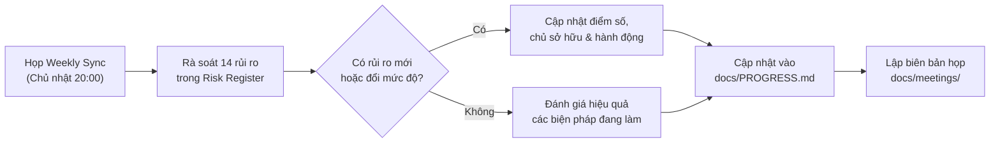

# KẾ HOẠCH QUẢN TRỊ RỦI RO (RISK REGISTER)

**Dự án:** Hệ thống ghép đội, ghép đồng đội theo độ phù hợp trong lĩnh vực cầu lông (Mobile App)  
**Tài liệu:** Sổ theo dõi rủi ro & Ma trận đánh giá rủi ro (Risk Heatmap)  
**Ngày ban hành:** 15/11/2026 | **Phiên bản:** 1.0  
**Quản lý rủi ro:** TV1 (Đào Duy Nhật - PM) & TV2 (Nguyễn Đức Đạt - QA Lead)  

---

## 1. Phương pháp luận & Thang đo rủi ro

Hệ thống đánh giá rủi ro định lượng theo tiêu chuẩn Quản trị dự án phần mềm:

$$\text{Điểm rủi ro (Risk Score)} = \text{Khả năng xảy ra (Likelihood)} \times \text{Mức độ tác động (Impact)}$$

### A. Thang đo Khả năng xảy ra (Likelihood: 1 – 5):
- **1 - Rất hiếm khi (Rare):** Xác suất < 10%, hầu như không xảy ra trong điều kiện bình thường.
- **2 - Hiếm khi (Unlikely):** Xác suất 10% – 30%, có thể xảy ra trong một vài tình huống cá biệt.
- **3 - Có thể xảy ra (Possible):** Xác suất 31% – 60%, rủi ro thông thường trong các dự án sinh viên.
- **4 - Khả năng cao (Likely):** Xác suất 61% – 80%, rủi ro rất dễ phát sinh nếu không có biện pháp phòng ngừa.
- **5 - Chắc chắn / Rất cao (Almost Certain):** Xác suất > 80%, rủi ro hiển nhiên từ thực tế môi trường.

### B. Thang đo Mức độ tác động (Impact: 1 – 5):
- **1 - Không đáng kể (Insignificant):** Ảnh hưởng nhẹ đến giao diện/thao tác phụ, không làm trễ tiến độ.
- **2 - Nhẹ (Minor):** Trễ tiến độ 1–2 ngày hoặc lỗi nhỏ có thể sửa ngay mà không đổi kiến trúc.
- **3 - Đáng kể (Moderate):** Trễ tiến độ 3–5 ngày hoặc ảnh hưởng đến 1 module tính năng, cần kích hoạt dự phòng.
- **4 - Nghiêm trọng (Major):** Trễ hơn 1 tuần, lỗi tính toán thuật toán hoặc đe dọa trực tiếp mốc Milestone.
- **5 - Thảm họa (Catastrophic):** Hệ thống không chạy được, mất dữ liệu, không thể bảo vệ đồ án.

### C. Phân cấp Mức độ ưu tiên rủi ro (Priority Levels):
| Khoảng điểm | Phân cấp mức độ | Mã màu | Chiến lược hành động |
|:---:|:---:|:---:|---|
| **20 – 25** | **CỰC CAO (Critical)** | 🔴 Đỏ | Bắt buộc có kế hoạch dự phòng kích hoạt ngay; theo dõi hằng ngày. |
| **12 – 19** | **CAO (High)** | 🟠 Cam | Bắt buộc có hành động giảm thiểu cụ thể gắn với WBS; rà soát mỗi tuần. |
| **6 – 11** | **TRUNG BÌNH (Medium)** | 🟡 Vàng | Kiểm soát định kỳ trong các buổi họp Sprint; có phương án xử lý sẵn. |
| **1 – 5** | **THẤP (Low)** | 🟢 Xanh | Chấp nhận rủi ro, chỉ ghi nhận và giám sát định kỳ. |

---

## 2. Ma trận rủi ro 5x5 (Risk Assessment Matrix / Heatmap)

Bảng phân bổ vị trí của **14 rủi ro** nhận diện trong dự án:

| Khả năng \ Tác động | 1 - Không đáng kể | 2 - Nhẹ | 3 - Đáng kể | 4 - Nghiêm trọng | 5 - Thảm họa |
|:---:|:---:|:---:|:---:|:---:|:---:|
| **5 - Rất cao** | | | | **RK-03** (20) | |
| **4 - Khả năng cao** | | | **RK-11** (12) | **RK-01** (16)<br>**RK-02** (16) | |
| **3 - Có thể** | | | **RK-04** (9)<br>**RK-07** (9)<br>**RK-10** (9)<br>**RK-12** (9) | **RK-05** (12)<br>**RK-06** (12)<br>**RK-08** (12)<br>**RK-13** (12)<br>**RK-14** (12) | |
| **2 - Hiếm khi** | | | **RK-09** (6) | | |
| **1 - Rất hiếm** | | | | | |

---

## 3. Bảng đăng ký và kiểm soát rủi ro chi tiết (Detailed Risk Register)

```carousel
### RK-01: Người chơi tự khai trình độ ảo (quá cao so với thực tế)
- **Mô tả:** Người chơi mới tạo tài khoản tự khai cấp 4–5 (Khá/Tốt) nhưng thực tế chỉ ở cấp 2 (Yếu/TB-), làm hỏng chất lượng cân kèo.
- **Nguyên nhân:** Tâm lý tự tin quá mức hoặc muốn được nhận vào các kèo trình độ cao.
- **Điểm rủi ro:** Khả năng: 4 | Tác động: 4 | **Điểm: 16 (CAO - 🟠)**
- **Chiến lược:** Giảm thiểu (Mitigate).
- **Hành động gắn WBS:** 
  - **WBS 2.1 & 3.4:** Áp dụng hệ số biến động Elo linh hoạt ($K$-factor cao cho 5 trận đầu) để điểm Elo nhanh chóng tụt về đúng thực lực nếu thua đậm.
  - **WBS 3.4 & 4.4:** Cho phép Host và bạn chơi gắn thẻ phản hồi sau trận ("Đánh dưới sức so với tự khai").
- **Dấu hiệu cảnh báo sớm:** Người chơi liên tục thua các set đấu với tỷ số cách biệt lớn (ví dụ: thua 5–21, 8–21).
- **Ngưỡng kích hoạt dự phòng:** Thua liên tiếp 2 trận đầu với chênh lệch > 10 điểm ➔ Hệ thống tự động gán nhãn cảnh báo "Đang hiệu chỉnh trình độ" cho Host xem xét.
- **Chủ sở hữu:** TV1 (Thuật toán) | **Trạng thái:** Đang giám sát | **Ngày xem lại:** 22/11/2026
<!-- slide -->
### RK-02: Khách vãng lai bùng kèo / hủy slot sát giờ
- **Mô tả:** Vãng lai đã được duyệt suất nhưng không xuất hiện tại sân hoặc hủy kèo trước giờ đánh 15–30 phút, khiến sân bị thiếu chân.
- **Nguyên nhân:** Kẹt việc đột xuất, thiếu ý thức trách nhiệm do chưa có chế tài thanh toán giữ chỗ.
- **Điểm rủi ro:** Khả năng: 4 | Tác động: 4 | **Điểm: 16 (CAO - 🟠)**
- **Chiến lược:** Giảm thiểu & Chuyển giao.
- **Hành động gắn WBS:**
  - **WBS 2.1 & 3.4:** Thiết lập hệ thống Điểm uy tín (Reputation Score, mốc 100). Hủy trước 2h: trừ 5 điểm; Hủy < 2h hoặc bùng: trừ 20 điểm.
  - **WBS 3.2:** Xây dựng danh sách dự bị (Waitlist) tự động đôn người chơi thay thế ngay khi có người rút.
  - **WBS 4.3:** Hiển thị điểm uy tín công khai để Host cân nhắc trước khi duyệt.
- **Dấu hiệu cảnh báo sớm:** Điểm uy tín người chơi < 80 điểm hoặc có lịch sử hủy kèo trong 7 ngày gần nhất.
- **Ngưỡng kích hoạt dự phòng:** Nếu uy tín < 60 điểm ➔ Khóa quyền đặt suất trong 7 ngày; cảnh báo đỏ cho Host.
- **Chủ sở hữu:** TV1 (Nghiệp vụ & Data) | **Trạng thái:** Đang giám sát | **Ngày xem lại:** 22/11/2026
<!-- slide -->
### RK-03: Mất kết nối mạng / Sóng 3G/4G chập chờn tại sân cầu lông
- **Mô tả:** Nhà thi đấu cầu lông tại Đà Nẵng có kết cấu khung thép mái tôn làm suy giảm sóng di động, khiến app mất kết nối khi Host đang chia cặp.
- **Nguyên nhân:** Nhiễu sóng vật lý và đặc thù kiến trúc nhà thi đấu thể thao.
- **Điểm rủi ro:** Khả năng: 5 | Tác động: 4 | **Điểm: 20 (CỰC CAO - 🔴)**
- **Chiến lược:** Giảm thiểu (Mitigate - Thiết kế phòng vệ).
- **Hành động gắn WBS:**
  - **WBS 3.3:** Toàn bộ thuật toán chia cặp (Session Balancing) được viết thành pure function chạy hoàn toàn offline bằng JavaScript cục bộ trên máy Host.
  - **WBS 4.1 & 4.4:** Bộ nhớ đệm AsyncStorage lưu danh sách thành viên sân cục bộ; kết quả trận đấu được lưu tạm vào hàng đợi (Offline sync queue) và tự động đồng bộ lên Firebase khi có mạng lại.
- **Dấu hiệu cảnh báo sớm:** Listener realtime của Firestore kích hoạt sự kiện offline/disconnect.
- **Ngưỡng kích hoạt dự phòng:** App tự động chuyển sang "Chế độ sân đấu Offline", cho phép chia cặp và ghi nhận tỷ số bình thường mà không cần mạng.
- **Chủ sở hữu:** TV1 & TV2 | **Trạng thái:** Đang thiết kế giải pháp | **Ngày xem lại:** 29/11/2026
<!-- slide -->
### RK-04: Thuật toán chia cặp chạy chậm hoặc timeout trên mobile
- **Mô tả:** Khi một sân có nhiều cặp khóa cứng và nhiều người lẻ (5 hoặc 7 người), thuật toán tìm kiếm tối ưu vét cạn (exhaustive search) có thể bị đơ máy.
- **Nguyên nhân:** Độ phức tạp tổ hợp tăng cao khi tìm hoán vị thỏa mãn đồng thời: cân bằng Elo, thỏa mãn cặp khóa, xoay tua người nghỉ đều.
- **Điểm rủi ro:** Khả năng: 3 | Tác động: 3 | **Điểm: 9 (TRUNG BÌNH - 🟡)**
- **Chiến lược:** Giảm thiểu (Mitigate).
- **Hành động gắn WBS:**
  - **WBS 3.3:** Giới hạn không gian tìm kiếm, sử dụng heuristic tham lam (Greedy with early pruning).
  - Giới hạn thời gian chạy thuật toán tối đa 200ms; nếu vượt quá sẽ trả về phương án cận tối ưu tốt nhất tìm được.
- **Dấu hiệu cảnh báo sớm:** Thời gian chạy test case B1–B15 trên Jest vượt quá 150ms trên môi trường giả lập.
- **Ngưỡng kích hoạt dự phòng:** Kích hoạt thuật toán dự phòng: Thuật toán tham lam ghép cặp đối xứng Elo đơn giản (chỉ mất < 20ms).
- **Chủ sở hữu:** TV1 (Thuật toán) | **Trạng thái:** Đang giám sát | **Ngày xem lại:** 06/12/2026
<!-- slide -->
### RK-05: Rào cản gói cước hạ tầng Firebase Cloud Functions
- **Mô tả:** Gói Spark miễn phí không cho phép Cloud Functions gọi ra Internet ngoài; nhóm có thể gặp trở ngại khi đăng ký gói Blaze (thiếu thẻ tín dụng quốc tế).
- **Nguyên nhân:** Chính sách dịch vụ của Google Cloud / Firebase.
- **Điểm rủi ro:** Khả năng: 3 | Tác động: 4 | **Điểm: 12 (CAO - 🟠)**
- **Chiến lược:** Tránh & Giảm thiểu (Mitigate).
- **Hành động gắn WBS:**
  - **WBS 3.1 & 3.4:** Đã chốt lựa chọn gói **Spark miễn phí (0 VNĐ)** tại `DECISIONS-PENDING.md`. Chuyển toàn bộ logic cập nhật Elo và đôn waitlist về hàm thuần chạy ở Client, bảo vệ nghiêm ngặt bằng Firestore Security Rules.
- **Dấu hiệu cảnh báo sớm:** Firebase CLI báo lỗi `Billing must be enabled` khi deploy functions.
- **Ngưỡng kích hoạt dự phòng:** Chạy 100% logic trên Client SDK kết hợp Firestore Batch Transaction và Security Rules (đã được phê duyệt trong thiết kế).
- **Chủ sở hữu:** TV1 (Backend) | **Trạng thái:** Đã giải quyết bằng kiến trúc | **Ngày xem lại:** 29/11/2026
<!-- slide -->
### RK-06: Xung đột đặt trùng suất cuối cùng (Race Condition)
- **Mô tả:** Sân chỉ còn đúng 1 suất vãng lai duy nhất, 2 người chơi ở 2 nơi cùng lúc bấm "Xác nhận đặt suất", dẫn đến việc cả 2 cùng được duyệt hoặc vượt quá 8 người.
- **Nguyên nhân:** Bất đồng bộ mạng và không có khóa dữ liệu (data lock) ở tầng cơ sở dữ liệu.
- **Điểm rủi ro:** Khả năng: 3 | Tác động: 4 | **Điểm: 12 (CAO - 🟠)**
- **Chiến lược:** Tránh (Avoid - Thiết kế kiến trúc).
- **Hành động gắn WBS:**
  - **WBS 3.2:** Sử dụng Firestore `runTransaction` với trường phiên bản `slotVersion` hoặc kiểm tra `currentSlots > 0` trong giao dịch nguyên tử. Yêu cầu nào đến sau sẽ tự động bị rollback và chuyển vào Waitlist.
- **Dấu hiệu cảnh báo sớm:** Số người trong roster sân vượt quá con số 8.
- **Ngưỡng kích hoạt dự phòng:** Transaction thất bại lập tức hiển thị thông báo: "Suất vừa có người đặt trước, bạn đã được xếp vào danh sách dự bị số 1".
- **Chủ sở hữu:** TV1 (Data Architecture) | **Trạng thái:** Đang giám sát | **Ngày xem lại:** 13/12/2026
<!-- slide -->
### RK-07: Giả định nghiệp vụ A1–A8 khác với thực tế tại Đà Nẵng
- **Mô tả:** Sau khi phỏng vấn host thật ở Tuần 1, phát hiện các quy định (như bắt buộc tối thiểu 4 người mặc định, hoặc 1 điểm Elo chung) không khớp với văn hóa chơi thực tế.
- **Nguyên nhân:** Giả định ban đầu được xây dựng trên suy đoán lý thuyết.
- **Điểm rủi ro:** Khả năng: 3 | Tác động: 3 | **Điểm: 9 (TRUNG BÌNH - 🟡)**
- **Chiến lược:** Giảm thiểu (Mitigate).
- **Hành động gắn WBS:**
  - **WBS 1.1:** Tiến hành phỏng vấn sâu 2–3 host ngay trong Sprint 1 (Tuần 1).
  - Soạn thảo quy trình Change Request (CR) minh bạch trong `PROJECT_CONTEXT.md` để điều chỉnh kịp thời.
- **Dấu hiệu cảnh báo sớm:** Host phỏng vấn phản đối hoặc không đồng tình với các giả định A1, A2, A5.
- **Ngưỡng kích hoạt dự phòng:** Nếu có ít nhất 2/3 host phản đối giả định A1 (cho phép mở tuyển khi chỉ có 2-3 người mặc định) ➔ Lập tức ban hành CR-03 điều chỉnh công thức tính slot trước khi code.
- **Chủ sở hữu:** TV1 (BA Lead) | **Trạng thái:** Đang thực hiện phỏng vấn | **Ngày xem lại:** 21/11/2026
<!-- slide -->
### RK-08: Lệch tiến độ & Phụ thuộc đường găng giữa TV1 và TV2
- **Mô tả:** TV1 chậm bàn giao Data Contract hoặc Backend API khiến TV2 không thể tích hợp giao diện; hoặc TV2 chậm làm UI khiến TV1 không thể kiểm thử thực tế.
- **Nguyên nhân:** Ước lượng thời gian sai, bài toán kỹ thuật phát sinh ngoài dự kiến.
- **Điểm rủi ro:** Khả năng: 3 | Tác động: 4 | **Điểm: 12 (CAO - 🟠)**
- **Chiến lược:** Giảm thiểu & Phân tách (Decoupling).
- **Hành động gắn WBS:**
  - **WBS 2.3:** Bàn giao Data Contract chuẩn dạng TypeScript Interfaces ngay cuối Tuần 2.
  - **WBS 4.1:** TV2 sử dụng thư mục `src/mocks/` để sinh dữ liệu giả độc lập, code UI song song mà không cần đợi backend thật.
- **Dấu hiệu cảnh báo sớm:** Một thành viên báo cáo trễ task quá 2 ngày trong cuộc họp tuần.
- **Ngưỡng kích hoạt dự phòng:** Nếu trễ quá 3 ngày trên đường găng ➔ Kích hoạt họp khẩn cấp, cắt giảm tính năng phụ (Nice-to-have) để bảo vệ mốc Milestone.
- **Chủ sở hữu:** TV1 & TV2 | **Trạng thái:** Đang giám sát | **Ngày xem lại:** 28/11/2026
<!-- slide -->
### RK-09: Lỗi cấu hình Push Notification theo loại bản build Expo
- **Mô tả:** Thông báo đẩy (Expo Push Notifications) hoạt động trên Expo Go nhưng không nhận được thông báo khi đóng gói thành file APK độc lập (Standalone APK).
- **Nguyên nhân:** Sai lệch cấu hình FCM (Firebase Cloud Messaging) và quyền cấp phát trên Android 13+.
- **Điểm rủi ro:** Khả năng: 2 | Tác động: 3 | **Điểm: 6 (TRUNG BÌNH - 🟡)**
- **Chiến lược:** Giảm thiểu (Mitigate).
- **Hành động gắn WBS:**
  - **WBS 4.1 & 4.3:** Thử nghiệm tạo bản build development client (`eas build`) sớm từ Tuần 4–5 thay vì đợi đến tuần cuối mới cấu hình.
  - Xây dựng cơ chế fallback: Thông báo in-app (In-app notification bell & toast) song song với Push notification.
- **Dấu hiệu cảnh báo sớm:** Thiết bị Android không hiển thị token thông báo đẩy khi khởi chạy.
- **Ngưỡng kích hoạt dự phòng:** Nếu Push Notification gặp lỗi cấu hình chứng chỉ ➔ Dùng cơ chế thông báo trong app (Polling / Realtime listener) để phục vụ chấm điểm đồ án.
- **Chủ sở hữu:** TV2 (Mobile Lead) | **Trạng thái:** Đang giám sát | **Ngày xem lại:** 12/12/2026
<!-- slide -->
### RK-10: Host nhập sai số người mặc định (Core Members)
- **Mô tả:** Host đếm nhầm người quen hoặc vô tình nhập số người mặc định > 8, dẫn đến hệ thống tính ra số suất tuyển bị âm hoặc sân quá tải.
- **Nguyên nhân:** Thao tác nhầm lẫn của người dùng trên màn hình điện thoại.
- **Điểm rủi ro:** Khả năng: 3 | Tác động: 3 | **Điểm: 9 (TRUNG BÌNH - 🟡)**
- **Chiến lược:** Tránh (Avoid - Ràng buộc giao diện).
- **Hành động gắn WBS:**
  - **WBS 3.2 & 4.3:** Khóa chặt miền giá trị: Trường `coreCount` chỉ cho phép nhập số nguyên trong khoảng từ $0 \le \text{coreCount} \le 8$.
  - Công thức slot tự động giới hạn: $\text{slot} = \max(0, \min(4, 8 - \text{coreCount}))$. Nếu coreCount = 8 thì nút "Mở tuyển" tự động bị disable.
- **Dấu hiệu cảnh báo sớm:** Giá trị nhập vào ô input không phải là số từ 0 đến 8.
- **Ngưỡng kích hoạt dự phòng:** Giao diện hiển thị thông báo lỗi tức thì: "Mỗi sân tối đa 8 người. Nhóm bạn đã đủ 8 người, không thể mở tuyển thêm!".
- **Chủ sở hữu:** TV1 (Domain) & TV2 (UI) | **Trạng thái:** Đã thiết kế ràng buộc | **Ngày xem lại:** 13/12/2026
<!-- slide -->
### RK-11: Rủi ro dữ liệu từ thành viên "Ghost" (Giả định A2)
- **Mô tả:** Thành viên mặc định chưa có tài khoản app được Host tự nhập tên text (ví dụ: "Tuấn", "Nam"). Có thể bị trùng tên, sai giới tính hoặc không lưu vết được sự tiến bộ của họ.
- **Nguyên nhân:** Bạn bè đi đánh giao lưu không phải ai cũng chịu tải ứng dụng trước giờ đánh.
- **Điểm rủi ro:** Khả năng: 4 | Tác động: 3 | **Điểm: 12 (CAO - 🟠)**
- **Chiến lược:** Chấp nhận có kiểm soát & Giảm thiểu.
- **Hành động gắn WBS:**
  - **WBS 2.3 & 3.3:** Khởi tạo object Ghost với ID duy nhất dạng `ghost_${sessionId}_${index}` để tránh trùng lặp.
  - Bắt buộc Host chọn Giới tính (Nam/Nữ) và Cấp độ tự khai khi tạo Ghost để thuật toán chia cặp hoạt động chính xác.
  - Quy định rõ: Ghost không có tài khoản thì không tính điểm Elo cá nhân lâu dài.
- **Dấu hiệu cảnh báo sớm:** Host nhập 2 người cùng tên mà không phân biệt họ tên hoặc biệt danh.
- **Ngưỡng kích hoạt dự phòng:** Hệ thống tự động thêm hậu tố (ví dụ: "Tuấn (1)", "Tuấn (2)") nếu phát hiện trùng tên hiển thị trên sân.
- **Chủ sở hữu:** TV1 (Data & Domain) | **Trạng thái:** Đang giám sát | **Ngày xem lại:** 22/11/2026
<!-- slide -->
### RK-12: Người chơi muốn đổi sân trong cùng một kèo (Kèo 2 sân)
- **Mô tả:** Kèo có 2 sân (ví dụ Sân 1: Đôi nam, Sân 2: Đôi nam nữ). Trong buổi đánh, người chơi tự ý nhảy từ Sân 1 sang Sân 2 làm đảo lộn danh sách xếp trận độc lập của từng sân.
- **Nguyên nhân:** Nhu cầu giao lưu tự do thực tế của người chơi tại sân.
- **Điểm rủi ro:** Khả năng: 3 | Tác động: 3 | **Điểm: 9 (TRUNG BÌNH - 🟡)**
- **Chiến lược:** Giảm thiểu (Mitigate).
- **Hành động gắn WBS:**
  - **WBS 3.3 & 4.4:** Thuật toán chạy độc lập cho từng sân. Tuy nhiên, cung cấp tính năng dành riêng cho Host: "Chuyển thành viên sang Sân khác".
  - Khi chuyển, hệ thống kiểm tra ngay ràng buộc: Sân đích có bị vượt quá 8 người không? Có vi phạm giới tính theo nội dung sân đích không? Nếu hợp lệ mới cho phép chuyển và tính lại lịch trận.
- **Dấu hiệu cảnh báo sớm:** Host thao tác hoán đổi người giữa 2 sân trên giao diện quản lý.
- **Ngưỡng kích hoạt dự phòng:** Nếu sân đích đã đủ 8 người ➔ Chặn thao tác chuyển sân và giải thích rõ: "Sân 2 đã đủ 8 người, không thể nhận thêm!".
- **Chủ sở hữu:** TV1 (Domain) & TV2 (UI) | **Trạng thái:** Đang giám sát | **Ngày xem lại:** 27/12/2026
<!-- slide -->
### RK-13: Thay đổi luật nghiệp vụ hoặc phình to phạm vi (Scope Creep)
- **Mô tả:** Giảng viên hoặc người dùng thử nghiệm yêu cầu thêm tính năng mới ngoài MVP (ví dụ: đòi tích hợp ví thanh toán, đòi chia tiền sân, đòi đấu giải, đòi chat real-time).
- **Nguyên nhân:** Ý tưởng phát sinh trong quá trình thấy sản phẩm chạy thực tế.
- **Điểm rủi ro:** Khả năng: 3 | Tác động: 4 | **Điểm: 12 (CAO - 🟠)**
- **Chiến lược:** Tránh (Avoid).
- **Hành động gắn WBS:**
  - **WBS 1.2:** Điều lệ dự án (Charter) đã quy định rõ danh mục "Ngoài phạm vi MVP".
  - Mọi yêu cầu mới phải lập phiếu Change Request (CR) và chỉ được xem xét đưa vào danh mục "Kế hoạch phát triển tương lai" (Post-MVP), tuyệt đối không nhận thêm tính năng sau mốc Feature Freeze (M8).
- **Dấu hiệu cảnh báo sớm:** Có yêu cầu thêm chức năng mới trong các buổi review tuần.
- **Ngưỡng kích hoạt dự phòng:** Từ chối đưa vào sprint hiện tại; ghi nhận vào mục "Định hướng phát triển" trong Báo cáo đồ án.
- **Chủ sở hữu:** TV1 (PM) | **Trạng thái:** Đang kiểm soát | **Ngày xem lại:** Định kỳ hàng tuần
<!-- slide -->
### RK-14: Rủi ro ốm đau, thi cử học kỳ của thành viên nhóm
- **Mô tả:** Một trong hai thành viên bị ốm hoặc vướng lịch thi tập trung các môn học khác tại trường, dẫn đến gián đoạn việc code trong 1–2 tuần.
- **Nguyên nhân:** Áp lực học tập và các yếu tố sức khỏe khách quan của sinh viên.
- **Điểm rủi ro:** Khả năng: 3 | Tác động: 4 | **Điểm: 12 (CAO - 🟠)**
- **Chiến lược:** Giảm thiểu & Dự phòng đệm (Buffer).
- **Hành động gắn WBS:**
  - Lịch trình 12 tuần đã thiết kế mốc **Feature Freeze tại cuối Tuần 8**, tạo ra khoảng thời gian đệm (Buffer) lên tới 2 tuần (Sprint 5) để hấp thụ sự chậm trễ nếu có.
  - Phân chia công việc theo Data Contract rõ ràng: Mã nguồn của TV1 và TV2 độc lập, thành viên còn lại có thể tiếp tục phần việc của mình thông qua Mock Data.
- **Dấu hiệu cảnh báo sớm:** Thành viên thông báo lịch thi cử trước 1 tuần.
- **Ngưỡng kích hoạt dự phòng:** Kích hoạt thời gian đệm dự phòng; ưu tiên dồn lực hoàn thành các hạng mục trên Đường găng (Critical Path).
- **Chủ sở hữu:** TV1 & TV2 | **Trạng thái:** Đang giám sát | **Ngày xem lại:** Định kỳ hàng tuần
```

---

## 4. Quy trình giám sát & Cập nhật rủi ro hằng tuần (Risk Review Process)

Quy trình quản trị rủi ro được tích hợp chặt chẽ vào nhịp vận hành Agile của nhóm:



### Các bước thực hiện định kỳ:
1. **Thời điểm rà soát:** Cố định vào lúc **20:00 tối Chủ nhật hàng tuần** trong cuộc họp đồng bộ tuần (Weekly Sync).
2. **Nội dung kiểm tra:**
   - Đánh giá xem các dấu hiệu cảnh báo sớm của 14 rủi ro trên có xuất hiện trong tuần vừa qua không.
   - Có rủi ro nào đã vượt ngưỡng kích hoạt (Trigger threshold) cần chuyển sang phương án dự phòng (Contingency action) không?
   - Phát hiện các rủi ro mới phát sinh từ phản hồi của Giảng viên hướng dẫn hoặc thực tế kiểm thử.
3. **Ghi chép và công khai:**
   - Mọi thay đổi về trạng thái rủi ro (Mở ➔ Đang giám sát ➔ Đã kích hoạt dự phòng ➔ Đã đóng) phải được ghi nhận vào biên bản họp tuần tại `docs/meetings/` và cập nhật trực tiếp vào file này.

