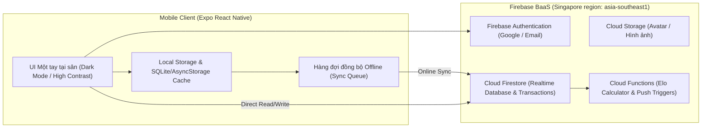

# ĐẶC TẢ YÊU CẦU PHẦN MỀM (SOFTWARE REQUIREMENTS SPECIFICATION - SRS)

**Dự án:** Hệ thống ghép đội và cân bằng kèo cầu lông (Mobile App)  
**Tên sản phẩm:** Badminton Matchmaker Đà Nẵng  
**Phiên bản:** 1.0 (Dành cho Sprint 1 - Mốc M2)  
**Tác giả:** Đào Duy Nhật (TV1 - PM, BA, Backend & Thuật toán)  
**Phối hợp:** Nguyễn Đức Đạt (TV2 - QA Lead, UI/UX & Mobile Developer)  
**Giảng viên hướng dẫn:** ThS. Nguyễn Thanh Tuấn  
**Ngày phát hành:** 2026-11-15  

---

## 1. GIỚI THIỆU (INTRODUCTION)

### 1.1 Mục đích tài liệu
Tài liệu Đặc tả Yêu cầu Phần mềm (SRS) này xác định toàn bộ các yêu cầu chức năng (FR) và phi chức năng (NFR) cho ứng dụng di động **"Hệ thống ghép đội và cân bằng kèo cầu lông"**. Tài liệu đóng vai trò là "bản hợp đồng nghiệp vụ kỹ thuật" giữa hai thành viên phát triển (TV1 phụ trách Backend/Data/Thuật toán và TV2 phụ trách Mobile/UI/QA), làm cơ sở cho TV2 thiết kế nguyên mẫu Figma (WBS 2.4), xây dựng kế hoạch kiểm thử Test Plan (WBS 5.1) và triển khai tích hợp mã nguồn trong 6 Sprint (12 tuần).

### 1.2 Phạm vi sản phẩm (Product Scope)
Ứng dụng di động hướng tới cộng đồng người chơi cầu lông phong trào và các chủ sân/chủ nhóm (Host) tại khu vực thành phố Đà Nẵng. 
- **Trong phạm vi (In-Scope - MVP):**
  1. *Module 1:* Đăng ký, hồ sơ người chơi, bộ câu hỏi tự đánh giá 10 câu khởi tạo trình độ ban đầu theo thang 6 cấp, cập nhật Elo đôi động và điểm uy tín.
  2. *Module 2:* Thuật toán gợi ý đồng đội phù hợp (Partner Finder) dựa trên dải Elo (chênh lệch $\le 150$), khu vực và lối chơi; thuật toán xếp cặp tự động cân bằng (Session Balancing) cho 4–8 người/sân, hỗ trợ cặp khóa, xoay vòng người nghỉ cho ca lẻ 5 và 7 người, cho phép hoán đổi thủ công.
  3. *Module 3:* Tạo và quản lý phòng kèo (1–2 sân/kèo), quản lý người mặc định (kể cả thành viên ghost), tính toán suất tuyển vãng lai tự động ($Slot = \min(4, 8 - Core)$), duyệt/từ chối, hàng đợi dự bị (Waitlist) và tự động đôn người khi có người hủy.
  4. *Module 4:* Nhập tỷ số set đấu, chấm thẻ đánh giá nhanh trong 5 giây, cập nhật điểm Elo và độ uy tín, lưu trữ lịch sử thi đấu và thống kê "Đồng đội ăn ý" (thắng $\ge 60\%$).
  5. *Quản trị in-app:* Phân quyền quản trị viên (`role: "admin"`) trực tiếp trên mobile app để khóa/mở tài khoản, xử lý khiếu nại hoàn uy tín, duyệt danh mục sân mới và theo dõi dashboard.
  6. *Hỗ trợ vận hành sân đấu:* Khả năng chia cặp và nhập tỷ số ngoại tuyến (Offline cache) khi sân cầu mất sóng, đồng bộ tự động khi có mạng; thông báo đẩy (Push Notifications).
- **Ngoài phạm vi (Out-of-Scope - MVP):**
  - Không hỗ trợ đánh đơn (chỉ tập trung tối ưu đánh đôi phong trào).
  - Không hỗ trợ kèo quá 2 sân ($> 16$ người cùng lúc).
  - Không tích hợp cổng thanh toán trực tuyến (thanh toán tiền sân thực hiện trực tiếp giữa người chơi và host qua tiền mặt hoặc quét mã VietQR ngoài ứng dụng).
  - Không xây dựng phân hệ Web Admin riêng biệt.
  - Không hỗ trợ nhắn tin trò chuyện tức thời (In-app Chat).
  - Không tổ chức giải đấu dạng bảng biểu hoặc nhánh đấu loại trực tiếp (Tournament bracket).

### 1.3 Định nghĩa và thuật ngữ chuyên môn (Definitions & Acronyms)
Hệ thống tuân thủ nghiêm ngặt bảng thuật ngữ chuẩn hóa trong `badminton-domain-rules` và `06-rating-scale.md`:

| Thuật ngữ | Tên trong Code | Định nghĩa nghiệp vụ |
|---|---|---|
| **Kèo / Buổi đánh** | `Session` | Một buổi giao lưu cầu lông tại một địa điểm sân, khung giờ và ngày cụ thể do một Host khởi tạo. |
| **Sân** | `Court` | Một thảm sân cầu lông trong kèo. Mỗi kèo chứa 1 hoặc tối đa 2 sân. Sức chứa tối đa 8 người/sân. |
| **Host / Chủ kèo** | `Host` | Người chơi khởi tạo kèo, chịu trách nhiệm thuê sân, quản lý danh sách người mặc định, duyệt vãng lai và vận hành chia cặp tại sân. |
| **Người mặc định** | `Core Player` | Thành viên cố định trong nhóm của host, đã chắc chắn tham gia. |
| **Thành viên Ghost** | `Ghost Member` | Người mặc định chưa cài app; Host tự nhập tên, giới tính và trình độ ước lượng để phục vụ chia cặp tại sân. Không lưu điểm Elo dài hạn. |
| **Vãng lai** | `Recruit` | Người chơi tự do ngoài nhóm nộp đơn xin tham gia khi sân còn suất trống. |
| **Suất tuyển** | `Slot` | Số chỗ trống mở tuyển vãng lai cho một sân: $Slot = \min(4, 8 - Core)$. |
| **Nội dung thi đấu** | `Category` | Thể thức thi đấu của sân: Đôi nam (`men`), Đôi nữ (`women`), Đôi nam nữ (`mixed`). |
| **Cặp đánh** | `Pair` | Hai người chơi cùng đứng một bên sân hợp thành một đội thi đấu. |
| **Cặp khóa** | `Locked Pair` | Cặp đấu do người mặc định tự bắt (`self`) hoặc do Host xếp cố định trước (`host`). Hệ thống tự động không được phép tách rời. |
| **Danh sách dự bị** | `Waitlist` | Hàng đợi chứa những người chơi đăng ký sau khi sân đã hết suất tuyển, được xếp thứ tự thời gian để đôn lên khi có người hủy. |
| **Điểm Elo** | `Elo Rating` | Chỉ số phản ánh trình độ kỹ chiến thuật đánh đôi, nằm trong thang $1000 - 2000$ điểm (sàn 800, trần 2200). |
| **Điểm uy tín** | `Reputation` | Chỉ số văn hóa ứng xử và tính đúng giờ, thang $0 - 100$ điểm (mặc định khởi tạo 100). Bị trừ khi hủy muộn/bùng kèo, được tích lũy lại $+1$ sau mỗi buổi tham gia trọn vẹn. |
| **Lối chơi** | `PlayStyle` | Xu hướng vị trí thi đấu: Chuyên cầu trước/trên lưới (`front`), Chuyên cầu sau/tấn công (`back`), hoặc Linh hoạt cả hai (`both`). |
| **Tay thuận** | `Handedness` | Tay cầm vợt: Tay phải (`right`) hoặc Tay trái (`left`). |

### 1.4 Tài liệu tham chiếu (References)
1. **IEEE Std 830-1998 / ISO/IEC/IEEE 29148:2018:** Recommended Practice for Software Requirements Specifications.
2. [docs/PROJECT_CONTEXT.md](file:///d:/QLDAPM/docs/PROJECT_CONTEXT.md): Ngữ cảnh tổng thể dự án, phân công WBS và quy tắc phối hợp.
3. [docs/01-project-charter.md](file:///d:/QLDAPM/docs/01-project-charter.md): Điều lệ dự án, mục tiêu đo lường và phạm vi MVP.
4. [docs/02-stakeholders.md](file:///d:/QLDAPM/docs/02-stakeholders.md): Phân tích kỳ vọng và ma trận quyền hạn các bên liên quan.
5. [docs/06-rating-scale.md](file:///d:/QLDAPM/docs/06-rating-scale.md): Quy chuẩn thang đo trình độ 6 cấp và mô hình toán Elo đôi.
6. [docs/DECISIONS-PENDING.md](file:///d:/QLDAPM/docs/DECISIONS-PENDING.md): Bảng chốt quyết định nghiệp vụ và kiến trúc kỹ thuật.
7. Bộ luật cầu lông phong trào nhóm: `badminton-domain-rules`, `badminton-rating`, `recruit-slot-matching`, `session-balancing`.

---

## 2. MÔ TẢ TỔNG QUAN (OVERALL DESCRIPTION)

### 2.1 Bối cảnh sản phẩm (Product Perspective)
Tại các cụm sân cầu lông phong trào lớn ở Đà Nẵng (Kỳ Đồng, Tuyên Sơn, Quân Khu 5, Trương Vĩnh Ký, Bưu Điện...), nhu cầu kết nối giữa các nhóm chơi cố định thiếu người và các tay vợt tự do đi tìm sân là rất lớn. Tuy nhiên, hình thức tìm người truyền thống qua mạng xã hội (Facebook Group, Zalo) bộc lộ 3 bất cập lớn:
1. **Lệch trình độ nghiêm trọng:** Người chơi tự khai trình độ mơ hồ ("biết đánh", "trung bình khá"), dẫn đến khi vào sân các trận đấu bị "một chiều", gây ức chế cho cả hai bên.
2. **Nạn "bùng kèo" và trễ giờ:** Vãng lai nhận lời nhưng sát giờ không đến, khiến chủ nhóm phải gánh tiền sân hoặc sân bị thiếu người đánh.
3. **Thao tác chia cặp thủ công tại sân lúng túng:** Host vừa phải đánh vừa phải nhớ ai đã nghỉ, ai đánh cặp với ai, mất thời gian sắp xếp giữa các set, đặc biệt trong điều kiện tay ướt mồ hôi và sóng di động trong nhà thi đấu chập chờn.

Ứng dụng **Badminton Matchmaker** ra đời nhằm số hóa toàn diện quy trình này: từ đánh giá trình độ khách quan bằng thuật toán Elo, quản lý suất tuyển chặt chẽ với hàng đợi dự bị tự động, đến công cụ chia cặp tại sân chỉ trong **3 chạm** và dưới **1 giây**.

### 2.2 Các nhóm tác nhân người dùng (User Classes & Characteristics)
Hệ thống phục vụ 3 nhóm đối tượng người dùng chính thông qua một ứng dụng di động duy nhất:

| Nhóm người dùng | Đặc điểm & Hành vi | Tần suất sử dụng |
|---|---|---|
| **Người chơi vãng lai (Player / Recruit)** | Người yêu thích cầu lông tại Đà Nẵng, tìm sân giao lưu hoặc tìm bạn đánh đôi ăn ý. Cần tìm kèo nhanh, biết rõ trình độ đối thủ trước khi xin vào, hạn chế bị từ chối oan. | 2–4 lần/tuần (tìm kèo, xem lịch sử, kiểm tra Elo). |
| **Chủ kèo / Trưởng nhóm (Host)** | Người trực tiếp thuê sân cố định, quản lý nhóm bạn. Cần công cụ chốt người dứt khoát, chống bùng kèo, hỗ trợ chia lượt đánh nhanh gọn, công bằng để không phải ghi chép sổ tay. | 2–5 buổi/tuần (tạo kèo, duyệt người, bấm chia cặp tại sân). |
| **Quản trị viên (Admin in-app)** | Thành viên ban quản trị hệ thống (role: `admin`). Cần công cụ giám sát chất lượng cộng đồng, xử lý báo cáo bùng kèo/khai ảo, duyệt danh mục sân mới do người dùng đóng góp. | Hàng ngày hoặc định kỳ hàng tuần. |

### 2.3 Môi trường vận hành (Operating Environment)
- **Nền tảng thiết bị di động:** Hệ điều hành **Android 8.0 (API 26) trở lên** và **iOS 13.0 trở lên**.
- **Công nghệ phát triển:** Framework **React Native** kết hợp bộ công cụ **Expo SDK 52+** (TypeScript).
- **Hạ tầng Backend:** Nền tảng **Google Firebase BaaS** đặt tại Region `asia-southeast1` (Singapore) nhằm tối ưu độ trễ mạng thấp nhất cho người dùng tại Đà Nẵng:
  - Xác thực: Firebase Authentication (Google Sign-In, Email/Password).
  - Cơ sở dữ liệu: Cloud Firestore (NoSQL Document Store, hỗ trợ Realtime Listeners và Offline Persistence).
  - Logic tính toán: Cloud Functions V2 (Node.js/TypeScript) hoặc Domain Engine trên Client.

### 2.4 Ràng buộc thiết kế và triển khai (Design & Implementation Constraints)
- **Ràng buộc thời gian & nhân lực:** Đồ án 2 người hoàn thành trong đúng 12 tuần (6 Sprint tinh gọn).
- **Ràng buộc UX tại sân:** Giao diện tối ưu cho người dùng thao tác bằng một tay (ngón cái), kích thước vùng bấm (touch target) tối thiểu $48 \times 48\text{ dp}$, chữ và số có độ tương phản cao để đọc rõ dưới ánh đèn nhà thi đấu.
- **Ràng buộc kết nối:** Sân cầu lông trong nhà thường có sóng 4G/Wi-Fi yếu; hệ thống phải hoạt động theo nguyên lý **Offline-first**, cho phép chia cặp và nhập tỷ số cục bộ ngay cả khi mất mạng hoàn toàn.
- **Ràng buộc chi phí:** Vận hành tối ưu trên hạn ngạch miễn phí của Firebase (Spark/Blaze free tier), hạn chế tối đa số lượng Document Read/Write dư thừa.

### 2.5 Các giả định và quyết định đã duyệt (Assumptions A1–A8)
Hệ thống được thiết kế dựa trên các giả định nghiệp vụ đã được TV1 phê duyệt chính thức tại [docs/DECISIONS-PENDING.md](file:///d:/QLDAPM/docs/DECISIONS-PENDING.md):
- **A1:** Host có thể mở tuyển vãng lai nếu có từ **1 người mặc định trở lên**, miễn là tổng số người trong sân không vượt quá 8.
- **A2:** Cho phép thành viên "ghost" (người mặc định chưa có app). Sau buổi đánh, nếu họ cài app, hệ thống hỗ trợ quét mã QR/nhập mã để liên kết lịch sử trận đấu.
- **A3:** 100% duyệt thủ công bởi Host trong giai đoạn MVP (không tự động duyệt).
- **A4:** Nếu số lượng vãng lai được duyệt đã đủ suất, khóa nút thêm người mặc định của host. Nếu chưa đủ suất, host vẫn được thêm người mặc định và hệ thống tự động giảm số suất tuyển tương ứng.
- **A5:** Cho phép người chơi lệch quá 1 cấp nộp đơn xin vào sân, nhưng hệ thống sẽ hiển thị nhãn cảnh báo **"Lệch trình độ"** màu vàng/đỏ cho Host cân nhắc trước khi bấm duyệt.
- **A6:** Sử dụng **1 chỉ số Elo duy nhất** cho cả 3 nội dung đánh đôi để đơn giản hóa thuật toán giai đoạn MVP.
- **A7:** Quy tắc phạt uy tín: Hủy trước 2 giờ: phạt $-5$ điểm; Hủy sát giờ ($< 2$ giờ) hoặc bùng: phạt $-20$ điểm; Tham gia trọn vẹn 1 buổi được cộng hoàn lại $+1$ điểm uy tín.
- **A8:** Thanh toán tiền sân nằm ngoài app. Ứng dụng hỗ trợ Host nhập số tài khoản/Ngân hàng để tự động hiển thị mã **VietQR** thanh toán nhanh trong phòng kèo.

---

## 3. YÊU CẦU CHỨC NĂNG (FUNCTIONAL REQUIREMENTS - FR)

Mức độ ưu tiên được phân loại theo tiêu chuẩn **MoSCoW**:
- **Must Have (M):** Bắt buộc phải có trong bản phát hành MVP (Sprint 1–4).
- **Should Have (S):** Cần có để hoàn thiện trải nghiệm người dùng (Sprint 4–5).
- **Could Have (C):** Tính năng nâng cao, triển khai nếu còn thời gian (Sprint 5).

---

### MODULE 1: HỒ SƠ & ĐÁNH GIÁ TRÌNH ĐỘ ĐỘNG (PROFILE & RATING)

#### FR-01: Đăng ký, Đăng nhập và Xác thực tài khoản
- **Mức ưu tiên:** Must Have (M)
- **Mô tả:** Hệ thống cho phép người dùng đăng ký và đăng nhập tài khoản bằng **Google Sign-In** hoặc **Email/Mật khẩu**.
- **Chi tiết xử lý:**
  - Xác thực qua Firebase Authentication.
  - Tự động tạo bản ghi trong collection `users` với mã định danh `uid`.
  - Tự động gán quyền mặc định `role: "player"`.
  - Hỗ trợ tính năng Đăng xuất và Quên/Đặt lại mật khẩu qua Email.

#### FR-02: Bảng câu hỏi Onboarding tự đánh giá trình độ ban đầu
- **Mức ưu tiên:** Must Have (M)
- **Mô tả:** Người dùng mới bắt buộc phải hoàn thành bài khảo sát 10 câu hỏi trắc nghiệm khách quan (về kinh nghiệm, tần suất, kỹ thuật ve cầu, đập cầu, phòng thủ, di chuyển...) theo quy chuẩn [docs/06-rating-scale.md](file:///d:/QLDAPM/docs/06-rating-scale.md).
- **Chi tiết xử lý:**
  - Mỗi câu hỏi có 4 mức lựa chọn (tương ứng 1 đến 4 điểm). Tổng điểm nằm trong khoảng $10 - 40$ điểm.
  - Hệ thống gọi hàm `calculateInitialRatingFromAnswers()` trong domain engine để tính ra Cấp độ (1 đến 6) và gán Điểm Elo khởi tạo tương ứng ($1100, 1275, 1425, 1575, 1725, 1900$).
  - Gắn nhãn trạng thái `isProvisional: true` cho tài khoản mới.

#### FR-03: Khai báo hồ sơ thể thao và thông số lối chơi
- **Mức ưu tiên:** Must Have (M)
- **Mô tả:** Người dùng thiết lập các thông số đánh đôi cá nhân trong hồ sơ:
  - Họ và tên, Biệt danh (Nickname), Giới tính (Nam / Nữ), Số điện thoại liên hệ.
  - Tay thuận: Tay phải (`right`) hoặc Tay trái (`left`).
  - Vị trí sở trường (Lối chơi): Chuyên cầu trước/lưới (`front`), Chuyên cầu sau/tấn công (`back`), hoặc Linh hoạt cả hai (`both`).
  - Khu vực sân quen thuộc tại Đà Nẵng (Hải Châu, Thanh Khê, Sơn Trà, Ngũ Hành Sơn, Cẩm Lệ, Liên Chiểu, Hòa Vang).
  - Nội dung sở trường quan tâm: Đôi nam, Đôi nữ, Đôi nam nữ.

#### FR-04: Hiển thị Thẻ thông tin cá nhân (Player Card) & Chỉ số
- **Mức ưu tiên:** Must Have (M)
- **Mô tả:** Màn hình Profile hiển thị trực quan thông tin người chơi:
  - Tên hiển thị, Avatar, Huy hiệu Cấp độ phong trào (Yếu, TB-, TB, TB+, Khá, Tốt / Bán chuyên).
  - Điểm Elo hiện tại kèm biểu đồ xu hướng biến động điểm.
  - Điểm uy tín (Reputation score) kèm thanh tiến trình màu sắc ($80–100$: Xanh lá - Uy tín cao; $50–79$: Vàng - Trung bình; $< 50$: Đỏ - Cảnh báo).
  - Thống kê thi đấu: Tổng số trận, Tỷ lệ thắng (Win rate %), Huy hiệu số lần được khen "Đúng trình", "Đánh hay", "Thái độ tốt".

#### FR-05: Chuyển đổi trạng thái tài khoản sang Chính thức (Non-Provisional)
- **Mức ưu tiên:** Must Have (M)
- **Mô tả:** Hệ thống theo dõi số trận đấu hợp lệ đã tham gia.
- **Chi tiết xử lý:**
  - Trong 5 trận đầu tiên ($N = 5$): Tài khoản mang nhãn "Đang hiệu chỉnh" (`isProvisional = true`), sử dụng hệ số biến động Elo cao $K = 40$ để kéo nhanh điểm về đúng thực lực.
  - Từ trận thứ 6 trở đi: Tự động gỡ nhãn provisional (`isProvisional = false`), chuyển sang hệ số ổn định $K = 24$.

#### FR-06: Chỉnh sửa hồ sơ và cài đặt tài khoản
- **Mức ưu tiên:** Should Have (S)
- **Mô tả:** Cho phép người chơi cập nhật lại biệt danh, số điện thoại, tay thuận, lối chơi, khu vực ưu tiên và thông tin thanh toán VietQR cá nhân. Không được tự ý sửa điểm Elo hoặc Cấp độ.

---

### MODULE 2: GHÉP ĐỒNG ĐỘI & CHIA CẶP CÂN KÈO (MATCHMAKING & BALANCING)

#### FR-07: Tìm kiếm và Gợi ý đồng đội phù hợp (Partner Finder)
- **Mức ưu tiên:** Must Have (M)
- **Mô tả:** Người chơi có thể tìm kiếm danh sách các tay vợt đang rảnh rỗi hoặc có cùng nhu cầu tìm bạn đánh đôi tại Đà Nẵng.
- **Chi tiết xử lý:**
  - Bộ lọc tìm kiếm: Theo Quận/Huyện tại Đà Nẵng, Nội dung thi đấu, Giới tính.
  - Thuật toán sắp xếp theo Điểm tương thích ghép đôi ($0 - 100$ điểm):
    - Độ lệch Elo: $|\text{Elo}_A - \text{Elo}_B| \le 150$ điểm (ưu tiên hàng đầu, trừ dần điểm tương thích nếu độ lệch lớn hơn).
    - Bù trừ vị trí thi đấu: Cặp Lưới + Công thưởng $+40$ điểm; Linh hoạt + Bất kỳ thưởng $+20..+25$ điểm; Cùng vị trí chuyên trừ $-30$ điểm.
    - Bù trừ tay thuận: Cặp 1 Tay Phải + 1 Tay Trái thưởng $+25$ điểm.
    - Điểm uy tín: Ưu tiên người có điểm uy tín $\ge 80$.

#### FR-08: Chia cặp tự động cho sân đấu (Session Balancing Engine)
- **Mức ưu tiên:** Must Have (M)
- **Mô tả:** Tại sân đấu, Host bấm nút "Chia cặp tự động", hệ thống phân bổ các đấu thủ trong sân thành các cặp đấu có tổng điểm Elo cân bằng nhất.
- **Chi tiết xử lý:**
  - Sân áp dụng: Chứa từ 4 đến 8 người chơi (bao gồm cả người mặc định và vãng lai đã duyệt).
  - Thuật toán heuristic đánh giá toàn bộ tổ hợp các cặp khả dĩ sao cho chênh lệch tổng Elo giữa hai đội: $|\text{Elo}_{\text{Đội 1}} - \text{Elo}_{\text{Đội 2}}| \to \min$.
  - Tôn trọng tuyệt đối ràng buộc nội dung sân:
    - Sân Đôi nam: $100\%$ các cặp là Nam + Nam.
    - Sân Đôi nữ: $100\%$ các cặp là Nữ + Nữ.
    - Sân Đôi nam nữ: $100\%$ các cặp là Nam + Nữ.
  - Thời gian xử lý: Dưới 1 giây trên thiết bị di động.

#### FR-09: Tôn trọng và bảo toàn Cặp đánh khóa (Locked Pairs)
- **Mức ưu tiên:** Must Have (M)
- **Mô tả:** Người mặc định tự ghép đôi với nhau (`self`) hoặc Host chủ động gán trước 2 người thành một cặp cố định (`host`).
- **Chi tiết xử lý:**
  - Cặp đấu này được gắn cờ `isLocked: true` kèm biểu tượng ổ khóa trên giao diện.
  - Khi thực hiện thuật toán chia cặp hoặc tạo lịch đấu xoay vòng, thuật toán coi cặp khóa như một khối thống nhất, không bao giờ được tách rời 2 thành viên sang 2 cặp khác nhau.

#### FR-10: Lập lịch thi đấu xoay vòng và luân phiên người nghỉ
- **Mức ưu tiên:** Must Have (M)
- **Mô tả:** Đối với sân có số lượng người chơi lẻ hoặc lớn hơn 4 (ví dụ 5, 6, 7 hoặc 8 người), hệ thống lập danh sách các lượt trận (Matches/Rounds) đảm bảo công bằng thời gian ra sân.
- **Chi tiết xử lý:**
  - Luôn có đúng 4 người trên sân trong mỗi set đấu ($2\text{ vs }2$).
  - Người không thi đấu trong set hiện tại được xếp vào danh sách "Nghỉ ngơi" (`resting`).
  - Xoay vòng lượt nghỉ công bằng: Người vừa nghỉ ở set trước sẽ được ưu tiên vào sân ở set tiếp theo; không ai phải nghỉ 2 set liên tiếp trừ khi tự yêu cầu.
  - Hạn chế tối đa việc lặp lại đối thủ hoặc lặp lại đồng đội quá nhiều lần trong cùng một buổi đánh.

#### FR-11: Điều chỉnh hoán đổi vị trí thủ công tại sân (Manual Swap)
- **Mức ưu tiên:** Must Have (M)
- **Mô tả:** Host có thể can thiệp kéo-thả hoặc bấm chọn 2 người chơi bất kỳ trên bảng sơ đồ sân để hoán đổi vị trí cho nhau.
- **Chi tiết xử lý:**
  - Cho phép đổi giữa 2 người đang thi đấu, hoặc giữa 1 người thi đấu với 1 người đang nghỉ.
  - Nếu thao tác hoán đổi vi phạm cặp khóa (`isLocked`), hệ thống hiển thị cảnh báo xác nhận mở khóa trước khi thực hiện.
  - Tức thời tính toán lại và hiển thị độ chênh lệch Elo mới giữa 2 đội sau khi hoán đổi.

#### FR-12: Hỗ trợ vận hành kèo 2 sân độc lập
- **Mức ưu tiên:** Should Have (S)
- **Mô tả:** Một buổi đánh có thể cấu hình tối đa 2 sân đấu (tối đa 16 người).
- **Chi tiết xử lý:**
  - Mỗi sân có tab quản lý riêng biệt, có thể khác nhau về thể thức (ví dụ Sân 1: Đôi nam nữ; Sân 2: Đôi nam).
  - Một người chơi chỉ thuộc về đúng 1 sân trong một thời điểm (không thể cùng lúc có tên ở cả 2 sân).
  - Cho phép Host chuyển người chơi giữa 2 sân nếu hai bên thỏa thuận và đáp ứng đúng điều kiện giới tính/trình độ của sân nhận.

#### FR-13: Chế độ phân bổ ngẫu nhiên có kiểm soát (Fun Match Mode)
- **Mức ưu tiên:** Could Have (C)
- **Mô tả:** Host có thể chuyển đổi giữa chế độ "Cân bằng tối đa" (Tryhard/Balanced) và "Giao lưu ngẫu nhiên" (Fun/Social) để thuật toán ưu tiên cho mọi người đều được bắt cặp chéo với nhau mà không đặt nặng chênh lệch điểm số.

---

### MODULE 3: QUẢN LÝ KÈO & TUYỂN SUẤT VÃNG LAI (LOBBY & SLOTS)

#### FR-14: Tạo kèo và cấu hình thông số sân đấu
- **Mức ưu tiên:** Must Have (M)
- **Mô tả:** Host khởi tạo một buổi đánh mới với các thông tin chi tiết:
  - Tiêu đề kèo, Địa điểm (chọn từ danh mục sân có sẵn tại Đà Nẵng hoặc nhập tự do), Ngày thi đấu, Khung giờ (Bắt đầu – Kết thúc).
  - Số lượng sân (1 hoặc 2 sân).
  - Thiết lập cho từng sân: Tên sân (ví dụ Sân 1, Sân 2), Thể thức (`men`, `women`, `mixed`), Dải trình độ chấp nhận (từ Cấp $X$ đến Cấp $Y$, ví dụ Cấp 2 đến Cấp 4).
  - Chi phí ước tính mỗi người (VNĐ) và Thông tin chuyển khoản VietQR của host (Số tài khoản, Ngân hàng).

#### FR-15: Quản lý danh sách người mặc định (Core Members & Ghosts)
- **Mức ưu tiên:** Must Have (M)
- **Mô tả:** Host thêm danh sách bạn bè thân thiết vào nhóm mặc định của sân.
- **Chi tiết xử lý:**
  - Thêm thành viên đã có tài khoản (tìm kiếm theo Nickname/SĐT).
  - Thêm thành viên "ghost" (chưa có app): Host nhập Họ tên, Giới tính, Trình độ ước lượng (1–6), Lối chơi.
  - Khóa quyền thêm người mặc định nếu tổng số người trong sân đã đạt tối đa 8 người.

#### FR-16: Tính toán và hiển thị số suất tuyển vãng lai tự động
- **Mức ưu tiên:** Must Have (M)
- **Mô tả:** Hệ thống tự động tính toán số suất tuyển vãng lai còn trống theo công thức bất biến:  
  $$\text{TotalSlots} = \min(4, 8 - \text{CorePlayers})$$  
  $$\text{RemainingSlots} = \text{TotalSlots} - \text{ConfirmedRecruits}$$
- **Chi tiết xử lý:**
  - Nếu $\text{RemainingSlots} > 0$: Hiển thị trạng thái "Đang tuyển ($X$ chỗ)".
  - Nếu $\text{RemainingSlots} = 0$: Tự động đóng cổng nhận đơn chính thức, chuyển sang trạng thái "Đầy suất - Nhận vào Waitlist".
  - Nếu sân có 8 người mặc định: Không mở tuyển (0 suất).

#### FR-17: Tìm kiếm, lọc và xem danh sách kèo công khai
- **Mức ưu tiên:** Must Have (M)
- **Mô tả:** Người chơi vãng lai duyệt danh sách các kèo đang mở tuyển trên địa bàn Đà Nẵng.
- **Chi tiết xử lý:**
  - Bộ lọc đa tiêu chí: Theo Ngày đánh, Khung giờ, Quận/Huyện, Tên sân, Thể thức (Đôi nam/nữ/nam nữ), Dải trình độ phù hợp với bản thân.
  - Hiển thị trực quan: Tên kèo, Địa điểm, Giờ đánh, Số suất còn trống, Dải trình độ yêu cầu, Avatar Host và Điểm uy tín của Host.

#### FR-18: Gửi yêu cầu đặt suất tham gia (Request to Join)
- **Mức ưu tiên:** Must Have (M)
- **Mô tả:** Người chơi bấm nút "Xin tham gia" vào một sân còn suất trống hoặc xin vào hàng đợi dự bị.
- **Chi tiết xử lý:**
  - Kiểm tra điều kiện giới tính: Phải khớp với thể thức sân (Nam chỉ được xin vào Men/Mixed; Nữ chỉ được xin vào Women/Mixed).
  - Kiểm tra điều kiện uy tín: Điểm uy tín phải $\ge 50$ (người bị cảnh báo bùng kèo dưới 50 điểm bị chặn đặt suất).
  - Kiểm tra dải trình độ: Nếu ngoài dải trình độ của sân, hệ thống cảnh báo người chơi nhưng vẫn cho phép nộp kèm cờ cảnh báo cho Host.
  - Sử dụng Firestore Transaction để tránh tình trạng race-condition khi nhiều người cùng bấm xin suất cuối cùng.

#### FR-19: Host duyệt hoặc từ chối yêu cầu tham gia
- **Mức ưu tiên:** Must Have (M)
- **Mô tả:** Host xem danh sách các đơn xin tham gia kèm hồ sơ chi tiết (Cấp độ, Elo, Tay thuận, Lối chơi, Điểm uy tín, Lịch sử bùng kèo) để bấm "Duyệt" hoặc "Từ chối".
- **Chi tiết xử lý:**
  - Khi Host bấm "Duyệt": Trạng thái chuyển thành `confirmed`, giảm 1 suất trống của sân.
  - Nếu số vãng lai được duyệt đã đạt giới hạn $\text{TotalSlots}$: Tự động chặn duyệt thêm người tiếp theo.
  - Khi Host bấm "Từ chối": Chuyển trạng thái `rejected`, người chơi nhận thông báo.

#### FR-20: Hàng đợi dự bị (Waitlist) và Cơ chế tự động đôn người
- **Mức ưu tiên:** Must Have (M)
- **Mô tả:** Khi một người chơi vãng lai đã `confirmed` thực hiện hủy suất tham gia, hệ thống tự động xử lý hàng đợi.
- **Chi tiết xử lý:**
  - Suất trống được giải phóng.
  - Hệ thống tự động tìm người đứng đầu trong danh sách `waitlist` (theo thứ tự `createdAt` ưu tiên thời gian nộp sớm nhất và thỏa mãn điều kiện giới tính).
  - Chuyển trạng thái người dự bị thành `confirmed` (hoặc gửi thông báo mời xác nhận trong vòng 30 phút).
  - Gửi thông báo đẩy tức thời cho người được đôn: "Bạn đã được đôn lên danh sách chính thức!".

#### FR-21: Quy tắc Hủy tham gia và Phạt điểm uy tín
- **Mức ưu tiên:** Must Have (M)
- **Mô tả:** Người chơi đã được duyệt có quyền bấm "Hủy tham gia kèo".
- **Chi tiết xử lý:**
  - Hủy trước giờ đánh $\ge 2$ tiếng: Trừ $-5$ điểm uy tín (phạt nhẹ vì chủ động báo sớm để host kịp đôn người).
  - Hủy trong vòng $< 2$ tiếng trước giờ đánh: Trừ $-20$ điểm uy tín (phạt nặng do gây khó khăn cho việc tìm người thay thế).
  - Không đến sân (Bùng kèo): Sau buổi đánh, Host báo cáo "Bùng kèo", hệ thống xác minh và trừ $-20$ điểm uy tín, đồng thời ghi vết vi phạm vào hồ sơ.

---

### MODULE 4: LỊCH SỬ THI ĐẤU & ĐỒNG ĐỘI ĂN Ý (HISTORY & ELO LOOP)

#### FR-22: Nhập tỷ số set đấu tại sân (Score Tracking)
- **Mức ưu tiên:** Must Have (M)
- **Mô tả:** Sau khi hoàn thành một set đấu, Host (hoặc người chơi trong sân) nhập kết quả tỷ số giữa Đội A và Đội B.
- **Chi tiết xử lý:**
  - Giao diện nhập điểm dạng nút bấm lớn $+1 / -1$ cho mỗi bên hoặc nhập trực tiếp (ví dụ: $21 - 18, 15 - 21$).
  - Kiểm tra tính hợp lệ của điểm cầu lông chuẩn (điểm cách biệt $\ge 2$, điểm tối đa 30).
  - Lưu kết quả set đấu cục bộ tức thời và đồng bộ lên Cloud Firestore.

#### FR-23: Chấm thẻ đánh giá sau trận nhanh trong 5 giây (Post-match Review)
- **Mức ưu tiên:** Must Have (M)
- **Mô tả:** Ngay sau khi nhập tỷ số hoặc kết thúc buổi đánh, màn hình hiển thị bảng đánh giá nhanh các bạn chơi cùng sân với thao tác 1 chạm.
- **Chi tiết xử lý:**
  - Bảng thẻ đánh giá gồm 3 nút chọn nhanh:
    1. 🟢 **Đúng trình:** Đánh đúng với cấp độ khai báo.
    2. 🔵 **Đánh hay:** Kỹ thuật và thể lực vượt trội so với điểm hiện tại.
    3. ⭐ **Thái độ tốt:** Vui vẻ, hòa đồng, đúng giờ, fair-play.
  - Tùy chọn báo cáo vi phạm: "Khai ảo (quá yếu so với điểm)" hoặc "Bùng kèo / Bỏ về giữa chừng".
  - Thời gian hoàn thành đánh giá thiết kế dưới 5 giây để không làm phiền người chơi.

#### FR-24: Cập nhật biến động điểm Elo đôi sau buổi đánh
- **Mức ưu tiên:** Must Have (M)
- **Mô tả:** Hệ thống tự động tính toán và cập nhật điểm Elo cho các đấu thủ sau khi trận đấu được xác nhận kết quả.
- **Chi tiết xử lý:**
  - Áp dụng công thức Elo đôi chuẩn xác suất logistic:  
    $$R_{\text{team}} = \frac{R_1 + R_2}{2}, \quad E_A = \frac{1}{1 + 10^{(R_{\text{team}B} - R_{\text{team}A})/400}}$$  
    $$\Delta R = K \times (S_A - E_A)$$  
  - Phân bổ điểm cho từng thành viên: $R_{1,\text{new}} = R_1 + \Delta R$.
  - Hệ số $K$: $K = 40$ nếu người chơi đang trong 5 trận đầu (`isProvisional = true`); $K = 24$ nếu đã đánh $\ge 6$ trận.
  - Điểm sàn bảo vệ: Điểm tối thiểu không thấp hơn 800, trần không vượt quá 2200.
  - Thành viên "ghost" không được tính toán lưu vết Elo.

#### FR-25: Xem lịch sử thi đấu chi tiết (Match History)
- **Mức ưu tiên:** Must Have (M)
- **Mô tả:** Người chơi xem lại danh sách các buổi đánh và các trận đấu đã tham gia.
- **Chi tiết xử lý:**
  - Hiển thị ngày giờ, tên sân, tỷ số từng set, danh sách đồng đội và đối thủ.
  - Hiển thị biến động Elo sau mỗi trận ($+12, -8...$).
  - Bộ lọc xem theo: Tất cả, Trận thắng, Trận thua.

#### FR-26: Danh sách "Đồng đội ăn ý" (Best Partners)
- **Mức ưu tiên:** Should Have (S)
- **Mô tả:** Hệ thống phân tích dữ liệu lịch sử thi đấu và tự động vinh danh những người bạn đánh đôi ăn ý nhất.
- **Chi tiết xử lý:**
  - Điều kiện xét duyệt: Hai người đã từng đứng cặp cùng nhau tối thiểu **$\ge 3$ trận**.
  - Tỷ lệ chiến thắng khi cùng đội đạt từ **$\ge 60\%$** trở lên.
  - Hiển thị danh sách thẻ Bạn ăn ý trong Profile kèm số trận đã đánh chung và tỷ lệ thắng; có nút bấm "Mời đánh chung" để tạo kèo kết nối nhanh.

#### FR-27: Tích lũy và phục hồi điểm uy tín
- **Mức ưu tiên:** Should Have (S)
- **Mô tả:** Khuyến khích văn hóa chơi thể thao lành mạnh.
- **Chi tiết xử lý:**
  - Khi tham gia hoàn thành trọn vẹn một buổi đánh (không hủy, không bùng, có mặt đúng giờ): Hệ thống tự động cộng hoàn lại $+1$ điểm uy tín (tối đa không vượt quá 100 điểm).

---

### PHÂN HỆ QUẢN TRỊ VIÊN IN-APP (ADMIN IN-APP)

#### FR-28: Phân quyền vai trò người dùng (Role-based Access Control)
- **Mức ưu tiên:** Must Have (M)
- **Mô tả:** Hệ thống kiểm tra quyền hạn dựa trên trường `role` (`"player"` hoặc `"admin"`) trong bản ghi `users/{uid}`. Người dùng có `role == "admin"` sẽ thấy thêm lối tắt truy cập Bảng quản trị (Admin Dashboard) ngay trong ứng dụng di động.

#### FR-29: Quản lý và Khóa / Mở khóa tài khoản người dùng vi phạm
- **Mức ưu tiên:** Must Have (M)
- **Mô tả:** Admin có quyền tìm kiếm người dùng theo tên/email/SĐT, xem lịch sử vi phạm (bùng kèo, bị báo cáo khai ảo nhiều lần) và thực hiện tác vụ:
  - Tạm khóa tài khoản (7 ngày / 30 ngày) hoặc Khóa vĩnh viễn (`status: "banned"`).
  - Mở khóa cho tài khoản đã khắc phục vi phạm.

#### FR-30: Tiếp nhận khiếu nại và Hoàn trả điểm uy tín
- **Mức ưu tiên:** Should Have (S)
- **Mô tả:** Người chơi bị trừ điểm uy tín do sự cố bất khả kháng (xe hỏng, cấp cứu...) có thể gửi đơn khiếu nại kèm minh chứng. Admin xem xét phê duyệt và thực hiện hoàn trả lại số điểm uy tín đã bị trừ.

#### FR-31: Quản lý danh mục sân cầu lông tại Đà Nẵng
- **Mức ưu tiên:** Should Have (S)
- **Mô tả:** Admin duyệt các địa điểm sân mới do người dùng đóng góp vào hệ thống (Tên sân, Địa chỉ, Quận/Huyện, Tọa độ GPS, Số điện thoại chủ sân) để đưa vào danh mục chọn nhanh khi tạo kèo.

---

### PHÂN HỆ NỀN TẢNG DI ĐỘNG (MOBILE & OFFLINE)

#### FR-32: Lưu trữ bộ đệm cục bộ ngoại tuyến (Offline Local Caching)
- **Mức ưu tiên:** Must Have (M)
- **Mô tả:** Ứng dụng tự động lưu trữ dữ liệu các buổi đánh đang tham gia, danh sách thành viên trong sân và sơ đồ cặp đấu vào bộ nhớ máy (AsyncStorage/SQLite và Firestore Offline Persistence). Khi mất mạng hoàn toàn tại sân, Host vẫn mở được phòng kèo và xem đủ thông tin.

#### FR-33: Vận hành chia cặp và Nhập tỷ số ngoại tuyến (Offline Execution)
- **Mức ưu tiên:** Must Have (M)
- **Mô tả:** Thuật toán chia cặp và logic nhập điểm được đóng gói chạy hoàn toàn phía Client. Host có thể bấm chia cặp, đổi người thủ công và nhập tỷ số các set đấu mà không cần kết nối Internet.

#### FR-34: Hàng đợi đồng bộ dữ liệu tự động (Sync Queue)
- **Mức ưu tiên:** Must Have (M)
- **Mô tả:** Mọi thay đổi dữ liệu phát sinh trong trạng thái offline (kết quả set đấu, thẻ đánh giá) được ghi vào hàng đợi đồng bộ cục bộ (`sync_queue`). Ngay khi thiết bị có kết nối Internet trở lại, hệ thống tự động đẩy dữ liệu lên Firestore theo cơ chế bảo toàn tính toàn vẹn (Optimistic UI & Retry).

#### FR-35: Dịch vụ thông báo đẩy (Push Notifications)
- **Mức ưu tiên:** Should Have (S)
- **Mô tả:** Tích hợp Expo Notifications / Firebase Cloud Messaging gửi thông báo tới người dùng:
  - Nhắc nhở lịch đánh trước 1 giờ thi đấu.
  - Báo cho Host khi có người chơi mới gửi yêu cầu đặt suất.
  - Báo cho Người chơi khi đơn xin tham gia được duyệt hoặc bị từ chối.
  - Báo cho Người trong Waitlist khi có suất trống được đôn lên danh sách chính thức.

---

## 4. YÊU CẦU PHI CHỨC NĂNG (NON-FUNCTIONAL REQUIREMENTS - NFR)

Mọi yêu cầu phi chức năng đều được gắn kèm tiêu chí định lượng có thể đo lường và kiểm chứng khách quan:

| Mã | Hạng mục | Tiêu chí định lượng đo lường | Phương pháp kiểm chứng |
|---|---|---|---|
| **NFR-01** | **Tốc độ thuật toán chia cặp** | Thời gian thực thi thuật toán chia cặp (Session Balancing) cho 1 sân 8 người phải **dưới 1,000 ms (1 giây)** trên các thiết bị di động tầm trung. | Đo bằng `console.time()` trong Jest benchmark và trên thiết bị Android/iOS thực tế. |
| **NFR-02** | **Tối ưu thao tác một tay tại sân** | Host có thể hoàn thành việc chia cặp và bắt đầu trận đấu trong vòng **tối đa 3 lần chạm (taps)** trên màn hình. Mọi nút bấm cốt lõi nằm trong vùng quét tự nhiên của ngón tay cái (Thumb Zone). | Kiểm thử khả năng sử dụng (Usability test) theo kịch bản đo số lần chạm. |
| **NFR-03** | **Kích thước & Độ tương phản UI** | Tất cả các nút bấm tương tác tại sân có kích thước vùng chạm tối thiểu **$48 \times 48\text{ dp}$**. Độ tương phản màu sắc văn bản đạt chuẩn WCAG 2.1 AA (tỷ lệ tương phản tối thiểu **4.5:1** trên nền tối) để đọc rõ dưới ánh đèn chói của sân cầu. | Kiểm tra bằng công cụ Accessibility Scanner và đo đạc trên Figma tokens. |
| **NFR-04** | **Tính chịu lỗi mất mạng (Offline-first)** | Hệ thống không được crash, đơ hoặc chặn người dùng khi mất mạng. Cho phép chia cặp và ghi nhận tỷ số $100\%$ ngoại tuyến; thời gian tự động đồng bộ lên Cloud khi có mạng trở lại **dưới 3 giây**. | Giả lập chế độ máy bay (Airplane Mode) trên máy thật trong quá trình nhập tỷ số và chia cặp. |
| **NFR-05** | **Thời gian cập nhật Realtime** | Khi có mạng, sự thay đổi về số lượng suất tuyển hoặc trạng thái duyệt người phải hiển thị trên màn hình của tất cả các máy đang mở phòng kèo trong vòng **dưới 1.5 giây**. | Đo độ trễ qua Firestore snapshot listener giữa 2 thiết bị cùng mở một phòng kèo. |
| **NFR-06** | **An toàn bảo mật & Phân quyền** | $100\%$ các thao tác ghi dữ liệu (cập nhật tỷ số, duyệt người, khóa tài khoản) phải được kiểm soát chặt chẽ bởi Firestore Security Rules; người chơi thường tuyệt đối không thể tự ý sửa điểm Elo hoặc ghi đè kết quả của người khác. | Kiểm thử bộ test tự động Firebase Security Rules Emulator (đạt $100\%$ ca kiểm thử phân quyền). |
| **NFR-07** | **Tương thích đa nền tảng** | Ứng dụng hoạt động mượt mà, đồng nhất về mặt giao diện và logic trên cả hai nền tảng Android (Android 8.0+) và iOS (iOS 13+), không có lỗi crash do khác biệt nền tảng. | Chạy kiểm thử trên ít nhất 1 máy Android thật và 1 máy iOS thật / Simulator. |
| **NFR-08** | **Bảo vệ quyền riêng tư dữ liệu** | Thu thập dữ liệu cá nhân tối thiểu: Chỉ lưu tên/biệt danh, email/SĐT, giới tính, khu vực và thông số thể thao. Mật khẩu được mã hóa an toàn qua Firebase Auth; không lưu trữ số thẻ ngân hàng (chỉ lưu STK nhận tiền công khai). | Rà soát schema dữ liệu NoSQL Firestore. |
| **NFR-09** | **Khả năng bảo trì & Độc lập kiến trúc** | Toàn bộ mã nguồn nghiệp vụ cốt lõi (Domain logic: tính suất, tính Elo, thuật toán chia cặp) phải viết bằng TypeScript thuần, độc lập $100\%$ với UI React Native và Firebase SDK để dễ dàng viết Unit test tự động. | Độ bao phủ mã nguồn (Code Coverage) của thư mục `src/domain` đạt tối thiểu **$\ge 85\%$**. |

---

## 5. MA TRẬN TRUY VẾT YÊU CẦU (REQUIREMENTS TRACEABILITY MATRIX)

Ma trận thể hiện mối liên kết chặt chẽ từ Yêu cầu chức năng (FR) $\to$ Ca sử dụng (Use Case) $\to$ Câu chuyện người dùng (User Story) $\to$ Gói công việc WBS $\to$ Mã kiểm thử (Test Case ID):

| Mã FR | Tên Yêu cầu chức năng | Mã Use Case | Mã User Story | Gói WBS | Mã Test Case *(TV2 điền ở WBS 5.1)* |
|---|---|---|---|---|:---:|
| **FR-01** | Đăng ký, đăng nhập và xác thực | UC-01 | US-01, US-02 | WBS 3.2, 4.1 | `[TV2 điền]` |
| **FR-02** | Khảo sát Onboarding tính cấp & Elo ban đầu | UC-01 | US-03, US-04 | WBS 2.1, 3.1, 4.1 | `[TV2 điền]` |
| **FR-03** | Khai báo hồ sơ và lối chơi (tay, vị trí) | UC-01 | US-05 | WBS 3.2, 4.1 | `[TV2 điền]` |
| **FR-04** | Hiển thị Thẻ thông tin cá nhân & Chỉ số | UC-01 | US-06 | WBS 4.1 | `[TV2 điền]` |
| **FR-05** | Chuyển đổi trạng thái tài khoản chính thức | UC-12 | US-07 | WBS 3.1 | `[TV2 điền]` |
| **FR-06** | Chỉnh sửa hồ sơ và cài đặt tài khoản | UC-01 | US-08 | WBS 4.1 | `[TV2 điền]` |
| **FR-07** | Tìm kiếm và gợi ý đồng đội (Partner Finder)| UC-08 | US-09, US-10 | WBS 3.3, 4.2 | `[TV2 điền]` |
| **FR-08** | Chia cặp tự động cân bằng (Session Balancing)| UC-09 | US-11, US-12 | WBS 3.3, 4.4a | `[TV2 điền]` |
| **FR-09** | Tôn trọng và bảo toàn Cặp đánh khóa | UC-09 | US-13 | WBS 3.3, 4.4a | `[TV2 điền]` |
| **FR-10** | Lập lịch xoay vòng và luân phiên người nghỉ| UC-09 | US-14, US-15 | WBS 3.3, 4.4a | `[TV2 điền]` |
| **FR-11** | Điều chỉnh hoán đổi vị trí thủ công | UC-10 | US-16 | WBS 4.4a | `[TV2 điền]` |
| **FR-12** | Hỗ trợ vận hành kèo 2 sân độc lập | UC-02, UC-09 | US-17 | WBS 3.3, 4.3 | `[TV2 điền]` |
| **FR-13** | Chế độ ghép cặp ngẫu nhiên (Fun Match) | UC-09 | US-18 | WBS 3.3 | `[TV2 điền]` |
| **FR-14** | Tạo kèo và cấu hình thông số sân đấu | UC-02 | US-19, US-20 | WBS 3.2, 4.3 | `[TV2 điền]` |
| **FR-15** | Quản lý người mặc định và thành viên ghost | UC-03 | US-21, US-22 | WBS 3.2, 4.3 | `[TV2 điền]` |
| **FR-16** | Tính toán suất tuyển vãng lai tự động | UC-04 | US-23 | WBS 3.1, 4.3 | `[TV2 điền]` |
| **FR-17** | Tìm kiếm và lọc danh sách kèo mở tuyển | UC-05 | US-24, US-25 | WBS 4.3 | `[TV2 điền]` |
| **FR-18** | Gửi yêu cầu đặt suất tham gia | UC-05 | US-26 | WBS 3.2, 4.3 | `[TV2 điền]` |
| **FR-19** | Host duyệt hoặc từ chối yêu cầu | UC-06 | US-27 | WBS 3.2, 4.3 | `[TV2 điền]` |
| **FR-20** | Hàng đợi Waitlist và đôn người tự động | UC-07 | US-28, US-29 | WBS 3.2 | `[TV2 điền]` |
| **FR-21** | Hủy tham gia và phạt điểm uy tín | UC-07, UC-13 | US-30 | WBS 3.1, 3.2 | `[TV2 điền]` |
| **FR-22** | Nhập tỷ số set đấu tại sân | UC-11 | US-31 | WBS 4.4b | `[TV2 điền]` |
| **FR-23** | Chấm thẻ đánh giá sau trận trong 5 giây | UC-11 | US-32 | WBS 4.4b | `[TV2 điền]` |
| **FR-24** | Cập nhật Elo đôi và lưu biến động | UC-12 | US-33 | WBS 3.1, 3.4 | `[TV2 điền]` |
| **FR-25** | Xem lịch sử thi đấu chi tiết | UC-11 | US-34 | WBS 4.5 | `[TV2 điền]` |
| **FR-26** | Thống kê danh sách Đồng đội ăn ý | UC-08 | US-35 | WBS 3.3, 4.5 | `[TV2 điền]` |
| **FR-27** | Tích lũy và hoàn trả điểm uy tín | UC-12 | US-36 | WBS 3.1 | `[TV2 điền]` |
| **FR-28** | Phân quyền vai trò người dùng (RBAC) | UC-14 | US-37 | WBS 3.2, 4.5 | `[TV2 điền]` |
| **FR-29** | Khóa / Mở khóa tài khoản người dùng | UC-14 | US-38 | WBS 4.5 | `[TV2 điền]` |
| **FR-30** | Tiếp nhận khiếu nại và hoàn uy tín | UC-14 | US-39 | WBS 4.5 | `[TV2 điền]` |
| **FR-31** | Quản trị danh mục sân cầu lông Đà Nẵng | UC-14 | US-40 | WBS 4.5 | `[TV2 điền]` |
| **FR-32** | Lưu trữ bộ đệm cục bộ ngoại tuyến | UC-09, UC-11 | US-41 | WBS 4.4a, 4.4b | `[TV2 điền]` |
| **FR-33** | Vận hành chia cặp và nhập điểm Offline | UC-09, UC-11 | US-42 | WBS 4.4a, 4.4b | `[TV2 điền]` |
| **FR-34** | Hàng đợi đồng bộ dữ liệu tự động (Sync) | UC-11 | US-43 | WBS 3.2, 4.4b | `[TV2 điền]` |
| **FR-35** | Gửi thông báo đẩy (Push Notifications) | UC-06, UC-07 | US-44 | WBS 3.4, 4.3 | `[TV2 điền]` |

---

## 6. KÝ DUYỆT VÀ BÀN GIAO (APPROVAL & SIGN-OFF)

Tài liệu này được lập và thông qua làm căn cứ nghiệm thu Mốc M2:

| Đại diện kỹ thuật TV1 | Đại diện kiểm thử & UI TV2 | Giảng viên hướng dẫn |
|:---:|:---:|:---:|
| *(Đã ký điện tử)* | *(Chờ rà soát cùng Figma)* | *(Chờ báo cáo mốc M2)* |
| **Đào Duy Nhật** | **Nguyễn Đức Đạt** | **ThS. Nguyễn Thanh Tuấn** |
| Ngày: 2026-11-15 | Ngày: .................... | Ngày: .................... |
