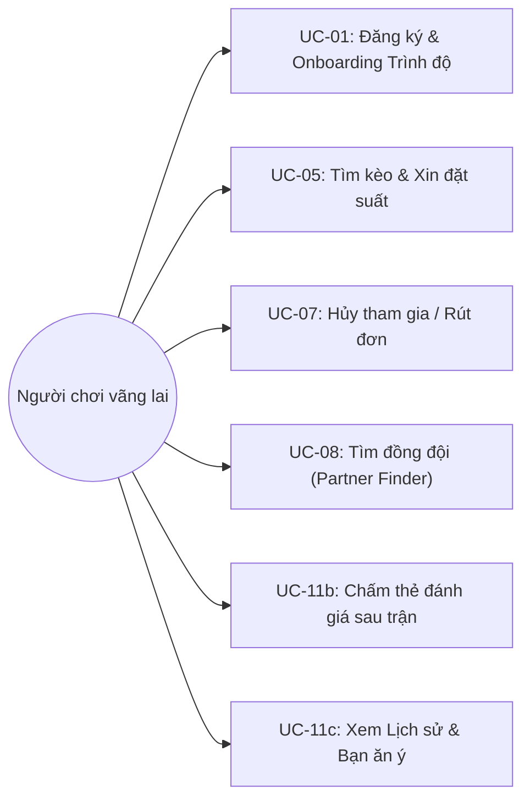
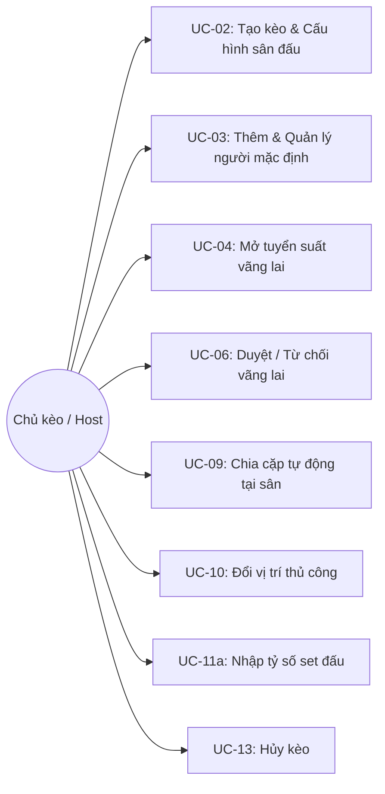
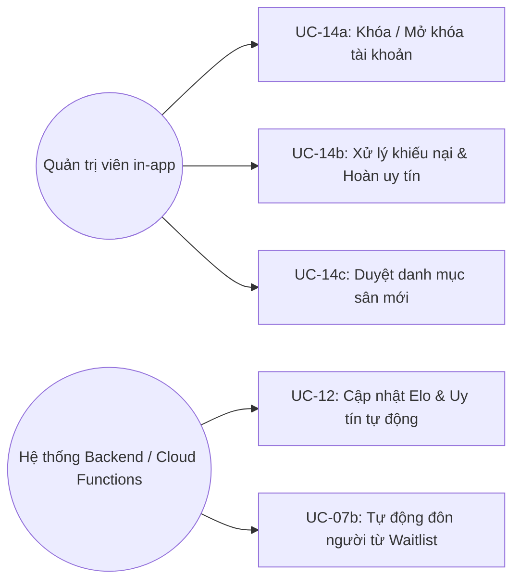

# ĐẶC TẢ CA SỬ DỤNG (USE CASE SPECIFICATION)

**Dự án:** Hệ thống ghép đội và cân bằng kèo cầu lông (Mobile App)  
**Tài liệu:** `docs/08-use-cases.md`  
**Phiên bản:** 1.0  
**Tác giả:** Đào Duy Nhật (TV1 - PM, BA, Backend & Thuật toán)  
**Tài liệu liên quan:** `docs/07-srs.md`, `docs/06-rating-scale.md`  

---

## 1. SƠ ĐỒ USE CASE TỔNG QUAN (USE CASE DIAGRAMS)

### 1.1 Sơ đồ Phân hệ Người chơi vãng lai (Player / Recruit)

### 1.2 Sơ đồ Phân hệ Chủ kèo / Trưởng nhóm (Host)

### 1.3 Sơ đồ Phân hệ Quản trị viên & Tác nhân Hệ thống (Admin & System)

---

## 2. ĐẶC TẢ CHI TIẾT CÁC USE CASE CỐT LÕI

---

### UC-01: ĐĂNG KÝ, ĐĂNG NHẬP & ONBOARDING KHAI BÁO TRÌNH ĐỘ
- **Mã FR liên quan:** FR-01, FR-02, FR-03, FR-04, FR-06
- **Tác nhân chính:** Người dùng mới / Người chơi (Player)
- **Mục đích:** Tạo tài khoản mới, xác thực danh tính và hoàn thành bài trắc nghiệm 10 câu để xác định Cấp độ và Điểm Elo khởi tạo.
- **Tiền điều kiện:** Người dùng đã cài đặt ứng dụng trên thiết bị di động Android hoặc iOS và có kết nối mạng Internet.
- **Luồng sự kiện chính (Basic Flow):**
  1. Người dùng mở ứng dụng, chọn "Đăng nhập bằng Google" hoặc "Đăng ký với Email".
  2. Firebase Authentication xác thực thành công danh tính người dùng.
  3. Hệ thống kiểm tra: Người dùng chưa có dữ liệu hồ sơ $\to$ chuyển hướng tới màn hình Onboarding (Khảo sát trình độ ban đầu).
  4. Người dùng lần lượt trả lời 10 câu hỏi trắc nghiệm chuyên môn (Kinh nghiệm, Kỹ thuật phông cầu, Đập gõ, Thủ cầu, Ve trái tay, Bỏ nhỏ lưới, Di chuyển bộ pháp, Đọc trận đấu, Tần suất chơi, Thể lực).
  5. Người dùng khai báo các thông số phong cách thi đấu:
     - Giới tính (Nam / Nữ).
     - Tay thuận (Tay phải / Tay trái).
     - Vị trí sở trường (Chuyên lưới / Chuyên công sau / Linh hoạt cả hai).
     - Khu vực Quận/Huyện hoạt động tại Đà Nẵng (Hải Châu, Sơn Trà, Cẩm Lệ...).
  6. Hệ thống thực thi hàm domain `calculateInitialRatingFromAnswers()`:
     - Tính tổng điểm khảo sát ($10 - 40$ điểm).
     - Xác định Cấp độ ban đầu ($1 - 6$ theo chuẩn Đà Nẵng: Yếu, TB-, TB, TB+, Khá, Tốt / Bán chuyên).
     - Gán Điểm Elo khởi tạo tương ứng ($1100, 1275, 1425, 1575, 1725, 1900$).
     - Gán cờ `isProvisional: true` (hệ số $K = 40$) và Điểm uy tín khởi tạo `reputation: 100`.
  7. Hệ thống tạo tài khoản trong Firestore và hiển thị màn hình Trang chủ kèm Player Card của người dùng.
- **Luồng thay thế (Alternative Flows):**
  - *A1 - Người dùng đã có tài khoản:* Tại bước 3, hệ thống nhận diện hồ sơ đã hoàn tất, chuyển thẳng vào màn hình Trang chủ (Lobby).
- **Ngoại lệ (Exceptions):**
  - *E1 - Người dùng bỏ dở khảo sát:* Nếu tắt ứng dụng giữa chừng, lần đăng nhập tiếp theo ứng dụng vẫn bắt buộc quay lại hoàn thành khảo sát trước khi được xem hoặc tham gia kèo.
  - *E2 - Lỗi mạng khi ghi Firestore:* Lưu tạm câu trả lời vào local storage và tự động thử lại khi có mạng.
- **Hậu điều kiện:** Bản ghi người dùng được lưu trong `users/{uid}`, sẵn sàng tìm kèo hoặc tạo kèo.

---

### UC-02: TẠO KÈO VÀ CẤU HÌNH THÔNG SỐ SÂN ĐẤU
- **Mã FR liên quan:** FR-14, FR-12
- **Tác nhân chính:** Chủ kèo (Host)
- **Mục đích:** Host tạo một phòng kèo mới cho nhóm giao lưu, thiết lập số sân, khung giờ, địa điểm và tiêu chuẩn tuyển người.
- **Tiền điều kiện:** Host đã đăng nhập và có điểm uy tín $\ge 50$.
- **Luồng sự kiện chính (Basic Flow):**
  1. Host chọn "Tạo kèo mới" từ thanh điều hướng chính.
  2. Host nhập tiêu đề buổi đánh, chọn Ngày thi đấu và Khung giờ (ví dụ: $18:00 - 20:00$).
  3. Host chọn Sân cầu từ danh mục có sẵn tại Đà Nẵng (ví dụ: Sân Kỳ Đồng - 49 Kỳ Đồng) hoặc nhập địa chỉ mới.
  4. Host chọn Số lượng sân: **1 sân** hoặc **2 sân**.
  5. Với mỗi sân, Host cấu hình:
     - Tên định danh (Sân 1 / Sân 2).
     - Nội dung thi đấu (`men`: Đôi nam, `women`: Đôi nữ, `mixed`: Đôi nam nữ).
     - Dải trình độ chấp nhận (ví dụ: Cấp 2 [TB-] đến Cấp 4 [TB+]).
  6. Host nhập chi phí ước tính mỗi người (VNĐ) và Số tài khoản/Ngân hàng để app tự tạo mã VietQR.
  7. Host bấm "Tạo phòng kèo". Hệ thống lưu dữ liệu vào Firestore collection `sessions` và tạo các sub-collection `courts`.
  8. Hệ thống chuyển hướng Host vào màn hình Chi tiết phòng kèo.
- **Luồng thay thế (Alternative Flows):**
  - *A1 - Host tạo 2 sân khác thể thức:* Sân 1 chọn Đôi nam nữ, Sân 2 chọn Đôi nam. Hệ thống quản lý độc lập điều kiện tuyển cho từng sân.
- **Ngoại lệ (Exceptions):**
  - *E1 - Giờ kết thúc sớm hơn giờ bắt đầu:* Hệ thống báo lỗi "Khung giờ thi đấu không hợp lệ".
  - *E2 - Điểm uy tín Host $< 50$:* Hệ thống khóa tính năng tạo kèo, hiển thị thông báo liên hệ Admin giải quyết.
- **Hậu điều kiện:** Buổi đánh được khởi tạo với trạng thái `open`, hiển thị trên danh sách sảnh chờ chung.

---

### UC-03: THÊM VÀ QUẢN LÝ NGƯỜI MẶC ĐỊNH (CORE & GHOST MEMBERS)
- **Mã FR liên quan:** FR-15
- **Tác nhân chính:** Chủ kèo (Host)
- **Mục đích:** Host đưa các thành viên cố định trong nhóm vào sân trước khi mở tuyển người lạ.
- **Tiền điều kiện:** Kèo đã được tạo, sân có số người hiện tại $< 8$.
- **Luồng sự kiện chính (Basic Flow):**
  1. Host mở tab chi tiết một Sân trong phòng kèo, chọn "Thêm người mặc định".
  2. Host chọn hình thức thêm:
     - **Thành viên có app:** Tìm theo Nickname hoặc Số điện thoại $\to$ chọn người dùng $\to$ hệ thống tự điền Cấp độ, Elo, Giới tính thật.
     - **Thành viên chưa có app (Ghost):** Host nhập Tên/Biệt danh, chọn Giới tính, chọn Cấp độ ước lượng (1 đến 6) và Lối chơi (Lưới/Công/Linh hoạt).
  3. Host bấm xác nhận thêm vào sân.
  4. Hệ thống kiểm tra: Tổng số người trong sân vẫn $\le 8$ và giới tính phù hợp với thể thức sân.
  5. Hệ thống ghi người chơi vào danh sách `roster` của sân với vai trò `role: "core"`, trạng thái `confirmed`.
- **Luồng thay thế (Alternative Flows):**
  - *A1 - Ghép cặp khóa ngay khi thêm:* Host tick chọn "Bắt cặp cố định với người này", hệ thống tạo cặp khóa `isLocked: true`.
- **Ngoại lệ (Exceptions):**
  - *E1 - Sân đã đủ 8 người:* Nút thêm người mặc định bị vô hiệu hóa; hệ thống báo "Sân đã đạt sức chứa tối đa 8 người".
  - *E2 - Sai giới tính theo thể thức sân:* Hệ thống báo lỗi (ví dụ: Không thể thêm bạn Nữ vào sân Đôi nam).
- **Hậu điều kiện:** Danh sách người mặc định tăng lên; số suất tuyển tự động tính toán lại.

---

### UC-04: MỞ TUYỂN SUẤT VÃNG LAI VÀ ĐẶT ĐIỀU KIỆN
- **Mã FR liên quan:** FR-16
- **Tác nhân chính:** Chủ kèo (Host) / Hệ thống tự động
- **Mục đích:** Tự động xác định số suất vãng lai được phép tuyển cho sân theo công thức nghiệp vụ chuẩn.
- **Tiền điều kiện:** Sân đã có danh sách người mặc định ($Core \ge 1$).
- **Luồng sự kiện chính (Basic Flow):**
  1. Sau khi Host hoàn thành thêm người mặc định, hệ thống gọi hàm domain `computeSlots(coreCount)`.
  2. Hệ thống áp dụng công thức:  
     $$\text{TotalSlots} = \min(4, 8 - Core)$$  
     $$\text{RemainingSlots} = \text{TotalSlots} - \text{ConfirmedRecruits}$$
  3. Nếu $\text{RemainingSlots} > 0$: Hệ thống tự động kích hoạt trạng thái mở tuyển vãng lai cho sân, hiển thị rõ số suất còn trống trên sảnh chờ.
  4. Nếu $Core = 8$: Hệ thống đặt $\text{TotalSlots} = 0$, hiển thị nhãn "Kèo nội bộ (Đủ người)".
- **Hậu điều kiện:** Thông tin số suất tuyển hiển thị công khai trên danh sách tìm kiếm cho toàn bộ người chơi xem.

---

### UC-05: TÌM KIẾM KÈO VÀ GỬI YÊU CẦU ĐẶT SUẤT
- **Mã FR liên quan:** FR-17, FR-18
- **Tác nhân chính:** Người chơi vãng lai (Recruit)
- **Mục đích:** Người chơi tìm sân phù hợp với lịch trình, dải trình độ của mình và gửi yêu cầu xin vào đánh.
- **Tiền điều kiện:** Người chơi đã hoàn thành Onboarding, điểm uy tín $\ge 50$.
- **Luồng sự kiện chính (Basic Flow):**
  1. Người chơi mở tab "Tìm kèo", áp dụng các bộ lọc: Quận/Huyện, Thể thức (Đôi nam/nữ/nam nữ), Khung giờ, Cấp độ phù hợp.
  2. Danh sách các phòng kèo phù hợp hiển thị kèm số suất trống và địa chỉ sân.
  3. Người chơi bấm vào xem chi tiết phòng kèo: xem danh sách người đã có mặt trong sân, Cấp độ trung bình, thông tin Host.
  4. Người chơi bấm nút "Xin tham gia Sân 1".
  5. Hệ thống kiểm tra điều kiện nghiệp vụ:
     - Giới tính có khớp thể thức sân không? (Hợp lệ).
     - Người chơi đã tham gia sân khác trong cùng khung giờ chưa? (Chưa).
     - Điểm uy tín $\ge 50$? (Hợp lệ).
     - Trình độ có nằm trong dải sân yêu cầu không? (Nếu lệch, hiển thị pop-up cảnh báo nhưng vẫn cho nộp).
  6. Hệ thống thực hiện Firestore Transaction: tạo bản ghi yêu cầu tham gia với trạng thái `status: "requested"` (hoặc `waitlist` nếu sân đã hết suất chính thức).
  7. Hệ thống gửi thông báo đẩy (Push Notification) đến máy của Host: "Có người chơi [Tên] xin tham gia Sân 1".
- **Luồng thay thế (Alternative Flows):**
  - *A1 - Sân đã hết suất trống:* Hệ thống thông báo "Sân đã đủ suất chính thức. Bạn có muốn đăng ký vào Hàng đợi dự bị (Waitlist) không?". Nếu người chơi đồng ý $\to$ tạo bản ghi trạng thái `waitlist`.
- **Ngoại lệ (Exceptions):**
  - *E1 - Giới tính không hợp lệ:* Báo lỗi "Sân này dành riêng cho Đôi nữ. Bạn không thể đăng ký."
  - *E2 - Điểm uy tín $< 50$:* Báo lỗi "Tài khoản có điểm uy tín quá thấp (< 50) do tiền sử bùng kèo, tạm thời bị hạn chế đặt suất."
- **Hậu điều kiện:** Đơn xin tham gia ở trạng thái chờ Host duyệt.

---

### UC-06: DUYỆT HOẶC TỪ CHỐI YÊU CẦU THAM GIA
- **Mã FR liên quan:** FR-19
- **Tác nhân chính:** Chủ kèo (Host)
- **Mục đích:** Host xem xét hồ sơ người xin vào và quyết định nhận hoặc từ chối để bảo đảm chất lượng trận đấu.
- **Tiền điều kiện:** Sân có ít nhất một yêu cầu ở trạng thái `requested`.
- **Luồng sự kiện chính (Basic Flow):**
  1. Host mở phòng kèo, thấy thông báo huy hiệu số đơn chờ duyệt.
  2. Host mở danh sách chờ duyệt: xem Player Card của ứng viên (Cấp độ, Điểm Elo, Tay thuận, Lối chơi công/thủ, Điểm uy tín, Tỷ lệ thắng).
  3. Host bấm nút "Duyệt" (Accept).
  4. Hệ thống chạy Firestore Transaction kiểm tra: Số suất trống của sân vẫn còn $\ge 1$.
  5. Chuyển trạng thái người chơi thành `confirmed`, thêm vào `roster` của sân.
  6. Số suất tuyển còn lại giảm đi 1 ($\text{RemainingSlots} - 1$).
  7. Gửi thông báo đẩy đến người chơi: "Host đã duyệt bạn vào Sân 1!".
- **Luồng thay thế (Alternative Flows):**
  - *A1 - Host bấm "Từ chối" (Reject):* Host chọn lý do nhanh (Lệch trình độ / Đủ người quen) $\to$ hệ thống chuyển trạng thái `rejected` $\to$ gửi thông báo lịch sự cho người chơi.
- **Ngoại lệ (Exceptions):**
  - *E1 - Suất trống vừa bị người khác chiếm (Trùng lặp thao tác):* Transaction phát hiện hết suất $\to$ hệ thống hỏi Host có muốn đưa người này vào hàng đợi dự bị không.
- **Hậu điều kiện:** Người chơi chính thức có tên trong danh sách thi đấu của sân.

---

### UC-07: HỦY THAM GIA VÀ TỰ ĐỘNG ĐÔN NGƯỜI TỪ WAITLIST
- **Mã FR liên quan:** FR-20, FR-21
- **Tác nhân chính:** Người chơi vãng lai / Hệ thống tự động
- **Mục đích:** Người chơi rút lui khi có việc bận; hệ thống tự động xử lý phạt điểm uy tín và đôn người dự bị lên thay thế ngay lập tức.
- **Tiền điều kiện:** Người chơi đang ở trạng thái `confirmed` hoặc `waitlist` trong một buổi đánh chưa diễn ra.
- **Luồng sự kiện chính (Basic Flow):**
  1. Người chơi mở chi tiết kèo, chọn "Hủy tham gia".
  2. Hệ thống kiểm tra thời gian hiện tại so với giờ bắt đầu trận đấu:
     - Nếu $\Delta t \ge 2\text{ giờ}$: Hiển thị pop-up: "Hủy trước 2 tiếng sẽ bị trừ 5 điểm uy tín. Bạn có chắc chắn muốn hủy?".
     - Nếu $\Delta t < 2\text{ giờ}$: Hiển thị pop-up cảnh báo màu đỏ: "Hủy sát giờ (< 2 tiếng) sẽ bị trừ 20 điểm uy tín. Bạn có chắc chắn muốn hủy?".
  3. Người chơi bấm xác nhận hủy.
  4. Hệ thống thực hiện:
     - Trừ điểm uy tín tương ứng của người chơi và ghi lý do vào lịch sử.
     - Chuyển trạng thái người chơi thành `cancelled`.
     - Giải phóng 1 suất trống trong sân.
  5. **Cơ chế đôn người tự động từ Waitlist:**
     - Hệ thống quét sub-collection `requests` tìm người có `status: "waitlist"` có thời gian nộp sớm nhất (`orderBy: createdAt ASC`) và đáp ứng đúng giới tính của sân.
     - Chuyển trạng thái người này thành `confirmed`, thêm vào `roster`.
     - Gửi thông báo đẩy khẩn cấp: "Tin vui! Bạn đã được đôn từ dự bị lên suất chính thức của Sân 1!".
     - Gửi thông báo cho Host: "[Tên người hủy] vừa hủy, hệ thống đã tự động đôn [Tên người mới] từ danh sách dự bị vào sân."
- **Luồng thay thế (Alternative Flows):**
  - *A1 - Danh sách Waitlist trống:* Suất trống được mở lại công khai trên sảnh chờ cho bất kỳ ai đăng ký mới.
- **Hậu điều kiện:** Sân duy trì đủ quân số; điểm uy tín của người hủy được cập nhật chính xác.

---

### UC-08: TÌM ĐỒNG ĐỘI ĂN Ý (PARTNER FINDER)
- **Mã FR liên quan:** FR-07, FR-26
- **Tác nhân chính:** Người chơi (Player)
- **Mục đích:** Tìm kiếm các tay vợt tự do có trình độ tương đương và lối chơi bù trừ để rủ nhau lập cặp đi đánh giải hoặc đánh giao lưu.
- **Tiền điều kiện:** Người chơi đã hoàn thành Onboarding hồ sơ.
- **Luồng sự kiện chính (Basic Flow):**
  1. Người chơi chọn tab "Tìm đồng đội" (Partner Finder).
  2. Người chơi chọn tiêu chí tìm kiếm: Khu vực Quận/Huyện, Nội dung mong muốn, Giới tính bạn đánh.
  3. Hệ thống chạy thuật toán chấm Điểm tương thích ghép đôi:
     - Lọc các tay vợt có độ lệch Elo: $|\text{Elo}_A - \text{Elo}_B| \le 150$ điểm.
     - Tính điểm tương thích: Cộng $+40$ nếu Lưới + Công; $+25$ nếu 1 Tay Phải + 1 Tay Trái; $+20$ nếu Linh hoạt; Trừ $-30$ nếu trùng vị trí chuyên.
  4. Hiển thị danh sách gợi ý sắp xếp theo % độ tương thích từ cao xuống thấp (ví dụ: 95% Ăn ý).
  5. Người chơi bấm xem chi tiết Player Card của ứng viên, thấy các huy hiệu đánh giá và tỷ lệ thắng.
  6. Người chơi bấm "Rủ đánh chung" $\to$ hệ thống gửi thông báo mời kết nối.
- **Hậu điều kiện:** Kết nối giữa hai người chơi được thiết lập.

---

### UC-09: CHIA CẶP TỰ ĐỘNG TẠI SÂN (SESSION BALANCING ENGINE)
- **Mã FR liên quan:** FR-08, FR-09, FR-10, FR-32, FR-33
- **Tác nhân chính:** Chủ kèo (Host)
- **Mục đích:** Bấm chia cặp nhanh cho 4–8 người chơi tại sân để tạo ra các set đấu cân bằng trình độ nhất trong vòng chưa đầy 1 giây.
- **Tiền điều kiện:** Buổi đánh đang diễn ra; sân có từ 4 đến 8 người chơi đã xác nhận có mặt tại sân.
- **Luồng sự kiện chính (Basic Flow):**
  1. Tại sân đấu, Host mở màn hình "Bàn điều khiển sân" (Court Balancing Board).
  2. Host tích chọn các thành viên thực tế đang có mặt trên sân (từ 4 đến 8 người).
  3. (Tùy chọn) Host tick chọn biểu tượng ổ khóa cho 1 cặp đấu nếu họ muốn cố định đánh chung (`isLocked: true`).
  4. Host bấm nút lớn "CHIA CẶP TỰ ĐỘNG" (thao tác 1 chạm).
  5. Thuật toán `SessionBalancingEngine` chạy cục bộ trên máy:
     - Giữ nguyên cặp khóa.
     - Tạo tổ hợp các cặp khả dĩ thỏa mãn giới tính theo thể thức sân.
     - Tính toán hiệu số chênh lệch Elo: $\Delta = |(R_1 + R_2) - (R_3 + R_4)| \to \min$.
     - Xử lý ca lẻ 5 hoặc 7 người: Chọn người có số set nghỉ ít nhất để thi đấu, chọn 1 hoặc 3 người ra nghỉ xoay vòng.
  6. Trong vòng $< 0.5$ giây, màn hình hiển thị trực quan Sơ đồ sân đấu:
     - Đội Xanh (Cặp 1) vs Đội Đỏ (Cặp 2) kèm Cấp độ và tổng điểm Elo của mỗi bên.
     - Danh sách các thành viên nghỉ xoay vòng set này.
- **Ngoại lệ (Exceptions):**
  - *E1 - Thiết bị mất mạng (Offline):* Thuật toán vẫn thực thi $100\%$ bình thường trên local cache, không có độ trễ.
  - *E2 - Sân có ít hơn 4 người:* Nút chia cặp bị vô hiệu hóa, hiển thị thông báo "Cần tối thiểu 4 người để bắt đầu chia cặp đánh đôi".
- **Hậu điều kiện:** Trận đấu mới được tạo với trạng thái `in_progress`, hiển thị trên bảng sơ đồ sân.

---

### UC-10: ĐIỀU CHỈNH HOÁN ĐỔI VỊ TRÍ THỦ CÔNG (MANUAL SWAP)
- **Mã FR liên quan:** FR-11
- **Tác nhân chính:** Chủ kèo (Host)
- **Mục đích:** Host linh hoạt can thiệp đổi người giữa các cặp hoặc đổi người đang đánh với người đang nghỉ theo nguyện vọng thực tế.
- **Tiền điều kiện:** Sơ đồ sân vừa được chia cặp hoặc đang hiển thị một set đấu.
- **Luồng sự kiện chính (Basic Flow):**
  1. Host bấm vào thẻ của Người chơi A trên sơ đồ sân.
  2. Host bấm tiếp vào thẻ của Người chơi B (ở đội đối diện hoặc trong danh sách nghỉ).
  3. Hệ thống kiểm tra: Nếu Người chơi A hoặc B thuộc cặp khóa (`isLocked`), hiển thị hộp thoại: "Thao tác này sẽ mở khóa cặp cố định. Bạn có muốn tiếp tục?". Host chọn "Đồng ý".
  4. Hệ thống thực hiện đổi vị trí giữa A và B trên giao diện.
  5. Hệ thống tức thời tính toán lại tổng Elo của 2 đội và hiển thị độ chênh lệch mới kèm nhãn chỉ báo (Xanh: Cực cân bằng; Vàng: Tương đối; Đỏ: Chênh lệch lớn).
- **Hậu điều kiện:** Sơ đồ trận đấu cập nhật vị trí mới theo ý muốn của Host.

---

### UC-11: NHẬP TỶ SỐ SET ĐẤU VÀ CHẤM THẺ ĐÁNH GIÁ (SCORE & REVIEW)
- **Mã FR liên quan:** FR-22, FR-23, FR-34
- **Tác nhân chính:** Chủ kèo (Host) / Người chơi trong sân
- **Mục đích:** Ghi nhận kết quả trận đấu và gửi đánh giá nhanh các bạn chơi trong vòng 5 giây.
- **Tiền điều kiện:** Trận đấu đang ở trạng thái `in_progress`.
- **Luồng sự kiện chính (Basic Flow):**
  1. Sau khi set đấu kết thúc, Host bấm "Kết thúc set & Nhập điểm".
  2. Host nhập tỷ số hai đội (ví dụ: Đội 1: 21, Đội 2: 19) bằng nút bấm nhanh $+1 / -1$ hoặc bàn phím số.
  3. Host bấm "Lưu kết quả".
  4. Màn hình tự động bật lên pop-up "Đánh giá nhanh bạn chơi (5 giây)":
     - Hiển thị danh sách 3 người chơi còn lại trong trận.
     - Với mỗi người, có 3 nút icon 1 chạm: 🟢 Đúng trình, 🔵 Đánh hay, ⭐ Thái độ tốt.
     - Người dùng bấm chọn nhanh (hoặc bấm "Bỏ qua").
  5. Dữ liệu tỷ số và thẻ đánh giá được lưu cục bộ và đẩy vào hàng đợi `sync_queue`.
  6. Hệ thống chuyển sang set đấu tiếp theo, tự động xoay người nghỉ vào sân.
- **Hậu điều kiện:** Kết quả set đấu được ghi nhận, kích hoạt quy trình tính Elo sau khi kết thúc toàn bộ buổi đánh.

---

### UC-12: CẬP NHẬT BIẾN ĐỘNG ELO VÀ UY TÍN TỰ ĐỘNG
- **Mã FR liên quan:** FR-05, FR-24, FR-27
- **Tác nhân chính:** Hệ thống Backend / Cloud Functions
- **Mục đích:** Tính toán chính xác số điểm Elo tăng/giảm của từng người sau trận và cập nhật điểm uy tín.
- **Tiền điều kiện:** Host bấm "Kết thúc buổi đánh" (End Session) và thiết bị có kết nối Internet.
- **Luồng sự kiện chính (Basic Flow):**
  1. Trigger hàm tính toán (hoặc Cloud Function `onSessionCompleted`):
     - Lấy danh sách toàn bộ các set đấu hợp lệ trong buổi.
     - Lọc bỏ các thành viên "ghost" (không tính Elo).
  2. Với từng trận đấu:
     - Tính Elo trung bình của Đội thắng ($R_W$) và Đội thua ($R_L$).
     - Tính xác suất kỳ vọng thắng: $E_W = \frac{1}{1 + 10^{(R_L - R_W)/400}}$.
     - Xác định hệ số $K$ của từng người: $K = 40$ nếu `isProvisional == true` (dưới 5 trận); $K = 24$ nếu tài khoản chính thức.
     - Tính biến động điểm: $\Delta R = K \times (1 - E_W)$ cho người thắng; $\Delta R = K \times (0 - E_L)$ cho người thua.
     - Cập nhật điểm Elo mới vào hồ sơ người dùng trong Firestore (đảm bảo sàn 800, trần 2200).
  3. Cập nhật số trận đã đấu: $\text{matchesPlayed} + 1$. Nếu đạt mốc 5 trận $\to$ tự động chuyển `isProvisional = false`.
  4. Cập nhật Điểm uy tín: Người chơi hoàn thành trọn vẹn buổi đánh được cộng $+1$ điểm uy tín (tối đa 100).
  5. Cập nhật dữ liệu "Đồng đội ăn ý": Tăng số trận đánh chung và số trận thắng chung của từng cặp đôi.
- **Hậu điều kiện:** Điểm số và lịch sử của tất cả người chơi được đồng bộ nhất quán trên Cloud.

---

### UC-13: HỦY KÈO (CANCEL SESSION)
- **Mã FR liên quan:** FR-14, FR-21
- **Tác nhân chính:** Chủ kèo (Host)
- **Mục đích:** Host hủy toàn bộ buổi đánh khi có sự cố bất khả kháng (sân mưa dột, sự cố lịch đột xuất).
- **Tiền điều kiện:** Kèo chưa bắt đầu thi đấu.
- **Luồng sự kiện chính (Basic Flow):**
  1. Host mở phòng kèo, chọn "Cài đặt kèo" $\to$ "Hủy buổi đánh".
  2. Host nhập lý do hủy bắt buộc (ví dụ: Sân bị cúp điện đột xuất).
  3. Hệ thống hiển thị cảnh báo: Toàn bộ thành viên đã đăng ký sẽ nhận được thông báo hủy.
  4. Host bấm xác nhận.
  5. Hệ thống chuyển trạng thái kèo sang `cancelled`.
  6. Hệ thống gửi thông báo đẩy khẩn cấp đến toàn bộ người chơi mặc định và vãng lai đã đăng ký.
  7. Không ai bị trừ điểm uy tín trong trường hợp Host hủy vì lý do khách quan.
- **Hậu điều kiện:** Phòng kèo đóng lại, không còn xuất hiện trên danh sách tìm kiếm công khai.

---

### UC-14: QUẢN TRỊ IN-APP & XỬ LÝ VI PHẠM (ADMIN ACTIONS)
- **Mã FR liên quan:** FR-28, FR-29, FR-30, FR-31
- **Tác nhân chính:** Quản trị viên (Admin)
- **Mục đích:** Kiểm soát trật tự cộng đồng, xử lý bùng kèo, hoàn uy tín và duyệt danh mục sân mới trực tiếp trên điện thoại.
- **Tiền điều kiện:** Tài khoản đăng nhập có `role == "admin"`.
- **Luồng sự kiện chính (Basic Flow):**
  1. Admin mở app, truy cập tab "Bảng Quản trị" (Admin Dashboard).
  2. **Tác vụ 1 - Khóa tài khoản:** Admin xem danh sách người dùng bị báo cáo bùng kèo $\ge 3$ lần $\to$ bấm "Khóa tài khoản 30 ngày" hoặc "Khóa vĩnh viễn" $\to$ trạng thái user chuyển thành `banned`.
  3. **Tác vụ 2 - Hoàn trả uy tín:** Admin mở danh sách đơn khiếu nại của người chơi (kèm lý do và ảnh minh chứng) $\to$ bấm "Chấp thuận" $\to$ hệ thống hoàn lại $+5$ hoặc $+20$ điểm uy tín bị trừ nhầm.
  4. **Tác vụ 3 - Duyệt sân mới:** Admin xem các địa điểm sân do người dùng đề xuất $\to$ xác minh địa chỉ, số sân $\to$ bấm "Duyệt đưa vào danh mục chung".
  5. **Tác vụ 4 - Giám sát chỉ số:** Xem dashboard tổng số người dùng active tại Đà Nẵng, số kèo đã tạo trong tuần, số trận đấu đã hoàn thành.
- **Hậu điều kiện:** Cơ sở dữ liệu và cộng đồng người chơi được duy trì trong sạch và lành mạnh.

---

## 3. BẢNG TỔNG HỢP TIÊU CHÍ HOÀN THÀNH USE CASE

| Mã UC | Tên Use Case | Tác nhân chính | Độ phức tạp | Mốc Sprint |
|---|---|---|:---:|:---:|
| **UC-01** | Đăng ký & Onboarding Trình độ | Người chơi | Trung bình | Sprint 1–2 |
| **UC-02** | Tạo kèo & Cấu hình sân đấu | Host | Trung bình | Sprint 3 |
| **UC-03** | Thêm & Quản lý người mặc định | Host | Thấp | Sprint 3 |
| **UC-04** | Mở tuyển suất vãng lai tự động | Hệ thống / Host | Thấp | Sprint 3 |
| **UC-05** | Tìm kèo & Xin đặt suất | Người chơi | Trung bình | Sprint 3 |
| **UC-06** | Duyệt / Từ chối vãng lai | Host | Trung bình | Sprint 3 |
| **UC-07** | Hủy tham gia & Đôn người từ Waitlist | Người chơi / Hệ thống | Cao | Sprint 3 |
| **UC-08** | Tìm kiếm đồng đội (Partner Finder) | Người chơi | Cao | Sprint 2 |
| **UC-09** | Chia cặp tự động cân bằng (Balancing) | Host | Rất cao | Sprint 4 |
| **UC-10** | Điều chỉnh hoán đổi vị trí thủ công | Host | Trung bình | Sprint 4 |
| **UC-11** | Nhập tỷ số & Chấm thẻ đánh giá | Host / Người chơi | Trung bình | Sprint 4 |
| **UC-12** | Cập nhật Elo & Uy tín tự động | Hệ thống Cloud | Cao | Sprint 4 |
| **UC-13** | Hủy kèo buổi đánh | Host | Thấp | Sprint 3 |
| **UC-14** | Quản trị in-app & Xử lý khiếu nại | Admin | Trung bình | Sprint 5 |
