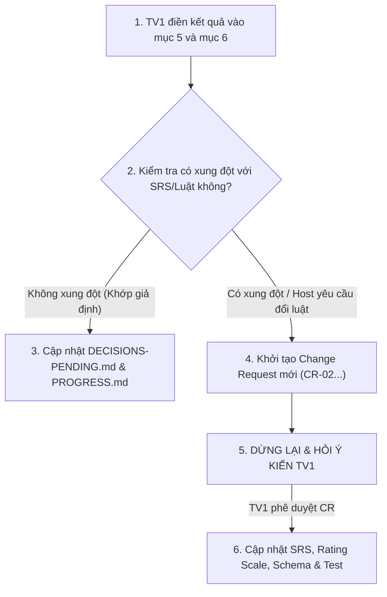

# KẾ HOẠCH & BIÊN BẢN PHỎNG VẤN CHỦ KÈO THỰC TẾ TẠI ĐÀ NẴNG (HOST VALIDATION)

**Dự án:** Hệ thống ghép đội và cân bằng kèo cầu lông (Mobile App)  
**Tài liệu:** `docs/10-host-interview.md`  
**Phiên bản:** 1.0 (Phục vụ kiểm chứng thực địa Sprint 1 - Mốc M2)  
**Người thực hiện:** Đào Duy Nhật (TV1 - PM, BA) & Nguyễn Đức Đạt (TV2 - QA, UI/UX)  
**Địa bàn khảo sát:** Các cụm sân cầu lông tại Đà Nẵng (Kỳ Đồng, Tuyên Sơn, Quân Khu 5, Trương Vĩnh Ký, Bưu Điện...)  
**Tài liệu liên quan:** `docs/PROJECT_CONTEXT.md`, `docs/DECISIONS-PENDING.md`, `docs/07-srs.md`, `docs/06-rating-scale.md`  

---

> [!IMPORTANT]
> **NGUYÊN TẮC TUÂN THỦ DỮ LIỆU THỰC TẾ:**  
> Trợ lý AI tuyệt đối **KHÔNG ĐƯỢC TỰ BỊA** bất kỳ thông tin, câu trả lời, tên tuổi hay ý kiến của người thật. Toàn bộ các mục ghi nhận ý kiến khảo sát được định dạng `[TV1 điền]` để TV1 trực tiếp phỏng vấn và nhập liệu thực tế.

---

## 1. MỤC TIÊU PHỎNG VẤN (INTERVIEW OBJECTIVES)

1. **Kiểm chứng tính đúng đắn của 8 giả định nghiệp vụ cốt lõi (A1 – A8)** đã được đề xuất trong `DECISIONS-PENDING.md`.
2. **Khảo sát thói quen vận hành thực tế tại các cụm sân Đà Nẵng:**
   - Sức chứa tối đa của một sân (Có đúng là 6–8 người không? Khi nào bị quá tải?).
   - Quy mô kèo (Host thường bao mấy sân? 1 sân hay 2 sân?).
   - Cách host xử lý ca lẻ người (5 người hoặc 7 người/sân) và cách xoay vòng người nghỉ.
   - Cách host đang chia cặp hiện tại (Nhìn mặt đoán trình, bốc thăm ngẫu nhiên, hay để người chơi tự bắt cặp?).
3. **Đánh giá mức độ nhức nhối của các vấn đề:** Bùng kèo sát giờ, khai khống trình độ, người lạ vào làm hỏng nhịp đánh của nhóm cố định.
4. **Thăm dò phản ứng của Host đối với Thang 6 cấp phong trào (Yếu $\to$ Bán chuyên) và Cơ chế chấm điểm Elo.**
5. **Thu thập dữ liệu thực tế về giá thuê sân, tiền cầu và phương thức thanh toán** tại Đà Nẵng để hoàn thiện tính năng VietQR và chia tiền.

---

## 2. PHIẾU ĐỒNG Ý THAM GIA KHẢO SÁT & CAM KẾT ẨN DANH (CONSENT FORM)

```markdown
CỘNG HÒA XÃ HỘI CHỦ NGHĨA VIỆT NAM
Độc lập - Tự do - Hạnh phúc
-----------------------------------
PHIẾU ĐỒNG Ý THAM GIA KHẢO SÁT NGHIÊN CỨU NGHIỆP VỤ
(Dự án Đồ án Tốt nghiệp: Ứng dụng Di động Ghép đội & Cân bằng Kèo Cầu lông tại Đà Nẵng)

Kính gửi Quý Chủ sân / Chủ kèo / Trưởng nhóm cầu lông,

Chúng tôi là nhóm sinh viên thực hiện đồ án tốt nghiệp phát triển ứng dụng di động hỗ trợ kết nối và vận hành sân cầu lông phong trào tại Đà Nẵng. Cuộc phỏng vấn này nhằm mục đích lắng nghe kinh nghiệm thực tế của Quý vị để xây dựng phần mềm phục vụ cộng đồng tốt nhất.

CAM KẾT CỦA NHÓM NGHIÊN CỨU:
1. Mọi thông tin cá nhân (Họ tên thật, Số điện thoại cá nhân) sẽ được ẨN DANH HOÀN TOÀN trong hồ sơ đồ án (được mã hóa thành Host A, Host B, Host C).
2. Dữ liệu thu thập chỉ sử dụng duy nhất cho mục đích nghiên cứu học thuật và thiết kế tính năng phần mềm.
3. Quý vị có quyền từ chối trả lời bất kỳ câu hỏi nào hoặc dừng cuộc phỏng vấn bất cứ lúc nào.

Người tham gia ký tên / Xác nhận đồng ý: [TV1 điền: Đã xác nhận miệng / Ký tên]
Ngày thực hiện: ..../..../2026
```

---

## 3. MẪU FORM KHẢO SÁT NHANH (BẢN VĂN BẢN DÀNH CHO GOOGLE FORMS)

*Dùng để gửi online qua Zalo/Facebook nếu Host không có nhiều thời gian ngồi phỏng vấn sâu.*

### PHẦN A: THÔNG TIN CHUNG
- **Câu 1:** Nhóm của anh/chị thường sinh hoạt tại cụm sân nào ở Đà Nẵng?  
  *(Trắc nghiệm: Sân Kỳ Đồng / Sân Tuyên Sơn / Sân Quân Khu 5 / Sân Trương Vĩnh Ký / Sân khác: [TV1 điền])*
- **Câu 2:** Nhóm thường cố định bao nhiêu sân và trong khung giờ nào?  
  *(Lựa chọn: 1 sân / 2 sân / Trên 2 sân | Khung giờ: ....................)*
- **Câu 3:** Số lượng người chơi lý tưởng trên 1 sân của nhóm thường là bao nhiêu người?  
  *(Lựa chọn: 4–6 người / 6–8 người / Trên 8 người)*

### PHẦN B: QUẢN LÝ TUYỂN NGƯỜI & BÙNG KÈO
- **Câu 4:** Khi nhóm thiếu người, anh/chị thường tuyển người chơi vãng lai qua kênh nào?  
  *(Lựa chọn: Đăng bài nhóm Facebook Cầu Lông Đà Nẵng / Nhắn nhóm Zalo / Nhờ người quen dắt bạn / Không tuyển người lạ)*
- **Câu 5:** Tần suất gặp người chơi vãng lai nhận lời nhưng bùng kèo hoặc hủy sát giờ:  
  *(Lựa chọn: Rất hiếm khi / Thỉnh thoảng (1–2 lần/tháng) / Thường xuyên (tuần nào cũng bị))*
- **Câu 6:** Khi bị bùng kèo, anh/chị xử lý tiền sân thế nào?  
  *(Lựa chọn: Nhóm mặc định tự chia nhau gánh bù / Bắt người bùng chuyển khoản bù / Chấp nhận chịu lỗ)*

### PHẦN C: CHIA CẶP & TRÌNH ĐỘ
- **Câu 7:** Hiện tại anh/chị đang chia cặp tại sân bằng cách nào?  
  *(Lựa chọn: Tự nhìn mặt xếp theo kinh nghiệm / Để mọi người tự bắt cặp / Bốc thăm bài/số ngẫu nhiên)*
- **Câu 8:** Nếu có ứng dụng di động tự động chia cặp cân bằng trình độ trong 1 giây, anh/chị có sẵn sàng dùng thử không?  
  *(Lựa chọn: Rất sẵn sàng / Sẵn sàng nếu dễ dùng bằng 1 tay / Không cần thiết)*

---

## 4. KỊCH BẢN PHỎNG VẤN SÂU CHI TIẾT (IN-DEPTH INTERVIEW GUIDE)

---

### PHẦN 1: THÔNG TIN CHUNG & QUY MÔ SÂN
- **Q1.1:** *Chào anh/chị, nhóm mình sinh hoạt vào những ngày nào trong tuần, cố định mấy sân và chi phí thuê sân hiện tại ở Đà Nẵng là bao nhiêu?*  
  - Ghi nhận: `[TV1 điền]`
- **Q1.2:** *Thông thường trên 1 sân đánh đôi, nhóm anh/chị duy trì bao nhiêu người là đánh vừa sức, không bị ngồi chờ quá lâu?*  
  - Ghi nhận: `[TV1 điền]`

---

### PHẦN 2: KIỂM CHỨNG CÁC GIẢ ĐỊNH A1 – A8

#### Giả định A1: Điều kiện mở tuyển vãng lai
- **Q-A1:** *Có bao giờ nhóm mình chỉ có 1–2 hoặc 3 người bạn thân ra sân, rồi muốn mở tuyển thêm 2–3 bạn vãng lai cho đủ 1 sân đánh đôi không? Hay bắt buộc nhóm phải có sẵn ít nhất 4 người cố định thì mới dám mở tuyển người ngoài?*  
  - Phản hồi thực tế: `[TV1 điền]`
  - Đánh giá phù hợp với: *[Lựa chọn A: Cần $\ge 4$ người]* hay *[Lựa chọn B: Từ 1 người trở lên là được mở tuyển]*? `[TV1 điền]`

#### Giả định A2: Thành viên mặc định chưa có tài khoản app (Thành viên "Ghost")
- **Q-A2:** *Trong nhóm cố định của anh/chị, có người lớn tuổi hoặc bạn bè ngại cài app mới không? Nếu app cho phép Host tự gõ tên (ví dụ: Anh Tuấn, Cấp 3) để đưa vào sơ đồ chia cặp thì có thuận tiện không? Sau đó nếu họ cài app thì có cần tính năng nhận lại lịch sử trận đấu không?*  
  - Phản hồi thực tế: `[TV1 điền]`

#### Giả định A3: Duyệt thủ công vs Tự động duyệt vãng lai
- **Q-A3:** *Khi có người lạ xin vào sân, anh/chị muốn tự tay xem hồ sơ (tuổi, giới tính, trình độ, độ uy tín) rồi mới bấm Duyệt, hay muốn app tự động nhận người vào nếu họ đủ tiêu chuẩn?*  
  - Phản hồi thực tế: `[TV1 điền]`

#### Giả định A4: Xử lý khi Host thêm bạn quen làm vượt số chỗ đã tuyển
- **Q-A4:** *Giả sử sân chỉ tuyển 2 vãng lai và anh/chị đã bấm duyệt đủ 2 người rồi. Đột nhiên có 1 người bạn thân trong nhóm báo đến đánh. Lúc đó anh/chị xử lý thế nào? App nên khóa nút thêm người bạn thân đó, hay cho phép anh/chị đẩy 1 bạn vãng lai xuống danh sách dự bị (kèm thông báo giải thích)?*  
  - Phản hồi thực tế: `[TV1 điền]`

#### Giả định A5: Người chơi lệch dải trình độ xin vào sân
- **Q-A5:** *Nếu anh/chị đăng tuyển người trình độ Trung bình (Cấp 3–4), nhưng có một bạn Mới chơi (Cấp 1) hoặc Bán chuyên (Cấp 6) xin vào: Anh/chị muốn hệ thống CHẶN THẲNG không cho họ nộp đơn, hay vẫn cho nộp nhưng hiện cảnh báo màu đỏ "Lệch trình độ" để anh/chị tự quyết định?*  
  - Phản hồi thực tế: `[TV1 điền]`

#### Giả định A6: Điểm Elo chung cho cả 3 nội dung đánh đôi
- **Q-A6:** *Nhóm mình có phân biệt rạch ròi trình độ đánh Đôi nam khác hoàn toàn với Đôi nam nữ không? Ở giai đoạn đầu ứng dụng, nếu dùng chung 1 chỉ số điểm trình độ (Elo) cho cả đôi nam, đôi nữ và đôi nam nữ để dễ tính toán thì có chấp nhận được không?*  
  - Phản hồi thực tế: `[TV1 điền]`

#### Giả định A7: Mức phạt uy tín khi hủy kèo / bùng kèo & Cơ chế phục hồi
- **Q-A7.1:** *Theo anh/chị, vãng lai báo hủy trước giờ đánh bao lâu thì coi là chấp nhận được để Host kịp tìm người thay thế? (Ví dụ: trước 2 tiếng hay trước 4 tiếng?)*  
  - Phản hồi thực tế: `[TV1 điền]`
- **Q-A7.2:** *Nếu hệ thống trừ điểm uy tín của họ khi hủy sát giờ, và cộng hoàn lại $+1$ điểm uy tín mỗi khi họ tham gia một buổi đánh nghiêm túc, đúng giờ thì quy tắc này đã hợp lý chưa?*  
  - Phản hồi thực tế: `[TV1 điền]`

#### Giả định A8: Thanh toán tiền sân & Mã VietQR
- **Q-A8:** *Hiện tại nhóm anh/chị thu tiền vãng lai bằng cách nào? (Tiền mặt tại sân hay chuyển khoản?). Nếu trong phòng kèo hiển thị sẵn mã QR ngân hàng (VietQR) của Host kèm số tiền đã chia đều để vãng lai quét trả tiền nhanh thì có giúp ích cho anh/chị không?*  
  - Phản hồi thực tế: `[TV1 điền]`

---

### PHẦN 3: VẬN HÀNH THỰC TẾ TẠI SÂN & THUẬT TOÁN CHIA CẶP
- **Q3.1:** *Khi sân có số người lẻ như 5 người hoặc 7 người, nhóm thường sắp xếp lượt nghỉ thế nào để công bằng? Có ai phàn nàn vì phải ngồi ngoài 2 set liên tiếp không?*  
  - Phản hồi thực tế: `[TV1 điền]`
- **Q3.2:** *Có trường hợp nào 2 người quen bắt buộc phải đánh cùng nhau suốt cả buổi không (ví dụ vợ chồng, đôi bạn tập đi đánh giải)? Host có cần tính năng "Khóa cặp cố định" khi chia đội không?*  
  - Phản hồi thực tế: `[TV1 điền]`
- **Q3.3:** *Khi đang ở trên sân, tay thường ra mồ hôi và ánh đèn nhà thi đấu rất chói. Thao tác trên điện thoại thế nào là tiện nhất cho anh/chị? (Ví dụ: nút to, bấm 1 chạm, nền tối?)*  
  - Phản hồi thực tế: `[TV1 điền]`
- **Q3.4:** *Sóng 4G/Wi-Fi tại nhà thi đấu của anh/chị có bao giờ bị mất hoặc chập chờn không? Nếu app bị mất mạng mà vẫn bấm chia cặp và ghi điểm được thì có cần thiết không?*  
  - Phản hồi thực tế: `[TV1 điền]`

---

### PHẦN 4: PHẢN ỨNG VỚI THANG TRÌNH ĐỘ 6 CẤP & ELO ĐỘI
- **Q4.1:** *Dân cầu lông phong trào Đà Nẵng thường dùng những từ ngữ nào để gọi trình độ của nhau? Tên gọi 6 cấp: `Yếu - TB- - TB - TB+ - Khá - Tốt / Bán chuyên` có đúng với ngôn ngữ ngoài sân không?*  
  - Phản hồi thực tế: `[TV1 điền]`
- **Q4.2:** *Hiện tượng "khai ảo" (tự nhận mình đánh hay nhưng vào sân đánh yếu, hoặc giấu trình để hành gà) có phổ biến không? Tính năng cho phép bạn chơi cùng sân vote thẻ "Đánh hay hơn khai báo" hoặc "Đúng trình" sau trận có giải quyết được vấn đề này không?*  
  - Phản hồi thực tế: `[TV1 điền]`

---

## 5. BIÊN BẢN GHI NHẬN KẾT QUẢ PHỎNG VẤN THỰC ĐỊA

---

### 5.1 HỒ SƠ PHỎNG VẤN HOST 1 (SÂN 1)
- **Mã định danh:** `HOST-01` (Ẩn danh)
- **Địa điểm sân sinh hoạt:** `[TV1 điền: ví dụ Sân Kỳ Đồng / Sân Tuyên Sơn]`
- **Thời gian phỏng vấn:** `[TV1 điền: Ngày .../.../2026]`
- **Hình thức phỏng vấn:** `[TV1 điền: Trực tiếp tại sân / Gọi điện]`
- **Thông tin nhóm:**
  - Quy mô: `[TV1 điền: ... sân, ... buổi/tuần]`
  - Số người/sân thường duy trì: `[TV1 điền: ... người]`
  - Chi phí thuê sân & tiền cầu: `[TV1 điền: ... VNĐ/giờ, loại cầu dùng: ...]`
- **Chi tiết câu trả lời theo từng nội dung:**
  - *Ý kiến về A1 (Mở tuyển):* `[TV1 điền]`
  - *Ý kiến về A2 (Thành viên ghost):* `[TV1 điền]`
  - *Ý kiến về A3 (Duyệt vãng lai):* `[TV1 điền]`
  - *Ý kiến về A4 (Thêm người mặc định khi đã full):* `[TV1 điền]`
  - *Ý kiến về A5 (Lệch dải trình độ):* `[TV1 điền]`
  - *Ý kiến về A6 (Một điểm Elo chung):* `[TV1 điền]`
  - *Ý kiến về A7 (Quy tắc phạt bùng & hồi uy tín):* `[TV1 điền]`
  - *Ý kiến về A8 (Thanh toán VietQR):* `[TV1 điền]`
  - *Ý kiến về chia cặp ca lẻ (5/7 người) & Cặp khóa:* `[TV1 điền]`
  - *Ý kiến về Thang 6 cấp & Khai ảo:* `[TV1 điền]`
  - *Đóng góp ý kiến thêm cho phần mềm:* `[TV1 điền]`

---

### 5.2 HỒ SƠ PHỎNG VẤN HOST 2 (SÂN 2)
- **Mã định danh:** `HOST-02` (Ẩn danh)
- **Địa điểm sân sinh hoạt:** `[TV1 điền: ví dụ Sân Quân Khu 5 / Sân Bưu Điện]`
- **Thời gian phỏng vấn:** `[TV1 điền: Ngày .../.../2026]`
- **Hình thức phỏng vấn:** `[TV1 điền: Trực tiếp tại sân / Gọi điện]`
- **Thông tin nhóm:**
  - Quy mô: `[TV1 điền: ... sân, ... buổi/tuần]`
  - Số người/sân thường duy trì: `[TV1 điền: ... người]`
  - Chi phí thuê sân & tiền cầu: `[TV1 điền: ... VNĐ/giờ, loại cầu dùng: ...]`
- **Chi tiết câu trả lời theo từng nội dung:**
  - *Ý kiến về A1 (Mở tuyển):* `[TV1 điền]`
  - *Ý kiến về A2 (Thành viên ghost):* `[TV1 điền]`
  - *Ý kiến về A3 (Duyệt vãng lai):* `[TV1 điền]`
  - *Ý kiến về A4 (Thêm người mặc định khi đã full):* `[TV1 điền]`
  - *Ý kiến về A5 (Lệch dải trình độ):* `[TV1 điền]`
  - *Ý kiến về A6 (Một điểm Elo chung):* `[TV1 điền]`
  - *Ý kiến về A7 (Quy tắc phạt bùng & hồi uy tín):* `[TV1 điền]`
  - *Ý kiến về A8 (Thanh toán VietQR):* `[TV1 điền]`
  - *Ý kiến về chia cặp ca lẻ (5/7 người) & Cặp khóa:* `[TV1 điền]`
  - *Ý kiến về Thang 6 cấp & Khai ảo:* `[TV1 điền]`
  - *Đóng góp ý kiến thêm cho phần mềm:* `[TV1 điền]`

---

### 5.3 HỒ SƠ PHỎNG VẤN HOST 3 (SÂN 3 - DỰ PHÒNG NẾU CÓ)
- **Mã định danh:** `HOST-03` (Ẩn danh)
- **Địa điểm sân sinh hoạt:** `[TV1 điền]`
- **Thời gian phỏng vấn:** `[TV1 điền]`
- **Chi tiết câu trả lời & Đóng góp ý kiến:** `[TV1 điền]`

---

## 6. BẢNG ĐỐI CHIẾU GIẢ ĐỊNH NGHIỆP VỤ (ASSUMPTION VALIDATION MATRIX)

Bảng đối chiếu tổng hợp ý kiến thực tế của các Host để đưa ra kết luận cuối cùng:

| Mã | Giả định hiện tại | Câu hỏi kiểm chứng thực địa | Kết quả ghi nhận thực tế từ các Host | Kết luận chính thức | Tác động lên SRS / Schema / Code |
|---|---|---|---|---|---|
| **A1** | Cho phép mở tuyển khi có từ 1 người mặc định trở lên ($\le 8$ người). | Có bao giờ nhóm chỉ có 1–3 người nhưng vẫn mở tuyển vãng lai không? | `[TV1 điền]` | `[TV1 điền: Giữ nguyên / Điều chỉnh]` | Giữ nguyên công thức: $Slot = \min(4, 8 - Core)$. |
| **A2** | Hỗ trợ thành viên "ghost" chưa có app, hỗ trợ liên kết lịch sử sau. | Trong nhóm có người không dùng app không? Có cần nhập tên tạm để chia cặp không? | `[TV1 điền]` | `[TV1 điền: Giữ nguyên / Điều chỉnh]` | Roster schema hỗ trợ trường `isGhost: boolean`. |
| **A3** | 100% duyệt thủ công bởi Host, không tự động duyệt. | Host muốn tự tay bấm duyệt hay để app tự động duyệt người đủ chuẩn? | `[TV1 điền]` | `[TV1 điền: Giữ nguyên / Điều chỉnh]` | FR-19 chỉ xây dựng luồng duyệt thủ công trong MVP. |
| **A4** | Khóa nút thêm Core khi vãng lai full; giảm suất tuyển khi thêm Core. | Host xử lý thế nào khi bạn quen đột xuất đến mà vãng lai đã đủ suất? | `[TV1 điền]` | `[TV1 điền: Giữ nguyên / Điều chỉnh]` | UI khóa nút "Thêm Core" khi $RemainingSlots == 0$. |
| **A5** | Cho phép người chơi lệch trình độ nộp đơn kèm cờ cảnh báo cho Host. | Chặn thẳng người lệch trình độ hay cho nộp kèm cảnh báo cho Host? | `[TV1 điền]` | `[TV1 điền: Giữ nguyên / Điều chỉnh]` | Form xin tham gia bật popup cảnh báo lệch trình độ. |
| **A6** | Dùng 1 điểm Elo chung cho cả 3 thể thức đánh đôi giai đoạn MVP. | Gộp chung Elo cho đôi nam, đôi nữ, đôi nam nữ có chấp nhận được không? | `[TV1 điền]` | `[TV1 điền: Giữ nguyên / Điều chỉnh]` | User profile chỉ lưu 1 trường `rating: number`. |
| **A7** | Phạt -5đ uy tín nếu hủy trước 2h; phạt -20đ nếu sát giờ; cộng +1đ khi đi trọn vẹn. | Mốc thời gian 2h và mức phạt như vậy đã đủ răn đe chống bùng kèo chưa? | `[TV1 điền]` | `[TV1 điền: Giữ nguyên / Điều chỉnh]` | Logic phạt hủy trong Cloud Function / Service. |
| **A8** | Thanh toán ngoài app; hiển thị mã VietQR của Host trong phòng kèo. | Host có cần app hiển thị mã QR kèm số tiền đã chia đều để quét nhanh không? | `[TV1 điền]` | `[TV1 điền: Giữ nguyên / Điều chỉnh]` | Tích hợp thư viện sinh mã VietQR theo chuẩn Napas. |

---

## 7. QUY TRÌNH XỬ LÝ DỮ LIỆU SAU PHỎNG VẤN & QUẢN LÝ THAY ĐỔI (CHANGE MANAGEMENT)

Sau khi TV1 hoàn tất phỏng vấn thực tế và điền kết quả vào file này, quy trình xử lý tiếp theo được tiến hành như sau:



### Nguyên tắc thực thi:
1. **Nếu kết quả phỏng vấn KHỚP HOÀN TOÀN với các quyết định hiện tại:**
   - Cập nhật xác nhận vào `DECISIONS-PENDING.md`.
   - Đánh dấu hoàn thành tác vụ `MAN-05` trong `PROGRESS.md`.
2. **Nếu kết quả phỏng vấn MÂU THUẪN hoặc Host đề xuất quy tắc mới:**
   - Trợ lý AI lập tức tạo file tài liệu Yêu cầu Thay đổi mới: `docs/adr/CR-02-[tên-thay-đổi].md`.
   - **DỪNG LẠI và BÁO CÁO TV1**, trình bày rõ lý do mâu thuẫn và các phương án xử lý, không được tự ý sửa code hoặc SRS khi chưa có chỉ đạo của TV1.
