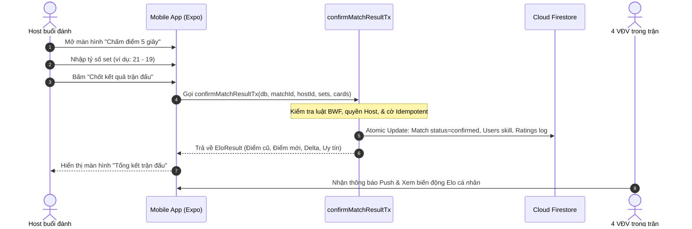

# HỢP ĐỒNG API & ĐẶC TẢ TÍNH NĂNG: XÁC NHẬN KẾT QUẢ TRẬN ĐẤU, TÍNH ELO ĐÔI ĐỘNG & ĐIỂM UY TÍN (FINISH MATCH & ELO)

**Mã chức năng:** WBS 3.4 & Milestone M7  
**Đối tượng sử dụng chính:** TV2 (Nguyễn Đức Đạt - Mobile Dev dựng màn hình "Chấm điểm 5 giây" 4.4 và "Xem điểm Elo thay đổi" 4.5 trên Expo) & Báo cáo kỹ thuật đồ án.  
**Căn cứ kỹ thuật & luật nghiệp vụ:**
- Skill `badminton-rating`, `badminton-domain-rules`.
- Tài liệu thang trình độ: [docs/06-rating-scale.md](file:///d:/QLDAPM/docs/06-rating-scale.md).
- Hợp đồng dữ liệu toàn hệ thống: [docs/api/data-contract.md](file:///d:/QLDAPM/docs/api/data-contract.md).
- Phê duyệt của TV1 (Product Owner / Technical Lead) ngày 2026-11-15.

---

## 1. Luồng trải nghiệm người dùng (UX Flow cho TV2)



### 1. Màn hình "Chấm điểm 5 giây" (Màn hình 4.4):
- Host chọn trận đấu vừa xong (`status: "playing"`).
- Giao diện có 2 nút tăng giảm tỷ số cực lớn, hoặc bàn phím số nhanh cho 2 đội.
- Hỗ trợ đánh 1 set chạm 21 hoặc đánh 3 set thắng 2 (Best of 3).
- Có switch cho phép gửi thẻ đánh giá chéo (Review Cards): "Đúng trình", "Đánh hay hơn khai báo", "Thái độ tốt" hoặc báo cáo "Khai khống trình độ".

### 2. Màn hình "Xem điểm Elo thay đổi" (Màn hình 4.5):
- Hiển thị hoạt họa biến động Elo: Ví dụ `1,520 -> 1,533 (+13 Elo)`.
- Hiển thị biến động Điểm uy tín: `80 -> 82 (+2 Uy tín)`.
- Liệt kê chi tiết lý do biến động: Thắng áp đảo, hệ số K (Provisional hay Chuẩn), thưởng/phạt từ thẻ đánh giá chéo.

---

## 2. Kiểm tra tính hợp lệ của tỷ số set theo chuẩn BWF (Score Validation)

Hàm `validateMatchScores(sets)` kiểm tra nghiêm ngặt theo luật Cầu lông thế giới (BWF):
1. **Điểm thắng chuẩn:** Điểm của đội thắng phải $\ge 21$.
2. **Cách biệt tối thiểu:** Phải cách biệt $\ge 2$ điểm (ví dụ: 21-19, 22-20, 25-23).
3. **Không có tỷ số hòa:** Không chấp nhận set đấu hòa (ví dụ: 21-21).
4. **Trần tối đa 30 điểm (Golden Point):** Nếu tỷ số hòa đến 29-29, bên nào chạm 30 trước sẽ thắng set (tỷ số hợp lệ duy nhất cách biệt 1 điểm là **30-29**). Không chấp nhận tỷ số vượt quá 30 điểm (ví dụ: 31-29 là sai luật).
5. **Độ dài trận đấu:** Hỗ trợ 1 set (đánh 1 ván nghỉ) hoặc tối đa 3 set (đội nào thắng trước 2 set thì trận đấu kết thúc, không được đánh set thứ 3 nếu tỷ số đã là 2-0).

---

## 3. Công thức tính toán Elo Đôi Động (Dynamic Double Elo)

### 3.1. Điểm kỳ vọng của cặp đôi ($E_A, E_B$)
Tổng hợp trình độ của mỗi đội bằng trung bình cộng Elo của 2 thành viên:
$$\bar{R}_A = \frac{R_{A1} + R_{A2}}{2}, \quad \bar{R}_B = \frac{R_{B1} + R_{B2}}{2}$$

Điểm kỳ vọng chiến thắng của Đội A:
$$E_A = \frac{1}{1 + 10^{(\bar{R}_B - \bar{R}_A) / 400}}, \quad E_B = 1 - E_A$$

### 3.2. Hệ số chênh lệch tỷ số set (Score Margin Multiplier)
Khuyến khích thi đấu hết mình, thắng áp đảo sẽ nhận được nhiều điểm hơn thắng sát nút:
$$\text{Margin Multiplier} = 1 + \left( \frac{|\text{Score}_A - \text{Score}_B|}{21} \right) \times 0.25$$
- Kẹp trong khoảng $[1.00, 1.25]$.
- Thắng sát nút $21 - 19 \implies \text{diff} = 2 \implies \text{Multiplier} \approx 1.02$.
- Thắng áp đảo $21 - 5 \implies \text{diff} = 16 \implies \text{Multiplier} \approx 1.19$.

### 3.3. Hệ số K-factor phân tầng theo kinh nghiệm
- **$K = 40$ (Provisional Player):** Người chơi mới đấu $\le 5$ trận đầu tiên hoặc có cờ `isProvisional = true`. Điểm số biến động mạnh để nhanh chóng tìm về đúng trình độ thực tế.
- **$K = 24$ (Standard Player):** Người chơi đã hoàn thành $> 5$ trận. Điểm số ổn định, chống lạm phát.

### 3.4. Thẻ đánh giá chéo & Cơ chế Đồng thuận (Review Cards Consensus)
Chống gian lận và thông đồng, đảm bảo phản ánh đúng năng lực:
- **Tự vote:** Bị loại bỏ hoàn toàn (không được tự chấm cho mình).
- **Thẻ `plays_better` (Đánh hay hơn khai báo):** Bắt buộc có **ít nhất 2 người** trong trận cùng bầu chọn $\implies$ Cộng $+4$ Elo.
- **Thẻ `fake_level` (Khai khống trình độ):** Bắt buộc có **ít nhất 2 người** trong trận cùng báo cáo $\implies$ Phạt $-5$ Elo và $-2$ Điểm uy tín.
- **Thẻ `good_attitude` (Thái độ hòa nhã):** Mỗi phiếu bầu cộng $+1$ Điểm uy tín (tối đa $+2$ Điểm uy tín/trận).
- **Trần điều chỉnh từ thẻ:** Điểm thưởng/phạt Elo từ thẻ được kẹp chặt trong khoảng $[-5, +5]$ Elo/trận.

### 3.5. Kẹp trần/sàn và Thành viên Ghost
- **Thang điểm chuẩn:** Kẹp nghiêm ngặt trong khoảng $[800, 2200]$.
- **Thành viên Ghost (vãng lai không có tài khoản):** Cố định $\Delta = 0$, không cập nhật điểm hay ghi log rating. Người chơi có tài khoản cùng đội hoặc đối thủ vẫn nhận điểm bình thường.

---

## 4. Hệ thống Điểm Uy Tín (Reliability Score: $0..100$)

Điểm uy tín khởi tạo mặc định là **80/100** khi tạo tài khoản.
- **Check-in đúng giờ & hoàn thành trận:** $+2$ điểm.
- **Hủy kèo trước $\ge 12$ tiếng:** $0$ điểm (không phạt).
- **Hủy kèo muộn ($< 12$ tiếng):** $-5$ điểm.
- **Bùng kèo (No-show):** $-15$ điểm.
- **Thẻ thái độ fair-play:** $+1$ điểm/phiếu.
- **Quy tắc trần/sàn:** Tối đa $100$ điểm, tối thiểu $0$ điểm. Điểm uy tín tự động phục hồi dần sau mỗi buổi đánh hoàn thành nghiêm túc.

---

## 5. Đặc tả Giao dịch Firestore `confirmMatchResultTx`

### 5.1. Chữ ký hàm (Function Signature)
```typescript
import { confirmMatchResultTx } from "@/domain/elo";

const result = await confirmMatchResultTx(
  db,           // Firestore Instance
  matchId,      // string (ID trận đấu)
  hostId,       // string (UID của Host đang đăng nhập)
  sets,         // MatchSetScore[] (Danh sách tỷ số các set)
  cards         // PostMatchCard[] (Tùy chọn: danh sách thẻ đánh giá sau trận)
);
```

### 5.2. Mẫu Payload đầu vào (Input Example)
```json
{
  "matchId": "match_tuyn_son_01",
  "hostId": "host_nhat_01",
  "sets": [
    { "setNumber": 1, "scoreA": 21, "scoreB": 19 }
  ],
  "cards": [
    {
      "fromUserId": "player_b1",
      "toUserId": "player_a1",
      "tag": "plays_better"
    },
    {
      "fromUserId": "player_b2",
      "toUserId": "player_a1",
      "tag": "plays_better"
    }
  ]
}
```

### 5.3. Mẫu Dữ liệu đầu ra (Output Example)
```json
{
  "matchId": "match_tuyn_son_01",
  "message": "Xác nhận kết quả trận đấu thành công. Đội A chiến thắng.",
  "eloResult": {
    "winner": "teamA",
    "scoreMultiplier": 1.024,
    "teamA": [
      {
        "userId": "player_a1",
        "displayName": "VĐV Nguyễn Văn A",
        "oldRating": 1500,
        "newRating": 1517,
        "delta": 17,
        "kFactor": 24,
        "oldReliability": 80,
        "newReliability": 82,
        "reliabilityDelta": 2,
        "isProvisional": false,
        "matchesPlayed": 11,
        "isGhost": false,
        "cardEloAdjustment": 4,
        "cardsSummary": {
          "correctLevelVotes": 0,
          "playsBetterVotes": 2,
          "goodAttitudeVotes": 0,
          "fakeLevelVotes": 0
        }
      },
      {
        "userId": "player_a2",
        "displayName": "VĐV Trần Văn B",
        "oldRating": 1500,
        "newRating": 1513,
        "delta": 13,
        "kFactor": 24,
        "oldReliability": 80,
        "newReliability": 82,
        "reliabilityDelta": 2,
        "isProvisional": false,
        "matchesPlayed": 11,
        "isGhost": false,
        "cardEloAdjustment": 0,
        "cardsSummary": {
          "correctLevelVotes": 0,
          "playsBetterVotes": 0,
          "goodAttitudeVotes": 0,
          "fakeLevelVotes": 0
        }
      }
    ],
    "teamB": [
      {
        "userId": "player_b1",
        "displayName": "VĐV Lê Văn C",
        "oldRating": 1500,
        "newRating": 1487,
        "delta": -13,
        "kFactor": 24,
        "oldReliability": 80,
        "newReliability": 82,
        "reliabilityDelta": 2,
        "isProvisional": false,
        "matchesPlayed": 11,
        "isGhost": false,
        "cardEloAdjustment": 0,
        "cardsSummary": {
          "correctLevelVotes": 0,
          "playsBetterVotes": 0,
          "goodAttitudeVotes": 0,
          "fakeLevelVotes": 0
        }
      },
      {
        "userId": "player_b2",
        "displayName": "VĐV Phạm Văn D",
        "oldRating": 1500,
        "newRating": 1487,
        "delta": -13,
        "kFactor": 24,
        "oldReliability": 80,
        "newReliability": 82,
        "reliabilityDelta": 2,
        "isProvisional": false,
        "matchesPlayed": 11,
        "isGhost": false,
        "cardEloAdjustment": 0,
        "cardsSummary": {
          "correctLevelVotes": 0,
          "playsBetterVotes": 0,
          "goodAttitudeVotes": 0,
          "fakeLevelVotes": 0
        }
      }
    ]
  }
}
```

---

## 6. Tính chất Bắt buộc của Giao dịch (Architectural Guarantees)

1. **Tính chất Bắt buộc Idempotent:**
   - Hệ thống kiểm tra cờ `match.ratingProcessed === true` hoặc `match.status === "confirmed"`.
   - Nếu trận đấu đã được xử lý Elo trước đó, giao dịch ngay lập tức bị hủy bỏ và ném lỗi `"Trận đấu này đã được xác nhận kết quả và cập nhật Elo trước đó (Idempotent Block)"`.
   - Cam kết không có tình trạng mạng chập chờn Host bấm 2 lần làm tăng điểm 2 lần.

2. **Giao dịch Nguyên tử (ACID Transaction):**
   - Tài liệu `matches/{matchId}`, `users/{uid}` của 4 người chơi và các bản ghi log trong collection `ratings` được cập nhật đồng thời trong 1 giao dịch Firestore duy nhất. Nếu bất kỳ thao tác nào gặp lỗi, toàn bộ giao dịch được rollback 100%.

3. **Phân quyền Bảo mật (Security Rules Compliance):**
   - Client thường không được phép ghi trực tiếp vào trường `skill.rating` hay `skill.reliability` của User.
   - Chỉ Host của buổi đánh (xác thực thông qua `session.hostId`) mới có quyền chốt tỷ số trận đấu.

