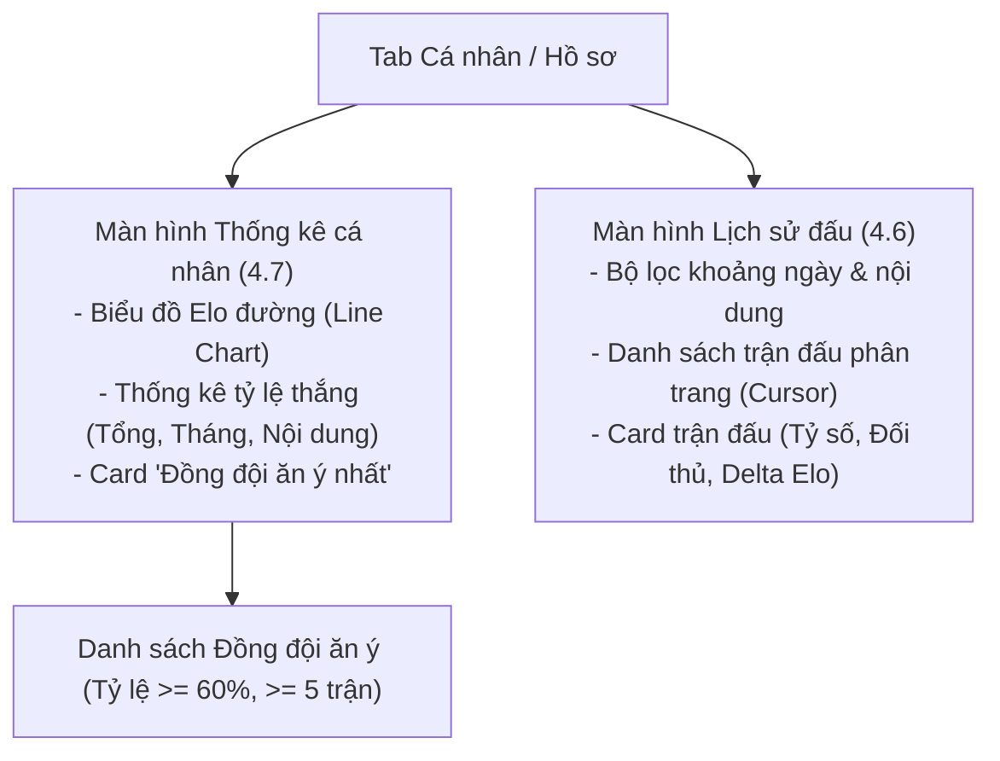

# HỢP ĐỒNG API & ĐẶC TẢ TÍNH NĂNG: LỊCH SỬ ĐẤU, THỐNG KÊ TỶ LỆ THẮNG & ĐỒNG ĐỘI ĂN Ý NHẤT (HISTORY & STATS)

**Mã chức năng:** WBS 3.4 & Milestone M7  
**Đối tượng sử dụng chính:** TV2 (Nguyễn Đức Đạt - Mobile Dev dựng màn hình Lịch sử đấu 4.6 & Thống kê cá nhân 4.7 trên Expo) & Báo cáo kỹ thuật đồ án.  
**Căn cứ kỹ thuật & luật nghiệp vụ:**
- Skill `badminton-domain-rules`, `badminton-rating`, `firebase-data-model`.
- Thang đo trình độ & Elo: [docs/06-rating-scale.md](file:///d:/QLDAPM/docs/06-rating-scale.md).
- Quyết định phê duyệt của TV1 (2026-11-15):
  - Ngưỡng tối thiểu "Đồng đội ăn ý nhất": **$\ge 5$ trận** ($N_{min} = 5$).
  - Ngưỡng tỷ lệ chiến thắng: **$\ge 60\%$** ($\text{winRate} \ge 0.60$).
  - Xếp hạng & Tie-break: `winRate DESC -> matchesCount DESC -> lastPlayedAt DESC`.

---

## 1. Luồng trải nghiệm người dùng trên Mobile App (UX Flow cho TV2)



---

## 2. Truy vấn Lịch sử đấu & Chỉ mục Firestore (Match History Query)

### 2.1. Cấu trúc truy vấn Firestore (Query Contract)
Để người chơi xem lịch sử các trận đấu mình đã tham gia, ứng dụng truy vấn collection `matches` kết hợp trường mảng `playerIds: [string, string, string, string]` với toán tử `array-contains`:

```typescript
import { collection, query, where, orderBy, limit, startAfter, getDocs } from "firebase/firestore";

// 1. Query cơ bản: Lấy danh sách trận đấu của user theo thời gian giảm dần
const q = query(
  collection(db, "matches"),
  where("playerIds", "array-contains", currentUserId),
  where("status", "in", ["finished", "confirmed"]),
  orderBy("createdAt", "desc"),
  limit(20)
);

// 2. Query phân trang (Cursor-based):
const nextQ = query(
  collection(db, "matches"),
  where("playerIds", "array-contains", currentUserId),
  where("status", "in", ["finished", "confirmed"]),
  orderBy("createdAt", "desc"),
  startAfter(lastDocSnapshot),
  limit(20)
);
```

### 2.2. Composite Indexes đã được cấu hình trong `firestore.indexes.json`
1. **Trận đấu theo thời gian:**
   - Collection: `matches`
   - Fields: `playerIds` (CONTAINS) + `createdAt` (DESC)
2. **Trận đấu lọc theo trạng thái:**
   - Collection: `matches`
   - Fields: `playerIds` (CONTAINS) + `status` (ASC) + `createdAt` (DESC)
3. **Trận đấu lọc theo nội dung (`men`, `women`, `mixed`):`
   - Collection: `matches`
   - Fields: `playerIds` (CONTAINS) + `category` (ASC) + `createdAt` (DESC)
4. **Lịch sử biến động điểm Elo:**
   - Collection: `ratings`
   - Fields: `userId` (ASC) + `createdAt` (DESC)

---

## 3. Chỉ số "Đồng đội ăn ý nhất" (Best Partners)

### 3.1. Tiêu chí xác định (Đã duyệt chính thức từ TV1):
1. **Số trận tối thiểu đánh cùng:** **$\ge 5$ trận** ($N_{min} = 5$). Các cặp đánh dưới 5 trận dù thắng 100% (ví dụ 4/4 trận) vẫn không được xét là đồng đội ăn ý để đảm bảo tính ổn định và chống số liệu ảo.
2. **Tỷ lệ chiến thắng:** **$\ge 60\%$** ($\text{winRate} \ge 0.60$).
3. **Thứ tự xếp hạng (Sorting & Tie-break):**
   - **Ưu tiên 1:** Tỷ lệ thắng giảm dần (`winRate DESC`).
   - **Ưu tiên 2:** Số trận đánh cùng nhiều hơn xếp trên (`matchesCount DESC`).
   - **Ưu tiên 3:** Trận đánh gần nhất mới hơn xếp trên (`lastPlayedAt DESC`).
   - **Ưu tiên 4:** Deterministic theo `partnerId ASC`.
4. **Loại trừ an toàn:**
   - Bỏ qua thành viên Ghost (vãng lai không có tài khoản).
   - Bỏ qua các trận chưa kết thúc (`playing`, `planned`).
   - Nếu không có đồng đội nào đủ chuẩn $\to$ trả về danh sách rỗng `[]` và hiển thị gợi ý *"Hãy đánh thêm cùng đồng đội để mở khóa danh hiệu"*.

### 3.2. Mẫu JSON Đồng đội ăn ý nhất (JSON Example)
```json
[
  {
    "partnerId": "usr_quoc_bao_99",
    "partnerName": "Trần Quốc Bảo",
    "partnerAvatar": "https://cdn.badminton.app/avatars/bao.jpg",
    "matchesCount": 10,
    "winsCount": 8,
    "winRate": 0.8,
    "lastPlayedAt": "2026-11-15T10:30:00Z"
  },
  {
    "partnerId": "usr_thanh_tuan_88",
    "partnerName": "Nguyễn Thanh Tuấn",
    "partnerAvatar": "https://cdn.badminton.app/avatars/tuan.jpg",
    "matchesCount": 6,
    "winsCount": 4,
    "winRate": 0.6667,
    "lastPlayedAt": "2026-11-12T19:00:00Z"
  }
]
```

---

## 4. Dữ liệu Thống kê & Chuỗi thời gian cho Biểu đồ (Charts Data)

TV2 sử dụng thư viện biểu đồ (ví dụ: `react-native-chart-kit` hoặc `victory-native`) để vẽ:

### 4.1. Chuỗi thời gian Biến động Elo (Line Chart)
Dữ liệu trích xuất từ hàm thuần `buildRatingTimeSeries`:
```json
[
  {
    "date": "2026-11-01T10:00:00Z",
    "rating": 1400,
    "delta": 0,
    "cumulativeMatches": 0,
    "cumulativeWins": 0,
    "cumulativeWinRate": 0
  },
  {
    "date": "2026-11-05T15:30:00Z",
    "rating": 1416,
    "delta": 16,
    "cumulativeMatches": 1,
    "cumulativeWins": 1,
    "cumulativeWinRate": 1.0
  },
  {
    "date": "2026-11-10T18:45:00Z",
    "rating": 1405,
    "delta": -11,
    "cumulativeMatches": 2,
    "cumulativeWins": 1,
    "cumulativeWinRate": 0.5
  },
  {
    "date": "2026-11-15T11:00:00Z",
    "rating": 1422,
    "delta": 17,
    "cumulativeMatches": 3,
    "cumulativeWins": 2,
    "cumulativeWinRate": 0.6667
  }
]
```

### 4.2. Thống kê theo Nội dung & Theo Tháng
```json
{
  "totalMatches": 28,
  "totalWins": 18,
  "totalLosses": 10,
  "overallWinRate": 0.6429,
  "byCategory": {
    "men": { "matches": 16, "wins": 11, "losses": 5, "winRate": 0.6875 },
    "women": { "matches": 0, "wins": 0, "losses": 0, "winRate": 0.0 },
    "mixed": { "matches": 12, "wins": 7, "losses": 5, "winRate": 0.5833 }
  },
  "byMonth": {
    "2026-10": { "month": "2026-10", "matches": 8, "wins": 5, "losses": 3, "winRate": 0.625 },
    "2026-11": { "month": "2026-11", "matches": 20, "wins": 13, "losses": 7, "winRate": 0.65 }
  }
}
```

---

## 5. Mẫu Dữ liệu Trận đấu hoàn chỉnh (Enriched Match History Item)

Đối tượng trả về từ hàm `enrichMatchHistory` cho danh sách lịch sử trận:

```json
{
  "matchId": "match_tuyen_son_101",
  "sessionId": "session_danang_01",
  "sessionTitle": "Giao lưu Sân Tuyên Sơn Sáng T7",
  "courtId": "1",
  "category": "men",
  "date": "2026-11-15T10:00:00Z",
  "isWin": true,
  "eloDelta": 14,
  "newRating": 1514,
  "reliabilityDelta": 2,
  "sets": [
    { "setNumber": 1, "scoreA": 21, "scoreB": 19 }
  ],
  "winner": "teamA",
  "partner": {
    "userId": "usr_quoc_bao_99",
    "displayName": "Trần Quốc Bảo",
    "avatarUrl": "https://cdn.badminton.app/avatars/bao.jpg",
    "isGhost": false
  },
  "opponents": [
    {
      "userId": "usr_le_minh_01",
      "displayName": "Lê Văn Minh",
      "avatarUrl": null,
      "isGhost": false
    },
    {
      "userId": "ghost_vanglai_99",
      "displayName": "Khách (Vãng lai Sân 1)",
      "isGhost": true
    }
  ]
}
```

---

## 6. Bảng Mã Lỗi (Error Codes)

| Mã lỗi | Nguyên nhân | Hướng xử lý cho UI của TV2 |
|---|---|---|
| `HISTORY_USER_NOT_FOUND` | `userId` không tồn tại trong hệ thống | Hiển thị thông báo "Không tìm thấy thông tin người dùng" |
| `HISTORY_INVALID_DATE_RANGE` | `startDate` lớn hơn `endDate` | Hiển thị Toast cảnh báo: "Khoảng ngày chọn không hợp lệ" |
| `HISTORY_PAGING_ERROR` | `lastMatchId` không tồn tại | Tải lại trang đầu tiên (Reset về page 1) |
| `HISTORY_EMPTY` | Người chơi chưa thi đấu trận nào | Hiển thị Empty State màn hình: "Bạn chưa có trận đấu nào. Hãy tham gia một kèo giao lưu ngay!" |
| `BEST_PARTNER_EMPTY` | Chưa có ai cùng đánh $\ge 5$ trận hoặc tỷ lệ $< 60\%$ | Hiển thị Card rỗng: "Đánh cùng một bạn chơi từ 5 trận trở lên để tìm ra đồng đội ăn ý nhất!" |
