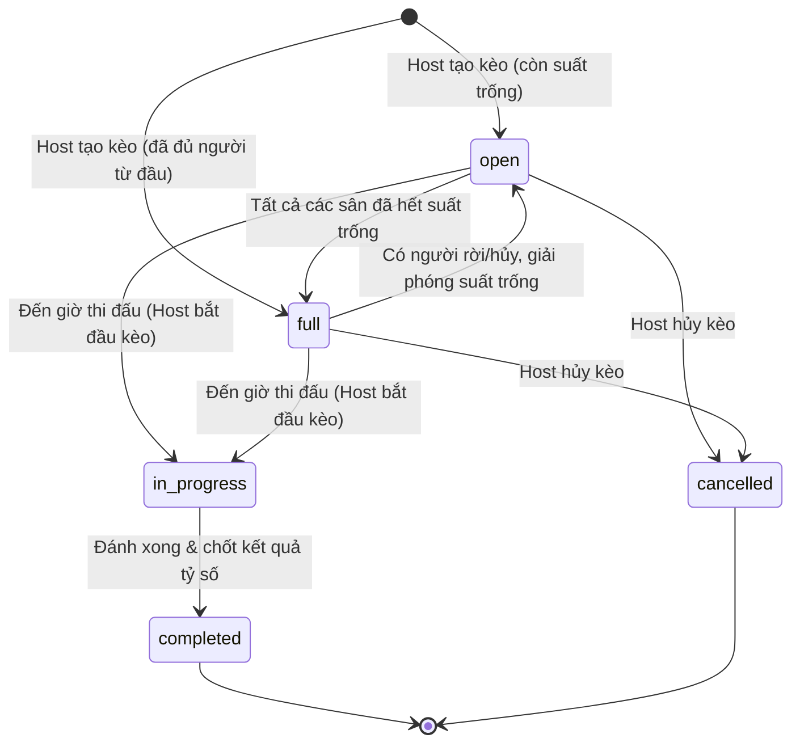
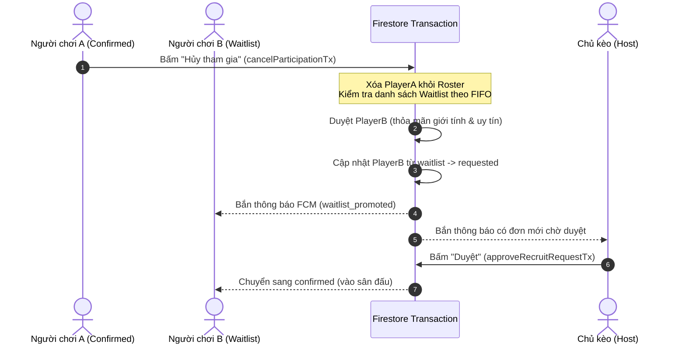

# ĐẶC TẢ TÍNH NĂNG VÀ HỢP ĐỒNG REALTIME: PHÒNG GIAO LƯU (MATCH LOBBY)

**Mã chức năng:** WBS 3.2 & M5 | CR-01, CR-02  
**Đối tượng sử dụng chính:** TV2 (Nguyễn Đức Đạt - Mobile Dev dựng màn hình Danh sách kèo 4.1 & Chi tiết phòng kèo 4.2 trên Expo).  
**Căn cứ pháp lý & kỹ thuật:**
- Skill `badminton-domain-rules` (CR-01: Tối đa 2 sân/kèo, mỗi sân $\le 8$ người, tổng kèo $\le 16$ người).
- Skill `recruit-slot-matching` & `badminton-rating` (Hạn chót hủy 12h, phạt uy tín, tự động đôn Waitlist).
- Quyết định phê duyệt của TV1 ngày 15/11/2026.

---

## 1. Trạng thái vòng đời buổi đánh (Session Lifecycle)



### Ý nghĩa các trạng thái:
| Trạng thái (`status`) | Ý nghĩa nghiệp vụ | Hành động cho phép của người chơi / Host |
|---|---|---|
| `open` | Đang mở tuyển vãng lai (còn ít nhất 1 sân có suất trống). | Người chơi nộp đơn xin tham gia; Host duyệt/từ chối đơn. |
| `full` | Kèo đã đủ người ở tất cả các sân. | Người chơi chỉ có thể đăng ký vào **danh sách dự bị (Waitlist)**. |
| `in_progress` | Buổi giao lưu đang diễn ra tại sân. | Host điều khiển chia cặp, ghi nhận tỷ số các set đấu. |
| `completed` | Buổi đánh kết thúc và đã chốt tỷ số. | Hệ thống tự động cập nhật điểm Elo và mở chấm điểm sau trận. |
| `cancelled` | Host đã hủy buổi đánh. | Toàn bộ đơn bị hủy, hoàn cờ và bắn thông báo giải thích cho người chơi. |

---

## 2. Hợp đồng lắng nghe thời gian thực (Realtime Listeners)

TV2 sử dụng hàm `onSnapshot` của Firebase Firestore Web/React Native SDK để tự động cập nhật giao diện khi có biến động về chỗ trống hoặc danh sách người chơi:

### A. Lắng nghe danh sách kèo trên Trang chủ (`HomeScreen.tsx`)
Hiển thị danh sách các buổi đánh sắp diễn ra, lọc theo khu vực hoặc thời gian:

```typescript
import { collection, query, where, orderBy, onSnapshot } from "firebase/firestore";
import { db } from "../config/firebase";
import { SessionDoc } from "../domain/types";

export function listenToActiveSessions(
  districtFilter: string | null,
  onUpdate: (sessions: SessionDoc[]) => void,
  onError: (err: Error) => void
) {
  const nowIso = new Date().toISOString();
  const constraints: any[] = [
    where("isDeleted", "==", false),
    where("status", "in", ["open", "full"]),
    where("startsAt", ">=", nowIso),
    orderBy("startsAt", "asc")
  ];

  if (districtFilter) {
    constraints.unshift(where("district", "==", districtFilter));
  }

  const q = query(collection(db, "sessions"), ...constraints);

  return onSnapshot(q, (snapshot) => {
    const sessions = snapshot.docs.map((doc) => ({
      ...(doc.data() as SessionDoc),
      id: doc.id,
    }));
    onUpdate(sessions);
  }, onError);
}
```

### B. Lắng nghe chi tiết số suất trống của kèo (`LobbyDetailScreen.tsx`)
Khi có bất kỳ ai đặt suất hoặc rời sân, Firestore tự động push dữ liệu mới:

```typescript
import { doc, onSnapshot } from "firebase/firestore";
import { db } from "../config/firebase";
import { SessionDoc } from "../domain/types";

export function listenToSessionDetail(
  sessionId: string,
  onUpdate: (session: SessionDoc | null) => void
) {
  const sessionRef = doc(db, "sessions", sessionId);
  return onSnapshot(sessionRef, (snap) => {
    if (snap.exists()) {
      onUpdate(snap.data() as SessionDoc);
    } else {
      onUpdate(null);
    }
  });
}
```

### C. Lắng nghe danh sách thành viên trong từng sân (`CourtRosterCard.tsx`)
```typescript
import { collection, onSnapshot } from "firebase/firestore";
import { db } from "../config/firebase";
import { CourtDoc } from "../domain/types";

export function listenToCourts(
  sessionId: string,
  onUpdate: (courts: CourtDoc[]) => void
) {
  const courtsRef = collection(db, "sessions", sessionId, "courts");
  return onSnapshot(courtsRef, (snap) => {
    const courts = snap.docs.map((d) => d.data() as CourtDoc);
    onUpdate(courts);
  });
}
```

---

## 3. Quy tắc Hủy kèo & Phạt điểm uy tín (P16)

Quy định hạn chót và mức phạt điểm uy tín được tính tự động trong giao dịch `leaveSessionWithPenaltyTx`:

| Thời điểm hủy tham gia | Mức phạt điểm uy tín | Ghi nhận sự kiện |
|---|:---:|---|
| **Trước $\ge 12$ tiếng** so với giờ đánh | **0 điểm** | Không phạt, tạo điều kiện cho người khác đăng ký. |
| **Trong vòng $< 12$ tiếng** trước giờ đánh | **Trừ 5 điểm** | Bắn thông báo nhắc nhở trách nhiệm (`type: "reputation_penalty"`). |
| **Sau giờ bắt đầu hoặc Bùng kèo (No-show)** | **Trừ 15 điểm** | Đưa vào danh sách cảnh báo uy tín thấp, lưu log `ratings`. |

---

## 4. Cơ chế Waitlist và Tự động đôn người



1. **Thứ tự ưu tiên:** Người nộp đơn dự bị sớm nhất (`createdAt` asc) được xét trước (FIFO).
2. **Kiểm tra tương thích khi đôn:** Nếu người đứng đầu Waitlist không còn thỏa mãn giới tính sân sau khi người cũ rút (ví dụ: sân đang thừa Nam, người đứng đầu là Nam), hệ thống tự động **bỏ qua** và xét người tiếp theo trong Waitlist là Nữ.
3. **Tránh nhận đè:** Toàn bộ quá trình diễn ra trong một **Firestore Transaction Atomic**, cam kết không bao giờ nhận quá 8 người/sân kể cả khi nhiều người cùng thao tác đồng thời.

---

## 5. Danh mục mã lỗi hiển thị trên giao diện Expo

| Mã lỗi | Nguyên nhân | Gợi ý xử lý trên UI |
|---|---|---|
| `SESSION_CLOSED` | Kèo đã bị hủy hoặc đã kết thúc | Khóa nút đăng ký, hiển thị nhãn xám "Kèo đã đóng". |
| `RECRUIT_CLOSED` | Host chưa bật tuyển hoặc tạm ngưng tuyển | Ẩn nút "Xin tham gia", hiện nhãn "Chưa mở tuyển". |
| `ALREADY_IN_SESSION` | Người chơi đã có tên trên sân hoặc sân khác cùng kèo | Đổi nút thành "Đã tham gia" (hoặc nút "Rời kèo"). |
| `TIME_CONFLICT` | Trùng khung giờ thi đấu với 1 kèo khác | Hiển thị Dialog cảnh báo trùng giờ, yêu cầu rời kèo cũ trước. |
| `GENDER_NOT_ALLOWED` | Sai giới tính quy định của sân | Hiển thị thông báo: "Sân Đôi nam chỉ nhận Nam" (hoặc Đôi nữ/Đôi nam nữ). |
| `LEVEL_OUT_OF_RANGE` | Cấp độ không nằm trong dải yêu cầu của sân | Báo dải cấp độ yêu cầu của sân và trình độ hiện tại của bạn. |
| `RELIABILITY_TOO_LOW` | Điểm uy tín dưới ngưỡng yêu cầu của sân | Thông báo điểm uy tín không đủ điều kiện để nộp đơn. |
| `NO_SLOT` | Sân đã kín chỗ chính thức | Hiển thị hộp thoại: "Hết chỗ chính thức. Bạn có muốn đăng ký vào **Danh sách dự bị (Waitlist)** không?". |
| `OVERBOOKED` | Sân đã đủ tối đa 8 người | Chặn thao tác thêm người mặc định hoặc duyệt vượt quá 8 người. |
