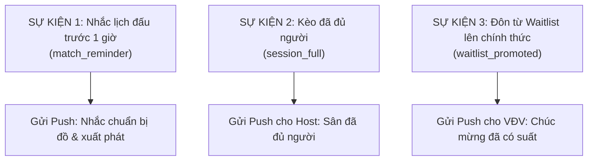

# ĐẶC TẢ TÍNH NĂNG & HỢP ĐỒNG TÍCH HỢP: THÔNG BÁO ĐẨY (PUSH NOTIFICATIONS - FCM)

**Mã chức năng:** WBS 3.5 & Milestone M9  
**Đối tượng sử dụng chính:** TV2 (Nguyễn Đức Đạt - Tích hợp Expo Notifications trên di động) & Backend Cloud Functions.  
**Căn cứ kỹ thuật:**
- Hợp đồng dữ liệu: [docs/api/data-contract.md](file:///d:/QLDAPM/docs/api/data-contract.md) (Collection `notifications`).
- Quyết định kiến trúc hạ tầng: [docs/adr/ADR-001-backend-approach.md](file:///d:/QLDAPM/docs/adr/ADR-001-backend-approach.md) (Gói Blaze + Cloud Functions V2 tại Singapore).

---

## 1. Ba Sự kiện Thông báo Cốt lõi (Core Push Events)

Backend Cloud Functions chịu trách nhiệm phát đúng **3 sự kiện nghiệp vụ then chốt**:



### 1. Sự kiện 1: Nhắc lịch trước giờ thi đấu 1 giờ (`match_reminder`)
- **Đối tượng nhận:** Tất cả các thành viên có mặt trong `roster` của các sân thuộc kèo đấu.
- **Cơ chế triển khai:**
  - **Trên gói Blaze (Theo ADR-001):** Sử dụng Cloud Scheduler định kỳ mỗi 15 phút gọi Cloud Function `cronCheckUpcomingSessions` quét các kèo có `startsAt` nằm trong khoảng $[T + 45\text{ phút}, T + 60\text{ phút}]$ và cờ `reminderSent !== true`.
  - **Phương án thay thế nếu môi trường Client-only (Gói Spark):** Ứng dụng Expo tự lên lịch thông báo cục bộ (Local Scheduled Notification) thông qua thư viện `expo-notifications`:
    ```typescript
    await Notifications.scheduleNotificationAsync({
      content: {
        title: "🏸 Sắp đến giờ ra sân!",
        body: `Kèo tại ${session.venueName} sẽ bắt đầu lúc ${formattedTime}. Đừng quên khởi động kỹ nhé!`,
        data: { sessionId: session.id },
      },
      trigger: { date: new Date(new Date(session.startsAt).getTime() - 3600000) },
    });
    ```

### 2. Sự kiện 2: Thông báo Kèo đã tuyển đủ người (`session_full`)
- **Điều kiện kích hoạt:** Khi `openSlotsTotal === 0` và tất cả các sân trong kèo đã đủ người sau khi Host duyệt đơn.
- **Đối tượng nhận:** Host của buổi đánh (`session.hostId`).

### 3. Sự kiện 3: Thông báo Có suất trống được đôn từ Waitlist (`waitlist_promoted`)
- **Điều kiện kích hoạt:** Khi một người chơi chính thức bấm hủy kèo/rời kèo (`leaveSessionWithPenaltyTx`) và giao dịch nguyên tử đôn ứng viên đầu tiên trong Waitlist lên danh sách chính thức (`status: confirmed`).
- **Đối tượng nhận:** Người chơi vừa được đôn lên từ Waitlist.

---

## 2. Mẫu Nội dung Thông báo Tiếng Việt (Notification Templates)

| Loại sự kiện (`type`) | Tiêu đề thông báo (`title`) | Nội dung chi tiết (`body`) | Điều hướng (`data`) |
|---|---|---|---|
| `match_reminder` | 🏸 Sắp đến giờ ra sân giao lưu! | Kèo cầu lông tại **{venueName}** sẽ bắt đầu lúc **{startsAt}**. Bạn nhớ chuẩn bị vợt và có mặt đúng giờ nhé! | `{ screen: "lobby_detail", sessionId: "{sessionId}" }` |
| `session_full` | 🎉 Kèo đấu đã đủ người! | Kèo **"{sessionTitle}"** của bạn đã tuyển đủ quân số. Bấm vào để xem danh sách đội hình thi đấu! | `{ screen: "court_balancing", sessionId: "{sessionId}" }` |
| `waitlist_promoted` | 🚀 Bạn đã có suất thi đấu chính thức! | Có thành viên vừa rút khỏi kèo **{venueName}**. Bạn đã được tự động đôn từ hàng đợi dự bị lên danh sách đánh chính! | `{ screen: "lobby_detail", sessionId: "{sessionId}" }` |

---

## 3. Cơ chế Quản lý & Làm sạch FCM Tokens (Token Hygiene)

Để đảm bảo hiệu năng và tiết kiệm chi phí, hệ thống áp dụng chiến lược làm sạch token tự động:

```typescript
// Payload gửi FCM qua Firebase Admin SDK
const message = {
  notification: { title, body },
  data: { sessionId, courtId, screen: "lobby_detail" },
  tokens: user.fcmTokens,
};

const response = await admin.messaging().sendEachForMulticast(message);

// Thu dọn token chết (Invalid / Unregistered)
const failedTokens: string[] = [];
response.responses.forEach((resp, idx) => {
  if (!resp.success) {
    const errCode = resp.error?.code;
    if (
      errCode === "messaging/registration-token-not-registered" ||
      errCode === "messaging/invalid-registration-token"
    ) {
      failedTokens.push(user.fcmTokens[idx]);
    }
  }
});

if (failedTokens.length > 0) {
  await db.doc(`users/${user.uid}`).update({
    fcmTokens: admin.firestore.FieldValue.arrayRemove(...failedTokens),
  });
}
```

---

## 4. Hướng dẫn tích hợp phía Mobile Client (Expo - TV2)

1. **Cài đặt thư viện:** `npx expo install expo-notifications expo-device`
2. **Đăng ký nhận quyền Push:**
   ```typescript
   import * as Notifications from "expo-notifications";
   import * as Device from "expo-device";

   export async function registerForPushNotificationsAsync(userId: string, db: any) {
     if (!Device.isDevice) return null;

     const { status: existingStatus } = await Notifications.getPermissionsAsync();
     let finalStatus = existingStatus;
     if (existingStatus !== "granted") {
       const { status } = await Notifications.requestPermissionsAsync();
       finalStatus = status;
     }
     if (finalStatus !== "granted") return null;

     const tokenData = await Notifications.getExpoPushTokenAsync();
     const token = tokenData.data;

     // Lưu token vào UserProfile
     await updateDoc(doc(db, "users", userId), {
       fcmTokens: arrayUnion(token),
     });

     return token;
   }
   ```
3. **Lắng nghe sự kiện người dùng bấm vào Push để chuyển màn hình:**
   ```typescript
   Notifications.addNotificationResponseReceivedListener((response) => {
     const data = response.notification.request.content.data;
     if (data?.sessionId) {
       router.push(`/lobby/${data.sessionId}`);
     }
   });
   ```
