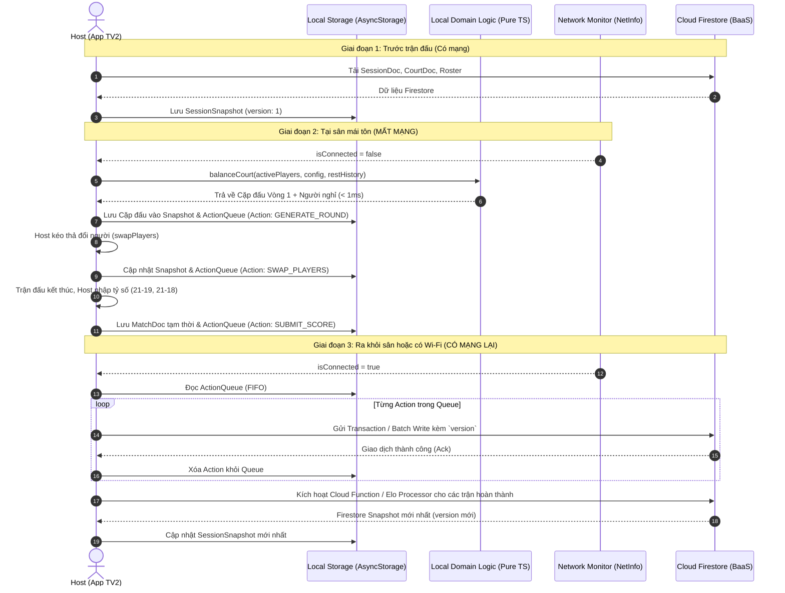

# Hợp Đồng Offline Cache và Đồng Bộ Khi Mất Mạng Tại Sân (TV1 ↔ TV2)

> **Mã tài liệu:** `docs/api/offline-contract.md`  
> **Áp dụng cho:** Phiên bản Mobile App (Expo / React Native) và Backend (Firestore)  
> **Ngữ cảnh thực tế:** Các nhà thi đấu cầu lông tại Đà Nẵng (như Kỳ Đồng, Trình Trung, Tuyên Sơn, Chi Lăng) thường có sóng 4G/Wi-Fi yếu, chập chờn hoặc mất mạng hoàn toàn trong nhà kín mái tôn. Ứng dụng phải duy trì trải nghiệm mượt mà cho Host và thành viên khi đang diễn ra buổi đánh.

---

## 1. Nguyên Tắc Cốt Lõi (Offline-First Principles)

1. **Hàm thuần chạy Client (Zero-Network Balancing):** Thuật toán xếp cặp `balanceCourt` và hoán đổi vị trí `swapPlayers` nằm hoàn toàn trong `src/domain/balancing/` là các **hàm thuần (pure functions)**, không phụ thuộc Firebase SDK hay API. TV2 có thể bundle trực tiếp vào ứng dụng di động để chạy in-memory trong $< 1\text{ ms}$.
2. **Snapshot cục bộ trước giờ thi đấu:** Trước khi vào sân hoặc ngay khi mở màn hình Buổi đánh (Match Lobby) khi còn mạng, app tải và lưu `SessionSnapshot` vào bộ nhớ cục bộ (`AsyncStorage` hoặc `expo-sqlite`).
3. **Lưu trữ hàng đợi thao tác (Action Queue):** Mọi thao tác cục bộ của Host khi offline (xếp cặp mới, hoán đổi người, nhập tỷ số set) được ghi nhận vào `ActionQueue` với timestamp `clientTimestamp` và số thứ tự cục bộ `localSequence`.
4. **Quy tắc giải quyết xung đột (Conflict Resolution - Host Authority):**
   - Host là người nắm quyền thực tế tại sân. Khi có mạng trở lại, thao tác của Host trên sân có độ ưu tiên cao nhất (**Host-Authority**).
   - Nếu có nhiều thiết bị cùng sửa (ví dụ Host và Co-host), hệ thống dựa trên `version` tăng dần (Optimistic Concurrency Control) hoặc Last-Write-Wins (LWW) trên từng trận đấu độc lập.

---

## 2. Cấu Trúc Dữ Liệu Lưu Cục Bộ (Local Storage Schema)

TV2 sử dụng thư viện `@react-native-async-storage/async-storage` hoặc `expo-file-system` để lưu trữ trạng thái offline.

### 2.1. Khóa lưu trữ (Storage Keys)

```typescript
const STORAGE_KEYS = {
  // Snapshot thông tin buổi đánh và các sân
  SESSION_SNAPSHOT: (sessionId: string) => `@badminton/session_snapshot_${sessionId}`,
  // Hàng đợi các action chờ đồng bộ lên Firestore
  OFFLINE_MUTATION_QUEUE: (sessionId: string) => `@badminton/mutation_queue_${sessionId}`,
  // Trạng thái mạng lần cuối
  NETWORK_STATUS: '@badminton/network_status',
};
```

### 2.2. Giao diện `SessionSnapshot`

```typescript
import { CourtDoc, SessionDoc, MatchDoc } from '../../src/types';

export interface LocalPlayerInfo {
  userId: string;
  displayName: string;
  eloScore: number;
  gender: 'MALE' | 'FEMALE';
  preferredPosition?: 'FRONT' | 'BACK' | 'FLEXIBLE';
  dominantHand?: 'LEFT' | 'RIGHT' | 'BOTH';
  checkInStatus: 'CHECKED_IN' | 'WAITING' | 'ABSENT';
}

export interface SessionSnapshot {
  sessionId: string;
  version: number;               // Version đồng bộ từ Firestore (CourtDoc.version)
  updatedAt: string;             // ISO Date String
  session: SessionDoc;
  courts: Record<string, CourtDoc>;  // Key là courtId ("court_1", "court_2")
  players: Record<string, LocalPlayerInfo>; // Key là userId
  currentRound: number;
  completedMatches: MatchDoc[];  // Các trận đã có kết quả tạm thời
  activeMatches: Record<string, {
    matchId: string;
    courtId: string;
    roundIndex: number;
    teamA: [string, string];
    teamB: [string, string];
    restingPlayerIds: string[];
    scores?: Array<{ setNumber: number; teamAScore: number; teamBScore: number }>;
  }>;
}
```

---

## 3. Quy Trình Vận Hành Khi Offline Tại Sân



---

## 4. Tích Hợp Hàm Thuần Cho TV2 (Code Mẫu Client)

TV2 không cần viết lại logic xếp cặp hay hoán đổi, chỉ cần import từ package dùng chung:

```typescript
// Trong màn hình CourtBalancingScreen.tsx của Expo
import { balanceCourt, swapPlayers } from '../domain/balancing/courtBalancing';
import { CourtBalancingConfig, CourtPlayer } from '../domain/balancing/courtBalancingTypes';
import AsyncStorage from '@react-native-async-storage/async-storage';

// 1. Chạy xếp cặp hoàn toàn Offline
export async function handleGenerateRoundOffline(
  courtId: string,
  presentPlayers: CourtPlayer[],
  config: CourtBalancingConfig,
  restingHistory: Record<string, number>
) {
  // Chạy tức thì không cần await network
  const balanceResult = balanceCourt(presentPlayers, config, restingHistory);

  // Cập nhật State UI cho Host xem ngay
  // Lưu vào hàng đợi offline
  await enqueueOfflineAction({
    actionType: 'GENERATE_ROUND',
    courtId,
    timestamp: Date.now(),
    payload: balanceResult,
  });

  return balanceResult;
}

// 2. Host kéo thả hoán đổi 2 người chơi
export async function handleSwapPlayersOffline(
  currentAssignments: [CourtPlayer, CourtPlayer][],
  playerAId: string,
  playerBId: string
) {
  const newAssignments = swapPlayers(currentAssignments, playerAId, playerBId);
  
  await enqueueOfflineAction({
    actionType: 'SWAP_PLAYERS',
    timestamp: Date.now(),
    payload: { playerAId, playerBId, newAssignments },
  });

  return newAssignments;
}
```

---

## 5. Cấu Trúc Action Queue & Cơ Chế Đồng Bộ (Sync Engine)

### 5.1. Cấu trúc Action trong Queue

```typescript
export type OfflineActionType = 
  | 'GENERATE_ROUND' 
  | 'SWAP_PLAYERS' 
  | 'SUBMIT_SCORE' 
  | 'CHECK_IN_PLAYER';

export interface QueuedAction {
  id: string;                 // UUID v4
  sessionId: string;
  courtId: string;
  actionType: OfflineActionType;
  clientTimestamp: number;    // Date.now()
  version: number;            // Snapshot version lúc thực hiện
  payload: any;
  retryCount: number;
}
```

### 5.2. Thuật toán Sync Engine khi có mạng

```typescript
import NetInfo from '@react-native-community/netinfo';
import { db } from '../config/firebase';
import { runTransaction, doc } from 'firebase/firestore';

export async function processOfflineQueue(sessionId: string) {
  const queue = await getOfflineQueue(sessionId);
  if (!queue || queue.length === 0) return;

  const net = await NetInfo.fetch();
  if (!net.isConnected || !net.isInternetReachable) return;

  for (const action of [...queue]) {
    try {
      await syncActionWithServer(action);
      // Đồng bộ thành công -> Xóa khỏi queue
      await removeActionFromQueue(sessionId, action.id);
    } catch (error: any) {
      console.warn(`[OfflineSync] Lỗi khi đồng bộ action ${action.id}:`, error);
      if (error.code === 'failed-precondition' || error.message.includes('CONFLICT')) {
        // Xử lý xung đột
        await handleSyncConflict(action, error);
        await removeActionFromQueue(sessionId, action.id);
      } else {
        // Lỗi mạng tạm thời: Tăng retry count và dừng đợt sync này
        action.retryCount += 1;
        break;
      }
    }
  }
}
```

---

## 6. Chiến Lược Giải Quyết Xung Đột (Conflict Resolution)

| Tình Huống Xung Đột | Nguyên Nhân | Chiến Lược Giải Quyết |
| :--- | :--- | :--- |
| **Host nhập tỷ số offline, nhưng trên server đã có tỷ số khác** | Host đổi máy hoặc Co-host nhập trước. | **Host-Authority:** Tỷ số gửi kèm chữ ký/role của Host chính thức sẽ đè tỷ số cũ nếu trận chưa qua bước tính Elo. Nếu Elo đã chốt, báo lỗi `MATCH_ALREADY_SETTLED`. |
| **Xếp cặp offline dựa trên danh sách người cũ (có người vừa xin rút online)** | Một thành viên bấm hủy kèo trên app trước khi Host xếp vòng. | Khi đồng bộ, Firestore kiểm tra: Nếu người đã rút có trong danh sách thi đấu, tự động thay thế bằng người nghỉ dự phòng hoặc nhắc Host: *"Nguyễn Văn A đã hủy kèo trước đó, vui lòng xếp lại vòng này"*. |
| **Version conflict (`CourtDoc.version` trên server cao hơn)** | Có cập nhật trung gian từ web admin hoặc Firebase console. | Áp dụng Transaction: Tăng `version = serverVersion + 1`. Không hủy bỏ lượt xếp cặp của Host, chấp nhận hợp nhất lịch sử nghỉ đấu (`restingHistory`). |

---

## 7. Khuyến Nghị Trải Nghiệm Người Dùng (UI/UX) Cho TV2

1. **Hiển thị Badge Offline rõ ràng:**
   - Khi mất mạng: Hiển thị thanh thông báo nhỏ màu cam trên đầu màn hình: `Đang ở chế độ Offline tại sân - Dữ liệu sẽ tự động đồng bộ khi có mạng`.
2. **Không block thao tác:**
   - Host vẫn bấm "Xếp cặp vòng tiếp theo", "Ghi điểm set", "Đổi người" bình thường với phản hồi xúc giác (Haptic feedback) tức thì.
3. **Cảnh báo trước khi thoát ứng dụng:**
   - Nếu trong `ActionQueue` còn tác vụ chưa đồng bộ, cảnh báo Host khi bấm nút Back/Thoát: `Bạn còn 2 kết quả trận đấu chưa được lưu lên máy chủ. Hãy giữ ứng dụng mở đến khi có mạng`.
