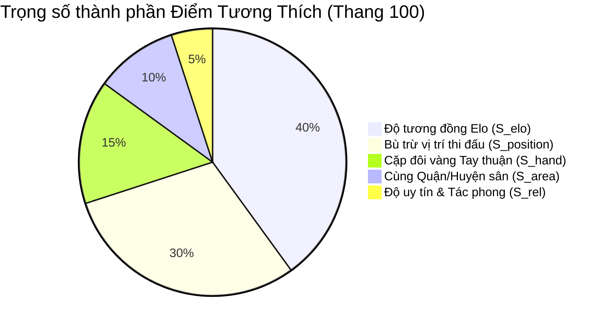

# ĐẶC TẢ TÍNH NĂNG VÀ TÀI LIỆU TÍCH HỢP: TÌM ĐỒNG ĐỘI (PARTNER FINDER)

**Mã chức năng:** WBS 3.1 & M4 | CR-02  
**Đối tượng sử dụng chính:** TV2 (Nguyễn Đức Đạt - Mobile Dev dựng giao diện trên Expo) & Báo cáo kỹ thuật đồ án.  
**Căn cứ pháp lý & kỹ thuật:**
- Skill `badminton-domain-rules` (ràng buộc nội dung đánh đôi nam / đôi nữ / đôi nam nữ).
- Skill `badminton-rating` & `docs/06-rating-scale.md` (chênh lệch Elo $\le 150$ điểm, ma trận bù trừ vị trí và tay thuận).
- Quyết định phê duyệt của TV1 ngày 15/11/2026.

---

## 1. Mục tiêu và phạm vi nghiệp vụ (Scope)

Partner Finder phục vụ nhu cầu **tìm kiếm bạn đánh cặp cố định (Fixed Partner)** có cùng trình độ và lối chơi bổ trợ cho nhau.

> [!IMPORTANT]
> **Phân định rõ với Tuyển vãng lai (Match Lobby - CR-02):**
> - **Partner Finder:** Là tính năng tìm người đánh cặp đôi dài hạn dựa trên tương thích lối chơi và Elo $\le 150$. Không tạo slot sân, không có danh sách dự bị.
> - **Match Lobby:** Là tính năng tổ chức buổi đánh tại sân (kèo), host tuyển người chơi vãng lai lấp chỗ trống theo công thức `slot = min(4, 8 - core)`.

---

## 2. Công thức tính điểm tương thích (Match Score $0..100$)

Điểm tương thích tổng hợp của một cặp đôi là tổng của **5 thành phần** có trọng số cụ thể:

$$\text{MatchScore} = S_{\text{elo}} + S_{\text{position}} + S_{\text{hand}} + S_{\text{area}} + S_{\text{reliability}}$$



### A. Độ tương đồng điểm Elo ($S_{\text{elo}}$ - Tối đa 40 điểm)
- Công thức:
  $$S_{\text{elo}} = 40 \times \max\left(0, 1 - \frac{|\text{Rating}_{\text{seeker}} - \text{Rating}_{\text{candidate}}|}{\text{allowedEloDiff}}\right)$$
- `allowedEloDiff` mặc định là $150$ điểm (`RATING_CONFIG.PARTNER_FINDER_MAX_ELO_DIFF`). Nếu có người đang trong giai đoạn Provisional (dưới 5 trận) và bật cờ nới lỏng, giới hạn nới lên $200$ điểm.
- Nếu $|\Delta\text{Elo}| > \text{allowedEloDiff}$: Ứng viên bị **loại khỏi danh sách** (Lọc cứng).

### B. Bù trừ vị trí thi đấu ($S_{\text{position}}$ - Tối đa 30 điểm)
Dựa trên ma trận lối chơi (Cầu trước - Net play vs Cầu sau - Smash power):
- **Cầu trước (`front`) + Cầu sau (`back`)** hoặc ngược lại: **30/30 điểm** (Bù trừ âm - dương hoàn hảo).
- **Toàn diện (`both`) + Cầu trước (`front`)** hoặc **Cầu sau (`back`)**: **22/30 điểm** (Bổ trợ rất tốt).
- **Toàn diện (`both`) + Toàn diện (`both`)**: **18/30 điểm** (Lối chơi cân bằng, dễ hoán đổi).
- **Chưa xác định / Thiếu dữ liệu:** **10/30 điểm** (Mức trung tính).
- **Cùng chuyên lưới (`front` + `front`)** hoặc **Cùng chuyên công (`back` + `back`)**: **0/30 điểm** và gắn thẻ cảnh báo màu vàng trên UI.

### C. Bù trừ tay thuận ($S_{\text{hand}}$ - Tối đa 15 điểm)
- **Tay phải (`right`) + Tay trái (`left`)**: **15/15 điểm** (Huy hiệu "Cặp đôi vàng").
- **Cùng tay phải hoặc cùng tay trái:** **5/15 điểm** (Mức tiêu chuẩn).

### D. Cùng khu vực sân tại Đà Nẵng ($S_{\text{area}}$ - Tối đa 10 điểm)
- Cùng Quận/Huyện (`seeker.areaLabel === candidate.areaLabel`): **10/10 điểm**.
- Khác quận: **0/10 điểm**.

### E. Điểm uy tín & Tác phong ($S_{\text{reliability}}$ - Tối đa 5 điểm)
- Điểm uy tín $\ge 90$: **5/5 điểm** (Huy hiệu "Uy tín cao").
- Điểm uy tín $70 - 89$: **4/5 điểm**.
- Điểm uy tín $50 - 69$: **2/5 điểm**.
- Điểm uy tín $< 50$: **0/5 điểm** (Cảnh báo "Uy tín thấp - cần lưu ý").

---

## 3. Ràng buộc Giới tính & Nội dung đánh đôi (Skill `badminton-domain-rules`)

Bộ lọc `category` bắt buộc tuân thủ luật nghiệp vụ:
| Nội dung (`category`) | Ràng buộc người tìm (`seeker`) | Ràng buộc ứng viên (`candidate`) | Ghi chú |
|---|---|---|---|
| `men` (Đôi nam) | Nam (`gender === "M"`) | Nam (`gender === "M"`) | Nếu seeker là Nữ, chặn tìm đôi nam |
| `women` (Đôi nữ) | Nữ (`gender === "F"`) | Nữ (`gender === "F"`) | Nếu seeker là Nam, chặn tìm đôi nữ |
| `mixed` (Đôi nam nữ) | Bất kỳ | Giới tính khác seeker (`M` tìm `F`, `F` tìm `M`) | Bắt buộc 1 Nam + 1 Nữ |

---

## 4. Quy tắc Tie-break xác định (Deterministic Sorting)

Để danh sách hiển thị trên mobile luôn ổn định và nhất quán 100% giữa các lần làm mới (không bị nhảy vị trí ngẫu nhiên):
1. **`matchScore` giảm dần** (Điểm tương thích cao hơn đứng đầu).
2. **`eloDiff` tăng dần** (Chênh lệch Elo ít hơn đứng trước).
3. **`skill.reliability` giảm dần** (Uy tín cao hơn đứng trước).
4. **`skill.matchesPlayed` giảm dần** (Nhiều kinh nghiệm thi đấu hơn đứng trước).
5. **`uid` tăng dần theo thứ tự từ điển string** (Đảm bảo thứ tự tuyệt đối).

---

## 5. Cấu trúc dữ liệu trả về (TypeScript Interface)

```typescript
export interface PartnerMatchItem {
  user: UserProfile;         // Thông tin đầy đủ của đối tác
  matchScore: number;        // Điểm tương thích 0 - 100
  eloDiff: number;           // Chênh lệch Elo thực tế (|seeker - candidate|)
  reasons: string[];         // Các nhãn khen/lý do điểm cộng (Chip xanh)
  warnings: string[];        // Các nhãn cảnh báo (Chip vàng/đỏ)
  breakdown: {
    eloScore: number;        // Điểm Elo (0 - 40)
    positionScore: number;   // Điểm vị trí (0 - 30)
    handScore: number;       // Điểm tay thuận (0 - 15)
    areaScore: number;       // Điểm khu vực (0 - 10)
    reliabilityScore: number;// Điểm uy tín (0 - 5)
  };
  isProvisional: boolean;    // true nếu đối tác đang trong 5 trận đầu
}
```

---

## 6. Mẫu dữ liệu JSON trả về (Mock Sample cho TV2 dựng UI)

```json
[
  {
    "user": {
      "uid": "usr_tran_thi_b",
      "displayName": "Trần Thị B",
      "gender": "F",
      "phoneNumber": "0912345678",
      "avatarUrl": "https://images.unsplash.com/photo-1544005313-94ddf0286df2",
      "areaLabel": "Hải Châu",
      "position": "front",
      "dominantHand": "left",
      "selfDeclaredLevel": 4,
      "role": "player",
      "skill": {
        "rating": 1520,
        "matchesPlayed": 18,
        "reliability": 96,
        "isProvisional": false
      },
      "fcmTokens": [],
      "schemaVersion": 1,
      "isDeleted": false,
      "createdAt": "2026-11-01T08:00:00.000Z",
      "updatedAt": "2026-11-15T10:00:00.000Z"
    },
    "matchScore": 99,
    "eloDiff": 20,
    "reasons": [
      "Trình độ rất tương đồng (lệch 20 điểm)",
      "Bù trừ vị trí hoàn hảo (Cầu trước + Cầu sau)",
      "Cặp đôi vàng (Tay phải + Tay trái)",
      "Cùng khu vực Hải Châu",
      "Độ uy tín cao (96/100)"
    ],
    "warnings": [],
    "breakdown": {
      "eloScore": 35,
      "positionScore": 30,
      "handScore": 15,
      "areaScore": 10,
      "reliabilityScore": 5
    },
    "isProvisional": false
  },
  {
    "user": {
      "uid": "usr_le_van_c",
      "displayName": "Lê Văn C",
      "gender": "M",
      "areaLabel": "Thanh Khê",
      "position": "front",
      "dominantHand": "right",
      "selfDeclaredLevel": 4,
      "role": "player",
      "skill": {
        "rating": 1490,
        "matchesPlayed": 4,
        "reliability": 80,
        "isProvisional": true
      },
      "fcmTokens": [],
      "schemaVersion": 1,
      "isDeleted": false,
      "createdAt": "2026-11-10T09:00:00.000Z",
      "updatedAt": "2026-11-14T15:00:00.000Z"
    },
    "matchScore": 77,
    "eloDiff": 10,
    "reasons": [
      "Trình độ rất tương đồng (lệch 10 điểm)",
      "Bù trừ vị trí hoàn hảo (Cầu trước + Cầu sau)"
    ],
    "warnings": [
      "Người chơi mới đang trong giai đoạn hiệu chỉnh rank (4/5 trận)"
    ],
    "breakdown": {
      "eloScore": 37,
      "positionScore": 30,
      "handScore": 5,
      "areaScore": 0,
      "reliabilityScore": 4
    },
    "isProvisional": true
  }
]
```

---

## 7. Hướng dẫn TV2 tích hợp vào Expo Client

### Cách 1: Sử dụng hàm truy vấn tích hợp Firestore (`fetchRecommendedPartners`)
Dùng khi lấy dữ liệu trực tiếp từ Cloud Firestore có phân trang tự động:

```typescript
import { db } from "../config/firebase";
import { fetchRecommendedPartners } from "../domain/partnerFinder";

// Trong màn hình PartnerFinderScreen.tsx
const loadPartners = async () => {
  const result = await fetchRecommendedPartners(
    db,
    currentUserProfile,
    {
      category: "mixed",          // 'men' | 'women' | 'mixed'
      areaLabel: "Hải Châu",      // Lọc theo quận nếu người dùng chọn
      levelMin: 3,
      levelMax: 5,
    },
    { limitCount: 20 }
  );

  console.log("Tìm thấy đối tác:", result.items);
  // result.hasMore để điều khiển nút Xem thêm / Infinite Scroll
};
```

### Cách 2: Sử dụng hàm thuần `findPartners` với Mock Data
Dùng trong giai đoạn làm UI chưa kết nối Firestore hoặc chạy Offline:

```typescript
import { findPartners } from "../domain/partnerFinder";
import mockUsers from "../mocks/users.json";

const recommendedList = findPartners(
  currentUser,
  mockUsers,
  { category: "men" }
);
```

---

## 8. Chỉ mục Firestore cần thiết (`firestore.indexes.json`)

Đã được cấu hình sẵn trong dự án:
```json
{
  "collectionGroup": "users",
  "queryScope": "COLLECTION",
  "fields": [
    { "fieldPath": "isDeleted", "order": "ASCENDING" },
    { "fieldPath": "gender", "order": "ASCENDING" },
    { "fieldPath": "skill.rating", "order": "ASCENDING" }
  ]
}
```
Query tự động lọc range Elo và giới tính trên server, đảm bảo chi phí đọc (document read) luôn ở mức tối thiểu.
