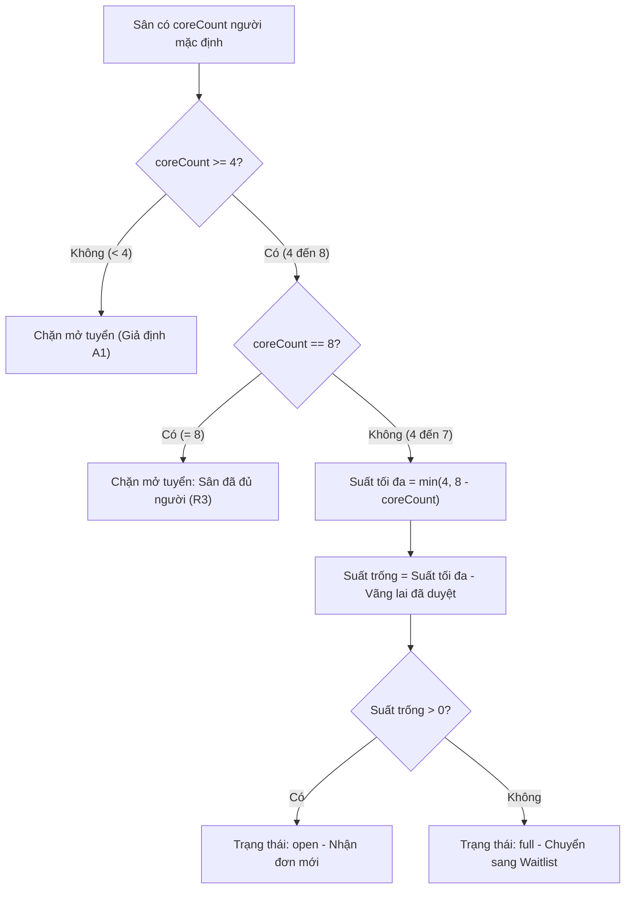
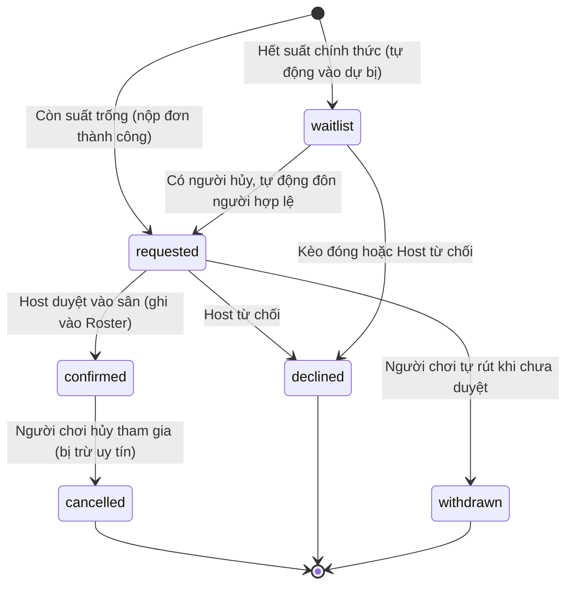

# ĐẶC TẢ TÍNH NĂNG VÀ TÀI LIỆU TÍCH HỢP: TUYỂN VÃNG LAI & ĐẶT SUẤT (RECRUIT SLOTS & WAITLIST)

**Mã chức năng:** WBS 3.2 & M5 | CR-02  
**Đối tượng sử dụng chính:** TV2 (Nguyễn Đức Đạt - Mobile Dev dựng màn hình Phòng kèo 4.2 & Danh sách kèo) & Báo cáo kỹ thuật đồ án.  
**Căn cứ pháp lý & kỹ thuật:**
- Skill `badminton-domain-rules` (Luật R2, R3, R4, R6, R7, R8, R9).
- Skill `recruit-slot-matching` (Công thức suất, bảng mã lỗi, vòng đời đơn, Heuristic Fit Score).
- Các quyết định thống nhất với TV1 ngày 15/11/2026 (Giả định A1, A2, A3, A4, A5).

---

## 1. Nguồn sự thật về Luật nghiệp vụ tuyển vãng lai



### Các quy tắc cốt lõi:
1. **Chỉ tuyển khi sân thiếu:** Host chỉ mở tuyển vãng lai khi sân có từ **4 đến 7 người mặc định** (R3, Giả định A1). Sân 8 người mặc định không mở tuyển.
2. **Công thức tính suất tuyển:**
   $$\text{Tổng suất tuyển} = \min(4, 8 - \text{Số người mặc định})$$
   $$\text{Suất còn trống} = \text{Tổng suất tuyển} - \text{Số vãng lai đã Host duyệt}$$

   | Người mặc định (`coreCount`) | Tổng suất tuyển tối đa | Số vãng lai tối đa |
   |:---:|:---:|:---:|
   | **4** | **4 suất** | 4 |
   | **5** | **3 suất** | 3 |
   | **6** | **2 suất** | 2 |
   | **7** | **1 suất** | 1 |
   | **8** | **0 suất** (Đầy sân) | 0 |

3. **Giới hạn bất biến:** Mỗi sân tối đa **8 người** (cả mặc định lẫn vãng lai). Mỗi kèo tối đa **2 sân** (tối đa 16 người).
4. **Thành viên mặc định chưa có tài khoản (Ghost member - A2):** Host có quyền tự thêm bạn bè vào nhóm mặc định bằng cách nhập tên, giới tính, cấp độ tự khai (`isGhost: true`). Các thành viên này vẫn chiếm chỗ trên sân nhưng không có tài khoản app.
5. **Chặn tăng người mặc định khi đã duyệt vãng lai (Hard Block - A4):** Nếu `số người mặc định mới + số vãng lai đã duyệt > 8`, hệ thống **chặn đứng thao tác**. Host phải chủ động hủy duyệt bớt vãng lai trước khi thêm bạn mình.
6. **Host duyệt tay 100% (A3 & R9):** Không có tự động duyệt. Đơn xin tham gia vào trạng thái `requested`, Host xem danh sách đã được xếp hạng thông minh và bấm **"Duyệt"** hoặc **"Từ chối"**.
7. **Ràng buộc giới tính theo nội dung (Luật R6):**
   - Đôi nam (`men`): Chỉ nhận Nam.
   - Đôi nữ (`women`): Chỉ nhận Nữ.
   - Đôi nam nữ (`mixed`): Hướng tới cân bằng $4 \text{ Nam} + 4 \text{ Nữ}$. Vãng lai giới tính $G$ chỉ được duyệt nếu sau khi duyệt:
     $$\text{Số người giới } G \le \max(4, \text{Số người mặc định giới } G)$$

---

## 2. Vòng đời đơn xin tham gia (Request Lifecycle)



---

## 3. Bảng mã lỗi kiểm tra điều kiện (Eligibility Validation)

Hàm `validateJoinEligibility(court, session, candidate)` kiểm tra lần lượt theo thứ tự, dừng ở lỗi đầu tiên để TV2 hiển thị thông báo lỗi rõ ràng trên UI:

| Thứ tự | Mã lỗi (`errorCode`) | Điều kiện kiểm tra | Thông điệp hiển thị cho người dùng |
|:---:|---|---|---|
| **1** | `SESSION_CLOSED` | `session.status === "open"` | Buổi đánh này hiện không còn mở nhận thêm người. |
| **2** | `RECRUIT_CLOSED` | `court.recruitOpen === true` | Sân này hiện đang đóng tuyển vãng lai. |
| **3** | `ALREADY_IN_SESSION` | Người chơi chưa ở bất kỳ sân nào của kèo (R7) | Bạn đã có tên trong danh sách thành viên của buổi đánh này. |
| **4** | `TIME_CONFLICT` | Không trùng khung giờ với kèo khác đang tham gia | Bạn đang tham gia một buổi đánh khác bị trùng khung giờ thi đấu. |
| **5** | `GENDER_NOT_ALLOWED` | Thỏa mãn luật giới tính R6 | Giới tính của bạn không phù hợp với nội dung sân này. |
| **6** | `LEVEL_OUT_OF_RANGE` | Cấp độ nằm trong `[levelMin, levelMax]` | Trình độ của bạn không nằm trong khoảng yêu cầu của sân. |
| **7** | `RELIABILITY_TOO_LOW` | `reliability >= minReliability` | Điểm uy tín của bạn thấp hơn mức tối thiểu yêu cầu của sân. |
| **8** | `NO_SLOT` | Còn suất trống (`open > 0`) | **Hết suất chính thức. Bạn được đưa vào danh sách dự bị (Waitlist).** |

> [!NOTE]
> Riêng đối với lỗi **`NO_SLOT`**, hệ thống trả về cờ `canWaitlist: true`. Giao diện Expo hiển thị popup: *"Sân đã hết chỗ chính thức, bạn có muốn đăng ký vào danh sách dự bị để được đôn lên khi có người rút không?"*.

---

## 4. Thuật toán Heuristic Fit Score (Gợi ý cho Host)

Khi Host mở danh sách đơn xin tham gia, hệ thống tự động tính điểm phù hợp ($0..100$) để đưa ứng viên sáng giá nhất lên đầu:

$$\text{TotalFit} = \text{levelScore } (0..40) + \text{positionScore } (0..25) + \text{reliabilityScore } (0..25) + \text{earlyScore } (0..10)$$

1. **`levelScore` ($0..40$):** So sánh điểm Elo của ứng viên với điểm Elo trung bình hiện tại của sân:
   $$\text{levelScore} = 40 \times \left(1 - \frac{|\text{Rating} - \text{Rating}_{\text{avg}}|}{200}\right)$$
2. **`positionScore` ($0..25$):**
   - **$25$ điểm:** Bù đúng vị trí sân đang thiếu (ví dụ sân có 3 người chuyên đập cầu sau, ứng viên là chuyên lưới cầu trước).
   - **$15$ điểm:** Lối chơi toàn diện (`both`), dễ xoay vòng.
   - **$5$ điểm:** Trùng vị trí sân đã quá thừa.
3. **`reliabilityScore` ($0..25$):** Tỷ lệ thuận theo điểm uy tín: $(\text{reliability} / 100) \times 25$.
4. **`earlyScore` ($0..10$):** Ưu tiên người nộp sớm ($10$ điểm cho người nộp đầu tiên, giảm dần cho người sau).

---

## 5. Hướng dẫn TV2 tích hợp vào Expo Client

### A. Lấy thông tin số suất hiển thị trên Card kèo
```typescript
import { computeSlots, getAvailableGenderSlots } from "../domain/recruit";

// Trong component SessionCourtCard.tsx
const slotInfo = computeSlots(coreCount, recruitConfirmed);
const genderSlot = getAvailableGenderSlots(court.category, court.roster, slotInfo.open);

console.log(genderSlot.label); // "Còn 3 suất: tối đa 2 nam, 1 nữ"
```

### B. Người chơi nộp đơn xin tham gia
```typescript
import { db } from "../config/firebase";
import { submitRecruitRequestTx } from "../domain/recruit";

const handleJoin = async () => {
  try {
    const result = await submitRecruitRequestTx(
      db,
      sessionId,
      courtId,
      currentUserProfile,
      "Mình đánh TB+ hay đi đều đặn, xin host 1 slot!"
    );
    
    if (result.status === "requested") {
      Alert.alert("Thành công", "Đã gửi đơn, chờ Host duyệt!");
    } else if (result.status === "waitlist") {
      Alert.alert("Danh sách dự bị", "Bạn đang ở hàng đợi dự bị!");
    }
  } catch (err: any) {
    Alert.alert("Không thể tham gia", err.message);
  }
};
```

### C. Host duyệt hoặc từ chối đơn
```typescript
import { approveRecruitRequestTx, declineRecruitRequestTx } from "../domain/recruit";

// Duyệt người vào sân (Atomic Transaction, chống race condition)
await approveRecruitRequestTx(db, sessionId, courtId, hostUid, requestId);

// Từ chối
await declineRecruitRequestTx(db, sessionId, hostUid, requestId);
```

### D. Host thêm người mặc định (Core / Ghost)
```typescript
import { addCoreMemberTx } from "../domain/recruit";

// Thêm bạn bè chưa có tài khoản (Ghost member)
await addCoreMemberTx(db, sessionId, courtId, hostUid, {
  displayName: "Anh Hùng (bạn host)",
  gender: "M",
  rating: 1500,
  level: 4,
  position: "back",
  dominantHand: "right",
  isGhost: true,
  checkedIn: false,
});
// Nếu vượt quá 8 người, hàm sẽ ném lỗi: "Không thể thêm người mặc định. Tổng số người vượt quá 8..."
```

### E. Người chơi hủy tham gia
```typescript
import { cancelParticipationTx } from "../domain/recruit";

const result = await cancelParticipationTx(db, sessionId, courtId, currentUserUid);
console.log(result.message); // Tự động đôn người trong waitlist lên requested nếu có
```

---

## 6. Mẫu dữ liệu JSON trả về cho TV2

### Danh sách đơn chờ duyệt kèm Heuristic Fit Score
```json
[
  {
    "request": {
      "id": "req_user_02",
      "courtId": "1",
      "sessionId": "sess_01",
      "userId": "usr_tran_van_b",
      "status": "requested",
      "snapshot": {
        "displayName": "Trần Văn B",
        "gender": "M",
        "rating": 1520,
        "level": 4,
        "position": "front",
        "dominantHand": "left",
        "reliability": 95
      },
      "note": "Mình xin 1 chân đứng lưới nhé host!",
      "createdAt": "2026-11-15T08:10:00.000Z"
    },
    "fitScore": {
      "levelScore": 38,
      "positionScore": 25,
      "reliabilityScore": 24,
      "earlyScore": 10,
      "totalFit": 97,
      "reasons": [
        "Trình độ tương đương mức trung bình của nhóm",
        "Bổ sung đúng vị trí cầu trước/bắt lưới nhóm đang thiếu",
        "Uy tín rất cao (95 điểm)",
        "Đăng ký sớm nhất"
      ]
    }
  }
]
```
