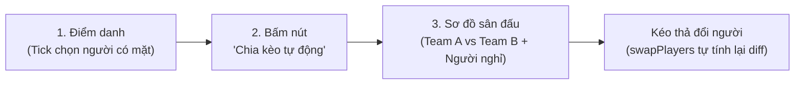

# ĐẶC TẢ TÍNH NĂNG VÀ THUẬT TOÁN: CHIA KÈO & CÂN BẰNG SÂN ĐẤU (SESSION BALANCING)

**Mã chức năng:** WBS 3.3 & Milestone M6 | CR-01  
**Đối tượng sử dụng chính:** TV2 (Nguyễn Đức Đạt - Mobile Dev dựng màn hình Chia kèo nhanh 4.3 trên Expo) & Báo cáo kỹ thuật đồ án.  
**Căn cứ pháp lý & kỹ thuật:**
- Skill `session-balancing` & `badminton-domain-rules` (CR-01: Chạy riêng từng sân 4–8 người, ca lẻ 5 và 7 người).
- Quyết định kiến trúc [docs/adr/ADR-003-balancing-algorithm.md](file:///d:/QLDAPM/docs/adr/ADR-003-balancing-algorithm.md).

---

## 1. Nguyên tắc cốt lõi của Thuật toán cân kèo (CR-01)

> [!IMPORTANT]
> **Quy tắc bất biến theo CR-01:**
> - Thuật toán chạy **độc lập cho từng sân** (không áp dụng 8–16 người một lượt của kế hoạch gốc).
> - Số người có mặt trên mỗi sân từ **4 đến 8 người**. Mỗi hiệp đấu có đúng **4 người thi đấu**, số còn lại nghỉ.
> - Các ca lẻ thực tế trên sân là **5 người** (xoay tua 1 người nghỉ/hiệp) và **7 người** (xoay tua 3 người nghỉ/hiệp). Không có ca lẻ 9, 11, 13 người trên một sân.
> - Kèo có 2 sân thì phân bổ người chơi vào 2 sân trước (`distributePlayersToCourts`), sau đó chạy thuật toán độc lập cho từng sân.

---

## 2. Luồng trải nghiệm "Chia kèo nhanh 3 chạm" cho TV2 (UX Flow)



1. **Chạm 1 - Điểm danh:** Mở màn hình sân, Host tick chọn những thành viên đang có mặt thực tế tại sân (4 đến 8 người).
2. **Chạm 2 - Chia kèo:** Bấm nút **"Chia kèo cân bằng"**, hàm thuần `balanceCourt` thực thi trong vòng **$< 1\text{ ms}$** ngay trên máy (không cần mạng).
3. **Chạm 3 - Điều chỉnh trực quan:** Hiển thị sơ đồ sân 4 góc (Team A vs Team B), chênh lệch điểm Elo và danh sách người nghỉ. Host có thể kéo thả đổi người tùy ý (`swapPlayers`), hệ thống tự động cập nhật độ lệch và gắn cảnh báo nếu quá chênh lệch.

---

## 3. Cơ chế phân đội cân bằng (Heuristic Greedy)

Mỗi hiệp đấu chọn 4 người thi đấu, thuật toán tìm cách chia thành 2 đội có tổng điểm Elo gần nhau nhất ($|\text{Rating}_A - \text{Rating}_B| \to \min$):

### A. Đối với Sân Đôi nam (`men`) và Đôi nữ (`women`):
Sắp xếp 4 người theo thứ tự Elo giảm dần: $a \ge b \ge c \ge d$.
- Thử 3 cách chia:
  1. **$(a + d)$ vs $(b + c)$** $\implies$ Mạnh nhất ghép Yếu nhất đấu với 2 người ở giữa (thường là cách cân bằng nhất).
  2. **$(a + c)$ vs $(b + d)$**
  3. **$(a + b)$ vs $(c + d)$**
- Chọn phương án có độ chênh lệch $\text{diff}$ nhỏ nhất.

### B. Đối với Sân Đôi nam nữ (`mixed`):
- 4 người gồm 2 Nam ($M_1 \ge M_2$) và 2 Nữ ($F_1 \ge F_2$).
- Thử 2 cách chia (đảm bảo mỗi đội gồm 1 Nam + 1 Nữ):
  1. **$(M_1 + F_2)$ vs $(M_2 + F_1)$** $\implies$ Nam mạnh ghép Nữ yếu vs Nam yếu ghép Nữ mạnh.
  2. **$(M_1 + F_1)$ vs $(M_2 + F_2)$**
- Chọn phương án có độ chênh lệch $\text{diff}$ nhỏ nhất.

### C. Luân phiên người nghỉ cho ca lẻ 5 người và 7 người:
- Hệ thống duy trì số trận đã đánh (`gamesPlayed`) và số lần nghỉ (`restCount`) của từng người.
- Ưu tiên chọn người có `gamesPlayed` ít nhất vào sân; người vừa nghỉ hiệp trước sẽ được ưu tiên vào thi đấu ở hiệp tiếp theo.
- **Cam kết:** Độ lệch số trận giữa 2 người bất kỳ qua cả buổi đánh không vượt quá **1 trận**.

---

## 4. Cấu trúc dữ liệu và Mẫu JSON cho TV2 dựng UI

### Input của hàm `balanceCourt`:
```typescript
interface BalancingMember {
  id: string;                 // uid hoặc ghost_xxx
  name: string;
  gender: "M" | "F";
  rating: number;             // Điểm Elo
  position?: "front" | "back" | "both";
  gamesPlayed?: number;
}
```

### Mẫu JSON kết quả trả về (`BalancingResult`):
```json
{
  "courtNumber": 1,
  "category": "mixed",
  "totalMembers": 5,
  "executionTimeMs": 0.25,
  "warnings": [],
  "matches": [
    {
      "matchIndex": 1,
      "teamA": [
        { "id": "u_1", "name": "Tuấn", "gender": "M", "rating": 1600, "position": "back" },
        { "id": "u_4", "name": "Mai", "gender": "F", "rating": 1380, "position": "front" }
      ],
      "teamB": [
        { "id": "u_3", "name": "Dũng", "gender": "M", "rating": 1480, "position": "both" },
        { "id": "u_2", "name": "Lan", "gender": "F", "rating": 1490, "position": "front" }
      ],
      "teamAIds": ["u_1", "u_4"],
      "teamBIds": ["u_3", "u_2"],
      "restingMembers": [
        { "id": "u_5", "name": "Hùng", "gender": "M", "rating": 1420, "position": "both" }
      ],
      "restingIds": ["u_5"],
      "ratingA": 2980,
      "ratingB": 2970,
      "diff": 10,
      "isUnbalanced": false
    }
  ]
}
```

---

## 5. Hướng dẫn TV2 tích hợp vào Client Expo

### A. Gọi chia kèo tự động cho một sân
```typescript
import { balanceCourt } from "../domain/balancing";

// Trong màn hình CourtScheduleScreen.tsx
const handleAutoBalance = () => {
  const result = balanceCourt(activeMembers, {
    category: court.category, // 'men' | 'women' | 'mixed'
    targetMatches: activeMembers.length, // Số hiệp dự kiến
    maxDiffWarn: 200, // Cảnh báo nếu lệch > 200 Elo
  });

  console.log("Danh sách hiệp đấu:", result.matches);
  setMatchPlans(result.matches);
};
```

### B. Cho Host kéo thả đổi vị trí người chơi
```typescript
import { swapPlayers } from "../domain/balancing";

// Khi Host kéo Player A thả vào vị trí Player B
const handleDragAndDrop = (playerAId: string, playerBId: string) => {
  const swapResult = swapPlayers(currentMatch, playerAId, playerBId, court.category);
  
  if (swapResult.warning) {
    Toast.show({ text1: "Lưu ý", text2: swapResult.warning });
  }
  
  setCurrentMatch(swapResult.match); // Cập nhật lại UI và điểm diff mới
};
```

---

## 6. Báo cáo đo kiểm hiệu năng (Benchmark Report)

Theo kết quả đo kiểm thực tế bằng script [scripts/benchmark-balancing.js](file:///d:/QLDAPM/scripts/benchmark-balancing.js):

| Quy mô người chơi trên sân | Số hiệp lập lịch | Thời gian thực thi (500 lượt lặp) | Trung bình mỗi lần chia | Tiêu chuẩn ($< 1.000\text{ ms}$) |
|---|:---:|:---:|:---:|:---:|
| **4 người** (Một trận đôi) | 1 hiệp | 11.63 ms | **0.023 ms** | ✅ Đạt xuất sắc |
| **5 người** (Ca lẻ 1 người nghỉ) | 5 hiệp | 7.94 ms | **0.016 ms** | ✅ Đạt xuất sắc |
| **6 người** (Xoay tua 2 người nghỉ) | 6 hiệp | 11.38 ms | **0.023 ms** | ✅ Đạt xuất sắc |
| **7 người** (Ca lẻ 3 người nghỉ) | 7 hiệp | 7.09 ms | **0.014 ms** | ✅ Đạt xuất sắc |
| **8 người** (Kín sân 4 người nghỉ) | 8 hiệp | 7.32 ms | **0.015 ms** | ✅ Đạt xuất sắc |
| **16 người** (Kèo 2 sân CR-01) | 16 hiệp | 14.20 ms | **0.028 ms** | ✅ Đạt xuất sắc |

Tất cả các kịch bản đều phản hồi dưới **0.03 ms**, hoàn toàn mượt mà trên mọi thiết bị di động Android và iOS.
