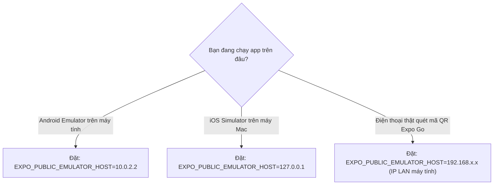

# HƯỚNG DẪN CẤU HÌNH MÔI TRƯỜNG FIREBASE & KẾT NỐI EMULATOR

**Dự án:** Hệ thống ghép đội và cân bằng kèo cầu lông (Mobile App)  
**Tài liệu:** `docs/firebase-env.md`  
**Phiên bản:** 1.0 (Hướng dẫn kỹ thuật cho TV1 & TV2)  
**Người soạn:** Đào Duy Nhật (TV1 - PM & Backend)  
**Tài liệu liên quan:** `docs/adr/ADR-001-backend-approach.md`, `firebase.json`, `.env.example`  

---

## 1. NGUYÊN TẮC BẢO MẬT & PHÂN BIỆT THÔNG TIN CẤU HÌNH

### 1.1 Thông tin Cấu hình Client (Public Configuration)
- **Bản chất:** `apiKey`, `authDomain`, `projectId`, `appId` trong `firebaseConfig` của ứng dụng Mobile **KHÔNG PHẢI LÀ KHÓA BÍ MẬT**.
- Các khóa này được đóng gói công khai vào file APK/IPA để ứng dụng điện thoại biết cách kết nối tới đúng máy chủ Firebase trên Cloud.
- **Cơ chế bảo vệ dữ liệu:** Firebase bảo vệ dữ liệu bằng **Firestore Security Rules** và **Firebase Authentication**, không dựa vào việc giấu `apiKey`.
- Dù vậy, để linh hoạt chuyển đổi giữa môi trường Dev (Emulator) và Production, các biến này được đưa vào file `.env` theo chuẩn của Expo: bắt đầu bằng tiền tố `EXPO_PUBLIC_`.

### 1.2 Khóa bí mật máy chủ (Service Account Private Key) - TUYỆT ĐỐI BÍ MẬT
- **Bản chất:** File `service-account.json` (hoặc biến `GOOGLE_APPLICATION_CREDENTIALS`) là khóa tối cao của quản trị viên (Admin SDK). Nó có quyền **BỎ QUA TOÀN BỘ SECURITY RULES** để đọc/ghi mọi dữ liệu.
- **Quy tắc bất biến:**
  - ❌ **TUYỆT ĐỐI KHÔNG** commit file `service-account.json` hoặc khóa private key vào Git.
  - File `.gitignore` đã chặn tất cả các file dạng `*service-account*.json`, `*credentials*.json`.
  - Không bao giờ nhúng Private Key của Admin vào code của Mobile App.

---

## 2. DANH SÁCH BIẾN MÔI TRƯỜNG EXPO (`.env`)

Tạo file `.env` tại thư mục gốc (sao chép từ `.env.example`):

```env
# 1. Cấu hình định danh Firebase Project (lấy từ Firebase Console -> Project Settings)
EXPO_PUBLIC_FIREBASE_API_KEY=AIzaSy...
EXPO_PUBLIC_FIREBASE_AUTH_DOMAIN=badminton-danang.firebaseapp.com
EXPO_PUBLIC_FIREBASE_PROJECT_ID=badminton-danang
EXPO_PUBLIC_FIREBASE_STORAGE_BUCKET=badminton-danang.appspot.com
EXPO_PUBLIC_FIREBASE_MESSAGING_SENDER_ID=123456789012
EXPO_PUBLIC_FIREBASE_APP_ID=1:123456789012:web:abcdef...

# 2. Cờ điều hướng môi trường (true: kết nối máy local; false: kết nối Cloud thật)
EXPO_PUBLIC_USE_FIREBASE_EMULATOR=true

# 3. Địa chỉ IP của máy tính host chạy Emulator
EXPO_PUBLIC_EMULATOR_HOST=10.0.2.2
```

---

## 3. CÁCH KẾT NỐI FIREBASE EMULATOR TỪ EXPO (DÀNH CHO TV2)

Khi dev trên máy cục bộ, cả TV1 và TV2 không cần kết nối Internet hoặc Firebase Cloud thật mà kết nối vào **Firebase Emulator Suite** chạy trên máy tính.

### 3.1 Bảng phân bổ cổng (Port Mapping) mặc định
| Dịch vụ Emulator | Cổng (Port) | Địa chỉ URL cục bộ |
|---|:---:|---|
| **Firebase Emulator UI (Giao diện Web)** | **4000** | `http://localhost:4000` |
| **Cloud Firestore Emulator** | **8080** | `http://localhost:8080` |
| **Firebase Authentication Emulator** | **9099** | `http://localhost:9099` |
| **Cloud Functions Emulator** | **5001** | `http://localhost:5001` |

### 3.2 Hướng dẫn cấu hình IP `EXPO_PUBLIC_EMULATOR_HOST` theo thiết bị

Tuỳ vào việc bạn đang chạy app bằng công cụ nào, hãy đặt giá trị `EXPO_PUBLIC_EMULATOR_HOST` trong `.env` tương ứng:



1. **Trường hợp 1: Chạy trên Android Emulator (Android Studio)**
   - Android Emulator coi máy ảo là một thiết bị riêng. Nó ánh xạ địa chỉ IP **`10.0.2.2`** trỏ về cổng `127.0.0.1` của máy tính.
   - Cấu hình trong `.env`:
     ```env
     EXPO_PUBLIC_EMULATOR_HOST=10.0.2.2
     ```

2. **Trường hợp 2: Chạy trên iOS Simulator (Xcode trên macOS)**
   - iOS Simulator dùng chung ngăn xếp mạng với máy tính Mac.
   - Cấu hình trong `.env`:
     ```env
     EXPO_PUBLIC_EMULATOR_HOST=127.0.0.1
     ```

3. **Trường hợp 3: Chạy trên Điện thoại thật (Cài Expo Go quét QR)**
   - Điện thoại thật và máy tính chạy Emulator phải **kết nối cùng một mạng Wi-Fi**.
   - Tìm địa chỉ IP LAN của máy tính:
     - Trên Windows: Mở cmd gõ `ipconfig` $\to$ tìm `IPv4 Address` của card Wi-Fi (ví dụ: `192.168.1.15`).
     - Trên Mac/Linux: Mở terminal gõ `ifconfig` $\to$ tìm `inet` của `en0` (ví dụ: `192.168.1.15`).
   - Cấu hình trong `.env`:
     ```env
     EXPO_PUBLIC_EMULATOR_HOST=192.168.1.15
     ```

---

## 4. ĐOẠN MÃ KHỞI TẠO SDK KẾT NỐI EMULATOR TRONG MÃ NGUỒN

Đoạn mã mẫu đặt tại `src/config/firebase.ts` để tự động chuyển đổi giữa Cloud thật và Emulator:

```typescript
import { initializeApp, getApps, getApp } from "firebase/app";
import { getAuth, connectAuthEmulator } from "firebase/auth";
import { getFirestore, connectFirestoreEmulator } from "firebase/firestore";
import { getFunctions, connectFunctionsEmulator } from "firebase/functions";

const firebaseConfig = {
  apiKey: process.env.EXPO_PUBLIC_FIREBASE_API_KEY,
  authDomain: process.env.EXPO_PUBLIC_FIREBASE_AUTH_DOMAIN,
  projectId: process.env.EXPO_PUBLIC_FIREBASE_PROJECT_ID,
  storageBucket: process.env.EXPO_PUBLIC_FIREBASE_STORAGE_BUCKET,
  messagingSenderId: process.env.EXPO_PUBLIC_FIREBASE_MESSAGING_SENDER_ID,
  appId: process.env.EXPO_PUBLIC_FIREBASE_APP_ID,
};

const app = !getApps().length ? initializeApp(firebaseConfig) : getApp();
export const auth = getAuth(app);
export const db = getFirestore(app);
export const functions = getFunctions(app, "asia-southeast1");

// Tự động kết nối Emulator nếu bật cờ DEV
if (process.env.EXPO_PUBLIC_USE_FIREBASE_EMULATOR === "true") {
  const host = process.env.EXPO_PUBLIC_EMULATOR_HOST || "10.0.2.2";
  console.log(`[Firebase] Đang kết nối Emulator tại host: ${host}`);

  connectAuthEmulator(auth, `http://${host}:9099`, { disableWarnings: true });
  connectFirestoreEmulator(db, host, 8080);
  connectFunctionsEmulator(functions, host, 5001);
}

export default app;
```

---

## 5. CÁCH CHẠY EMULATOR TRÊN MÁY DEV

Mở một cửa sổ Terminal riêng và chạy:

```bash
# Cách 1: Sử dụng npm script
npm run emulators:start

# Cách 2: Sử dụng script bat có sẵn trên Windows
scripts\emulators-start.bat

# Cách 3: Sử dụng shell script trên macOS / Linux
chmod +x scripts/emulators-start.sh
./scripts/emulators-start.sh
```

Sau khi chạy, mở trình duyệt vào địa chỉ: **`http://localhost:4000`** để xem giao diện quản lý dữ liệu trực quan của Firebase Emulator Suite (xem danh sách user đã đăng ký, dữ liệu Firestore, và nhật ký thực thi của Functions).

---

## 6. MỞ TƯỜNG LỬA (FIREWALL) KHI TEST TRÊN ĐIỆN THOẠI THẬT (EXPO GO)

Khi chạy Expo Go trên điện thoại thật cùng mạng Wi-Fi, máy tính phải cho phép kết nối vào (Inbound) tại các cổng **4000** (Emulator UI), **8080** (Firestore), **9099** (Auth), và **5001** (Cloud Functions), đồng thời `firebase.json` cần bind `host: "0.0.0.0"` cho từng emulator.

### Trên Windows (PowerShell chạy với quyền Administrator)

```powershell
New-NetFirewallRule -DisplayName "Firebase Emulator Suite (4000,8080,9099,5001)" `
  -Direction Inbound -Protocol TCP -LocalPort 4000,8080,9099,5001 -Action Allow
```

Hoặc mở **Windows Defender Firewall with Advanced Security** -> **Inbound Rules** -> **New Rule...** -> **Port** -> **TCP** -> nhập `4000, 8080, 9099, 5001` -> **Allow the connection**.

### Trên macOS

- Nếu bật macOS Application Firewall (`System Settings > Network > Firewall`): cho phép tiến trình `node` / `java` nhận kết nối đến (Allow incoming connections), hoặc tắt tạm thời khi test nội bộ trong mạng LAN.

### Lưu ý khi chuyển đổi nguồn dữ liệu trên app

- Đặt `EXPO_PUBLIC_DATA_SOURCE=firebase` trong `.env` (không commit `.env` lên Git).
- Khởi động lại Expo bằng `npx expo start -c` để Metro nạp lại biến môi trường mới.
