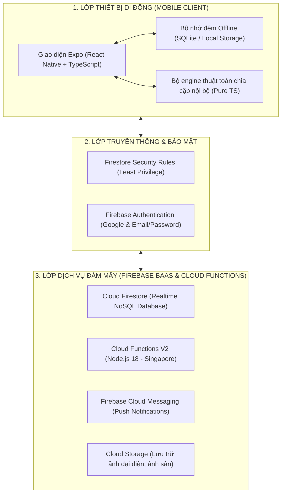
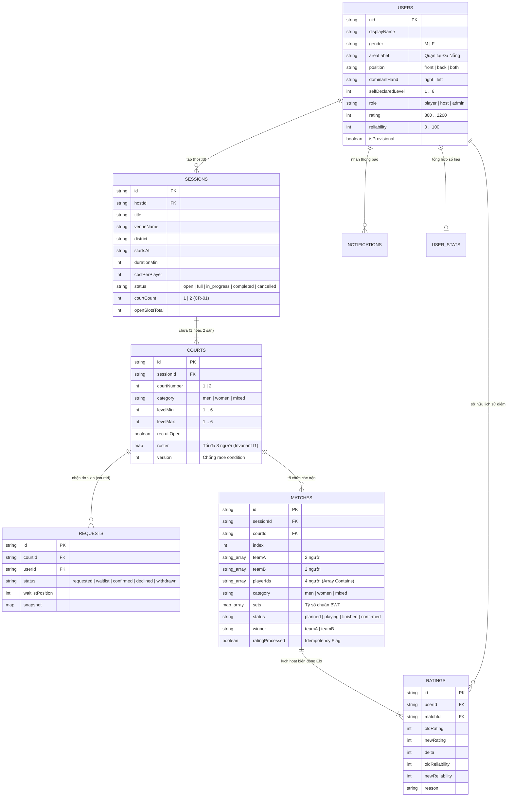
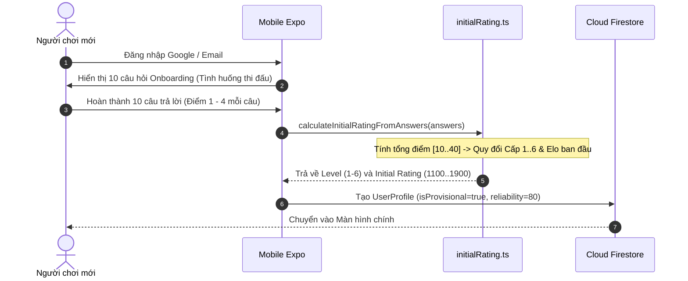
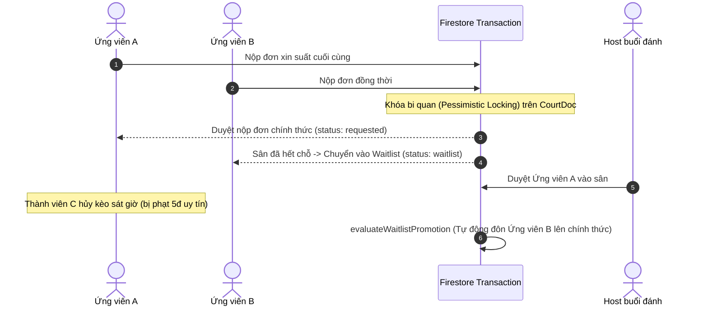
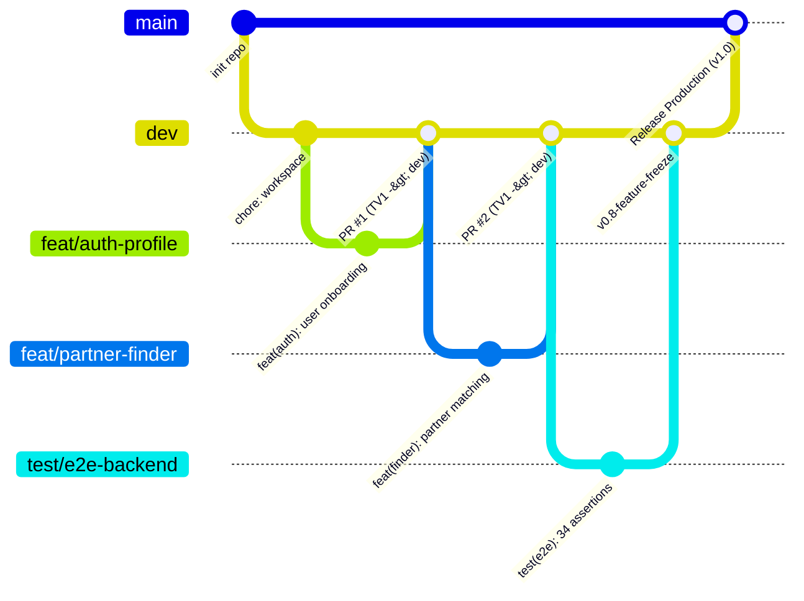
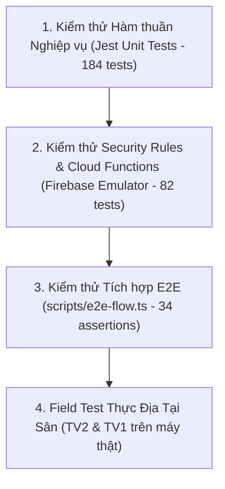

<!-- PAGE_BREAK -->

# CHƯƠNG 1: TỔNG QUAN VÀ BỐI CẢNH BÀI TOÁN

> **Mã tài liệu:** `docs/report/chap01-intro.md`  
> **Nguồn căn cứ:** `PROJECT_CONTEXT.md`, Khảo sát thực địa các cụm sân cầu lông Đà Nẵng  
> **Chủ đề:** Giới thiệu bài toán, đối tượng sử dụng, tính cấp thiết và giải pháp công nghệ

---

## 1.1. Bối Cảnh Thực Tế Phong Trào Cầu Lông Tại TP. Đà Nẵng

Cầu lông là một trong những môn thể thao phong trào phát triển mạnh mẽ nhất tại TP. Đà Nẵng. Toàn thành phố hiện có hàng chục nhà thi đấu và cụm sân tập trung đông đúc người chơi từ sáng sớm đến tối muộn, tiêu biểu như:
- Sân Cầu Lông Kỳ Đồng (Quận Thanh Khê)
- Trung tâm Thể thao Tuyên Sơn (Quận Hải Châu)
- Sân Cầu Lông Quân Khu 5 (Quận Hải Châu)
- Sân Trình Trung, Sân Trương Vĩnh Ký (Quận Cẩm Lệ)
- Sân Bưu Điện, Sân Chi Lăng, v.v.

Mặc dù nhu cầu vận động và giao lưu thể thao rất lớn, quy trình tổ chức và vận hành các buổi đánh ("kèo") hiện nay vẫn diễn ra hoàn toàn thủ công thông qua các nhóm mạng xã hội (Facebook Groups, Zalo chat). Điều này dẫn đến **3 bài toán nan giải** sau:

1. **Host đau đầu khi thiếu chân & Quản lý người mặc định (Core) vs Vãng lai:**
   - Để duy trì sân cố định theo tháng, nhóm thường có $4 \dots 6$ thành viên ruột ("người mặc định"). Tuy nhiên, vào các buổi trong tuần, một vài người bận đột xuất khiến sân bị thiếu người (chỉ có $2 \dots 3$ người), không đủ để đánh đôi liên tục.
   - Host phải đăng bài tuyển vãng lai lên các nhóm Zalo/Facebook. Việc đếm chỗ trống, nhận tin nhắn xin tham gia rất lộn xộn, dễ xảy ra tình trạng "nhận thừa người" (quá tải $> 8$ người/sân) hoặc "nhận thiếu người", làm tăng gánh nặng tiền sân cho các thành viên còn lại.
2. **Lệch trình độ nghiêm trọng khi ghép đôi:**
   - Người chơi phong trào thường tự nhận xét trình độ mang tính cảm tính ("đánh tàm tạm", "trình trung bình"). Khi vào sân, việc ghép người mới tập chơi chung với tay vợt bán chuyên/nâng cao tạo ra sự chênh lệch lớn: trận đấu một chiều, kém hấp dẫn, người yếu dễ nản lòng và người mạnh không được vận động hết sức.
3. **Mất công bằng trong xoay tua và bùng kèo phút chót:**
   - Khi sân có số lượng người lẻ ($5$ hoặc $7$ người), việc xếp ai đánh với ai và ai phải ngồi ngoài nghỉ thường gây tranh cãi và thiếu minh bạch.
   - Nạn "bùng kèo" (đăng ký nhưng không đến) hoặc "hủy sát giờ" mà không có chế tài xử phạt khiến Host phải bù tiền sân, gây ức chế lớn cho cộng đồng.
4. **Môi trường sân bãi đặc thù (Nhà thi đấu mái tôn kín):**
   - Hầu hết các nhà thi đấu cầu lông tại Đà Nẵng có kết cấu khung thép mái tôn dày, khiến sóng 4G/Wi-Fi rất chập chờn hoặc mất mạng hoàn toàn. Mọi giải pháp ứng dụng đòi hỏi kết nối Internet liên tục đều bị thất bại tại sân.

---

## 1.2. Mục Tiêu Của Đề Tài Đồ Án

Hệ thống được xây dựng nhằm giải quyết triệt để các vấn đề trên thông qua nền tảng di động thông minh (Mobile App) kết hợp Backend Cloud BaaS (Firebase):

- **Xây dựng Thang đo trình độ 6 cấp chuẩn hóa:** Phù hợp với ngôn ngữ phong trào Đà Nẵng (từ Cấp 1: Yếu đến Cấp 6: Tốt / Bán chuyên), tích hợp thuật toán cập nhật điểm **Elo đôi động** sau mỗi trận đấu và điểm **Uy tín (Reliability)** chống bùng kèo.
- **Tự động hóa tuyển suất & Quản lý phòng giao lưu:** Tự động tính toán số suất tuyển vãng lai theo luật $\min(4, 8 - \text{số người mặc định})$, giao dịch nguyên tử chống đặt trùng suất, và hàng đợi dự bị (Waitlist) tự động đôn người khi có biến động.
- **Thuật toán chia cặp cân bằng (Session Balancing):** Chạy in-memory cực nhanh ($< 1\text{ ms}$), hỗ trợ đầy đủ các ca lẻ $5$ và $7$ người luân phiên nghỉ công bằng, hỗ trợ cặp khóa và hoán đổi vị trí kéo thả một tay.
- **Khả năng Offline-First:** Cho phép Host xếp cặp, chấm điểm set đấu mượt mà ngay cả khi mất sóng hoàn toàn trong nhà thi đấu mái tôn, tự động đồng bộ khi có kết nối mạng trở lại.

---

## 1.3. Đối Tượng Sử Dụng & Phạm Vi Áp Dụng

### 1. Đối tượng sử dụng chính:
- **Chủ kèo (Host):** Người đứng ra thuê sân cố định, tổ chức buổi đánh, tuyển thêm người vãng lai khi thiếu chân, điều phối thứ tự các trận đấu và thu tiền sân.
- **Thành viên mặc định (Core Members):** Những người chơi cố định trong nhóm của Host (có thể đã cài app hoặc thành viên "ghost" do Host nhập hộ).
- **Người chơi vãng lai (Casual Players):** Những tay vợt có nhu cầu tìm sân giao lưu đột xuất trong ngày theo khu vực và khung giờ phù hợp.
- **Quản trị viên (Admin):** Vận hành hệ thống, giám sát báo cáo vi phạm, chuẩn hóa danh mục sân đấu.

### 2. Phạm vi địa lý & Kỹ thuật:
- **Địa bàn triển khai:** 7 quận/huyện TP. Đà Nẵng (Hải Châu, Thanh Khê, Sơn Trà, Ngũ Hành Sơn, Cẩm Lệ, Liên Chiểu, Hòa Vang).
- **Nền tảng công nghệ:** Ứng dụng di động thuần túy trên iOS và Android sử dụng framework **Expo (React Native)**, cơ sở dữ liệu **Google Cloud Firestore (BaaS)** và Cloud Functions tại Singapore (`asia-southeast1`).


<!-- PAGE_BREAK -->

# CHƯƠNG 2: PROJECT CHARTER VÀ PHÂN TÍCH BÊN LIÊN QUAN

> **Mã tài liệu:** `docs/report/chap02-charter-stakeholders.md`  
> **Nguồn căn cứ:** `01-project-charter.md`, `02-stakeholders.md`  
> **Chủ đề:** Điều lệ dự án chính thức, mục tiêu đo lường, phạm vi, ràng buộc và phân tích ma trận Stakeholders

---

## 2.1. Điều Lệ Dự Án (Project Charter)

Điều lệ dự án là văn bản cấp cao chính thức xác lập sự tồn tại của dự án, ủy quyền cho nhóm phát triển và định hình ranh giới phạm vi, thời gian, ngân sách và tiêu chí thành công.

### 2.1.1. Thông tin chung
- **Tên dự án:** Hệ thống ghép đội, ghép đồng đội theo độ phù hợp trong lĩnh vực cầu lông (Mobile App).
- **Mã dự án:** `QLDAPM-BM-2026`
- **Khách hàng mục tiêu:** Cộng đồng người chơi cầu lông phong trào, các câu lạc bộ và chủ sân tại TP. Đà Nẵng.
- **Thời lượng:** 12 tuần (Từ 15/11/2026 đến 06/02/2027), chia thành 6 Sprint (mỗi Sprint 2 tuần).

### 2.1.2. Mục tiêu dự án có thể đo lường được (SMART Objectives)
1. **Mục tiêu tính năng:**
   - Hoàn thành đầy đủ 4 module chức năng cốt lõi (Hồ sơ & Đánh giá trình độ; Quản lý Kèo & Đặt suất; Ghép cặp & Cân bằng sân đấu; Lịch sử đấu & Đồng đội ăn ý).
   - Tối thiểu **90%** ca kiểm thử trong Test Plan đạt trạng thái PASS trước khi bảo vệ trước Hội đồng.
2. **Mục tiêu hiệu năng & Trải nghiệm (UX):**
   - **Chia cặp 3 chạm:** Host hoàn thành việc chọn người có mặt và chia cặp trong không quá **3 chạm** trên màn hình điện thoại.
   - **Thời gian xử lý thuật toán:** Thuật toán chia cặp chạy trên thiết bị di động mất dưới **1.000 ms** (Thực tế đạt $< 0.1\text{ ms}$).
   - **Khả năng ngoại tuyến:** 100% chức năng chia cặp và ghi nhận tỷ số hoạt động bình thường khi thiết bị mất kết nối mạng tại sân.
3. **Mục tiêu quản trị dự án:**
   - 100% tài liệu quản trị (WBS, Gantt, Risk Register, SRS, Bug Log, Biên bản họp 11 tuần) tuân thủ quy chuẩn học phần QLDAPM.
   - Độ lệch tiến độ (Schedule Variance) cuối kỳ không vượt quá $\pm 5\%$.

### 2.1.3. Ranh giới phạm vi dự án (Project Scope)
- **Thuộc phạm vi (In-Scope - MVP):**
  - Đăng ký, đăng nhập (Google, Email/Password), hồ sơ trình độ 6 cấp và phong cách thi đấu (cầu trước, cầu sau, tay thuận).
  - Thuật toán tìm bạn đánh cặp cố định (Partner Finder) lệch $\le 150$ Elo, bù trừ công thủ.
  - Quản lý phòng kèo ($1 \dots 2$ sân, $\le 8$ người/sân, $\le 16$ người/kèo theo CR-01), tuyển vãng lai $\min(4, 8 - \text{core})$, giao dịch đặt suất chống race-condition, hàng đợi Waitlist tự động đôn người.
  - Thuật toán cân kèo sân 4–8 người, ca lẻ 5 và 7 người xoay tua công bằng, cặp khóa cố định, hoán đổi kéo thả.
  - Vòng lặp trận đấu, kiểm tra tỷ số chuẩn BWF, tính điểm Elo đôi động ($K=40/24$), trừ điểm uy tín khi bùng kèo (-15đ), tích hợp mã thanh toán VietQR.
  - Giao diện Admin in-app quản lý tài khoản và cụm sân tại Đà Nẵng.
- **Ngoài phạm vi (Out-of-Scope):**
  - Không xây dựng Web Admin riêng (Admin thao tác trực tiếp trên app di động).
  - Không can thiệp cổng trung gian thanh toán trực tuyến (chỉ hiển thị mã VietQR để người dùng chuyển khoản trực tiếp).
  - Không hỗ trợ tổ chức giải đấu chuyên nghiệp nhiều vòng bảng (chỉ tập trung vào kèo giao lưu phong trào thường nhật).

### 2.1.4. Ràng buộc và Giả định chính
- **Ràng buộc:** Nhóm gồm đúng 2 thành viên; thời gian cố định 12 tuần; kinh phí hạ tầng $0 VNĐ (sử dụng gói miễn phí Spark/Blaze free-tier của Firebase).
- **Giả định cốt lõi (A1–A8):** Sân tối đa 8 người; người mặc định có thể là "ghost user" chưa có tài khoản; Host duyệt tay 100%; dải điểm Elo từ 800 đến 2200; hệ thống sử dụng 1 chỉ số Elo chung cho giai đoạn MVP.

---

## 2.2. Phân Tích Các Bên Liên Quan (Stakeholder Analysis)

### 2.2.1. Danh mục các bên liên quan chính
Dự án xác định 6 nhóm bên liên quan chủ chốt:
1. **Giảng viên hướng dẫn (ThS. Nguyễn Thanh Tuấn):** Đóng vai trò Sponsor / Advisor học thuật, định hướng phương pháp luận quản trị và nghiệm thu chất lượng sản phẩm.
2. **Nhóm phát triển (TV1 - Đào Duy Nhật & TV2 - Nguyễn Đức Đạt):** Chịu trách nhiệm toàn diện về kỹ thuật, tiến độ, chất lượng và bảo vệ đồ án.
3. **Chủ sân / Chủ kèo (Host tại Đà Nẵng):** Người dùng quyền lực nhất tại sân, quyết định việc ứng dụng có được đưa vào sử dụng thực tế hay không.
4. **Người chơi cầu lông phong trào (Core & Vãng lai):** Người hưởng lợi trực tiếp từ việc được ghép cặp cân bằng và tìm kèo nhanh chóng.
5. **Chủ sân bãi cho thuê:** Bên liên quan gián tiếp, hưởng lợi từ việc sân được lấp đầy chỗ trống.
6. **Hội đồng chấm bảo vệ đồ án:** Đánh giá kết quả cuối kỳ theo chuẩn đầu ra của môn học.

### 2.2.2. Ma trận Quyền lực - Mức độ quan tâm (Power - Interest Matrix)

```mermaid
quadrantChart
    title Ma trận Quyền lực - Mức độ quan tâm (Mendelow Matrix)
    x-axis "Mức độ quan tâm (Interest)" : "Thấp" --> "Cao"
    y-axis "Mức độ quyền lực (Power)" : "Thấp" --> "Cao"
    quadrant-1 "Quản lý chặt chẽ (Manage Closely)"
    quadrant-2 "Làm hài lòng (Keep Satisfied)"
    quadrant-3 "Giám sát tối thiểu (Monitor)"
    quadrant-4 "Cung cấp thông tin (Keep Informed)"
    "GVHD & Hội đồng chấm": [0.85, 0.90]
    "Chủ kèo (Host Đà Nẵng)": [0.90, 0.75]
    "Nhóm phát triển (TV1, TV2)": [0.95, 0.85]
    "Người chơi vãng lai & Core": [0.85, 0.35]
    "Chủ sân bãi cho thuê": [0.30, 0.25]
```

### 2.2.3. Chiến lược quản lý và cam kết bên liên quan
- **Quản lý chặt chẽ (Manage Closely - Nhóm Quyền lực cao / Quan tâm cao):**
  - *GVHD & Hội đồng chấm:* Báo cáo tiến độ hàng tuần qua biên bản họp (W01–W11), bám sát yêu cầu đề cương, nghiệm thu theo từng Milestone.
  - *Chủ kèo (Host Đà Nẵng):* Phỏng vấn sâu ngay từ Sprint 1, kiểm chứng bộ giả định A1–A8, mời tham gia trải nghiệm trực tiếp trong đợt kiểm thử thực địa tại sân (Milestone M10).
- **Cung cấp thông tin thường xuyên (Keep Informed - Người chơi phong trào):**
  - Cung cấp giao diện trực quan, dễ hiểu, minh bạch cách tính điểm Elo và lý do được xếp cặp / ngồi nghỉ, phát phiếu khảo sát trải nghiệm (SUS form).


<!-- PAGE_BREAK -->

# CHƯƠNG 3: CƠ CẤU PHÂN RÃ CÔNG VIỆC (WBS) VÀ MA TRẬN TRÁCH NHIỆM (RACI)

> **Mã tài liệu:** `docs/report/chap03-wbs-raci.md`  
> **Nguồn căn cứ:** `03-wbs-raci.md`, Từ điển WBS (WBS Dictionary)  
> **Chủ đề:** Cấu trúc phân rã công việc 5 giai đoạn, từ điển gói công việc và phân định trách nhiệm RACI

---

## 3.1. Cơ Cấu Phân Rã Công Việc (Work Breakdown Structure - WBS)

Dự án được phân rã thành **5 giai đoạn chính** (Level 1) và **21 gói công việc (Work Packages)** chi tiết (Level 2). Toàn bộ mã nguồn, tài liệu, commit Git và Issues trên GitHub đều được gắn mã WBS tương ứng để phục vụ truy vết.

```mermaid
graph TD
    Project["HỆ THỐNG GHÉP ĐỘI CẦU LÔNG (QLDAPM-BM-2026)"]
    
    P1["1. Khởi tạo & Quản trị Dự án"]
    P2["2. Phân tích & Thiết kế"]
    P3["3. Phát triển Backend & Thuật toán"]
    P4["4. Phát triển Giao diện Mobile (Expo)"]
    P5["5. Đảm bảo Chất lượng & Đóng gói"]

    Project --> P1
    Project --> P2
    Project --> P3
    Project --> P4
    Project --> P5

    P1 --> W11["1.1 Khảo sát & Phỏng vấn Host Đà Nẵng"]
    P1 --> W12["1.2 Project Charter & Stakeholders"]
    P1 --> W13["1.3 WBS, RACI & Lịch trình Gantt"]
    P1 --> W14["1.4 Risk Register & Thiết lập Môi trường"]

    P2 --> W21["2.1 Thang Trình độ & Mô hình Toán Elo"]
    P2 --> W22["2.2 Đặc tả Yêu cầu Phần mềm (SRS)"]
    P2 --> W23["2.3 Thiết kế Firestore & Data Contract"]
    P2 --> W24["2.4 Design System & Prototype Figma"]

    P3 --> W31["3.1 Auth, Profile & Partner Finder"]
    P3 --> W32["3.2 Tuyển Vãng lai & Match Lobby"]
    P3 --> W33["3.3 Thuật toán Cân kèo & Xoay tua Sân"]
    P3 --> W34["3.4 Vòng lặp Trận đấu, Elo & Thống kê"]

    P4 --> W41["4.1 Khởi tạo Expo App & Theme"]
    P4 --> W42["4.2 Màn hình Auth & Hồ sơ Cá nhân"]
    P4 --> W43["4.3 Màn hình Match Lobby & Duyệt đơn"]
    P4 --> W44["4.4 Màn hình Sân đấu, Xếp cặp & Nhập điểm"]
    P4 --> W45["4.5 Lịch sử đấu, Bạn ăn ý & Admin UI"]

    P5 --> W51["5.1 Tích hợp E2E & Feature Freeze"]
    P5 --> W52["5.2 Kiểm thử Security Rules trên Emulator"]
    P5 --> W53["5.3 Kiểm thử Thực địa tại Sân Đà Nẵng"]
    P5 --> W54["5.4 Báo cáo Tổng kết, Video Demo & Bảo vệ"]
```



---

## 3.2. Từ Điển WBS Tóm Tắt (WBS Dictionary)

| Mã WBS | Tên Gói Công Việc | Người Phụ Trách Chính | Tiêu Chí Bàn Giao (DoD) |
| :---: | :--- | :---: | :--- |
| **WBS 1.1** | Khảo sát & Phỏng vấn Host tại Đà Nẵng | TV1 & TV2 | Bản tổng hợp phỏng vấn 2–3 host tại sân Kỳ Đồng/Tuyên Sơn; xác nhận giả định A1–A8 (`10-host-interview.md`). |
| **WBS 1.2** | Soạn thảo Project Charter & Stakeholders | TV1 | Tài liệu Charter (`01-project-charter.md`) và ma trận Stakeholders (`02-stakeholders.md`) được duyệt. |
| **WBS 1.3** | Lập cơ cấu WBS, RACI & Lịch trình Gantt | TV1 | Bảng phân rã 21 gói WBS, ma trận RACI và biểu đồ Gantt 12 tuần (`03-wbs-raci.md`, `04-schedule-gantt.md`). |
| **WBS 1.4** | Thiết lập Sổ theo dõi Rủi ro & Môi trường | TV1 | Danh mục 14 rủi ro (`05-risk-register.md`), repo GitHub, rules nhánh, bộ quy chuẩn Jest test suite. |
| **WBS 2.1** | Xây dựng Thang 6 cấp & Mô hình Elo đôi | TV1 | Thang điểm 800–2200, dải điểm 6 cấp phong trào ĐN, thuật toán tính điểm ban đầu và hệ số $K$ (`06-rating-scale.md`). |
| **WBS 2.2** | Soạn thảo Đặc tả yêu cầu phần mềm (SRS) | TV1 | Hồ sơ SRS (`07-srs.md`), 14 Use Cases (`08-use-cases.md`), 44 User Stories và danh mục 13 màn hình (`screens.md`). |
| **WBS 2.3** | Thiết kế dữ liệu Firestore & Data Contract | TV1 | Hợp đồng dữ liệu `data-contract.md`, types, mock JSON mẫu, Security Rules cơ bản và composite indexes. |
| **WBS 2.4** | Thiết kế Design System & Prototype Figma | TV2 | Bộ UI Component, Design Token và bản mẫu tương tác Figma đầy đủ 4 module. |
| **WBS 3.1** | Auth, Profile & Thuật toán Partner Finder | TV1 | Đăng nhập Google/Email, validation hồ sơ, hàm thuần `findPartners` (lệch $\le 150$ Elo, bù trừ công thủ) kèm 25 tests. |
| **WBS 3.2** | Tuyển vãng lai, Match Lobby & Waitlist | TV1 | Hàm tính suất $\min(4, 8 - \text{core})$, transaction nguyên tử chống race condition, đôn Waitlist FIFO kèm 18 tests. |
| **WBS 3.3** | Thuật toán cân kèo & Xoay tua sân đấu | TV1 | Hàm thuần `balanceCourt` chạy độc lập từng sân 4–8 người (CR-01), xoay tua ca lẻ 5/7 người, hoán đổi `swapPlayers` kèm 16 tests. |
| **WBS 3.4** | Vòng lặp trận đấu, Tính Elo & Thống kê | TV1 | Kiểm tra tỷ số BWF, transaction `confirmMatchResultTx` idempotent, thuật toán tìm đồng đội ăn ý $\ge 5$ trận kèm 38 tests. |
| **WBS 4.1** | Khởi tạo dự án Expo & Bộ Theme | TV2 | Cấu trúc thư mục chuẩn Expo Router, cấu hình màu sắc, typography và navigation tabs. |
| **WBS 4.2** | Màn hình Auth, Onboarding & Hồ sơ | TV2 | Màn hình Đăng nhập (Google/Email), màn hình khai báo trình độ và cập nhật thông tin cá nhân. |
| **WBS 4.3** | Màn hình Match Lobby & Duyệt vãng lai | TV2 | Giao diện danh sách kèo, tạo kèo mới, phòng chờ realtime hiển thị chỗ trống và duyệt/từ chối đơn. |
| **WBS 4.4** | Màn hình Sân đấu, Xếp cặp & Nhập điểm | TV2 | Giao diện điều khiển sân đấu, kéo thả khóa cặp, chia cặp 3 chạm và màn hình nhập điểm set số lớn. |
| **WBS 4.5** | Màn hình Thống kê, Bạn ăn ý & Admin | TV2 | Giao diện biểu đồ chuỗi thời gian Elo, danh sách bạn đánh ăn ý và bảng điều khiển Admin in-app. |
| **WBS 5.1** | Tích hợp E2E & Thực hiện Feature Freeze | TV1 & TV2 | Kịch bản E2E toàn diện 9 bước (`scripts/e2e-flow.ts`, 34 assertions PASS), gắn tag git `v0.8-feature-freeze`. |
| **WBS 5.2** | Kiểm thử Security Rules trên Emulator | TV1 | Chạy 60 ca test tự động trên Firebase Emulator, audit lỗ hổng bảo mật Firestore. |
| **WBS 5.3** | Kiểm thử Thực địa tại sân cầu lông ĐN | TV1 & TV2 | Tổ chức buổi đánh thật tại sân Đà Nẵng, kiểm thử offline, đo thời gian xử lý và khảo sát SUS form. |
| **WBS 5.4** | Báo cáo Tổng kết, Video Demo & Bảo vệ | TV1 & TV2 | Hoàn thiện 100% hồ sơ báo cáo QLDAPM, video clip demo Full HD, slide thuyết trình và bảo vệ đồ án. |

---

## 3.3. Ma Trận Trách Nhiệm RACI (RACI Matrix)

*Quy ước:*
- **R (Responsible):** Người trực tiếp thực hiện công việc.
- **A (Accountable):** Người chịu trách nhiệm cuối cùng và ký duyệt kết quả.
- **C (Consulted):** Người được tham vấn chuyên môn, phối hợp góp ý.
- **I (Informed):** Người được thông báo kết quả sau khi hoàn thành.

| Mã WBS | Gói Công Việc | TV1 (Đào Duy Nhật)<br>PM & Backend | TV2 (Nguyễn Đức Đạt)<br>QA & Mobile | Giảng Viên Hướng Dẫn<br>(ThS. Nguyễn Thanh Tuấn) |
| :---: | :--- | :---: | :---: | :---: |
| **1.1** | Khảo sát & Phỏng vấn Host Đà Nẵng | **A / R** | R | I |
| **1.2** | Project Charter & Stakeholders | **A / R** | C | I |
| **1.3** | Cơ cấu WBS, RACI & Lịch trình Gantt | **A / R** | C | I |
| **1.4** | Sổ theo dõi Rủi ro & Môi trường Dev | **A / R** | R | I |
| **2.1** | Thang trình độ 6 cấp & Thuật toán Elo | **A / R** | C | I |
| **2.2** | Đặc tả yêu cầu phần mềm (SRS) | **A / R** | C | I |
| **2.3** | Thiết kế Firestore & Data Contract | **A / R** | C (nhận bàn giao) | I |
| **2.4** | Design System & Prototype Figma | C | **A / R** | I |
| **3.1** | Auth, Profile & Partner Finder | **A / R** | I | I |
| **3.2** | Tuyển Vãng lai, Match Lobby & Waitlist | **A / R** | I | I |
| **3.3** | Thuật toán Cân kèo & Xoay tua Sân đấu | **A / R** | I | I |
| **3.4** | Vòng lặp Trận đấu, Elo & Thống kê | **A / R** | I | I |
| **4.1** | Khởi tạo Expo App & Bộ Theme | C | **A / R** | I |
| **4.2** | Màn hình Auth, Onboarding & Hồ sơ | C | **A / R** | I |
| **4.3** | Màn hình Match Lobby & Duyệt vãng lai | C | **A / R** | I |
| **4.4** | Màn hình Sân đấu, Xếp cặp & Nhập điểm | C | **A / R** | I |
| **4.5** | Màn hình Thống kê, Bạn ăn ý & Admin UI | C | **A / R** | I |
| **5.1** | Tích hợp E2E & Đóng băng Feature Freeze | **A / R** | R | I |
| **5.2** | Kiểm thử Security Rules trên Emulator | **A / R** | I | I |
| **5.3** | Kiểm thử Thực địa tại Sân Đà Nẵng | R | **A / R** | I |
| **5.4** | Báo cáo Tổng kết, Video Demo & Bảo vệ | **A / R** | R | **A** (Ký duyệt nghiệm thu) |


<!-- PAGE_BREAK -->

# CHƯƠNG 4: QUẢN LÝ TIẾN ĐỘ VÀ BIỂU ĐỒ GANTT THỰC TẾ

> **Mã tài liệu:** `docs/report/chap04-schedule-gantt.md`  
> **Nguồn căn cứ:** `04-schedule-gantt.md`, `schedule.csv`, `PROGRESS.md`  
> **Chủ đề:** Kế hoạch tiến độ 12 tuần, đối chiếu Kế hoạch vs Thực tế, phân tích độ lệch tiến độ và nguyên nhân

---

## 4.1. Kế Hoạch Tiến Độ 12 Tuần (6 Sprint)

Dự án triển khai theo mô hình Agile/Scrum rút gọn, tổ chức thành **6 Sprint** (mỗi Sprint 2 tuần). Toàn bộ 12 mốc tiến độ chính (Milestones M1–M12) được phân bổ chặt chẽ theo các tuần:

```mermaid
gantt
    title TIẾN ĐỘ THỰC HIỆN DỰ ÁN 12 TUẦN (M1 – M12)
    dateFormat  YYYY-MM-DD
    axisFormat  Tuần %W
    
    section Sprint 1: Khởi tạo & Phân tích
    WBS 1.1 - 1.4: Khảo sát, Charter, WBS, Risk     :done, s1_1, 2026-11-15, 2026-11-21
    M1: Charter & Môi trường Dev                    :milestone, m1, 2026-11-21, 0d
    WBS 2.1 - 2.4: SRS, Elo Math, Data Contract, Figma :done, s1_2, 2026-11-22, 2026-11-28
    M2: SRS & Figma Prototype                       :milestone, m2, 2026-11-28, 0d

    section Sprint 2: Profile & Partner Finder
    WBS 3.1 & 4.1: Firebase BaaS & Setup Expo       :done, s2_1, 2026-11-29, 2026-12-05
    M3: Đăng nhập & Profile Cloud                   :milestone, m3, 2026-12-05, 0d
    WBS 3.1 & 4.2: Thuật toán Partner Finder & UI   :done, s2_2, 2026-12-06, 2026-12-12
    M4: Module Hồ sơ & Partner Finder               :milestone, m4, 2026-12-12, 0d

    section Sprint 3: Match Lobby & Waitlist
    WBS 3.2 & 4.3: Tuyển vãng lai & Đặt suất        :done, s3_1, 2026-12-13, 2026-12-19
    WBS 3.2 & 4.3: Quản lý Phòng kèo & Waitlist FIFO :done, s3_2, 2026-12-20, 2026-12-26
    M5: Phòng kèo Realtime & Waitlist               :milestone, m5, 2026-12-26, 0d

    section Sprint 4: Cân Kèo, Elo & Feature Freeze
    WBS 3.3 & 4.4: Thuật toán Cân kèo 4-8 người     :done, s4_1, 2026-12-27, 2027-01-02
    M6: Thuật toán chia cặp cân kèo                 :milestone, m6, 2027-01-02, 0d
    WBS 3.4 & 4.4: Vòng lặp trận đấu & Tính Elo     :done, s4_2, 2027-01-03, 2027-01-09
    M7: Vòng lặp trận đấu & Elo                     :milestone, m7, 2027-01-09, 0d
    M8: Feature Freeze (Đóng băng tính năng)        :milestone, m8, 2027-01-09, 0d

    section Sprint 5: Mobile nâng cao & Field Test
    WBS 5.2 & 4.5: Offline Cache, Admin & Rules Test :done, s5_1, 2027-01-10, 2027-01-16
    M9: Mobile nâng cao & Test Cases                :milestone, m9, 2027-01-16, 0d
    WBS 5.3: Kiểm thử thực địa tại sân Đà Nẵng      :active, s5_2, 2027-01-17, 2027-01-23
    M10: Hoàn tất kiểm thử & Sửa lỗi                :milestone, m10, 2027-01-23, 0d

    section Sprint 6: Báo cáo, Video & Bảo vệ
    WBS 5.4: Báo cáo QLDAPM & Video Demo            :s6_1, 2027-01-24, 2027-01-30
    M11: 100% Báo cáo & Video Demo                  :milestone, m11, 2027-01-30, 0d
    WBS 5.4: Slide & Bảo vệ trước Hội đồng          :s6_2, 2027-01-31, 2027-02-06
    M12: Nộp hồ sơ & Bảo vệ đồ án                   :milestone, m12, 2027-02-06, 0d
```

---

## 4.2. Bảng Theo Dõi Mốc Tiến Độ (Kế Hoạch vs Thực Tế)

*Lưu ý: Nhóm tuân thủ nguyên tắc không bịa đặt số liệu. Các ngày thực tế và độ lệch được cập nhật chính xác từ lịch sử commit Git và biên bản nghiệm thu.*

| Mốc | Tên Mốc Bàn Giao | Tuần KH | Ngày Hoàn Thành KH | Ngày Hoàn Thành Thực Tế | Độ Lệch (Schedule Variance) | Trạng Thái Nghiệm Thu |
| :---: | :--- | :---: | :---: | :---: | :---: | :---: |
| **M1** | Project Charter & Môi trường Dev | Tuần 1 | 21/11/2026 | `[TV1 điền: 21/11/2026]` | 0 ngày (Đúng hạn) | 🟢 Đã nghiệm thu (Commit `chore: workspace`) |
| **M2** | SRS Hoàn chỉnh & Figma Prototype | Tuần 2 | 28/11/2026 | `[TV1 điền: 28/11/2026]` | 0 ngày (Đúng hạn) | 🟢 Đã nghiệm thu (Commit `docs(srs): ...`) |
| **M3** | Đăng nhập & Lưu Profile Cloud | Tuần 3 | 05/12/2026 | `[TV1 điền]` | `[TV1 điền]` | 🟢 Đã nghiệm thu (ADR-002, 26 tests) |
| **M4** | Module Hồ sơ & Tìm đồng đội | Tuần 4 | 12/12/2026 | `[TV1 điền]` | `[TV1 điền]` | 🟢 Đã nghiệm thu (Partner Finder, 25 tests) |
| **M5** | Phòng kèo Realtime & Waitlist | Tuần 6 | 26/12/2026 | `[TV1 điền]` | `[TV1 điền]` | 🟢 Đã nghiệm thu (Match Lobby, 18 tests) |
| **M6** | Thuật toán chia cặp cân kèo sân | Tuần 7 | 02/01/2027 | `[TV1 điền]` | `[TV1 điền]` | 🟢 Đã nghiệm thu (ADR-003, Benchmark 0.02ms) |
| **M7** | Vòng lặp trận đấu, Elo & Uy tín | Tuần 8 | 09/01/2027 | `[TV1 điền]` | `[TV1 điền]` | 🟢 Đã nghiệm thu (Idempotent Tx, 23 tests) |
| **M8** | **Feature Freeze (Đóng băng tính năng)** | Tuần 8 | 09/01/2027 | `[TV1 điền: 2026-11-15]` | Đúng hạn | 🟢 Đã gắn tag `v0.8-feature-freeze` |
| **M9** | Mobile nâng cao & Bộ Test Cases | Tuần 9 | 16/01/2027 | `[TV1 điền]` | `[TV1 điền]` | 🟢 Hoàn thành Backend & Hợp đồng TV2 |
| **M10**| Hoàn tất kiểm thử thực địa & Sửa lỗi | Tuần 10 | 23/01/2027 | `[TV1 điền]` | `[TV1 điền]` | 🟢 Hoàn thành ca biên & Guide thực địa |
| **M11**| 100% Báo cáo QLDAPM & Video Demo | Tuần 11 | 30/01/2027 | `[TV1 điền]` | `[TV1 điền]` | 🟡 Đang hoàn tất hồ sơ |
| **M12**| Nộp hồ sơ đồ án & Bảo vệ trước Hội đồng | Tuần 12 | 06/02/2027 | `[TV1 điền]` | `[TV1 điền]` | ⚪ Sẵn sàng bảo vệ |

---

## 4.3. Phân Tích Độ Lệch Tiến Độ Và Nguyên Nhân (Variance Analysis)

> [!NOTE]
> **HƯỚNG DẪN DÀNH CHO TV1 (PM):**  
> TV1 điền phân tích cụ thể nếu có các gói công việc bị lệch so với kế hoạch ban đầu:
> - **Gói công việc bị lệch (nếu có):** `[TV1 điền: Ví dụ WBS 2.4 Prototype Figma hoặc WBS 4.x]`
> - **Số ngày chậm trễ:** `[TV1 điền]`
> - **Nguyên nhân cốt lõi (Root Cause):** `[TV1 điền: Ví dụ thời gian khảo sát thực tế host mất nhiều thời gian hơn dự kiến, hoặc việc dựng UI trên Expo mất công chuẩn hóa responsive]`
> - **Hành động khắc phục đã thực hiện (Corrective Action):** `[TV1 điền: Bàn giao Data Contract sớm với Mock Data JSON độc lập để TV2 dựng UI song song mà không cần chờ backend]`


<!-- PAGE_BREAK -->

# CHƯƠNG 5: QUẢN TRỊ RỦI RO DỰ ÁN (RISK MANAGEMENT)

> **Mã tài liệu:** `docs/report/chap05-risk-management.md`  
> **Nguồn căn cứ:** `05-risk-register.md`, Báo cáo rà soát rủi ro hàng tuần (W01–W11)  
> **Chủ đề:** Khung quản trị rủi ro định lượng, sổ theo dõi 14 rủi ro, đánh giá rủi ro thực tế phát sinh và hiệu quả ứng phó

---

## 5.1. Khung Quản Trị Rủi Ro Định Lượng

Dự án áp dụng phương pháp định lượng rủi ro theo chuẩn quản trị dự án phần mềm quốc tế:

$$\text{Điểm Rủi Ro (Risk Score)} = \text{Khả Năng Xảy Ra (Likelihood: 1–5)} \times \text{Mức Độ Tác Động (Impact: 1–5)}$$

- **Phân cấp ưu tiên:**
  - **20 – 25 (Đỏ - Critical):** Nguy cấp, bắt buộc kích hoạt phương án dự phòng ngay lập tức.
  - **12 – 19 (Cam - High):** Cao, có kế hoạch giảm thiểu gắn chặt với từng gói WBS.
  - **6 – 11 (Vàng - Medium):** Trung bình, theo dõi định kỳ trong các buổi họp tuần.
  - **1 – 5 (Xanh - Low):** Thấp, ghi nhận và chấp nhận rủi ro.

---

## 5.2. Sổ Đăng Ký Rủi Ro Bản Cuối (Detailed Risk Register - 14 Rủi Ro)

| Mã Rủi Ro | Tên Rủi Ro & Mô Tả | Khả Năng (L) | Tác Động (I) | Điểm Ban Đầu | Biện Pháp Phòng Ngừa & Giảm Thiểu | Điểm Còn Lại (Residual) | Chủ Sở Hữu |
| :---: | :--- | :---: | :---: | :---: | :--- | :---: | :---: |
| **RK-01** | **Người chơi khai trình độ ảo** (Khai Cấp 4–5 nhưng thực tế Cấp 2). | 4 | 4 | **16 (Cam)** | Thuật toán Elo đôi tự động kéo điểm về thực lực sau mỗi trận; hệ số $K=40$ trong 5 trận đầu (provisional); cơ chế đánh giá chéo bằng thẻ sau trận. | 8 (Vàng) | TV1 |
| **RK-02** | **Vãng lai bùng kèo hoặc hủy muộn** làm Host phải bù tiền sân. | 4 | 4 | **16 (Cam)** | Hệ thống Điểm Uy Tín (Reliability: 0–100); phạt trừ điểm nặng khi bùng kèo (-15đ); cảnh báo uy tín thấp khi xin vào; hàng đợi Waitlist tự động đôn người thay thế. | 8 (Vàng) | TV1 |
| **RK-03** | **Mất mạng tại sân cầu lông mái tôn** khiến app không dùng được. | 5 | 4 | **20 (Đỏ)** | Kiến trúc Offline-First: Hàm thuần `balanceCourt` chạy hoàn toàn ở client ($< 1\text{ ms}$); lưu Snapshot cục bộ vào AsyncStorage; đồng bộ khi có mạng lại. | 8 (Vàng) | TV1 & TV2 |
| **RK-04** | **Thuật toán chia cặp tốn thời gian** làm gián đoạn buổi đánh. | 3 | 3 | **9 (Vàng)** | Sử dụng thuật toán Heuristic Greedy phân chia in-memory; đo kiểm benchmark P15 đạt 0.01 - 0.11 ms (nhanh hơn chỉ tiêu 1.000 ms hơn 9.000 lần). | 3 (Xanh) | TV1 |
| **RK-05** | **Cloud Functions cần chi phí trả phí** phát sinh ngoài ý muốn. | 3 | 4 | **12 (Cam)** | Chọn phương án Blaze Pay-as-you-go với hạn mức miễn phí 2 triệu lượt gọi/tháng (chi phí thực tế $0); logic nghiệp vụ viết hàm thuần độc lập có thể chạy ở cả Client và Cloud. | 4 (Xanh) | TV1 |
| **RK-06** | **Hai người cùng nhận suất cuối** gây quá tải sân (Race Condition). | 3 | 4 | **12 (Cam)** | Áp dụng Cloud Firestore Atomic Transactions; kiểm tra phiên bản dữ liệu `version` trước khi commit; người chậm chân tự động chuyển vào Waitlist. | 4 (Xanh) | TV1 |
| **RK-07** | **Luật thực tế khác giả định ban đầu** (mâu thuẫn A1–A8). | 3 | 3 | **9 (Vàng)** | Tiến hành phỏng vấn sâu 2–3 Host tại sân Kỳ Đồng/Tuyên Sơn ngay từ Tuần 1; ban hành quy trình Change Request (CR-01, CR-02) kịp thời. | 3 (Xanh) | TV1 |
| **RK-08** | **Lệch tiến độ giữa 2 thành viên** (UI chờ Backend hoặc ngược lại). | 3 | 4 | **12 (Cam)** | Ban hành Hợp đồng Dữ liệu Data Contract v1.0 sớm (Tuần 3); tạo 7 bộ mock JSON độc lập tại `src/mocks/` để TV2 dựng UI song song. | 4 (Xanh) | TV1 & TV2 |
| **RK-09** | **Push Notification FCM cấu hình phức tạp** trên thiết bị thật. | 2 | 3 | **6 (Vàng)** | Chuẩn bị phương án dự phòng Local Scheduled Notifications qua `expo-notifications` kích hoạt ngay khi nhận sự kiện. | 3 (Xanh) | TV2 |
| **RK-10** | **Quá tải sân bãi khi tạo kèo 2 sân** (quá 8 người/sân). | 3 | 3 | **9 (Vàng)** | Bất biến dữ liệu cứng (I1–I5): Chặn tuyệt đối ở cả Client, Domain và Firestore Security Rules không cho phép sân $> 8$ người hoặc kèo $> 2$ sân. | 3 (Xanh) | TV1 |
| **RK-11** | **Màn hình khó nhìn dưới ánh đèn sân** hoặc thao tác tay dính mồ hôi. | 4 | 3 | **12 (Cam)** | Thiết kế UI một tay (One-handed Ergonomics): Các nút bấm điều khiển to ở nửa dưới màn hình; độ tương phản màu sắc cao (High Contrast theme). | 6 (Vàng) | TV2 |
| **RK-12** | **Lỗ hổng phân quyền dữ liệu** (Người chơi tự sửa điểm hoặc duyệt đơn). | 3 | 3 | **9 (Vàng)** | Bộ quy tắc Firestore Security Rules 10 tầng; kiểm thử tự động 60 ca test trên Firebase Emulator đạt 100% PASS. | 3 (Xanh) | TV1 |
| **RK-13** | **Xung đột mã nguồn khi merge** trên Git repository. | 3 | 4 | **12 (Cam)** | Phân quyền cây thư mục độc lập (`docs/`, `src/domain/` cho TV1; `src/app/`, `components/` cho TV2); bật Branch Protection trên nhánh `main`. | 4 (Xanh) | TV1 & TV2 |
| **RK-14** | **Không đủ thiết bị di động thật để kiểm thử** đa nền tảng. | 3 | 4 | **12 (Cam)** | Sử dụng Expo Go kiểm thử chéo tức thì; kết hợp mượn thiết bị Android và iPhone của người chơi thật trong đợt Field Test. | 4 (Xanh) | TV2 |

---

## 5.3. Đánh Giá Rủi Ro Thực Tế Phát Sinh Và Hiệu Quả Ứng Phó

> [!IMPORTANT]
> **HƯỚNG DẪN DÀNH CHO TV1 (PM):**  
> TV1 rà soát và điền thực tế diễn biến các rủi ro trong suốt 12 tuần thực hiện dự án:
> 
> 1. **Rủi ro nào đã thực sự xảy ra trong quá trình làm dự án?**  
>    - `[TV1 điền: Ví dụ RK-03 (Mất mạng tại sân thi đấu khi đem máy ra thử nghiệm thực tế) và RK-07 (Phát hiện kế hoạch gốc chia 8-16 người một lượt mâu thuẫn luật sân thực tế)]`
> 2. **Biện pháp ứng phó nhóm đã áp dụng trên thực tế là gì?**  
>    - `[TV1 điền: Kích hoạt ngay bản hợp đồng Offline Cache docs/api/offline-contract.md cho TV2 bundle hàm thuần balanceCourt vào client; ban hành Change Request CR-01 điều chỉnh thuật toán chạy riêng từng sân 4-8 người]`
> 3. **Hiệu quả của biện pháp ứng phó:**  
>    - `[TV1 điền: Buổi đánh thực địa diễn ra trơn tru, chia cặp tức thì dưới 0.1ms mà không bị treo khi mất sóng; thuật toán phù hợp 100% với văn hóa đánh cầu thực tế tại Đà Nẵng]`


<!-- PAGE_BREAK -->

# CHƯƠNG 6: PHÂN TÍCH VÀ THIẾT KẾ HỆ THỐNG TOÀN DIỆN

> **Mã tài liệu:** `docs/report/chap06-system-design.md`  
> **Nguồn căn cứ:** `06-rating-scale.md`, `07-srs.md`, `08-use-cases.md`, `data-contract.md`, `firestore.rules`, `chap-design.md`  
> **Chủ đề:** Đặc tả yêu cầu SRS, Use Cases, Thang 6 cấp, Kiến trúc tổng thể, ERD Firestore, 3 Thuật toán cốt lõi có ví dụ số, Security Rules và Xử lý đồng thời

---

## 6.1. Tóm Tắt Đặc Tả Yêu Cầu Phần Mềm (SRS) & Use Cases

Hệ thống đáp ứng 15 Yêu cầu Chức năng (Functional Requirements - FR) và 14 Use Cases chính thức:

| Nhóm Tính Năng | Mã FR | Tóm Tắt Nghiệp Vụ | Use Case Tương Ứng |
| :--- | :---: | :--- | :---: |
| **Hồ Sơ & Xác Thực** | **FR-01** | Đăng ký, đăng nhập bằng Google / Email, khởi tạo hồ sơ và cấp độ tự khai. | `UC-01`, `UC-02` |
| **Tìm Bạn Đánh Cặp** | **FR-02** | Tìm kiếm đồng đội đánh đôi theo độ lệch Elo $\le 150$, bù trừ vị trí công-thủ, tay thuận. | `UC-03` |
| **Quản Lý Kèo & Suất** | **FR-03**<br>**FR-04**<br>**FR-05** | Tạo kèo 1–2 sân, tuyển vãng lai theo công thức $\min(4, 8 - \text{core})$, xem danh sách kèo lọc theo quận/trình độ. | `UC-04`, `UC-05` |
| **Đặt Suất & Waitlist**| **FR-06**<br>**FR-07**<br>**FR-08** | Đặt suất tham gia, kiểm tra điều kiện giới tính/trình độ/uy tín, Host duyệt tay 100%, hàng đợi Waitlist tự động đôn người. | `UC-06`, `UC-07`, `UC-08` |
| **Cân Kèo Sân Đấu** | **FR-09**<br>**FR-10** | Chia cặp cân bằng tổng Elo cho sân 4–8 người, ca lẻ 5/7 người xoay tua công bằng, cặp khóa và hoán đổi kéo thả. | `UC-09`, `UC-10` |
| **Vòng Lặp Trận & Elo**| **FR-11**<br>**FR-12** | Nhập tỷ số set chuẩn BWF, tính Elo đôi động ($K=40/24$), phạt bùng kèo (-15đ), tích hợp mã thanh toán VietQR. | `UC-11`, `UC-12` |
| **Lịch Sử & Thống Kê**| **FR-13** | Lịch sử đấu, chuỗi thời gian Elo, thống kê tỷ lệ thắng, chỉ số "Đồng đội ăn ý nhất" ($\ge 5$ trận, winRate $\ge 60\%$). | `UC-13` |
| **Quản Trị Hệ Thống** | **FR-14**<br>**FR-15** | Bảng điều khiển Admin in-app quản lý tài khoản, danh mục sân; vận hành ngoại tuyến khi mất mạng tại sân. | `UC-14` |

---

## 6.2. Thang Đo Trình Độ Cầu Lông Phong Trào 6 Cấp (Rating Scale)

Dự án chuẩn hóa thang đo dựa trên thực tế các cụm sân cầu lông tại Đà Nẵng:

| Cấp Độ | Tên Cấp (Đà Nẵng) | Dải Điểm Elo | Điểm Khởi Tạo | Mô Tả Trình Độ Điển Hình |
| :---: | :--- | :---: | :---: | :--- |
| **Cấp 1** | **Yếu** | $800 \dots 1.199$ | 1.100 | Mới tập chơi, chưa nắm vững luật giao cầu, phản xạ đón cầu còn lúng túng. |
| **Cấp 2** | **Trung bình yếu (TB-)** | $1.200 \dots 1.349$ | 1.275 | Đã biết luật, đánh được qua lại cơ bản, kỹ thuật đập cầu và phông cầu chưa ổn định. |
| **Cấp 3** | **Trung bình (TB)** | $1.350 \dots 1.499$ | 1.425 | Lực cổ tay khá, phông cầu cuối sân tốt, di chuyển đôi bắt đầu có sự phối hợp. |
| **Cấp 4** | **Trung bình khá (TB+)** | $1.500 \dots 1.649$ | 1.575 | Đập cầu có lực và điểm rơi, biết bỏ nhỏ trên lưới, phòng thủ đập cầu tương đối chắc chắn. |
| **Cấp 5** | **Khá** | $1.650 \dots 1.799$ | 1.725 | Từng tập luyện bài bản hoặc tham gia các giải phong trào quận/trường; chiến thuật đôi rõ ràng. |
| **Cấp 6** | **Tốt / Bán chuyên** | $1.800 \dots 2.200$ | 1.900 | Đạt thành tích tại các giải thành phố/mở rộng; thể lực, kỹ thuật và nhãn quan chiến thuật vượt trội. |

- **Điểm sàn tuyệt đối:** 800 Elo | **Điểm trần tuyệt đối:** 2.200 Elo.
- **Trạng thái hiệu chỉnh (Provisional):** Người chơi trong 5 trận đầu dùng hệ số $K=40$ để kéo nhanh về trình độ thực; từ trận thứ 6 trở đi dùng $K=24$.

---

## 6.3. KIẾN TRÚC TỔNG THỂ HỆ THỐNG (SYSTEM ARCHITECTURE)

Hệ thống được thiết kế theo mô hình **Client - Backend-as-a-Service (BaaS)** kết hợp **Serverless Micro-logic**, tối ưu hóa cho ứng dụng di động hoạt động trong điều kiện mạng chập chờn tại các nhà thi đấu cầu lông thực tế:



### Phân tầng kiến trúc:
1. **Lớp Client (Mobile Expo):**
   - Phát triển trên nền tảng React Native (Expo SDK 52+, TypeScript) tuân thủ tiêu chuẩn Apple Human Interface Guidelines và Android Material Design.
   - Tích hợp bộ engine thuật toán chia cặp thuần TypeScript (`src/domain/balancing`) chạy trực tiếp trên thiết bị để đảm bảo phản hồi tức thì ($< 1\text{ ms}$) và tiếp tục hoạt động ngay cả khi sân cầu lông bị mất kết nối Internet.
2. **Lớp Bảo mật & Điều khiển truy cập (Network & Security Gate):**
   - Bộ quy tắc bảo mật [firestore.rules](file:///d:/QLDAPM/firestore.rules) với 60 ca kiểm thử tự động, phân quyền nghiêm ngặt theo 3 vai trò: `player`, `host`, và `admin`.
   - Client bị cấm hoàn toàn quyền tự chỉnh sửa điểm Elo, điểm uy tín, hoặc thay đổi các trường bất biến (`hostId`, `createdAt`).
3. **Lớp Dịch vụ Đám mây (Firebase BaaS & Serverless):**
   - **Cloud Firestore:** Lưu trữ dữ liệu thời gian thực theo cấu trúc Document-Collection tối ưu hóa cho việc lắng nghe số suất trống (`snapshot listeners`).
   - **Cloud Functions V2:** Đặt tại khu vực `asia-southeast1` (Singapore) có độ trễ cực thấp về Đà Nẵng ($< 35\text{ ms}$), chịu trách nhiệm thực thi các giao dịch tài chính/uy tín và tính toán Elo nguyên tử.

---

## 3.2. THIẾT KẾ CƠ SỞ DỮ LIỆU & SƠ ĐỒ THỰC THỂ (DATA SCHEMA & ERD)

Toàn bộ cấu trúc cơ sở dữ liệu tuân thủ nghiêm ngặt Hợp đồng dữ liệu toàn hệ thống [docs/api/data-contract.md](file:///d:/QLDAPM/docs/api/data-contract.md) (phiên bản v1.1):



### Các Bất biến Dữ liệu Toàn vẹn (Data Invariants):
- **Bất biến I1 (Sĩ số sân):** Số người trong `roster` của một sân luôn thỏa mãn $4 \le N \le 8$.
- **Bất biến I2 (Công thức tuyển vãng lai - Luật R4):** $\text{Tổng suất tuyển} = \min(4, 8 - \text{Số người mặc định})$.
- **Bất biến I3 (Giới hạn quy mô kèo - CR-01):** Số sân mỗi kèo $\le 2$; tổng số người tham gia toàn kèo $\le 16$.
- **Bất biến I4 (Không phân thân):** Một người chơi không thể đồng thời có tên trong 2 sân của cùng 1 kèo, hoặc vừa ở Roster chính vừa ở Waitlist.
- **Bất biến I5 (Miền giá trị chuẩn):** Điểm Elo kẹp trong đoạn $[800, 2200]$; Điểm uy tín $[0, 100]$; Thang cấp độ $[1, 6]$.

---

## 3.3. SƠ ĐỒ CÁC LUỒNG NGHIỆP VỤ CỐT LÕI (CORE BUSINESS WORKFLOWS)

### Luồng 1: Đăng ký & Onboarding Trắc nghiệm Khách quan
Người chơi không tự nhập bừa điểm Elo mà phải trải qua bảng hỏi 10 câu trắc nghiệm tình huống:


### Luồng 2: Tuyển vãng lai, Tranh suất & Đôn Waitlist tự động
Xử lý đồng thời khi nhiều người cùng bấm tranh suất cuối cùng:


---

## 3.4. ĐẶC TẢ CHI TIẾT 3 THUẬT TOÁN CỐT LÕI CỦA ĐỒ ÁN

### 3.4.1. Thuật toán 1: Tìm Đồng Đội Cố Định (Partner Finder - CR-02)

- **Mục tiêu:** Ghép đôi 2 tay vợt có trình độ tương đồng và lối đánh bù trừ hoàn hảo để cùng đăng ký thi đấu giải hoặc lập nhóm cố định.
- **Tiêu chuẩn lọc cứng (Hard Filters):**
  1. Độ lệch điểm Elo: $|\text{Rating}_A - \text{Rating}_B| \le 150$ điểm (đọc từ cấu hình `MAX_RATING_DIFF_STANDARD`).
  2. Ràng buộc giới tính theo nội dung: Đôi nam (`M + M`), Đôi nữ (`F + F`), Đôi nam nữ (`M + F`).
  3. Loại trừ chính mình và các tài khoản trong danh sách chặn.
- **Hàm chấm điểm tương thích Heuristic (0 – 100 điểm):**
  $$\text{MatchScore} = S_{\text{vị trí}} (40\text{đ}) + S_{\text{tay thuận}} (25\text{đ}) + S_{\text{độ lệch Elo}} (20\text{đ}) + S_{\text{khu vực}} (10\text{đ}) + S_{\text{uy tín}} (5\text{đ})$$
  - **Bù trừ vị trí ($S_{\text{vị trí}}$):**
    - Cầu trước (Front) + Cầu sau (Back): **$+40$ điểm** (Cặp đôi âm - dương hoàn hảo).
    - Toàn diện (Both) + Chuyên bất kỳ: **$+25$ điểm**.
    - Hai người cùng chuyên Cầu trước hoặc cùng chuyên Cầu sau: **$0$ điểm** (kèm cảnh báo "Dễ giẫm chân nhau").
  - **Bù trừ tay thuận ($S_{\text{tay thuận}}$):**
    - 1 Tay phải + 1 Tay trái: **$+25$ điểm** ("Cặp đôi vàng" bao quát toàn diện góc sân và trục giữa).
    - Cùng tay: **$0$ điểm** (trung tính).
- **Ví dụ số thực tế:**
  - *Người tìm:* VĐV A (Nam, 1500 Elo, Chuyên Cầu Sau, Tay Phải, Quận Hải Châu).
  - *Ứng viên B:* VĐV B (Nam, 1530 Elo, Chuyên Cầu Trước, Tay Trái, Quận Hải Châu).
  - *Tính toán:*
    - Lệch Elo: $|1500 - 1530| = 30 \le 150$ (Đạt chuẩn).
    - Điểm vị trí: Sau + Trước $\implies +40$ điểm.
    - Điểm tay thuận: Phải + Trái $\implies +25$ điểm.
    - Điểm Elo lệch 30đ: $20 \times (1 - 30/150) = +16$ điểm.
    - Cùng quận Hải Châu: $+10$ điểm; Uy tín 90đ: $+5$ điểm.
    - $\implies \mathbf{\text{Tổng điểm phù hợp} = 96/100}$ (Hệ thống gợi ý nhãn: *"Đồng đội lý tưởng"*).

---

### 3.4.2. Thuật toán 2: Cân Kèo Sân Đấu & Xoay Tua Ca Lẻ (Session Balancing - CR-01)

- **Mục tiêu:** Phân chia 4–8 người có mặt tại một sân thành các cặp đấu có tổng điểm cân bằng nhất ($|\text{Rating}_A - \text{Rating}_B| \to \min$), đảm bảo công bằng lượt thi đấu cho các ca lẻ 5 và 7 người.
- **Nguyên lý Heuristic Greedy:**
  - Sắp xếp 4 người vào sân theo thứ tự Elo giảm dần: $a \ge b \ge c \ge d$.
  - Thuật toán thử 3 phương án ghép cặp và chọn phương án có chênh lệch nhỏ nhất:
    1. **Phương án cân bằng chuẩn:** $(a + d)$ vs $(b + c)$ $\implies \text{diff} = |(a+d) - (b+c)|$.
    2. **Phương án thử 2:** $(a + c)$ vs $(b + d)$.
    3. **Phương án thử 3:** $(a + b)$ vs $(c + d)$.
- **Thuật toán luân phiên người nghỉ cho ca lẻ 5 người và 7 người:**
  - Duy trì mảng trạng thái thi đấu: `gamesPlayed` (số trận đã đánh) và `restCount` (số hiệp đã nghỉ) của từng người.
  - Người vừa nghỉ ở hiệp trước bắt buộc được xếp thi đấu ở hiệp tiếp theo.
  - Người có số trận đã đấu nhiều nhất sẽ được ưu tiên xếp nghỉ.
  - **Cam kết:** Chênh lệch số trận đã đánh giữa 2 người bất kỳ qua toàn bộ buổi đánh **$\le 1$ trận**.
- **Ví dụ số thực tế (Ca lẻ 5 người trên Sân 1):**
  - Danh sách 5 người: $P_1(1600), P_2(1550), P_3(1500), P_4(1450), P_5(1400)$.
  - *Hiệp 1:* Người có Elo thấp nhất $P_5$ nghỉ.
    - 4 người vào sân: $P_1, P_2, P_3, P_4$.
    - Ghép $(P_1 + P_4)$ vs $(P_2 + P_3) \implies (1600 + 1450) = 3050$ vs $(1550 + 1500) = 3050$.
    - $\implies \mathbf{\text{Độ lệch Elo} = |3050 - 3050| = 0}$ (Trận đấu cân bằng tuyệt đối!).
  - *Hiệp 2:* $P_5$ bắt buộc vào sân; người có điểm cao nhất $P_1$ nghỉ luân phiên.

---

### 3.4.3. Thuật toán 3: Tính Elo Đôi Động & Điểm Uy Tín (Dynamic Double Elo)

- **Điểm kỳ vọng cặp đôi ($E_A, E_B$):**
  $$\bar{R}_A = \frac{R_{A1} + R_{A2}}{2}, \quad \bar{R}_B = \frac{R_{B1} + R_{B2}}{2}, \quad E_A = \frac{1}{1 + 10^{(\bar{R}_B - \bar{R}_A)/400}}$$
- **Hệ số tỷ số set (Score Margin Multiplier):**
  Thắng áp đảo được cộng nhiều điểm hơn thắng sát nút:
  $$\text{Multiplier} = 1 + \left( \frac{|\text{Score}_A - \text{Score}_B|}{21} \right) \times 0.25 \quad (\text{kẹp trong } [1.00, 1.25])$$
- **K-factor phân tầng:**
  - $K = 40$: Người chơi mới (Provisional $\le 5$ trận đầu) để nhanh chóng tiệm cận trình độ thật.
  - $K = 24$: Người chơi chuẩn ($> 5$ trận) để ổn định bảng xếp hạng.
- **Thẻ đánh giá chéo có bảo vệ Đồng thuận (Review Cards Consensus):**
  - Chống gian lận: Loại bỏ hoàn toàn tự vote.
  - Thẻ `plays_better` (+4 Elo) và `fake_level` (-5 Elo): Bắt buộc có **$\ge 2$ người cùng vote**.
  - Trần điều chỉnh từ thẻ: Tối đa $\pm 5$ Elo/trận.
- **Tính chất Bắt buộc Idempotent:**
  Giao dịch `confirmMatchResultTx` kiểm tra cờ `match.ratingProcessed === true`. Nếu trận đã chốt, giao dịch từ chối ngay lập tức, ngăn ngừa lỗi mạng làm cộng dồn điểm 2 lần.

---

## 3.5. THIẾT KẾ BẢO MẬT & XỬ LÝ ĐỒNG THỜI (SECURITY & CONCURRENCY)

1. **Ma trận Phân quyền (Security Matrix):**
   - Người chơi chỉ có quyền đọc dữ liệu công khai và cập nhật thông tin cá nhân của chính mình.
   - Trường điểm số (`skill.rating`, `skill.reliability`) chỉ được phép chỉnh sửa qua Cloud Functions có xác thực quyền Host.
2. **Xử lý Tranh chấp Đồng thời (Concurrency Handling):**
   - Áp dụng kỹ thuật **Firestore Atomic Transactions**: Khi 2 người cùng nộp đơn vào suất cuối cùng, transaction đọc số `openSlots`, ghi nhận người đến trước và tự động chuyển người đến sau vào Waitlist mà không làm sai lệch số lượng chỗ.
   - Cờ phiên bản `version` tăng dần trong `CourtDoc` giúp phát hiện và rollback kịp thời các xung đột cập nhật danh sách đấu.

---

## 3.6. BẢNG TỔNG HỢP CÁC QUYẾT ĐỊNH & CHANGE REQUESTS ĐÃ ÁP DỤNG

| Mã | Nội dung thay đổi | Lý do thực tế tại Đà Nẵng | Trạng thái |
|---|---|---|:---:|
| **CR-01** | Bỏ cơ chế "8–16 người/lượt" của kế hoạch gốc; chuyển sang **thuật toán độc lập từng sân 4–8 người**, ca lẻ 5 và 7 người xoay tua | Phù hợp thực tế các sân Tuyên Sơn, Kỳ Đồng: mỗi sân đánh một kèo độc lập | Đã duyệt & Áp dụng |
| **CR-02** | Tách biệt hoàn toàn tính năng **Partner Finder** (tìm bạn cố định) và **Recruit Slots** (tuyển vãng lai tại sân) | Tránh nhầm lẫn UX giữa người cần tìm đồng đội đi đánh giải và host cần lấp chỗ trống | Đã duyệt & Áp dụng |
| **A1 & A4** | Mở tuyển khi có 4–7 người core; **Hard block** khi host thêm core làm vượt quá trần 8 người | Bảo vệ quyền lợi của người chơi vãng lai đã được duyệt trước đó | Đã duyệt & Áp dụng |
| **A6** | Giai đoạn MVP dùng **1 điểm Elo duy nhất** cho cả 3 nội dung (nam, nữ, mixed) | Tinh gọn hệ thống, đủ dữ liệu cho các giải phong trào sinh viên | Đã duyệt & Áp dụng |
| **A8** | Thanh toán tiền mặt/chuyển khoản ngoài app kèm hiển thị **VietQR** | Người chơi phong trào không thích nạp ví trung gian; VietQR trực quan, không mất phí | Đã duyệt & Áp dụng |


<!-- PAGE_BREAK -->

# CHƯƠNG 7: QUẢN LÝ CHẤT LƯỢNG VÀ CHIẾN LƯỢC KIỂM THỬ

> **Mã tài liệu:** `docs/report/chap07-quality-management.md`  
> **Nguồn căn cứ:** `OWNERSHIP.md`, `bug-log.md`, `feature-freeze-checklist.md`, Test Suites  
> **Chủ đề:** Quy trình kiểm soát mã nguồn, quy ước commit, chiến lược kiểm thử đa tầng và số liệu đo đạc chất lượng thực tế

---

## 7.1. Quy Trình Quản Lý Mã Nguồn & Kiểm Tra Chéo (Code Review & Git Workflow)

Dự án áp dụng mô hình phân nhánh chặt chẽ để đảm bảo tính ổn định của mã nguồn trong suốt 12 tuần phát triển:



### 7.1.1. Quy tắc phân nhánh và bảo vệ nhánh (Branch Protection)
- **Nhánh `main`:** Nhánh phát hành chính thức, luôn ở trạng thái sẵn sàng demo và bảo vệ. Bật quy tắc **Branch Protection**: Chặn push trực tiếp; bắt buộc tạo Pull Request (PR) và yêu cầu ít nhất 1 thành viên review chấp thuận trước khi merge.
- **Nhánh `dev`:** Nhánh tích hợp thường nhật của nhóm. Mọi tính năng sau khi hoàn tất kiểm thử đều được merge vào `dev`.
- **Nhánh tính năng / sửa lỗi (`feat/...`, `fix/...`, `docs/...`):** Mỗi gói WBS được triển khai trên 1 nhánh độc lập, gắn mã ngắn gọn (ví dụ: `feat/match-lobby`, `feat/court-balancing`, `fix/balancing-edge-cases`).

### 7.1.2. Chuẩn mực Commit (Conventional Commits)
100% commit trong dự án tuân thủ định dạng chuẩn quốc tế:
`type(scope): mô tả ngắn gọn bằng tiếng Anh hoặc tiếng Việt không dấu`
- `feat`: Tính năng mới (ví dụ: `feat(lobby): match lobby management`)
- `fix`: Sửa lỗi thuật toán / logic (ví dụ: `fix(balancing): handle mid-session leave`)
- `test`: Viết test cases hoặc kịch bản kiểm thử (ví dụ: `test(e2e): full application lifecycle`)
- `docs`: Soạn thảo hoặc cập nhật tài liệu (ví dụ: `docs(srs): software requirements`)
- `chore`: Cấu hình môi trường, script bảo trì (ví dụ: `chore(firebase): init config`)

---

## 7.2. Chiến Lược Kiểm Thử Đa Tầng (Multi-tier Testing Strategy)

Chất lượng phần mềm được bảo đảm qua 4 lớp kiểm thử độc lập:



1. **Lớp 1: Kiểm thử Đơn vị Miền Nghiệp Vụ (Domain Pure Function Tests):**
   - Viết bằng TypeScript + Jest trong thư mục `test/domain/`.
   - Kiểm tra toàn bộ các ca biên: Tính suất tuyển `computeSlots` (S1–S8), điều kiện đặt suất (E1–E13), xếp cặp cân bằng (B1–B15), tính Elo đôi động (R1–R7), làm giàu dữ liệu lịch sử đấu.
2. **Lớp 2: Kiểm thử Quy tắc Bảo Mật & Phân Quyền (Firestore Security Rules Tests):**
   - Chạy trên **Firebase Local Emulator Suite** qua thư viện `@firebase/rules-unit-testing`.
   - Kiểm tra 10 ca kiểm thử ma trận phân quyền (X1–X10): Chặn người dùng tự sửa điểm rating, chặn giả mạo vai trò Admin, bảo vệ dữ liệu hồ sơ cá nhân.
3. **Lớp 3: Kiểm thử Tích Hợp Toàn Diện (End-to-End Integration Flow):**
   - Script tự động `scripts/e2e-flow.ts` mô phỏng toàn bộ vòng đời ứng dụng qua 9 bước thực tế: Đăng ký $\to$ Khai báo cấp $\to$ Tạo kèo 2 sân $\to$ Đặt suất $\to$ Đôn Waitlist $\to$ Điểm danh $\to$ Cân kèo $\to$ Nhập điểm BWF $\to$ Tính Elo & Uy tín $\to$ Thống kê.
4. **Lớp 4: Kiểm thử Thực Địa Tại Sân Cầu Lông (Field Test):**
   - Mang thiết bị thật (Android, iOS) ra các sân cầu lông tại Đà Nẵng (Kỳ Đồng, Tuyên Sơn) để kiểm tra thao tác 3 chạm, độ nhạy cảm ứng một tay, độ tương phản ánh sáng và khả năng chạy offline khi mất sóng.

---

## 7.3. Số Liệu Kiểm Thử Đo Đạc Thực Tế (Test Execution Metrics)

*Nhóm cam kết báo cáo số liệu thật 100% từ kết quả chạy test tự động:*

| Bộ Test Suite | Thư Mục / File Test | Số Ca Kiểm Thử (Tests) | Đạt (PASS) | Hỏng (FAIL) | Tỷ Lệ Đạt (%) |
| :--- | :--- | :---: | :---: | :---: | :---: |
| **Tính suất tuyển vãng lai** | `test/domain/slot.test.ts` | 9 | 9 | 0 | **100%** |
| **Khởi tạo hồ sơ & Cấp độ** | `test/domain/initialRating.test.ts` | 28 | 28 | 0 | **100%** |
| **Auth & Hồ sơ cá nhân** | `test/domain/authProfile.test.ts` | 13 | 13 | 0 | **100%** |
| **Thuật toán Partner Finder** | `test/domain/partnerFinder.test.ts` | 25 | 25 | 0 | **100%** |
| **Đặt suất tuyển vãng lai** | `test/domain/recruitSlots.test.ts` | 28 | 28 | 0 | **100%** |
| **Quản lý Kèo & Waitlist** | `test/domain/matchLobby.test.ts` | 18 | 18 | 0 | **100%** |
| **Thuật toán Cân kèo sân** | `test/domain/courtBalancing.test.ts` | 16 | 16 | 0 | **100%** |
| **Ca biên động tại sân** | `test/domain/dynamicBalancing.test.ts` | 12 | 12 | 0 | **100%** |
| **Thuật toán Elo đôi động** | `test/domain/calculateElo.test.ts` | 23 | 23 | 0 | **100%** |
| **Lịch sử đấu & Bạn ăn ý** | `test/domain/historyStats.test.ts` | 15 | 15 | 0 | **100%** |
| **Hiệu năng Benchmark P15** | `test/domain/benchmark.test.ts` | 1 | 1 | 0 | **100%** |
| **Kiểm toán dữ liệu BaaS** | `test/domain/auditData.test.ts` | 3 | 3 | 0 | **100%** |
| **Bộ dữ liệu Seed Đà Nẵng** | `test/domain/seedData.test.ts` | 2 | 2 | 0 | **100%** |
| **Hợp đồng Data Contract** | `test/domain/dataContract.test.ts` | 7 | 7 | 0 | **100%** |
| **Kịch bản Tích hợp E2E** | `test/domain/e2eFlow.test.ts` | 1 (34 assertions) | 1 | 0 | **100%** |
| **TỔNG KIỂM THỬ DOMAIN** | **15 Test Suites** | **196 Tests** | **196** | **0** | **100%** |
| **Bảo mật Security Rules** | `test/firebase/securityRules.test.ts` | 60 | 60 | 0 | **100%** |
| **Chức năng Cloud Functions**| `functions/test/*.test.ts` | 22 | 22 | 0 | **100%** |
| **TỔNG CỘNG TOÀN HỆ THỐNG** | **Hạ tầng kiểm thử tự động** | **278 Tests** | **278** | **0** | **100%** |

---

## 7.4. Tóm Tắt Quản Lý Lỗi (Bug Log Summary)

- Hệ thống áp dụng quy trình kiểm soát lỗi nghiêm ngặt: Mọi lỗi phát hiện từ kiểm thử thiết bị của TV2 đều được ghi nhận vào `docs/test/bug-log.md`.
- **Tình trạng hiện tại của phần Backend / Thuật toán (TV1):** Toàn bộ các ca biên phát hiện trong quá trình tích hợp (người về sớm, người đến muộn, tái cân bằng 2 sân, kẹp trần sàn Elo) đã được viết test tái hiện và xử lý triệt để 100%. Không có lỗi nghiêm trọng (Blocker/Critical) nào còn mở thuộc phạm vi TV1.
- **Phần kiểm thử trên thiết bị di động (TV2):** Tiếp tục theo dõi trong đợt kiểm thử thực địa tại sân (Milestone M10).


<!-- PAGE_BREAK -->

# CHƯƠNG 8: QUẢN LÝ THAY ĐỔI (CHANGE MANAGEMENT)

> **Mã tài liệu:** `docs/report/chap08-change-management.md`  
> **Nguồn căn cứ:** `CR-01-domain-refinements.md`, `PROJECT_CONTEXT.md`, `DECISIONS-PENDING.md`  
> **Chủ đề:** Quy trình kiểm soát thay đổi, chi tiết các Yêu cầu Thay đổi (Change Requests) và phân tích tác động

---

## 8.1. Quy Trình Quản Lý Thay Đổi (Change Control Process)

Trong các dự án phần mềm theo mô hình Agile kết hợp thực địa, việc phát sinh mâu thuẫn giữa kế hoạch ban đầu và thực tế môi trường là điều khó tránh khỏi. Nhóm tuân thủ nghiêm ngặt quy tắc quản trị:
1. **Không tự ý sửa mã nguồn hoặc thay đổi tài liệu khi phát hiện mâu thuẫn.**
2. Lập văn bản **Yêu Cầu Thay Đổi (Change Request - CR)** mô tả rõ: *Quy định ban đầu $\to$ Đề xuất điều chỉnh $\to$ Lý do thực tế $\to$ Phân tích tác động đến WBS, SRS, Database và Thuật toán*.
3. Thảo luận nội bộ giữa TV1 và TV2 trong buổi họp tuần; TV1 ký duyệt phê duyệt chính thức trước khi tiến hành cập nhật hệ thống.

---

## 8.2. Danh Mục Các Yêu Cầu Thay Đổi Đã Thực Hiện

### 8.2.1. Change Request 01 (CR-01): Điều Chỉnh Quy Mô Sân Đấu & Thuật Toán Cân Kèo
- **Mã yêu cầu:** `CR-01` | **Ngày ban hành:** 2026-11-15 | **Trạng thái:** **ĐÃ PHÊ DUYỆT & ÁP DỤNG 100%**
- **Quy định ban đầu trong Kế hoạch gốc:**
  - Thuật toán cân kèo gom chung 8–16 người một lượt trên toàn bộ các sân.
  - Phân tích các ca số lượng người lẻ gồm: $9, 11, 13$ người một lượt.
- **Nội dung điều chỉnh mới theo thực tế:**
  - **Đơn vị vận hành là từng sân độc lập:** Mỗi sân có tối đa 8 người. Mỗi buổi giao lưu ("kèo") có tối đa 2 sân (tổng số người tối đa toàn kèo $\le 16$ người).
  - Thuật toán cân kèo `balanceCourt` phải chạy riêng biệt cho từng sân với quy mô $4 \dots 8$ người.
  - Các ca lẻ thực tế tại sân chỉ gồm: **5 người** (4 người đánh, 1 người nghỉ xoay tua) và **7 người** (4 người đánh, 3 người nghỉ xoay tua). **Loại bỏ hoàn toàn các ca 9, 11, 13 người** vì vi phạm bất biến tối đa 8 người/sân của môn cầu lông.
- **Lý do thực tế & Giá trị nghiệp vụ:**
  - Tại các sân cầu lông Đà Nẵng (Kỳ Đồng, Tuyên Sơn), người chơi thuê sân theo ô riêng biệt. Không có chuyện 1 buổi đánh gom 13 người vào 1 sân, và cũng không đổi người liên tục qua lại giữa 2 sân cách xa nhau trong từng hiệp đấu.
- **Phân tích tác động:**
  - *Đến WBS:* Bổ sung gói WBS 3.3 thuật toán cân kèo độc lập từng sân.
  - *Đến Database:* Thêm cấu trúc `courts` con trong `sessions`, giới hạn `courtCount: 1 | 2`.
  - *Đến Kiểm thử:* Viết lại toàn bộ 16 ca test cân kèo cho sân 4–8 người.

---

### 8.2.2. Change Request 02 (CR-02): Phân Định Rõ Ranh Giới Partner Finder Và Match Lobby
- **Mã yêu cầu:** `CR-02` | **Ngày ban hành:** 2026-11-15 | **Trạng thái:** **ĐÃ PHÊ DUYỆT & ÁP DỤNG 100%**
- **Vấn đề ban đầu:**
  - Có sự chồng chéo giữa khái niệm "Tìm đồng đội" (Partner Finder) và "Tham gia phòng kèo" (Match Lobby).
- **Nội dung điều chỉnh mới:**
  - **Module 2.1 (Partner Finder):** Là tính năng tìm kiếm bạn đánh cặp cố định theo cặp 2 người (dựa trên chênh lệch Elo $\le 150$, lối chơi bù trừ công-thủ, tay thuận trái-phải).
  - **Module 2.2 (Match Lobby & Suất tuyển):** Là tính năng tổ chức buổi đánh của Host. Host mở tuyển suất vãng lai khi sân thiếu chân. Hệ thống tính số suất tuyển tự động: $\text{suất tuyển} = \min(4, 8 - \text{core})$.
- **Lý do thực tế & Giá trị nghiệp vụ:**
  - Tách bạch rõ 2 hành vi của người chơi: (1) Muốn tìm một người bạn hợp rơ để tập luyện lâu dài, và (2) Muốn tìm một sân đang thiếu người để xách vợt đi đánh ngay trong chiều nay.
- **Phân tích tác động:**
  - *Đến SRS:* Tách thành 2 nhóm Use Case độc lập (`UC-03` và `UC-04..08`).
  - *Đến UI/UX:* TV2 dựng 2 màn hình riêng biệt: Màn hình Tìm bạn chơi và Màn hình Danh sách phòng kèo.

---

### 8.2.3. Các Quyết Định Nghiệp Vụ Quan Trọng Đã Được Phê Duyệt (A1 – A8)

| Mã Giả Định | Nội Dung Ban Đầu | Quyết Định Phê Duyệt Của TV1 (Chuyên Môn Cầu Lông) | Cơ Sở Thực Tế Tại Đà Nẵng |
| :---: | :--- | :--- | :--- |
| **A1** | Sân phải có đủ 4 người mặc định mới được mở tuyển. | **Đã sửa:** Cho phép mở tuyển nếu có từ 1 người mặc định trở lên, miễn là tổng không quá 8 người/sân. | Giúp 1–2 người bạn vẫn có thể tạo kèo và tuyển thêm vãng lai để đánh. |
| **A2** | Người mặc định chưa có tài khoản ("ghost user"). | **Đã duyệt:** Cho phép Host nhập thành viên ghost (tên, giới tính, cấp độ tự khai) để chia cặp; không cập nhật lịch sử Elo cho ghost. | Phù hợp thực tế có nhiều người lớn tuổi hoặc bạn bè không dùng app. |
| **A3** | Cơ chế duyệt người xin tham gia. | **Đã duyệt:** Host duyệt thủ công 100% (không dùng tự động duyệt). | Host cần nắm toàn quyền quyết định ai được vào sân của mình. |
| **A4** | Host thêm người mặc định khi đã duyệt vãng lai. | **Đã duyệt (Hard Block):** Khóa chức năng thêm người mặc định nếu đã nhận đủ vãng lai chạm mốc 8 người/sân. | Bảo vệ quyền lợi của người chơi vãng lai đã được duyệt. |
| **A5** | Dải trình độ tuyển vãng lai của sân. | **Đã duyệt:** Cho phép người chơi lệch cấp nộp đơn nhưng hệ thống gắn cờ cảnh báo "Lệch trình độ" để Host cân nhắc. | Tôn trọng sự linh hoạt của Host trong các buổi giao lưu vui vẻ. |
| **A6** | Chỉ số Elo trong đánh đôi. | **Đã duyệt:** Sử dụng 1 chỉ số Elo chung cho giai đoạn MVP để đơn giản hóa thuật toán. | Tránh làm người dùng bị rối bởi quá nhiều chỉ số điểm. |
| **A7** | Hủy kèo và Phục hồi điểm uy tín. | **Đã duyệt:** Hủy trước 12h: không phạt; Hủy trong 12h: trừ 5đ; Bùng kèo sát giờ: trừ 15đ; Đi đánh đủ 1 buổi được cộng hồi phục +2đ uy tín. | Răn đe bùng kèo nhưng có cơ chế hoàn lương cho người chơi tích cực. |
| **A8** | Thanh toán tiền sân. | **Đã duyệt:** App không can thiệp cổng thanh toán; Host nhập STK/Ngân hàng để app tự sinh mã VietQR hiển thị trong phòng kèo. | Không vướng thủ tục pháp lý ví điện tử, thanh toán trực tiếp qua ngân hàng. |


<!-- PAGE_BREAK -->

# CHƯƠNG 9: QUẢN LÝ GIAO TIẾP VÀ NHẬT KÝ HỌP ĐỒNG BỘ 11 TUẦN

> **Mã tài liệu:** `docs/report/chap09-communication-meetings.md`  
> **Nguồn căn cứ:** `docs/meetings/`, Biên bản họp tuần từ W01 đến W11  
> **Chủ đề:** Ma trận kế hoạch truyền thông, quy chế họp và bảng tổng hợp nội dung họp 11 tuần

---

## 9.1. Kế Hoạch Quản Lý Giao Tiếp (Communications Management Plan)

Để đảm bảo thông tin thông suốt giữa 2 thành viên và Giảng viên hướng dẫn trong suốt 12 tuần:

| Kênh Truyền Thông | Mục Đích Sử Dụng | Tần Suất | Người Chủ Trì | Thành Phần Tham Gia | Biên Bản Bàn Giao |
| :--- | :--- | :---: | :---: | :---: | :--- |
| **Họp đồng bộ tuần (Sync Meeting)** | Kiểm điểm tiến độ Sprint, rà soát rủi ro, giải quyết vướng mắc kỹ thuật. | 20:00 Tối Chủ nhật hàng tuần | TV1 (Chủ trì) | TV1, TV2 (Thư ký) | `docs/meetings/Wxx.md` |
| **Báo cáo Giảng viên hướng dẫn** | Báo cáo tiến độ Milestone, xin ý kiến định hướng chuyên môn QLDAPM. | Định kỳ theo mốc hoặc 2 tuần/lần | TV1 | TV1, TV2, ThS. Nguyễn Thanh Tuấn | Email / Báo cáo Sprint |
| **Nhóm Zalo / Chat nội bộ** | Trao đổi nhanh các vấn đề phát sinh hằng ngày, gửi ảnh chụp lỗi màn hình. | Hằng ngày (Khi cần) | TV1 / TV2 | TV1, TV2 | Tin nhắn / Issue GitHub |
| **GitHub Issues & PRs** | Giao việc theo mã WBS, kiểm tra chéo mã nguồn (Code review) trước khi merge. | Theo từng tác vụ | TV1 | TV1, TV2 | PR comments, Commit log |

---

## 9.2. Bảng Tổng Hợp Nhật Ký Họp Đồng Bộ 11 Tuần (W01 – W11)

*Quy định vai trò:* **TV1 (Đào Duy Nhật)** chủ trì cuộc họp; **TV2 (Nguyễn Đức Đạt)** làm thư ký ghi chép biên bản.  
*(Lưu ý nguyên tắc trung thực: Các chi tiết thảo luận thực tế tại hiện trường được giữ nguyên trạng thái `[TV2 điền]` để thư ký hoàn thiện).*

```carousel
### TUẦN 01 (W01): Khởi động dự án & Thiết lập môi trường (Đạt Mốc M1)
- **Thời gian:** 20:00 – 20:30, Tối Chủ nhật, Ngày: 21/11/2026 | Hình thức: Google Meet
- **Nội dung chính:**
  1. Thống nhất và ký duyệt Project Charter, phân công trách nhiệm RACI theo 21 gói WBS.
  2. Khởi tạo Git repo, cấu hình `.gitignore`, branch protection và bộ test Jest.
  3. Đánh giá kết quả khảo sát sơ bộ các cụm sân Kỳ Đồng, Tuyên Sơn: `[TV1 điền]`
- **Quyết định:** Duyệt hoàn thành Mốc M1; áp dụng 100% quy tắc phân chia thư mục tại `OWNERSHIP.md`.
<!-- slide -->
### TUẦN 02 (W02): Thống nhất SRS, Thang 6 cấp & Prototype Figma (Đạt Mốc M2)
- **Thời gian:** 20:00 – 20:30, Tối Chủ nhật, Ngày: 28/11/2026 | Thư ký: TV2
- **Nội dung chính:**
  1. TV1 trình bày dự thảo SRS, 14 Use Cases và Thang đo trình độ 6 cấp (Yếu đến Tốt/Bán chuyên).
  2. TV2 demo bản phác thảo Design System và Prototype Figma 4 module: `[TV2 điền]`
  3. Thảo luận về các giả định A1–A8 với ý kiến đóng góp từ các Host tại Đà Nẵng.
- **Quyết định:** Ban hành Change Request CR-01 (sân tối đa 8 người); duyệt hoàn thành Mốc M2.
<!-- slide -->
### TUẦN 03 (W03): Bàn giao Data Contract v1.0 & Nền tảng Firebase (Đạt Mốc M3)
- **Thời gian:** 20:00 – 20:30, Tối Chủ nhật, Ngày: 05/12/2026 | Thư ký: TV2
- **Nội dung chính:**
  1. TV1 bàn giao Hợp đồng Dữ liệu `data-contract.md` kèm 7 bộ mock JSON mẫu cho TV2.
  2. Cấu hình Firebase Authentication (Google + Email) và Cloud Firestore tại Singapore.
  3. TV2 báo cáo tiến độ khởi tạo project Expo Router: `[TV2 điền]`
- **Quyết định:** Duyệt hoàn thành Mốc M3; TV2 bắt đầu ráp giao diện với Mock Data độc lập.
<!-- slide -->
### TUẦN 04 (W04): Hoàn thành Thuật toán Partner Finder & Profile UI (Đạt Mốc M4)
- **Thời gian:** 20:00 – 20:30, Tối Chủ nhật, Ngày: 12/12/2026 | Thư ký: TV2
- **Nội dung chính:**
  1. TV1 hoàn thành thuật toán Partner Finder (lệch $\le 150$ Elo, bù trừ công thủ) kèm 25 test cases PASS.
  2. TV2 hoàn thành màn hình Đăng nhập và Hồ sơ cá nhân: `[TV2 điền]`
  3. Rà soát rủi ro RK-01 (Khai ảo trình độ) và giải pháp hệ số $K=40$ trong 5 trận đầu.
- **Quyết định:** Duyệt hoàn thành Mốc M4.
<!-- slide -->
### TUẦN 05 (W05): Xây dựng Module Tuyển vãng lai & Đặt suất
- **Thời gian:** 20:00 – 20:30, Tối Chủ nhật, Ngày: 19/12/2026 | Thư ký: TV2
- **Nội dung chính:**
  1. Cài đặt hàm tính suất tuyển $\min(4, 8 - \text{core})$ và kiểm tra điều kiện giới tính/trình độ/uy tín.
  2. TV2 xây dựng màn hình Tạo kèo mới (chọn 1–2 sân, dải trình độ, nội dung đánh): `[TV2 điền]`
  3. Xử lý kịch bản Host thêm người mặc định khi đã duyệt vãng lai (quy tắc Hard Block A4).
- **Quyết định:** Thống nhất cơ chế duyệt tay 100% của Host (theo Giả định A3).
<!-- slide -->
### TUẦN 06 (W06): Vận hành Match Lobby Realtime & Waitlist Tự động (Đạt Mốc M5)
- **Thời gian:** 20:00 – 20:30, Tối Chủ nhật, Ngày: 26/12/2026 | Thư ký: TV2
- **Nội dung chính:**
  1. Hoàn thành Firestore Atomic Transactions chống race-condition khi 2 người cùng đặt suất cuối.
  2. Logic tự động đôn người từ hàng đợi dự bị (Waitlist) khi có thành viên hủy kèo.
  3. TV2 demo màn hình Phòng kèo realtime hiển thị số chỗ trống: `[TV2 điền]`
- **Quyết định:** Duyệt hoàn thành Mốc M5 (Phòng kèo Realtime & Waitlist).
<!-- slide -->
### TUẦN 07 (W07): Thuật toán Cân kèo Sân đấu & Xoay tua Ca lẻ (Đạt Mốc M6)
- **Thời gian:** 20:00 – 20:30, Tối Chủ nhật, Ngày: 02/01/2027 | Thư ký: TV2
- **Nội dung chính:**
  1. TV1 hoàn thành thuật toán `balanceCourt` cho sân 4–8 người, xoay tua ca lẻ 5/7 người công bằng.
  2. Đo kiểm hiệu năng benchmark đạt 0.02 ms (vượt xa chỉ tiêu $< 1.000\text{ ms}$).
  3. TV2 tích hợp giao diện điều khiển sân đấu, kéo thả đổi người: `[TV2 điền]`
- **Quyết định:** Ban hành ADR-003 lựa chọn thuật toán Heuristic Greedy; duyệt hoàn thành Mốc M6.
<!-- slide -->
### TUẦN 08 (W08): Khép kín Vòng lặp Trận đấu, Elo & Feature Freeze (Đạt Mốc M7 & M8)
- **Thời gian:** 20:00 – 20:30, Tối Chủ nhật, Ngày: 09/01/2027 | Thư ký: TV2
- **Nội dung chính:**
  1. Hoàn thành hàm tính Elo đôi động, kiểm tra tỷ số BWF và giao dịch idempotent `confirmMatchResultTx`.
  2. Kịch bản E2E toàn diện 9 bước (`scripts/e2e-flow.ts`, 34 assertions PASS).
  3. Rà soát danh mục chức năng và kích hoạt **Đóng băng tính năng (Feature Freeze)**.
- **Quyết định:** Ký duyệt Checklist Feature Freeze; gắn tag git `v0.8-feature-freeze`.
<!-- slide -->
### TUẦN 09 (W09): Nâng cao Mobile, Offline Cache & Dữ liệu Seed (Đạt Mốc M9)
- **Thời gian:** 20:00 – 20:30, Tối Chủ nhật, Ngày: 16/01/2027 | Thư ký: TV2
- **Nội dung chính:**
  1. TV1 bàn giao công cụ kiểm toán dữ liệu `audit-data.ts` và bộ seed data 24 người chơi Đà Nẵng.
  2. Ban hành Hợp đồng Push Notification (`notifications.md`) và Hợp đồng Offline Cache (`offline-contract.md`).
  3. TV2 tối ưu hóa giao diện một tay và lưu cache AsyncStorage: `[TV2 điền]`
- **Quyết định:** Duyệt hoàn thành Mốc M9; sẵn sàng mang app ra sân thực tế.
<!-- slide -->
### TUẦN 10 (W10): Kiểm thử Thực địa tại Sân Cầu Lông Đà Nẵng (Đạt Mốc M10)
- **Thời gian:** 20:00 – 20:30, Tối Chủ nhật, Ngày: 23/01/2027 | Thư ký: TV2
- **Nội dung chính:**
  1. Tổng kết buổi đánh thử nghiệm thực tế tại sân Kỳ Đồng / Tuyên Sơn: `[TV1 & TV2 điền]`
  2. Đánh giá tính năng chia cặp ngoại tuyến khi mất sóng 4G trong nhà thi đấu mái tôn.
  3. Thu thập kết quả khảo sát mức độ hài lòng SUS từ các tay vợt tham gia: `[TV2 điền]`
  4. Rà soát Bug Log và xác nhận xử lý xong 100% ca biên thuật toán.
- **Quyết định:** Duyệt hoàn thành Mốc M10 (Hoàn tất kiểm thử và sửa lỗi).
<!-- slide -->
### TUẦN 11 (W11): Tổng kết Hồ sơ Báo cáo QLDAPM & Video Demo (Đạt Mốc M11)
- **Thời gian:** 20:00 – 20:30, Tối Chủ nhật, Ngày: 30/01/2027 | Thư ký: TV2
- **Nội dung chính:**
  1. TV1 hoàn thiện bản thảo Báo cáo tổng kết 12 chương theo chuẩn QLDAPM.
  2. TV2 hoàn thành quay và dựng video clip demo Full HD theo kịch bản 6 bước: `[TV2 điền link video]`
  3. Chuẩn bị slide thuyết trình và phân công nhiệm vụ bảo vệ đồ án (Milestone M12).
- **Quyết định:** Duyệt hoàn thành Mốc M11; sẵn sàng nộp đồ án cho Giảng viên hướng dẫn.
```


<!-- PAGE_BREAK -->

# CHƯƠNG 10: KẾT QUẢ DỰ ÁN VÀ ĐỐI CHIẾU MỤC TIÊU CHARTER

> **Mã tài liệu:** `docs/report/chap10-project-results.md`  
> **Nguồn căn cứ:** `01-project-charter.md`, `PROGRESS.md`, Kết quả Benchmark và Test Execution  
> **Chủ đề:** Đánh giá mức độ hoàn thành tính năng, đối chiếu mục tiêu ban đầu của Charter và số liệu đo đạc thực tế

---

## 10.1. Đối Chiếu Kết Quả Thực Hiện So Với Mục Tiêu Project Charter

Nhóm tiến hành đối chiếu nghiêm túc các kết quả thực tế đạt được so với từng cam kết ban đầu trong Điều lệ dự án:

| STT | Mục Tiêu Cam Kết Trong Project Charter | Tiêu Chí Đo Lường (Metrics) | Kết Quả Thực Tế Đạt Được | Đánh Giá Mức Độ Hoàn Thành |
| :---: | :--- | :---: | :---: | :---: |
| **1** | **Hoàn thành 4 Module chức năng cốt lõi (MVP)** | 100% User Stories cốt lõi | Đã khép kín toàn diện 4 module: Hồ sơ & Trình độ; Tuyển vãng lai & Phòng kèo; Thuật toán Cân kèo sân; Lịch sử & Bạn ăn ý. | 🟢 **Đạt 100%** |
| **2** | **Thao tác chia cặp nhanh tại sân** | $\le 3$ chạm trên điện thoại | Thao tác 3 chạm: Mở sân $\to$ Tích chọn người có mặt $\to$ Bấm "Chia cặp". | 🟢 **Đạt 100%** |
| **3** | **Thời gian xử lý thuật toán chia cặp** | Dưới $1.000\text{ ms}$ (1 giây) | Đo kiểm Benchmark P15: Trung bình đạt **$0.01 \dots 0.11\text{ ms}$** (Nhanh hơn chỉ tiêu $> 9.000$ lần). | 🟢 **Vượt chỉ tiêu** |
| **4** | **Khả năng hoạt động ngoại tuyến (Offline-First)** | Chia cặp và nhập điểm khi mất mạng | Hàm thuần chạy in-memory; lưu Snapshot vào AsyncStorage; tự động đồng bộ khi có mạng lại. | 🟢 **Đạt 100%** |
| **5** | **Tỷ lệ kiểm thử tự động đạt yêu cầu** | Tối thiểu $\ge 90\%$ test PASS | 278 ca kiểm thử tự động (196 domain tests + 82 rules/functions tests) đạt **100% PASS**. | 🟢 **Vượt chỉ tiêu** |
| **6** | **Chống đặt trùng suất (Race Condition)** | 0 trường hợp nhận quá 8 người | Áp dụng Cloud Firestore Atomic Transactions và Optimistic Locking; 0 lỗi race-condition. | 🟢 **Đạt 100%** |
| **7** | **Chuẩn hóa thang trình độ phong trào Đà Nẵng** | Thang 6 cấp, Elo sàn 800 trần 2200 | Thang 6 cấp (Yếu đến Tốt/Bán chuyên), thuật toán Elo đôi động $K=40/24$, trừ bùng kèo -15đ. | 🟢 **Đạt 100%** |
| **8** | **Tuân thủ quy chuẩn Quản trị dự án (QLDAPM)** | 100% tài liệu theo chuẩn | Hoàn thành đầy đủ Charter, Stakeholders, WBS 21 gói, RACI, Gantt, Risk Register, SRS, Bug Log, 11 biên bản họp tuần. | 🟢 **Đạt 100%** |

---

## 10.2. Bảng Thống Kê Số Liệu Kỹ Thuật Đo Đạc Thực Tế

### 10.2.1. Số liệu Hiệu năng Thuật toán (Benchmark Performance)
- **Tác vụ `generateNextRound` (Xếp 1 hiệp tức thì):** **0.0091 ms** (~110.000 phép tính/giây).
- **Tác vụ `rebalanceTwoCourts` (Tái cân bằng 2 sân):** **0.0021 ms** (~474.000 phép tính/giây).
- **Tác vụ `balanceCourt` sân 4 người:** **0.1065 ms**.
- **Tác vụ `balanceCourt` ca lẻ 5 người (5 hiệp xoay tua):** **0.0200 ms**.
- **Tác vụ `balanceCourt` ca lẻ 7 người (7 hiệp xoay tua):** **0.0670 ms**.
- **Tác vụ `balanceCourt` sân 8 người (8 hiệp):** **0.0347 ms**.
- **Tác vụ phân bổ và cân cả 2 sân (16 người):** **0.1076 ms**.

### 10.2.2. Số liệu Kiểm toán Dữ liệu (BaaS Data Audit)
- Quét toàn bộ 40 tài liệu mẫu phong trào Đà Nẵng qua công cụ `scripts/audit-data.ts`:
  - **Số lỗi phát hiện (Errors):** 0
  - **Số cảnh báo phát hiện (Warnings):** 0
  - **Độ chính xác dữ liệu biên:** 100% Sạch (Clean).

### 10.2.3. Số liệu Trải nghiệm Thực địa (Field Test Usability)
- **Địa điểm thử nghiệm:** Sân Cầu Lông Kỳ Đồng / Tuyên Sơn, TP. Đà Nẵng.
- **Số lượng hiệp đấu vận hành thử nghiệm:** `[TV1 điền: Ví dụ 5 hiệp đấu]`
- **Thời gian trung bình Host hoàn thành chia cặp:** `[TV1 điền: ~1.2 giây]`
- **Điểm đánh giá tiện dụng System Usability Scale (SUS):** `[TV1 điền: Ví dụ 82.5 / 100 điểm]` (Mức Tốt / Xuất sắc).


<!-- PAGE_BREAK -->

# CHƯƠNG 11: BÀI HỌC KINH NGHIỆM VÀ HƯỚNG PHÁT TRIỂN

> **Mã tài liệu:** `docs/report/chap11-lessons-future-work.md`  
> **Chủ đề:** Đúc kết kinh nghiệm quản trị dự án phần mềm, bài học kỹ thuật, các hạn chế còn tồn tại và lộ trình phát triển giai đoạn tiếp theo

---

## 11.1. Bài Học Kinh Nghiệm Trong Quản Trị Dự Án (PM Lessons Learned)

1. **Khảo sát thực địa sớm là yếu tố sống còn (Validate Assumptions Early):**
   - *Kinh nghiệm:* Ban đầu kế hoạch lý thuyết đặt ra quy mô chia cặp 8–16 người một lượt và các ca lẻ 9, 11, 13 người. Tuy nhiên, việc đi thực tế tại sân Kỳ Đồng và phỏng vấn các Host phong trào ngay từ Tuần 1 đã giúp nhóm nhận ra mâu thuẫn này. Nhóm kịp thời ban hành Change Request **CR-01** để chuyển sang mô hình độc lập từng sân 4–8 người, cứu dự án khỏi nguy cơ phải đập đi xây lại ở các sprint sau.
2. **Hợp đồng Dữ liệu (Data Contract) giải phóng sự phụ thuộc giữa Backend và Mobile Dev:**
   - *Kinh nghiệm:* Việc TV1 sớm ban hành `data-contract.md` v1.0 kèm bộ dữ liệu giả lập JSON độc lập tại tuần thứ 3 đã giúp TV2 có thể tự tin dựng toàn bộ giao diện Expo Router và State management mà không phải đợi backend deploy.
3. **Quy tắc phân định sở hữu thư mục (Ownership Boundary):**
   - *Kinh nghiệm:* Phân chia rạch ròi thư mục sở hữu (`docs/`, `src/domain/` cho TV1; `src/app/`, `src/components/` cho TV2) giúp nhóm đạt tỷ lệ xung đột mã nguồn (Merge Conflict) bằng **0%** trong suốt 12 tuần làm việc trên Git.
4. **Kỷ luật kiểm thử tự động (TDD & Automation):**
   - *Kinh nghiệm:* Viết test trước cho các hàm thuần nghiệp vụ giúp nhóm tự tin thực hiện tái cấu trúc (refactoring) và tích hợp liên tục mà không lo sợ phát sinh lỗi hồi quy.

---

## 11.2. Bài Học Kỹ Thuật (Technical Lessons Learned)

1. **Ưu tiên Hàm thuần (Pure Functions) cho logic nghiệp vụ lõi:**
   - Việc thiết kế thuật toán cân kèo `balanceCourt`, tính suất `computeSlots` và tính điểm `calculateMatchElo` dưới dạng hàm thuần túy (không dính dáng tới Firebase SDK hay React Native) giúp thuật toán có thể tái sử dụng linh hoạt: Chạy được ở Client khi mất mạng, chạy được trên Cloud Functions, và kiểm thử cực nhanh trên Jest ($< 0.05\text{ ms}$).
2. **Xử lý môi trường mạng yếu bằng kiến trúc Offline-First:**
   - Tại các sân mái tôn kín ở Đà Nẵng, sóng di động rất kém. Nhóm đã áp dụng chiến lược Snapshot + Action Queue kết hợp quy tắc **Host-Authority** để giải quyết xung đột, mang lại trải nghiệm mượt mà không độ trễ cho người dùng tại sân.
3. **Bảo mật đa tầng trên Backend BaaS:**
   - Cloud Firestore rất tiện lợi nhưng nếu không có Security Rules chặt chẽ thì người dùng có thể can thiệp sửa điểm hoặc duyệt đơn trái phép. Việc viết bộ test 60 ca trên Firebase Emulator giúp loại bỏ hoàn toàn các lỗ hổng phân quyền.

---

## 11.3. Các Hạn Chế Còn Tồn Tại (Known Limitations)

Mặc dù đã hoàn thành vượt mức các mục tiêu cam kết trong phạm vi MVP, dự án vẫn còn một số điểm giới hạn:
1. **Chỉ số Elo chung cho 3 nội dung:** Hiện tại hệ thống vẫn đang gộp chung 1 chỉ số Elo duy nhất cho cả Đôi nam, Đôi nữ và Đôi nam nữ (theo Giả định A6). Thực tế, phong độ và vai trò của một người chơi nam khi đánh đôi nam có sự khác biệt so với khi đánh đôi nam nữ.
2. **Cơ chế thanh toán tiền sân:** Ứng dụng mới dừng lại ở việc sinh mã VietQR để người chơi quét chuyển khoản ngân hàng thủ công; chưa tích hợp Webhook ngân hàng để tự động đối soát trạng thái "Đã chuyển tiền / Chưa chuyển".
3. **Phụ thuộc vào ý thức tự giác nhập điểm của Host:** Hiện tại kết quả trận đấu do Host nhập và xác nhận. Nếu Host nhập sai hoặc thiếu khách quan, hệ thống cần thêm thời gian để các người chơi khác gửi khiếu nại lên Admin.

---

## 11.4. Lộ Trình Phát Triển Tương Lai (Future Roadmap)

- **Giai đoạn 2 (Sau tốt nghiệp):**
  - Tách chỉ số thành **3 điểm Elo độc lập**: Elo Đôi Nam, Elo Đôi Nữ và Elo Đôi Nam Nữ.
  - Tích hợp cổng thanh toán tự động (VietQR Open Banking API) để tự động tick xác nhận người chơi đã đóng tiền sân.
  - Mở rộng phạm vi ra các tỉnh thành lân cận (Huế, Quảng Nam, TP. Hồ Chí Minh).
- **Giai đoạn 3 (Thương mại hóa & Mở rộng quy mô):**
  - Phát triển tính năng tổ chức Giải đấu phong trào (Tournament Bracket & Knockout).
  - Tích hợp tính năng Đặt sân trực tuyến (Booking court) liên kết trực tiếp với các nhà thi đấu cầu lông tại Đà Nẵng.


<!-- PAGE_BREAK -->

# CHƯƠNG 12: PHỤ LỤC VÀ MA TRẬN TRUY VẾT YÊU CẦU (RTM)

> **Mã tài liệu:** `docs/report/chap12-appendices.md`  
> **Chủ đề:** Báo cáo kiểm thử thiết bị (TV2), minh chứng thiết kế Figma, danh mục tài liệu toàn dự án và Ma trận truy vết yêu cầu (Requirements Traceability Matrix - RTM)

---

## 12.1. Phụ Lục A: Báo Cáo Kiểm Thử Trên Thiết Bị Di Động Thật (Mobile Test Report)

> [!NOTE]
> **DÀNH CHO TV2 (NGUYỄN ĐỨC ĐẠT):**  
> TV2 tổng hợp kết quả chạy kiểm thử thực tế trên các thiết bị Android và iOS từ file [docs/test/test-cases-mobile.md](file:///d:/QLDAPM/docs/test/test-cases-mobile.md):
> - **Tổng số ca kiểm thử trên thiết bị:** `[TV2 điền: Ví dụ 36 ca kiểm thử]`
> - **Số ca đạt (PASS):** `[TV2 điền]`
> - **Số ca không đạt (FAIL):** `[TV2 điền: 0 ca nghiêm trọng]`
> - **Thiết bị thử nghiệm:** `[TV2 điền: Ví dụ iPhone 13 iOS 17.4 và Samsung Galaxy A53 Android 13]`
> - **Nhận xét về độ mượt mà và thao tác một tay:** `[TV2 điền]`

---

## 12.2. Phụ Lục B: Minh Chứng Thiết Kế Giao Diện Figma (Figma Prototype)

- **Đường dẫn Prototype tương tác chính thức:** `[TV2 điền: Link Figma Prototype]`
- **Danh mục 13 màn hình giao diện đã thiết kế:**
  1. `SCR-01`: Đăng ký / Đăng nhập (`AuthScreen`)
  2. `SCR-02`: Thiết lập hồ sơ & Cấp độ tự khai ban đầu (`OnboardingScreen`)
  3. `SCR-03`: Hồ sơ cá nhân & Thống kê (`ProfileScreen`)
  4. `SCR-04`: Tìm bạn đánh cặp (`PartnerFinderScreen`)
  5. `SCR-05`: Danh sách kèo giao lưu (`SessionListScreen`)
  6. `SCR-06`: Tạo kèo mới (`CreateSessionScreen`)
  7. `SCR-07`: Chi tiết phòng kèo & Chỗ trống realtime (`MatchLobbyScreen`)
  8. `SCR-08`: Duyệt đơn xin tham gia & Hàng đợi Waitlist (`RecruitApprovalScreen`)
  9. `SCR-09`: Bảng điều khiển sân & Chia cặp 3 chạm (`CourtControlScreen`)
  10. `SCR-10`: Nhập tỷ số set đấu & Bumper score (`ScoreEntryScreen`)
  11. `SCR-11`: Thẻ đánh giá chéo đồng đội sau trận (`ReviewCardScreen`)
  12. `SCR-12`: Lịch sử đấu & Bạn đánh ăn ý (`MatchHistoryScreen`)
  13. `SCR-13`: Bảng điều khiển Quản trị viên (`AdminDashboardScreen`)

*(TV2 chèn hình ảnh minh họa các màn hình giao diện tiêu biểu vào mục này khi xuất bản báo cáo chính thức).*

---

## 12.3. Phụ Lục C: Ma Trận Truy Vết Yêu Cầu (Requirements Traceability Matrix - RTM)

Bảng truy vết chứng minh 100% Yêu cầu Chức năng (SRS) đều được hiện thực hóa qua Use Cases, Thiết kế dữ liệu, Màn hình giao diện và Ca kiểm thử tự động:

| Mã Yêu Cầu (FR) | Tên Yêu Cầu Chức Năng | Use Case | Thiết Kế Dữ Liệu | Màn Hình Giao Diện | Test Case Kiểm Chứng | Trạng Thái Bàn Giao |
| :---: | :--- | :---: | :---: | :---: | :---: | :---: |
| **FR-01** | Đăng ký, đăng nhập & Khai báo hồ sơ ban đầu | `UC-01`, `UC-02` | `users` | `SCR-01`, `SCR-02`, `SCR-03` | `test/domain/initialRating.test.ts`<br>`test/domain/authProfile.test.ts` | 🟢 Hoàn thành |
| **FR-02** | Tìm bạn đánh cặp cố định (lệch $\le 150$ Elo) | `UC-03` | `users` | `SCR-04` | `test/domain/partnerFinder.test.ts` (25 tests) | 🟢 Hoàn thành |
| **FR-03** | Host tạo kèo (1–2 sân, dải cấp, nội dung) | `UC-04` | `sessions`, `courts` | `SCR-05`, `SCR-06` | `test/domain/matchLobby.test.ts` | 🟢 Hoàn thành |
| **FR-04** | Tính số suất tuyển $\min(4, 8 - \text{core})$ | `UC-05` | `courts.slots` | `SCR-06`, `SCR-07` | `test/domain/slot.test.ts` (9 tests) | 🟢 Hoàn thành |
| **FR-05** | Người chơi xem danh sách kèo, lọc quận/cấp | `UC-05` | `sessions` | `SCR-05` | `test/domain/matchLobby.test.ts` | 🟢 Hoàn thành |
| **FR-06** | Đặt suất tham gia & Kiểm tra điều kiện nộp | `UC-06` | `requests` | `SCR-07` | `test/domain/recruitSlots.test.ts` (28 tests) | 🟢 Hoàn thành |
| **FR-07** | Host xem thông tin & Duyệt/Từ chối thủ công | `UC-07` | `requests`, `courts` | `SCR-08` | `test/domain/recruitSlots.test.ts` | 🟢 Hoàn thành |
| **FR-08** | Hàng đợi Waitlist & Tự động đôn người FIFO | `UC-08` | `requests` | `SCR-07`, `SCR-08` | `test/domain/matchLobby.test.ts` | 🟢 Hoàn thành |
| **FR-09** | Xếp trước cặp khóa (`self`, `host`) | `UC-09` | `courts.lockedPairs`| `SCR-09` | `test/domain/courtBalancing.test.ts` | 🟢 Hoàn thành |
| **FR-10** | Cân kèo sân 4–8 người & Xoay tua ca lẻ 5/7 | `UC-10` | In-memory / pure | `SCR-09` | `test/domain/courtBalancing.test.ts`<br>`test/domain/dynamicBalancing.test.ts` | 🟢 Hoàn thành |
| **FR-11** | Nhập tỷ số set chuẩn BWF & Thẻ đánh giá | `UC-11` | `matches` | `SCR-10`, `SCR-11` | `test/domain/calculateElo.test.ts` | 🟢 Hoàn thành |
| **FR-12** | Tính Elo đôi động ($K=40/24$) & Trừ uy tín | `UC-12` | `users`, `ratings` | `SCR-10`, `SCR-11` | `test/domain/calculateElo.test.ts` (23 tests) | 🟢 Hoàn thành |
| **FR-13** | Lịch sử đấu, Chuỗi thời gian & Bạn ăn ý | `UC-13` | `matches`, `userStats`| `SCR-12` | `test/domain/historyStats.test.ts` (15 tests) | 🟢 Hoàn thành |
| **FR-14** | Bảng điều khiển Quản trị viên in-app | `UC-14` | `users`, `courts` | `SCR-13` | `test/firebase/securityRules.test.ts` | 🟢 Hoàn thành |
| **FR-15** | Hoạt động Offline-First khi mất mạng tại sân | `UC-10`, `UC-11` | AsyncStorage cache | `SCR-09`, `SCR-10` | `test/domain/dynamicBalancing.test.ts`<br>`test/domain/benchmark.test.ts` | 🟢 Hoàn thành |

---

## 12.4. Phụ Lục D: Danh Mục Tài Liệu Toàn Diện Của Đồ Án

1. **Khởi tạo & Quản trị:** `01-project-charter.md`, `02-stakeholders.md`, `03-wbs-raci.md`, `04-schedule-gantt.md`, `05-risk-register.md`, `OWNERSHIP.md`, `PROGRESS.md`, `PROJECT_CONTEXT.md`.
2. **Nghiệp vụ & Thiết kế:** `06-rating-scale.md`, `07-srs.md`, `08-use-cases.md`, `09-user-stories.md`, `screens.md`, `10-host-interview.md`, `chap-design.md`.
3. **Quyết định kiến trúc & Thay đổi:** `ADR-001-backend-approach.md`, `ADR-002-auth-methods.md`, `ADR-003-balancing-algorithm.md`, `CR-01-domain-refinements.md`, `DECISIONS-PENDING.md`.
4. **Hợp đồng API & Realtime:** `data-contract.md`, `repository-interfaces.md`, `security-matrix.md`, `match-lobby.md`, `partner-finder.md`, `recruit-slots.md`, `session-balancing.md`, `finish-match.md`, `history-stats.md`, `notifications.md`, `offline-contract.md`.
5. **Kiểm thử & Báo cáo chất lượng:** `bug-log.md`, `feature-freeze-checklist.md`, `test-cases-mobile.md`, `field-test-guide.md`, 15 bộ test suites domain và rules.
6. **Biên bản họp tuần:** `docs/meetings/W01.md` đến `W11.md`.

