# CHƯƠNG 3: CƠ CẤU PHÂN RÃ CÔNG VIỆC (WBS) VÀ MA TRẬN TRÁCH NHIỆM (RACI)

> **Mã tài liệu:** `docs/report/chap03-wbs-raci.md`  
> **Nguồn căn cứ:** `03-wbs-raci.md`, Từ điển WBS (WBS Dictionary)  
> **Chủ đề:** Cấu trúc phân rã công việc 5 giai đoạn, từ điển gói công việc và phân định trách nhiệm RACI

---

## 3.1. Cơ Cấu Phân Rã Công Việc (Work Breakdown Structure - WBS)

Dự án được phân rã thành **5 giai đoạn chính** (Level 1) và **21 gói công việc (Work Packages)** chi tiết (Level 2). Toàn bộ mã nguồn, tài liệu, commit Git và Issues trên GitHub đều được gắn mã WBS tương ứng để phục vụ truy vết.

```mermaid
graph TD
    Project["HỆ THỐNG GHÉP ĐỘI CẦU LÔNG (QLDAPM-BM-2026)"]
    
    P1["1. Khởi tạo & Quản trị Dự án"]
    P2["2. Phân tích & Thiết kế"]
    P3["3. Phát triển Backend & Thuật toán"]
    P4["4. Phát triển Giao diện Mobile (Expo)"]
    P5["5. Đảm bảo Chất lượng & Đóng gói"]

    Project --> P1
    Project --> P2
    Project --> P3
    Project --> P4
    Project --> P5

    P1 --> W11["1.1 Khảo sát & Phỏng vấn Host Đà Nẵng"]
    P1 --> W12["1.2 Project Charter & Stakeholders"]
    P1 --> W13["1.3 WBS, RACI & Lịch trình Gantt"]
    P1 --> W14["1.4 Risk Register & Thiết lập Môi trường"]

    P2 --> W21["2.1 Thang Trình độ & Mô hình Toán Elo"]
    P2 --> W22["2.2 Đặc tả Yêu cầu Phần mềm (SRS)"]
    P2 --> W23["2.3 Thiết kế Firestore & Data Contract"]
    P2 --> W24["2.4 Design System & Prototype Figma"]

    P3 --> W31["3.1 Auth, Profile & Partner Finder"]
    P3 --> W32["3.2 Tuyển Vãng lai & Match Lobby"]
    P3 --> W33["3.3 Thuật toán Cân kèo & Xoay tua Sân"]
    P3 --> W34["3.4 Vòng lặp Trận đấu, Elo & Thống kê"]

    P4 --> W41["4.1 Khởi tạo Expo App & Theme"]
    P4 --> W42["4.2 Màn hình Auth & Hồ sơ Cá nhân"]
    P4 --> W43["4.3 Màn hình Match Lobby & Duyệt đơn"]
    P4 --> W44["4.4 Màn hình Sân đấu, Xếp cặp & Nhập điểm"]
    P4 --> W45["4.5 Lịch sử đấu, Bạn ăn ý & Admin UI"]

    P5 --> W51["5.1 Tích hợp E2E & Feature Freeze"]
    P5 --> W52["5.2 Kiểm thử Security Rules trên Emulator"]
    P5 --> W53["5.3 Kiểm thử Thực địa tại Sân Đà Nẵng"]
    P5 --> W54["5.4 Báo cáo Tổng kết, Video Demo & Bảo vệ"]
```

---

## 3.2. Từ Điển WBS Tóm Tắt (WBS Dictionary)

| Mã WBS | Tên Gói Công Việc | Người Phụ Trách Chính | Tiêu Chí Bàn Giao (DoD) |
| :---: | :--- | :---: | :--- |
| **WBS 1.1** | Khảo sát & Phỏng vấn Host tại Đà Nẵng | TV1 & TV2 | Bản tổng hợp phỏng vấn 2–3 host tại sân Kỳ Đồng/Tuyên Sơn; xác nhận giả định A1–A8 (`10-host-interview.md`). |
| **WBS 1.2** | Soạn thảo Project Charter & Stakeholders | TV1 | Tài liệu Charter (`01-project-charter.md`) và ma trận Stakeholders (`02-stakeholders.md`) được duyệt. |
| **WBS 1.3** | Lập cơ cấu WBS, RACI & Lịch trình Gantt | TV1 | Bảng phân rã 21 gói WBS, ma trận RACI và biểu đồ Gantt 12 tuần (`03-wbs-raci.md`, `04-schedule-gantt.md`). |
| **WBS 1.4** | Thiết lập Sổ theo dõi Rủi ro & Môi trường | TV1 | Danh mục 14 rủi ro (`05-risk-register.md`), repo GitHub, rules nhánh, bộ quy chuẩn Jest test suite. |
| **WBS 2.1** | Xây dựng Thang 6 cấp & Mô hình Elo đôi | TV1 | Thang điểm 800–2200, dải điểm 6 cấp phong trào ĐN, thuật toán tính điểm ban đầu và hệ số $K$ (`06-rating-scale.md`). |
| **WBS 2.2** | Soạn thảo Đặc tả yêu cầu phần mềm (SRS) | TV1 | Hồ sơ SRS (`07-srs.md`), 14 Use Cases (`08-use-cases.md`), 44 User Stories và danh mục 13 màn hình (`screens.md`). |
| **WBS 2.3** | Thiết kế dữ liệu Firestore & Data Contract | TV1 | Hợp đồng dữ liệu `data-contract.md`, types, mock JSON mẫu, Security Rules cơ bản và composite indexes. |
| **WBS 2.4** | Thiết kế Design System & Prototype Figma | TV2 | Bộ UI Component, Design Token và bản mẫu tương tác Figma đầy đủ 4 module. |
| **WBS 3.1** | Auth, Profile & Thuật toán Partner Finder | TV1 | Đăng nhập Google/Email, validation hồ sơ, hàm thuần `findPartners` (lệch $\le 150$ Elo, bù trừ công thủ) kèm 25 tests. |
| **WBS 3.2** | Tuyển vãng lai, Match Lobby & Waitlist | TV1 | Hàm tính suất $\min(4, 8 - \text{core})$, transaction nguyên tử chống race condition, đôn Waitlist FIFO kèm 18 tests. |
| **WBS 3.3** | Thuật toán cân kèo & Xoay tua sân đấu | TV1 | Hàm thuần `balanceCourt` chạy độc lập từng sân 4–8 người (CR-01), xoay tua ca lẻ 5/7 người, hoán đổi `swapPlayers` kèm 16 tests. |
| **WBS 3.4** | Vòng lặp trận đấu, Tính Elo & Thống kê | TV1 | Kiểm tra tỷ số BWF, transaction `confirmMatchResultTx` idempotent, thuật toán tìm đồng đội ăn ý $\ge 5$ trận kèm 38 tests. |
| **WBS 4.1** | Khởi tạo dự án Expo & Bộ Theme | TV2 | Cấu trúc thư mục chuẩn Expo Router, cấu hình màu sắc, typography và navigation tabs. |
| **WBS 4.2** | Màn hình Auth, Onboarding & Hồ sơ | TV2 | Màn hình Đăng nhập (Google/Email), màn hình khai báo trình độ và cập nhật thông tin cá nhân. |
| **WBS 4.3** | Màn hình Match Lobby & Duyệt vãng lai | TV2 | Giao diện danh sách kèo, tạo kèo mới, phòng chờ realtime hiển thị chỗ trống và duyệt/từ chối đơn. |
| **WBS 4.4** | Màn hình Sân đấu, Xếp cặp & Nhập điểm | TV2 | Giao diện điều khiển sân đấu, kéo thả khóa cặp, chia cặp 3 chạm và màn hình nhập điểm set số lớn. |
| **WBS 4.5** | Màn hình Thống kê, Bạn ăn ý & Admin | TV2 | Giao diện biểu đồ chuỗi thời gian Elo, danh sách bạn đánh ăn ý và bảng điều khiển Admin in-app. |
| **WBS 5.1** | Tích hợp E2E & Thực hiện Feature Freeze | TV1 & TV2 | Kịch bản E2E toàn diện 9 bước (`scripts/e2e-flow.ts`, 34 assertions PASS), gắn tag git `v0.8-feature-freeze`. |
| **WBS 5.2** | Kiểm thử Security Rules trên Emulator | TV1 | Chạy 60 ca test tự động trên Firebase Emulator, audit lỗ hổng bảo mật Firestore. |
| **WBS 5.3** | Kiểm thử Thực địa tại sân cầu lông ĐN | TV1 & TV2 | Tổ chức buổi đánh thật tại sân Đà Nẵng, kiểm thử offline, đo thời gian xử lý và khảo sát SUS form. |
| **WBS 5.4** | Báo cáo Tổng kết, Video Demo & Bảo vệ | TV1 & TV2 | Hoàn thiện 100% hồ sơ báo cáo QLDAPM, video clip demo Full HD, slide thuyết trình và bảo vệ đồ án. |

---

## 3.3. Ma Trận Trách Nhiệm RACI (RACI Matrix)

*Quy ước:*
- **R (Responsible):** Người trực tiếp thực hiện công việc.
- **A (Accountable):** Người chịu trách nhiệm cuối cùng và ký duyệt kết quả.
- **C (Consulted):** Người được tham vấn chuyên môn, phối hợp góp ý.
- **I (Informed):** Người được thông báo kết quả sau khi hoàn thành.

| Mã WBS | Gói Công Việc | TV1 (Đào Duy Nhật) PM & Backend | TV2 (Nguyễn Đức Đạt) QA & Mobile | Giảng Viên Hướng Dẫn (ThS. Nguyễn Thanh Tuấn) |
| :---: | :--- | :---: | :---: | :---: |
| **1.1** | Khảo sát & Phỏng vấn Host Đà Nẵng | **A / R** | R | I |
| **1.2** | Project Charter & Stakeholders | **A / R** | C | I |
| **1.3** | Cơ cấu WBS, RACI & Lịch trình Gantt | **A / R** | C | I |
| **1.4** | Sổ theo dõi Rủi ro & Môi trường Dev | **A / R** | R | I |
| **2.1** | Thang trình độ 6 cấp & Thuật toán Elo | **A / R** | C | I |
| **2.2** | Đặc tả yêu cầu phần mềm (SRS) | **A / R** | C | I |
| **2.3** | Thiết kế Firestore & Data Contract | **A / R** | C (nhận bàn giao) | I |
| **2.4** | Design System & Prototype Figma | C | **A / R** | I |
| **3.1** | Auth, Profile & Partner Finder | **A / R** | I | I |
| **3.2** | Tuyển Vãng lai, Match Lobby & Waitlist | **A / R** | I | I |
| **3.3** | Thuật toán Cân kèo & Xoay tua Sân đấu | **A / R** | I | I |
| **3.4** | Vòng lặp Trận đấu, Elo & Thống kê | **A / R** | I | I |
| **4.1** | Khởi tạo Expo App & Bộ Theme | C | **A / R** | I |
| **4.2** | Màn hình Auth, Onboarding & Hồ sơ | C | **A / R** | I |
| **4.3** | Màn hình Match Lobby & Duyệt vãng lai | C | **A / R** | I |
| **4.4** | Màn hình Sân đấu, Xếp cặp & Nhập điểm | C | **A / R** | I |
| **4.5** | Màn hình Thống kê, Bạn ăn ý & Admin UI | C | **A / R** | I |
| **5.1** | Tích hợp E2E & Đóng băng Feature Freeze | **A / R** | R | I |
| **5.2** | Kiểm thử Security Rules trên Emulator | **A / R** | I | I |
| **5.3** | Kiểm thử Thực địa tại Sân Đà Nẵng | R | **A / R** | I |
| **5.4** | Báo cáo Tổng kết, Video Demo & Bảo vệ | **A / R** | R | **A** (Ký duyệt nghiệm thu) |
