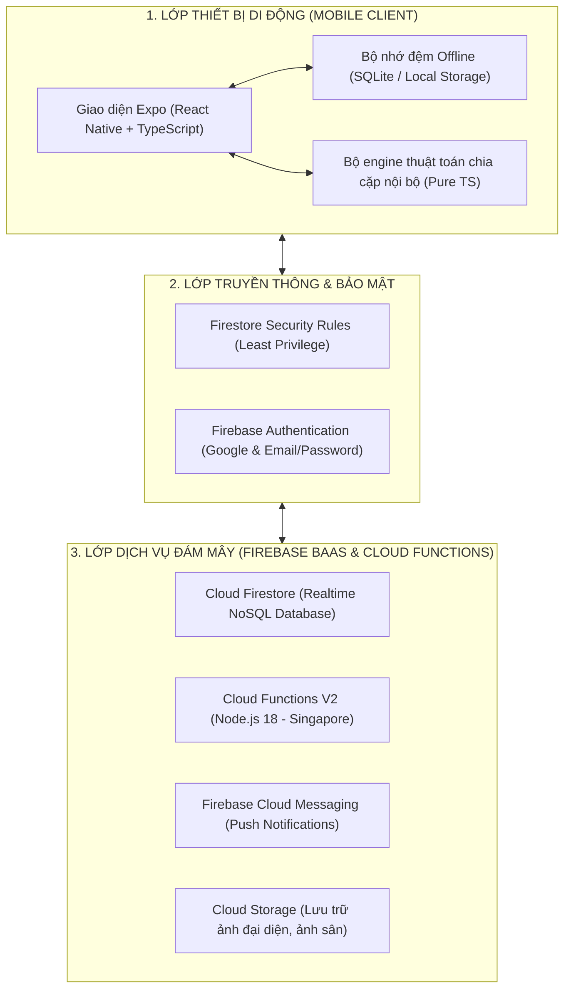
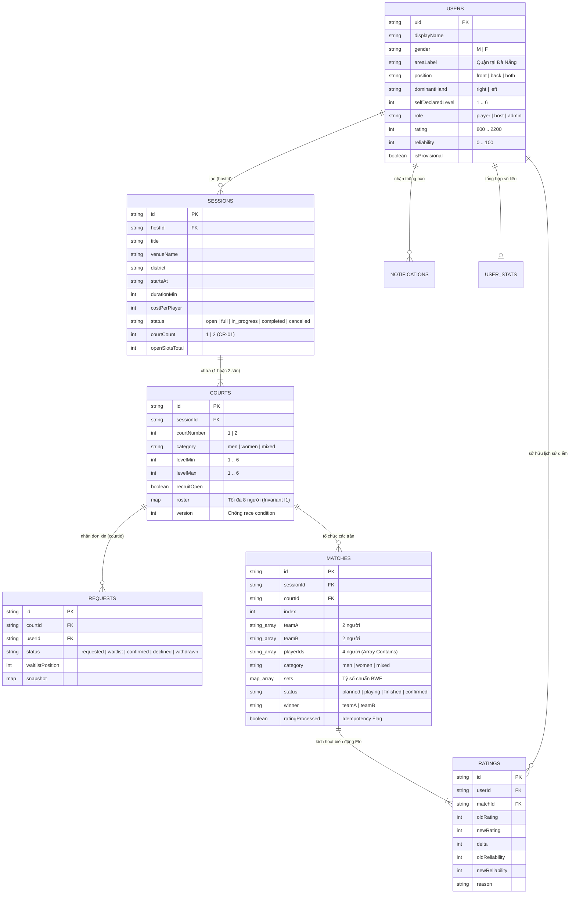
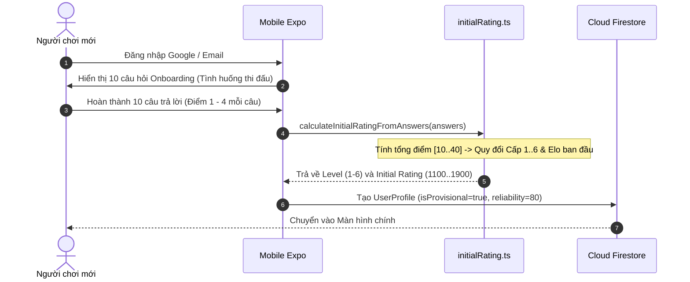
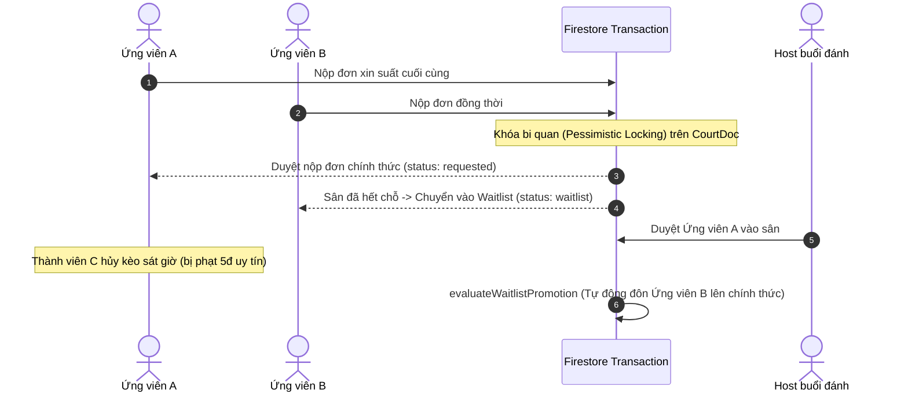

# CHƯƠNG 6: PHÂN TÍCH VÀ THIẾT KẾ HỆ THỐNG TOÀN DIỆN

> **Mã tài liệu:** `docs/report/chap06-system-design.md`  
> **Nguồn căn cứ:** `06-rating-scale.md`, `07-srs.md`, `08-use-cases.md`, `data-contract.md`, `firestore.rules`, `chap-design.md`  
> **Chủ đề:** Đặc tả yêu cầu SRS, Use Cases, Thang 6 cấp, Kiến trúc tổng thể, ERD Firestore, 3 Thuật toán cốt lõi có ví dụ số, Security Rules và Xử lý đồng thời

---

## 6.1. Tóm Tắt Đặc Tả Yêu Cầu Phần Mềm (SRS) & Use Cases

Hệ thống đáp ứng 15 Yêu cầu Chức năng (Functional Requirements - FR) và 14 Use Cases chính thức:

| Nhóm Tính Năng | Mã FR | Tóm Tắt Nghiệp Vụ | Use Case Tương Ứng |
| :--- | :---: | :--- | :---: |
| **Hồ Sơ & Xác Thực** | **FR-01** | Đăng ký, đăng nhập bằng Google / Email, khởi tạo hồ sơ và cấp độ tự khai. | `UC-01`, `UC-02` |
| **Tìm Bạn Đánh Cặp** | **FR-02** | Tìm kiếm đồng đội đánh đôi theo độ lệch Elo $\le 150$, bù trừ vị trí công-thủ, tay thuận. | `UC-03` |
| **Quản Lý Kèo & Suất** | **FR-03** **FR-04** **FR-05** | Tạo kèo 1–2 sân, tuyển vãng lai theo công thức $\min(4, 8 - \text{core})$, xem danh sách kèo lọc theo quận/trình độ. | `UC-04`, `UC-05` |
| **Đặt Suất & Waitlist**| **FR-06** **FR-07** **FR-08** | Đặt suất tham gia, kiểm tra điều kiện giới tính/trình độ/uy tín, Host duyệt tay 100%, hàng đợi Waitlist tự động đôn người. | `UC-06`, `UC-07`, `UC-08` |
| **Cân Kèo Sân Đấu** | **FR-09** **FR-10** | Chia cặp cân bằng tổng Elo cho sân 4–8 người, ca lẻ 5/7 người xoay tua công bằng, cặp khóa và hoán đổi kéo thả. | `UC-09`, `UC-10` |
| **Vòng Lặp Trận & Elo**| **FR-11** **FR-12** | Nhập tỷ số set chuẩn BWF, tính Elo đôi động ($K=40/24$), phạt bùng kèo (-15đ), tích hợp mã thanh toán VietQR. | `UC-11`, `UC-12` |
| **Lịch Sử & Thống Kê**| **FR-13** | Lịch sử đấu, chuỗi thời gian Elo, thống kê tỷ lệ thắng, chỉ số "Đồng đội ăn ý nhất" ($\ge 5$ trận, winRate $\ge 60\%$). | `UC-13` |
| **Quản Trị Hệ Thống** | **FR-14** **FR-15** | Bảng điều khiển Admin in-app quản lý tài khoản, danh mục sân; vận hành ngoại tuyến khi mất mạng tại sân. | `UC-14` |

---

## 6.2. Thang Đo Trình Độ Cầu Lông Phong Trào 6 Cấp (Rating Scale)

Dự án chuẩn hóa thang đo dựa trên thực tế các cụm sân cầu lông tại Đà Nẵng:

| Cấp Độ | Tên Cấp (Đà Nẵng) | Dải Điểm Elo | Điểm Khởi Tạo | Mô Tả Trình Độ Điển Hình |
| :---: | :--- | :---: | :---: | :--- |
| **Cấp 1** | **Yếu** | $800 \dots 1.199$ | 1.100 | Mới tập chơi, chưa nắm vững luật giao cầu, phản xạ đón cầu còn lúng túng. |
| **Cấp 2** | **Trung bình yếu (TB-)** | $1.200 \dots 1.349$ | 1.275 | Đã biết luật, đánh được qua lại cơ bản, kỹ thuật đập cầu và phông cầu chưa ổn định. |
| **Cấp 3** | **Trung bình (TB)** | $1.350 \dots 1.499$ | 1.425 | Lực cổ tay khá, phông cầu cuối sân tốt, di chuyển đôi bắt đầu có sự phối hợp. |
| **Cấp 4** | **Trung bình khá (TB+)** | $1.500 \dots 1.649$ | 1.575 | Đập cầu có lực và điểm rơi, biết bỏ nhỏ trên lưới, phòng thủ đập cầu tương đối chắc chắn. |
| **Cấp 5** | **Khá** | $1.650 \dots 1.799$ | 1.725 | Từng tập luyện bài bản hoặc tham gia các giải phong trào quận/trường; chiến thuật đôi rõ ràng. |
| **Cấp 6** | **Tốt / Bán chuyên** | $1.800 \dots 2.200$ | 1.900 | Đạt thành tích tại các giải thành phố/mở rộng; thể lực, kỹ thuật và nhãn quan chiến thuật vượt trội. |

- **Điểm sàn tuyệt đối:** 800 Elo | **Điểm trần tuyệt đối:** 2.200 Elo.
- **Trạng thái hiệu chỉnh (Provisional):** Người chơi trong 5 trận đầu dùng hệ số $K=40$ để kéo nhanh về trình độ thực; từ trận thứ 6 trở đi dùng $K=24$.

---

## 6.3. KIẾN TRÚC TỔNG THỂ HỆ THỐNG (SYSTEM ARCHITECTURE)

Hệ thống được thiết kế theo mô hình **Client - Backend-as-a-Service (BaaS)** kết hợp **Serverless Micro-logic**, tối ưu hóa cho ứng dụng di động hoạt động trong điều kiện mạng chập chờn tại các nhà thi đấu cầu lông thực tế:

### Phân tầng kiến trúc:
1. **Lớp Client (Mobile Expo):**
   - Phát triển trên nền tảng React Native (Expo SDK 52+, TypeScript) tuân thủ tiêu chuẩn Apple Human Interface Guidelines và Android Material Design.
   - Tích hợp bộ engine thuật toán chia cặp thuần TypeScript (`src/domain/balancing`) chạy trực tiếp trên thiết bị để đảm bảo phản hồi tức thì ($< 1\text{ ms}$) và tiếp tục hoạt động ngay cả khi sân cầu lông bị mất kết nối Internet.
2. **Lớp Bảo mật & Điều khiển truy cập (Network & Security Gate):**
   - Bộ quy tắc bảo mật [firestore.rules](file:///d:/QLDAPM/firestore.rules) với 60 ca kiểm thử tự động, phân quyền nghiêm ngặt theo 3 vai trò: `player`, `host`, và `admin`.
   - Client bị cấm hoàn toàn quyền tự chỉnh sửa điểm Elo, điểm uy tín, hoặc thay đổi các trường bất biến (`hostId`, `createdAt`).
3. **Lớp Dịch vụ Đám mây (Firebase BaaS & Serverless):**
   - **Cloud Firestore:** Lưu trữ dữ liệu thời gian thực theo cấu trúc Document-Collection tối ưu hóa cho việc lắng nghe số suất trống (`snapshot listeners`).
   - **Cloud Functions V2:** Đặt tại khu vực `asia-southeast1` (Singapore) có độ trễ cực thấp về Đà Nẵng ($< 35\text{ ms}$), chịu trách nhiệm thực thi các giao dịch tài chính/uy tín và tính toán Elo nguyên tử.

---

## 3.2. THIẾT KẾ CƠ SỞ DỮ LIỆU & SƠ ĐỒ THỰC THỂ (DATA SCHEMA & ERD)

Toàn bộ cấu trúc cơ sở dữ liệu tuân thủ nghiêm ngặt Hợp đồng dữ liệu toàn hệ thống [docs/api/data-contract.md](file:///d:/QLDAPM/docs/api/data-contract.md) (phiên bản v1.1):

### Các Bất biến Dữ liệu Toàn vẹn (Data Invariants):
- **Bất biến I1 (Sĩ số sân):** Số người trong `roster` của một sân luôn thỏa mãn $4 \le N \le 8$.
- **Bất biến I2 (Công thức tuyển vãng lai - Luật R4):** $\text{Tổng suất tuyển} = \min(4, 8 - \text{Số người mặc định})$.
- **Bất biến I3 (Giới hạn quy mô kèo - CR-01):** Số sân mỗi kèo $\le 2$; tổng số người tham gia toàn kèo $\le 16$.
- **Bất biến I4 (Không phân thân):** Một người chơi không thể đồng thời có tên trong 2 sân của cùng 1 kèo, hoặc vừa ở Roster chính vừa ở Waitlist.
- **Bất biến I5 (Miền giá trị chuẩn):** Điểm Elo kẹp trong đoạn $[800, 2200]$; Điểm uy tín $[0, 100]$; Thang cấp độ $[1, 6]$.

---

## 3.3. SƠ ĐỒ CÁC LUỒNG NGHIỆP VỤ CỐT LÕI (CORE BUSINESS WORKFLOWS)

### Luồng 1: Đăng ký & Onboarding Trắc nghiệm Khách quan
Người chơi không tự nhập bừa điểm Elo mà phải trải qua bảng hỏi 10 câu trắc nghiệm tình huống:

### Luồng 2: Tuyển vãng lai, Tranh suất & Đôn Waitlist tự động
Xử lý đồng thời khi nhiều người cùng bấm tranh suất cuối cùng:

---

## 3.4. ĐẶC TẢ CHI TIẾT 3 THUẬT TOÁN CỐT LÕI CỦA ĐỒ ÁN

### 3.4.1. Thuật toán 1: Tìm Đồng Đội Cố Định (Partner Finder - CR-02)

- **Mục tiêu:** Ghép đôi 2 tay vợt có trình độ tương đồng và lối đánh bù trừ hoàn hảo để cùng đăng ký thi đấu giải hoặc lập nhóm cố định.
- **Tiêu chuẩn lọc cứng (Hard Filters):**
  1. Độ lệch điểm Elo: $|\text{Rating}_A - \text{Rating}_B| \le 150$ điểm (đọc từ cấu hình `MAX_RATING_DIFF_STANDARD`).
  2. Ràng buộc giới tính theo nội dung: Đôi nam (`M + M`), Đôi nữ (`F + F`), Đôi nam nữ (`M + F`).
  3. Loại trừ chính mình và các tài khoản trong danh sách chặn.
- **Hàm chấm điểm tương thích Heuristic (0 – 100 điểm):**
  $$\text{MatchScore} = S_{\text{vị trí}} (40\text{đ}) + S_{\text{tay thuận}} (25\text{đ}) + S_{\text{độ lệch Elo}} (20\text{đ}) + S_{\text{khu vực}} (10\text{đ}) + S_{\text{uy tín}} (5\text{đ})$$
  - **Bù trừ vị trí ($S_{\text{vị trí}}$):**
    - Cầu trước (Front) + Cầu sau (Back): **$+40$ điểm** (Cặp đôi âm - dương hoàn hảo).
    - Toàn diện (Both) + Chuyên bất kỳ: **$+25$ điểm**.
    - Hai người cùng chuyên Cầu trước hoặc cùng chuyên Cầu sau: **$0$ điểm** (kèm cảnh báo "Dễ giẫm chân nhau").
  - **Bù trừ tay thuận ($S_{\text{tay thuận}}$):**
    - 1 Tay phải + 1 Tay trái: **$+25$ điểm** ("Cặp đôi vàng" bao quát toàn diện góc sân và trục giữa).
    - Cùng tay: **$0$ điểm** (trung tính).
- **Ví dụ số thực tế:**
  - *Người tìm:* VĐV A (Nam, 1500 Elo, Chuyên Cầu Sau, Tay Phải, Quận Hải Châu).
  - *Ứng viên B:* VĐV B (Nam, 1530 Elo, Chuyên Cầu Trước, Tay Trái, Quận Hải Châu).
  - *Tính toán:*
    - Lệch Elo: $|1500 - 1530| = 30 \le 150$ (Đạt chuẩn).
    - Điểm vị trí: Sau + Trước $\implies +40$ điểm.
    - Điểm tay thuận: Phải + Trái $\implies +25$ điểm.
    - Điểm Elo lệch 30đ: $20 \times (1 - 30/150) = +16$ điểm.
    - Cùng quận Hải Châu: $+10$ điểm; Uy tín 90đ: $+5$ điểm.
    - $\implies \mathbf{\text{Tổng điểm phù hợp} = 96/100}$ (Hệ thống gợi ý nhãn: *"Đồng đội lý tưởng"*).

---

### 3.4.2. Thuật toán 2: Cân Kèo Sân Đấu & Xoay Tua Ca Lẻ (Session Balancing - CR-01)

- **Mục tiêu:** Phân chia 4–8 người có mặt tại một sân thành các cặp đấu có tổng điểm cân bằng nhất ($|\text{Rating}_A - \text{Rating}_B| \to \min$), đảm bảo công bằng lượt thi đấu cho các ca lẻ 5 và 7 người.
- **Nguyên lý Heuristic Greedy:**
  - Sắp xếp 4 người vào sân theo thứ tự Elo giảm dần: $a \ge b \ge c \ge d$.
  - Thuật toán thử 3 phương án ghép cặp và chọn phương án có chênh lệch nhỏ nhất:
    1. **Phương án cân bằng chuẩn:** $(a + d)$ vs $(b + c)$ $\implies \text{diff} = |(a+d) - (b+c)|$.
    2. **Phương án thử 2:** $(a + c)$ vs $(b + d)$.
    3. **Phương án thử 3:** $(a + b)$ vs $(c + d)$.
- **Thuật toán luân phiên người nghỉ cho ca lẻ 5 người và 7 người:**
  - Duy trì mảng trạng thái thi đấu: `gamesPlayed` (số trận đã đánh) và `restCount` (số hiệp đã nghỉ) của từng người.
  - Người vừa nghỉ ở hiệp trước bắt buộc được xếp thi đấu ở hiệp tiếp theo.
  - Người có số trận đã đấu nhiều nhất sẽ được ưu tiên xếp nghỉ.
  - **Cam kết:** Chênh lệch số trận đã đánh giữa 2 người bất kỳ qua toàn bộ buổi đánh **$\le 1$ trận**.
- **Ví dụ số thực tế (Ca lẻ 5 người trên Sân 1):**
  - Danh sách 5 người: $P_1(1600), P_2(1550), P_3(1500), P_4(1450), P_5(1400)$.
  - *Hiệp 1:* Người có Elo thấp nhất $P_5$ nghỉ.
    - 4 người vào sân: $P_1, P_2, P_3, P_4$.
    - Ghép $(P_1 + P_4)$ vs $(P_2 + P_3) \implies (1600 + 1450) = 3050$ vs $(1550 + 1500) = 3050$.
    - $\implies \mathbf{\text{Độ lệch Elo} = |3050 - 3050| = 0}$ (Trận đấu cân bằng tuyệt đối!).
  - *Hiệp 2:* $P_5$ bắt buộc vào sân; người có điểm cao nhất $P_1$ nghỉ luân phiên.

---

### 3.4.3. Thuật toán 3: Tính Elo Đôi Động & Điểm Uy Tín (Dynamic Double Elo)

- **Điểm kỳ vọng cặp đôi ($E_A, E_B$):**
  $$\bar{R}_A = \frac{R_{A1} + R_{A2}}{2}, \quad \bar{R}_B = \frac{R_{B1} + R_{B2}}{2}, \quad E_A = \frac{1}{1 + 10^{(\bar{R}_B - \bar{R}_A)/400}}$$
- **Hệ số tỷ số set (Score Margin Multiplier):**
  Thắng áp đảo được cộng nhiều điểm hơn thắng sát nút:
  $$\text{Multiplier} = 1 + \left( \frac{|\text{Score}_A - \text{Score}_B|}{21} \right) \times 0.25 \quad (\text{kẹp trong } [1.00, 1.25])$$
- **K-factor phân tầng:**
  - $K = 40$: Người chơi mới (Provisional $\le 5$ trận đầu) để nhanh chóng tiệm cận trình độ thật.
  - $K = 24$: Người chơi chuẩn ($> 5$ trận) để ổn định bảng xếp hạng.
- **Thẻ đánh giá chéo có bảo vệ Đồng thuận (Review Cards Consensus):**
  - Chống gian lận: Loại bỏ hoàn toàn tự vote.
  - Thẻ `plays_better` (+4 Elo) và `fake_level` (-5 Elo): Bắt buộc có **$\ge 2$ người cùng vote**.
  - Trần điều chỉnh từ thẻ: Tối đa $\pm 5$ Elo/trận.
- **Tính chất Bắt buộc Idempotent:**
  Giao dịch `confirmMatchResultTx` kiểm tra cờ `match.ratingProcessed === true`. Nếu trận đã chốt, giao dịch từ chối ngay lập tức, ngăn ngừa lỗi mạng làm cộng dồn điểm 2 lần.

---

## 3.5. THIẾT KẾ BẢO MẬT & XỬ LÝ ĐỒNG THỜI (SECURITY & CONCURRENCY)

1. **Ma trận Phân quyền (Security Matrix):**
   - Người chơi chỉ có quyền đọc dữ liệu công khai và cập nhật thông tin cá nhân của chính mình.
   - Trường điểm số (`skill.rating`, `skill.reliability`) chỉ được phép chỉnh sửa qua Cloud Functions có xác thực quyền Host.
2. **Xử lý Tranh chấp Đồng thời (Concurrency Handling):**
   - Áp dụng kỹ thuật **Firestore Atomic Transactions**: Khi 2 người cùng nộp đơn vào suất cuối cùng, transaction đọc số `openSlots`, ghi nhận người đến trước và tự động chuyển người đến sau vào Waitlist mà không làm sai lệch số lượng chỗ.
   - Cờ phiên bản `version` tăng dần trong `CourtDoc` giúp phát hiện và rollback kịp thời các xung đột cập nhật danh sách đấu.

---

## 3.6. BẢNG TỔNG HỢP CÁC QUYẾT ĐỊNH & CHANGE REQUESTS ĐÃ ÁP DỤNG

| Mã | Nội dung thay đổi | Lý do thực tế tại Đà Nẵng | Trạng thái |
|---|---|---|:---:|
| **CR-01** | Bỏ cơ chế "8–16 người/lượt" của kế hoạch gốc; chuyển sang **thuật toán độc lập từng sân 4–8 người**, ca lẻ 5 và 7 người xoay tua | Phù hợp thực tế các sân Tuyên Sơn, Kỳ Đồng: mỗi sân đánh một kèo độc lập | Đã duyệt & Áp dụng |
| **CR-02** | Tách biệt hoàn toàn tính năng **Partner Finder** (tìm bạn cố định) và **Recruit Slots** (tuyển vãng lai tại sân) | Tránh nhầm lẫn UX giữa người cần tìm đồng đội đi đánh giải và host cần lấp chỗ trống | Đã duyệt & Áp dụng |
| **A1 & A4** | Mở tuyển khi có 4–7 người core; **Hard block** khi host thêm core làm vượt quá trần 8 người | Bảo vệ quyền lợi của người chơi vãng lai đã được duyệt trước đó | Đã duyệt & Áp dụng |
| **A6** | Giai đoạn MVP dùng **1 điểm Elo duy nhất** cho cả 3 nội dung (nam, nữ, mixed) | Tinh gọn hệ thống, đủ dữ liệu cho các giải phong trào sinh viên | Đã duyệt & Áp dụng |
| **A8** | Thanh toán tiền mặt/chuyển khoản ngoài app kèm hiển thị **VietQR** | Người chơi phong trào không thích nạp ví trung gian; VietQR trực quan, không mất phí | Đã duyệt & Áp dụng |
