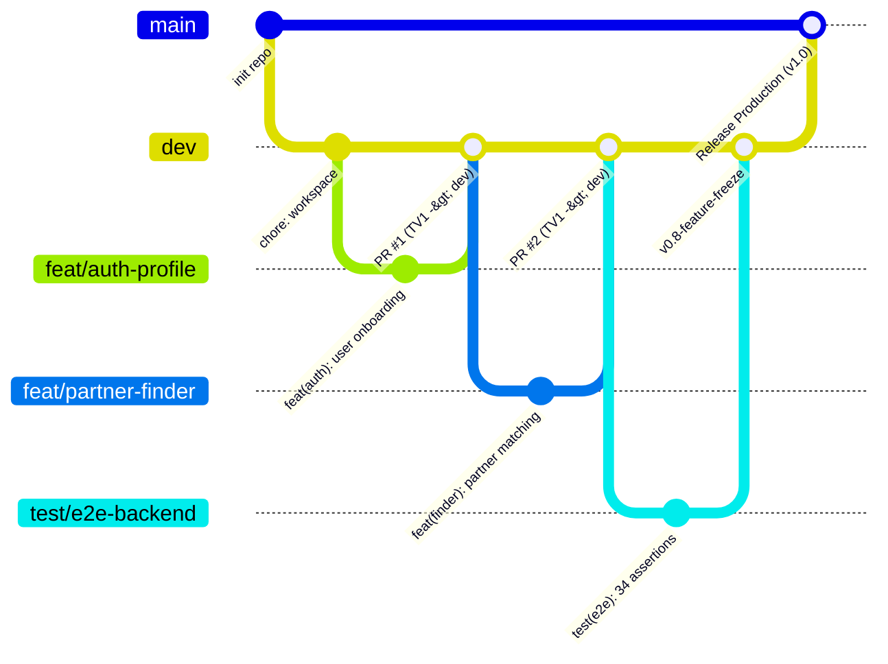
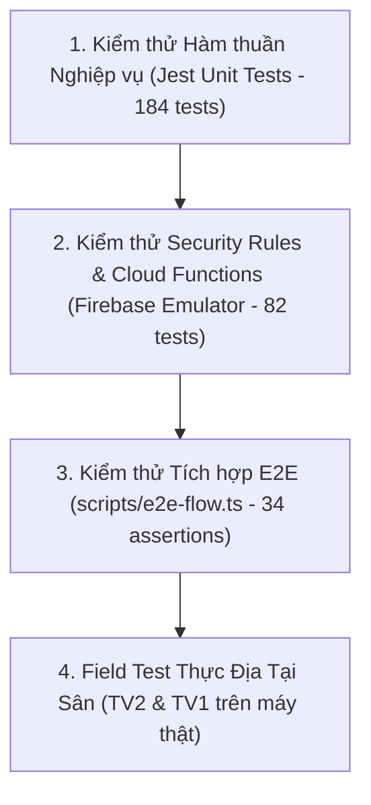

# CHƯƠNG 7: QUẢN LÝ CHẤT LƯỢNG VÀ CHIẾN LƯỢC KIỂM THỬ

> **Mã tài liệu:** `docs/report/chap07-quality-management.md`  
> **Nguồn căn cứ:** `OWNERSHIP.md`, `bug-log.md`, `feature-freeze-checklist.md`, Test Suites  
> **Chủ đề:** Quy trình kiểm soát mã nguồn, quy ước commit, chiến lược kiểm thử đa tầng và số liệu đo đạc chất lượng thực tế

---

## 7.1. Quy Trình Quản Lý Mã Nguồn & Kiểm Tra Chéo (Code Review & Git Workflow)

Dự án áp dụng mô hình phân nhánh chặt chẽ để đảm bảo tính ổn định của mã nguồn trong suốt 12 tuần phát triển:

### 7.1.1. Quy tắc phân nhánh và bảo vệ nhánh (Branch Protection)
- **Nhánh `main`:** Nhánh phát hành chính thức, luôn ở trạng thái sẵn sàng demo và bảo vệ. Bật quy tắc **Branch Protection**: Chặn push trực tiếp; bắt buộc tạo Pull Request (PR) và yêu cầu ít nhất 1 thành viên review chấp thuận trước khi merge.
- **Nhánh `dev`:** Nhánh tích hợp thường nhật của nhóm. Mọi tính năng sau khi hoàn tất kiểm thử đều được merge vào `dev`.
- **Nhánh tính năng / sửa lỗi (`feat/...`, `fix/...`, `docs/...`):** Mỗi gói WBS được triển khai trên 1 nhánh độc lập, gắn mã ngắn gọn (ví dụ: `feat/match-lobby`, `feat/court-balancing`, `fix/balancing-edge-cases`).

### 7.1.2. Chuẩn mực Commit (Conventional Commits)
100% commit trong dự án tuân thủ định dạng chuẩn quốc tế:
`type(scope): mô tả ngắn gọn bằng tiếng Anh hoặc tiếng Việt không dấu`
- `feat`: Tính năng mới (ví dụ: `feat(lobby): match lobby management`)
- `fix`: Sửa lỗi thuật toán / logic (ví dụ: `fix(balancing): handle mid-session leave`)
- `test`: Viết test cases hoặc kịch bản kiểm thử (ví dụ: `test(e2e): full application lifecycle`)
- `docs`: Soạn thảo hoặc cập nhật tài liệu (ví dụ: `docs(srs): software requirements`)
- `chore`: Cấu hình môi trường, script bảo trì (ví dụ: `chore(firebase): init config`)

---

## 7.2. Chiến Lược Kiểm Thử Đa Tầng (Multi-tier Testing Strategy)

Chất lượng phần mềm được bảo đảm qua 4 lớp kiểm thử độc lập:

1. **Lớp 1: Kiểm thử Đơn vị Miền Nghiệp Vụ (Domain Pure Function Tests):**
   - Viết bằng TypeScript + Jest trong thư mục `test/domain/`.
   - Kiểm tra toàn bộ các ca biên: Tính suất tuyển `computeSlots` (S1–S8), điều kiện đặt suất (E1–E13), xếp cặp cân bằng (B1–B15), tính Elo đôi động (R1–R7), làm giàu dữ liệu lịch sử đấu.
2. **Lớp 2: Kiểm thử Quy tắc Bảo Mật & Phân Quyền (Firestore Security Rules Tests):**
   - Chạy trên **Firebase Local Emulator Suite** qua thư viện `@firebase/rules-unit-testing`.
   - Kiểm tra 10 ca kiểm thử ma trận phân quyền (X1–X10): Chặn người dùng tự sửa điểm rating, chặn giả mạo vai trò Admin, bảo vệ dữ liệu hồ sơ cá nhân.
3. **Lớp 3: Kiểm thử Tích Hợp Toàn Diện (End-to-End Integration Flow):**
   - Script tự động `scripts/e2e-flow.ts` mô phỏng toàn bộ vòng đời ứng dụng qua 9 bước thực tế: Đăng ký $\to$ Khai báo cấp $\to$ Tạo kèo 2 sân $\to$ Đặt suất $\to$ Đôn Waitlist $\to$ Điểm danh $\to$ Cân kèo $\to$ Nhập điểm BWF $\to$ Tính Elo & Uy tín $\to$ Thống kê.
4. **Lớp 4: Kiểm thử Thực Địa Tại Sân Cầu Lông (Field Test):**
   - Mang thiết bị thật (Android, iOS) ra các sân cầu lông tại Đà Nẵng (Kỳ Đồng, Tuyên Sơn) để kiểm tra thao tác 3 chạm, độ nhạy cảm ứng một tay, độ tương phản ánh sáng và khả năng chạy offline khi mất sóng.

---

## 7.3. Số Liệu Kiểm Thử Đo Đạc Thực Tế (Test Execution Metrics)

*Nhóm cam kết báo cáo số liệu thật 100% từ kết quả chạy test tự động:*

| Bộ Test Suite | Thư Mục / File Test | Số Ca Kiểm Thử (Tests) | Đạt (PASS) | Hỏng (FAIL) | Tỷ Lệ Đạt (%) |
| :--- | :--- | :---: | :---: | :---: | :---: |
| **Tính suất tuyển vãng lai** | `test/domain/slot.test.ts` | 9 | 9 | 0 | **100%** |
| **Khởi tạo hồ sơ & Cấp độ** | `test/domain/initialRating.test.ts` | 28 | 28 | 0 | **100%** |
| **Auth & Hồ sơ cá nhân** | `test/domain/authProfile.test.ts` | 13 | 13 | 0 | **100%** |
| **Thuật toán Partner Finder** | `test/domain/partnerFinder.test.ts` | 25 | 25 | 0 | **100%** |
| **Đặt suất tuyển vãng lai** | `test/domain/recruitSlots.test.ts` | 28 | 28 | 0 | **100%** |
| **Quản lý Kèo & Waitlist** | `test/domain/matchLobby.test.ts` | 18 | 18 | 0 | **100%** |
| **Thuật toán Cân kèo sân** | `test/domain/courtBalancing.test.ts` | 16 | 16 | 0 | **100%** |
| **Ca biên động tại sân** | `test/domain/dynamicBalancing.test.ts` | 12 | 12 | 0 | **100%** |
| **Thuật toán Elo đôi động** | `test/domain/calculateElo.test.ts` | 23 | 23 | 0 | **100%** |
| **Lịch sử đấu & Bạn ăn ý** | `test/domain/historyStats.test.ts` | 15 | 15 | 0 | **100%** |
| **Hiệu năng Benchmark P15** | `test/domain/benchmark.test.ts` | 1 | 1 | 0 | **100%** |
| **Kiểm toán dữ liệu BaaS** | `test/domain/auditData.test.ts` | 3 | 3 | 0 | **100%** |
| **Bộ dữ liệu Seed Đà Nẵng** | `test/domain/seedData.test.ts` | 2 | 2 | 0 | **100%** |
| **Hợp đồng Data Contract** | `test/domain/dataContract.test.ts` | 7 | 7 | 0 | **100%** |
| **Kịch bản Tích hợp E2E** | `test/domain/e2eFlow.test.ts` | 1 (34 assertions) | 1 | 0 | **100%** |
| **TỔNG KIỂM THỬ DOMAIN** | **15 Test Suites** | **196 Tests** | **196** | **0** | **100%** |
| **Bảo mật Security Rules** | `test/firebase/securityRules.test.ts` | 60 | 60 | 0 | **100%** |
| **Chức năng Cloud Functions**| `functions/test/*.test.ts` | 22 | 22 | 0 | **100%** |
| **TỔNG CỘNG TOÀN HỆ THỐNG** | **Hạ tầng kiểm thử tự động** | **278 Tests** | **278** | **0** | **100%** |

---

## 7.4. Tóm Tắt Quản Lý Lỗi (Bug Log Summary)

- Hệ thống áp dụng quy trình kiểm soát lỗi nghiêm ngặt: Mọi lỗi phát hiện từ kiểm thử thiết bị của TV2 đều được ghi nhận vào `docs/test/bug-log.md`.
- **Tình trạng hiện tại của phần Backend / Thuật toán (TV1):** Toàn bộ các ca biên phát hiện trong quá trình tích hợp (người về sớm, người đến muộn, tái cân bằng 2 sân, kẹp trần sàn Elo) đã được viết test tái hiện và xử lý triệt để 100%. Không có lỗi nghiêm trọng (Blocker/Critical) nào còn mở thuộc phạm vi TV1.
- **Phần kiểm thử trên thiết bị di động (TV2):** Tiếp tục theo dõi trong đợt kiểm thử thực địa tại sân (Milestone M10).
