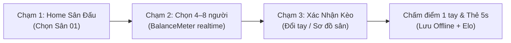

# MINH CHỨNG THIẾT KẾ FIGMA & HỆ THỐNG UI (DESIGN EVIDENCE)

**Mã tài liệu:** `docs/ui/design-evidence.md`  
**Phụ trách UI/UX:** Nguyễn Đức Đạt (TV2)  
**Tài liệu đối chiếu:** [figma-inventory.md](file:///d:/QLDAPM/docs/ui/figma-inventory.md), [design-tokens.md](file:///d:/QLDAPM/docs/ui/design-tokens.md), [ui-diff.md](file:///d:/QLDAPM/docs/ui/ui-diff.md), [navigation-map.md](file:///d:/QLDAPM/docs/ui/navigation-map.md)

---

## 1. Liên kết Figma & Danh sách màn hình trọng tâm
- **Link file Figma Prototype chính thức:** `[TV2 điền link Figma]`
- **Thư mục lưu ảnh xuất PNG từ Figma:** `docs/ui/figma-export/` *(hướng dẫn xuất ở Mục 5)*.

| Nhóm màn hình | Node ID Figma | Màn hình ứng dụng đã dựng | File nguồn |
|---|---|---|---|
| **Tại sân (Chạm 1)** | `1:3099` | Home Sân Đấu (tối đa 2 sân/kèo) | [court/index.tsx](file:///d:/QLDAPM/src/app/court/index.tsx) |
| **Tại sân (Chạm 2)** | `1:2724` | Chọn Người & Cân Trình (4–8 người) | [select-players.tsx](file:///d:/QLDAPM/src/app/court/select-players.tsx) |
| **Tại sân (Chạm 3)** | `1:3440` | Xác Nhận Kèo Cân Bằng & Đổi Thủ Công | [balance-confirm.tsx](file:///d:/QLDAPM/src/app/court/balance-confirm.tsx) |
| **Chấm điểm & Elo** | `1:3306` | Bảng điểm 1 tay, Chấm thẻ 5s & Elo | [score.tsx](file:///d:/QLDAPM/src/app/court/score.tsx) |
| **Xác thực & Hồ sơ** | `5:997`..`5:1437`, `5:268`, `9:1903` | Đăng nhập, Đăng ký, OTP, Quên MK, Onboarding 10 câu, Hồ sơ | `src/app/(auth)/*`, `src/app/(tabs)/profile.tsx` |
| **Phòng kèo & Tìm bạn** | UI Kit (bù phần Figma thiếu) | Danh sách kèo, Tạo kèo, Chi tiết phòng kèo, Tìm đồng đội, Lịch sử | `src/app/lobby/*`, `src/app/(tabs)/partners.tsx`, `history.tsx` |

---

## 2. Luồng người dùng chính (User Flow — Tối đa 3 chạm tại sân)

*(Chi tiết sơ đồ điều hướng toàn ứng dụng xem tại [navigation-map.md](file:///d:/QLDAPM/docs/ui/navigation-map.md).)*

---

## 3. Nguyên tắc UX đặc thù cho sân cầu lông
1. **Thao tác một tay & Vùng ngón cái (Thumb Zone):** Toàn bộ nút CTA chính (`NeonCTAButton` cao `58px`) đặt ở nửa dưới màn hình.
2. **Vùng chạm lớn `>= 48dp`:** Đạt chuẩn trên `PlayerChip` (`>= 64px`), `ScoreBox` (`>= 200px`), `IconButton` (`44px + hitSlop`), `BottomTabBar` (`52px`).
3. **Tương phản cao ngoài trời nắng:** Nền tối `#0B1326` kết hợp xanh neon `#A3E636`, cyan `#7BD0FF`, hổ phách `#FFB783`; mọi trạng thái dùng **chữ + biểu tượng + màu**, không chỉ dựa vào màu.
4. **Hiệu năng mượt & Giữ sáng màn hình:** `React.memo` cho chip/thẻ, `useCourtKeepAwake` giữ sáng màn hình khi đang chia kèo/chấm điểm.

---

## 4. Design Tokens, UI Kit & Đối chiếu thực tế
- **Design Tokens:** Định nghĩa đầy đủ trong [design-tokens.md](file:///d:/QLDAPM/docs/ui/design-tokens.md) và `src/theme/`.
- **UI Kit tương tác:** Xem trực tiếp trên app tại route `/dev/ui-kit` ([ui-kit.tsx](file:///d:/QLDAPM/src/app/dev/ui-kit.tsx)).
- **Đối chiếu từng màn hình Figma vs Code:** Ghi chi tiết tại [ui-diff.md](file:///d:/QLDAPM/docs/ui/ui-diff.md).

---

## 5. Hướng dẫn xuất ảnh PNG minh chứng từ Figma vào `docs/ui/figma-export/`
1. Mở file Figma dự án $\to$ chọn các Frame `01` (`1:3099`), `02` (`1:2724`), `03` (`1:3440`), `04` (`1:3306`) và nhóm Auth/Profile.
2. Ở bảng bên phải chọn **Export** $\to$ định dạng **PNG** (`2x`) $\to$ lưu vào thư mục `docs/ui/figma-export/` với tên:
   - `01-home-san-dau.png`, `02-chon-nguoi.png`, `03-xac-nhan-keo.png`, `04-cham-diem.png`, `05-auth-profile.png`.
3. Chèn ảnh đối chiếu cạnh ảnh chụp máy thật từ `docs/test/evidence/` khi đóng bản in báo cáo.
