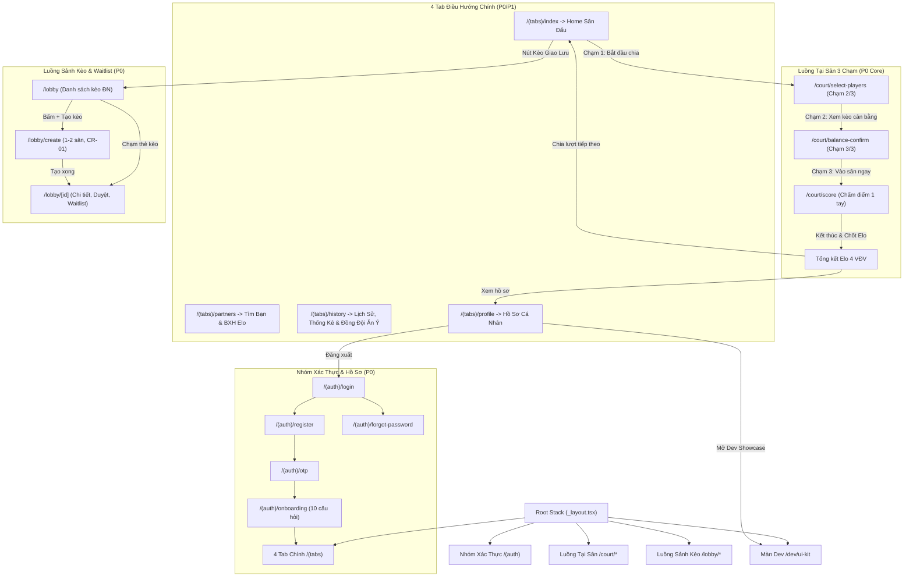

# Sơ Đồ Điều Hướng Toàn Ứng Dụng (End-to-End Navigation Map)

**Scheme Deep Link (`app.json`):** `badminton://`  
**Router:** `expo-router` (File-based Routing: `src/app/`)

---

## 1. Sơ đồ luồng điều hướng (Mermaid Flowchart)

---

## 2. Danh mục Route & Deep Link nội bộ

| Nhóm | Route Expo Router | Deep Link (`badminton://`) | Mức độ | Nút quay lại |
|---|---|---|---|---|
| **Xác thực** | `/(auth)/login`, `register`, `otp`, `forgot-password`, `onboarding` | `badminton://login` | P0 | Có (`Header` / `router.back()`) |
| **Tab 1: Sân Đấu** | `/(tabs)` & `/court` | `badminton://court` | P0 | Tab gốc |
| **Tab 2: Tìm Bạn** | `/(tabs)/partners` | `badminton://partners` | P0/P1 | Tab gốc |
| **Tab 3: Lịch Sử** | `/(tabs)/history` | `badminton://history` | P0 | Tab gốc |
| **Tab 4: Cá Nhân** | `/(tabs)/profile` | `badminton://profile` | P0 | Tab gốc |
| **Chọn Người (Chạm 2)** | `/court/select-players` | `badminton://court/select-players?sessionId=...&courtId=1` | P0 | `Header.onBackPress` -> `router.back()` |
| **Xác Nhận Kèo (Chạm 3)** | `/court/balance-confirm` | `badminton://court/balance-confirm?sessionId=...&courtId=1` | P0 | `Header.onBackPress` -> `router.back()` |
| **Chấm Điểm & Elo** | `/court/score` | `badminton://court/score?matchId=...&sessionId=...` | P0 | `Header.onBackPress` -> `router.back()` |
| **Danh Sách Kèo** | `/lobby` | `badminton://lobby` | P0 | `Header.onBackPress` -> `router.back()` |
| **Tạo Kèo Mới** | `/lobby/create` | `badminton://lobby/create` | P0 | `Header.onBackPress` -> `router.back()` |
| **Chi Tiết Kèo & Waitlist** | `/lobby/[id]` | `badminton://lobby/session_tienson_05` | P0 | `Header.onBackPress` -> `router.back()` |
| **Dev Showcase** | `/dev/ui-kit` | `badminton://dev/ui-kit` | Dev | `Header.onBackPress` -> `router.back()` |

> **Phạm vi P2 đã loại bỏ khỏi MVP:** Màn `05/06` (Thu tiền/QR), `14/15` (Cảm biến vợt/Smash Velocity/Smartwatch), `17` (Apple Watch/Garmin), `18/19/20` (Giải đấu Mini CLB & Cây nhánh đấu).

